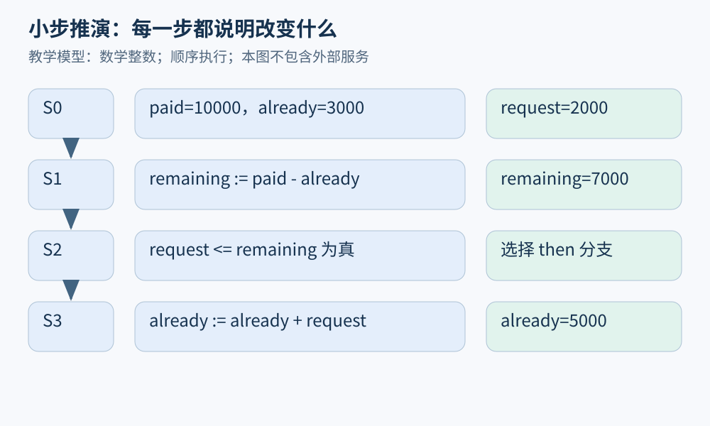

# 第 02 章 程序语义：状态、求值与可观察行为

读代码时，我们很容易把“看起来像”当成“执行起来就是”。程序语义要求把这种直觉变成规则：某个名字指向什么，表达式按什么顺序求值，赋值改变哪里，异常把控制交给谁。程序分析建立在这些规则上；模型用错，算法再精确也会得出错误答案。

## 先给程序一个状态

用一个微型命令语言说明。它只有整数、变量、赋值、顺序和条件，整数暂取数学整数，不考虑溢出。状态记作 `σ`，把变量名映射到值。例如 `σ = {paid↦10000, already↦3000}`。赋值 `remaining := paid-already` 先在旧状态中算表达式，再得到新状态：

$$
\sigma' = \sigma[remaining \mapsto 7000]
$$

方括号表示更新这一项，其他映射保持不变。状态不只是“变量列表”；引入对象后还需区分名字绑定与堆中的位置，引入 I/O 后还要记录外部行为。这些扩充都应由问题驱动。

考虑以下命令：

```text
remaining := paid - already;
if request <= remaining then
    already := already + request
else
    skip
```

若 `request=2000`，第一步把 `remaining` 设成 7000，第二步判断为真，第三步把 `already` 更新为 5000。旧值 3000 只存在于此前状态，而不是继续附着在变量名上。代码中同一个名字，在不同程序点代表的值可以不同。



图 02-1：每个箭头只表示图中明确的一次状态更新或分支选择。中间状态是后续并发分析的重要观察点。

## 大步与小步，各自保留什么

大步语义把“命令和初始状态”直接关联到最终状态：

$$
\langle c,\sigma\rangle\Downarrow\sigma'
$$

小步语义则写出一次局部转移：

$$
\langle c,\sigma\rangle\rightarrow\langle c',\sigma'\rangle
$$

前者适合概括最终结果，后者方便讨论中间过程、非终止与并发交错。[Software Foundations 的小步语义章节](https://softwarefoundations.cis.upenn.edu/plf-current/Smallstep.html)通过微型语言展示了这一差异。本书的图经常使用小步直觉，但一次箭头的粒度须说明：源码语句、字节码还是机器指令，不应混用。

例如先更新累计退款、再写状态，在顺序模型里可看成两步；若其他线程可插入观察，两步之间的状态就变得重要。“函数最后正确”并不能直接推出“任何观察时刻都正确”。

## 求值顺序属于行为

设 `take()` 从队列弹出一个元素，并返回它。表达式 `take() - take()` 的结果依赖哪个调用先发生。取队列 `[8,3]`，先左后右得 5；先右后左则得 -5。不能因为减法两侧语法对称，就交换有副作用的求值。

Python 的[表达式规范](https://docs.python.org/3/reference/expressions.html#evaluation-order)规定表达式从左到右求值，并说明赋值右侧先于左侧求值。其他语言应查各自规则。有的语言允许某些顺序不确定；这时分析器应考虑允许的多个行为，而不是偷偷选定一个。

短路也会改变可达性。`x != 0 and 100 // x > 2` 在 Python 中先判断左侧，左侧为假便不求右侧。若静态模型把两侧无条件求值，便可能报告一条实际上不会执行的除零路径。相反，自定义运算或不同语言的运算符，不能仅凭外形套入短路规则。

## 结果之外还有可观察行为

两个函数都返回 `True`，不代表行为等价。一个可能发送两次退款消息，一个只发送一次；一个可能在失败前修改状态，另一个保持原状。可把执行记录写成事件序列：

```text
读订单 → 请求支付服务 → 写 refunded → 返回 True
```

这就是轨迹的一种简化表示。观察者只看返回值时，两程序也许无法区分；观察者能看到网络请求或共享内存时，就可能区分它们。所谓等价，必须说明允许的上下文和观察内容。

异常同样需要纳入。`already += request; send()` 若在 `send()` 抛出异常，内存状态可能已经更新。把异常简单画成“返回失败”，会丢掉失败之前发生的副作用。分析错误处理时，正常边和异常边都可能影响资源释放与业务一致性。

## 别把模型中的错误等同真实语言概念

在微型语言中，遇到没有规则可继续的表达式可以称为“卡住”。真实语言还区分异常、未定义行为、实现定义行为等概念。某个模型没有给 `1 + true` 规则，不代表任何真实语言都会按同样方式处理。

分析报告应标明数值模型：数学整数、固定位宽整数、浮点数各自不同。把数学整数上的 `x+1>x` 直接套到允许回绕的机器无符号整数，便可能失效。第 25、26 章会进一步连接到机器与内存模型；现在先养成一个习惯：每次推导都问“这一步依据哪一条语义规则”。

## 相同语法，语义可能不同

变量作用域也属于语义。一个函数里出现名字 `rate`，它究竟使用定义处环境的绑定，还是调用时传入环境中的同名绑定？词法作用域和动态作用域对此采取不同规则。分析器若只按字符串名字合并所有 `rate`，就可能把不相干的值混在一起。第七章的符号表便用于恢复名字真正关联的声明。

赋值与参数传递同样不能靠生活类比决定。把字典传入函数后，修改它的字段可能对调用者可见；在函数内把参数重新绑定到另一个字典，往往不改变调用者的名字绑定。两者在源码里都可能出现等号，却更新了不同层次的状态。画清名字、位置和对象，通常比背诵“传值还是传引用”的一句标签更有效。

遇到规范允许多个结果时，本书把行为理解为一个集合。某次运行选中了其中一个结果，只说明这一结果被观察到；静态推理若承诺覆盖所有允许行为，就必须把其他许可结果也纳入。这个集合观点会自然连接到后面的抽象解释。

本章的作用是给后续所有图建立读法：箭头表示允许的转移，标签说明转移条件，图外假设决定哪些初态需要考虑。

## 练习与参考答案

比较下面两段教学命令。假定 `send()` 可能抛出异常，异常会终止当前命令，不自动回滚赋值。

```text
A: state := refunded; send()
B: send(); state := refunded
```

它们在成功时的最终状态相同，在异常时是否等价？

参考答案：不等价。A 在 `send` 抛异常时已把状态改为 `refunded`；B 保留原状态。若观察者看状态便能区分。仅移动赋值顺序也不能解决真实退款的一致性问题，因为外部服务可能已成功却在应答前断开；那需要更完整的事件与失败模型。

## 本章资料

- Software Foundations：[Small-step Operational Semantics](https://softwarefoundations.cis.upenn.edu/plf-current/Smallstep.html)，大步、小步和中间状态。
- Python Language Reference：[Expressions / Evaluation order](https://docs.python.org/3/reference/expressions.html#evaluation-order)，求值顺序与表达式规则。
