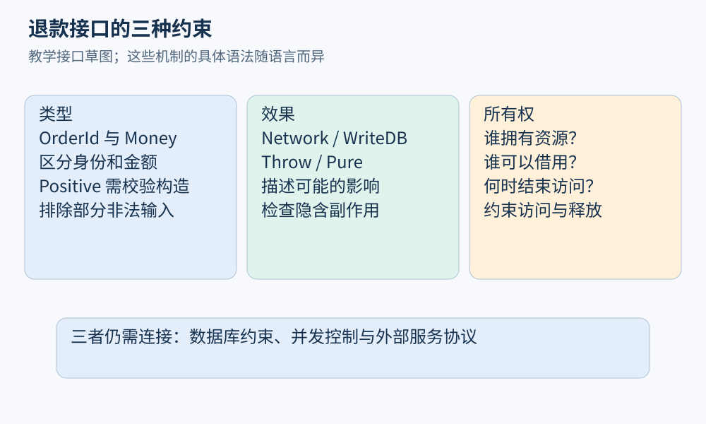

# 第 03 章 语言设计：类型、效果与所有权

假设要设计一个退款 API。最直接的接口是 `refund(order_id, amount)`，参数都是整数。编译器能检查调用者传入了两个整数，却分不清它们分别代表订单编号、人民币分还是美元分，也不知道退款额必须为正。语言设计决定哪些区别能进入类型，哪些检查留在运行时，哪些性质需要额外分析。

## 类型把哪些错误提前排除

类型系统按规则给表达式分类，再限制不同类别怎样组合。一个简化判断写作 `Γ ⊢ e : T`：在类型环境 `Γ` 中，表达式 `e` 具有类型 `T`。这里的环境记录名字和类型，不是当前运行值。

给订单编号与金额分别建立不透明类型，可以阻止参数互换；给已支付订单和已退款订单分别建类型，则能进一步限制调用顺序。设计时要区分“表示相同”与“含义相同”：二者都用 64 位整数表示，不代表就应互相赋值。

```text
OrderId                    // 订单身份
Money<CNY>                 // 币种
Positive<Money<CNY>>        // 需由校验构造
PaidOrder → refund → RefundedOrder
```

这是接口草图，不是某一真实语言的完整语法。`Positive` 的构造函数必须检查条件，或由证明机制建立条件；只把名字写成 Positive 不会自动获得保证。类型也无法替应用决定“什么情况下应该退款”。

[Software Foundations 的类型系统章节](https://softwarefoundations.cis.upenn.edu/plf-current/Types.html)通过进展和保持两个性质研究一个小语言的类型安全：在所讨论的小语言中，闭合且良类型的项要么已是值，要么能继续执行；按该语言的语义与类型规则执行一步后，仍保持相应类型。这种结论针对定义好的语义及错误类别，不能读成“程序不会有任何 bug”。

## 效果把操作影响说出来

函数的返回类型常常不够描述它。`check(order)` 可能只是计算布尔值，也可能读数据库、写日志、修改订单、抛出异常。效果描述计算对外部世界或程序状态的影响。

下面继续使用教学记号：

```text
remaining : Order → Money          ! Pure
save      : Order → Unit           ! {WriteDB, Throw}
refund    : PaidOrder → Result     ! {Network, WriteDB, Throw}
```

`!` 右边标出允许的效果。调用带有网络效果的函数，通常会把这种可能性传递给调用者。分析器于是可以检查：一个声明为纯计算的函数是否间接写数据库？一次缓存能否安全复用？异常可能从哪里穿出？

这里的效果集合是教学设计，具体语言的机制与细节各异。效果系统也存在精度选择：只记“会写内存”很便宜，却难以证明两个函数互不干扰；区分写哪一个区域更有用，却要处理别名和跨函数传播。类型与效果都可以看作通过语言规则组织的静态信息。



图 03-1：类型限制可接受的值，效果描述可能的影响，所有权约束访问和释放责任。三者回答不同问题。

## 所有权与借用约束访问关系

资源错误经常来自两个疑问：谁负责释放，谁仍然能访问？Rust 的[所有权章节](https://doc.rust-lang.org/book/ch04-01-what-is-ownership.html)用所有者、移动和离开作用域时的释放建立基础；[借用章节](https://doc.rust-lang.org/book/ch04-02-references-and-borrowing.html)再说明引用怎样在不转移所有权的情况下访问值。

```rust
let mut message = String::from("refund");
let view = &message;
println!("{}", view);
message.push_str(" queued");
```

在这一片段中，最后一次使用 `view` 后，再修改 `message` 可以成立。若把 `println!` 移到修改之后，便试图让共享借用跨越可变修改，编译器会拒绝这种冲突。准确规则涉及借用存活区间；不能粗略说“只要变量还在大括号内，就永远不能修改”。这是按规则推演的片段，未在本章宣称某个工具版本的实测输出。

所有权也并不等于“只有一个指针”。共享借用可以存在多个，某些库允许受控的内部可变性，底层不安全代码还有额外义务。分析 Rust 程序时，必须知道接口保证覆盖哪些操作，以及何处越过了保证边界。

## 语言让分析更容易，也可能更困难

不可变数据减少了“这个值会不会被别处改掉”的疑问；显式资源作用域有助于推理清理路径；封闭的变体集合方便穷举分支。另一方面，反射、动态加载和运行时生成代码会让调用目标在构建时难以确定。

这些选择都存在代价。把业务状态编码为类型能排除非法调用顺序，但跨数据库读写时，外部记录仍要重新验证。即使某次调用消耗了一个 `PaidOrder` 值，另一个进程仍可能读取同一订单并发起退款。因此进程内类型约束不能自动代替持久化层的原子性或唯一约束。

理解语言设计，有助于选择分析投入的位置：已经由受信任机制排除的问题，可以少做重复检查；语言和外部世界的交界处，则应加强模型与证据。检查器也可以把原本隐含的约定显式化，逐步推动 API 设计改进。

## 从限制中获得可检查的自由

语言机制的价值常常体现在组合时。若某个计算既不修改状态、不访问外部世界，也不会因未建模条件抛异常，那么重复计算、移动计算或缓存结果才更容易论证。若共享对象允许任意位置修改，分析器就必须扩大可能写入者集合。选择更严格的接口，可能减少调用者写法，却让工具获得更强的可组合保证。

这种限制并非越强越好。若为每种订单状态都建立独立类型，转换路径可能清晰，却会增加持久化、版本升级与跨语言传递的适配工作。设计者需要问：被排除的错误是否高价值，使用成本是否可接受，规则是否能穿过真实系统边界。程序分析能帮助回答这些问题，例如统计哪些不变量反复由手写条件维护，哪些资源误用集中出现在接口交接处。

由此，语言设计与分析形成双向关系：语言规则提供推理依据，分析结果又揭示值得进入语言或库接口的约束。读者无需先实现一门完整语言，也能用这种视角审查一个 API 是否容易被正确使用。

## 练习与参考答案

某函数接收 `Positive<Money<CNY>>` 并返回 `RefundedOrder`。能否仅凭签名断定“实际支付服务至多执行一次退款”？还缺什么？

参考答案：不能。签名没有完整说明网络效果、异常、重试与持久化语义。还需建模请求身份、外部服务的幂等保证、订单并发更新，以及失败发生在提交之前还是之后。类型能缩小状态空间，但这个分布式性质仍依赖环境协议。

## 本章资料

- Software Foundations：[Type Systems](https://softwarefoundations.cis.upenn.edu/plf-current/Types.html)，类型判断、进展与保持。
- The Rust Programming Language：[Ownership](https://doc.rust-lang.org/book/ch04-01-what-is-ownership.html)、[References and Borrowing](https://doc.rust-lang.org/book/ch04-02-references-and-borrowing.html)，所有权与借用规则。
