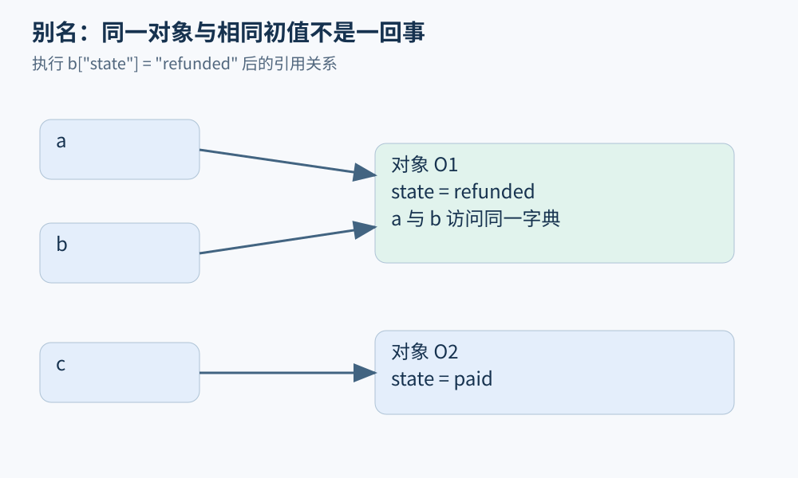
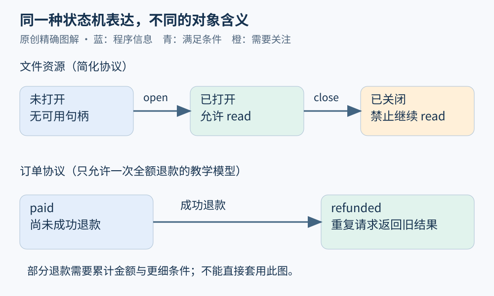

# 第 04 章 分析对象：数值、对象、资源与协议

“分析一个程序”听起来范围很大。实际工作往往先挑出一种对象：退款金额的范围、两变量是否引用同一订单、文件是否关闭、订单能否从已退款回到已支付。选择分析对象，就是选择要记住哪些信息。

## 数值：一个值还是一组可能值

假定累计退款 `already` 位于 0 到 3000 分，已支付金额固定为 10000 分，那么剩余金额位于 7000 到 10000 分。分析器可以用区间 `[7000,10000]` 概括许多执行，不必枚举每个整数。

但区间可能丢失关系。若 `remaining = paid-already`，分别记录 `paid∈[0,10000]`、`already∈[0,10000]`，并不足以保留 `already<=paid`；直接相减会得到 `[-10000,10000]`。需要关系信息才能排除负值。这里不是程序多出了错误，而是抽象没有记住支持结论的事实。第 15 章会详细展开。

数值模型也必须对应语言。数学整数没有位宽上限，机器整数和浮点数则有自己的行为。本书中的金额示例优先用整数分，目的在于避免把十进制金额的业务规则与二进制浮点误差混在首次讲解里。

## 对象：身份不等于内容

看以下 Python 片段：

```python
a = {"state": "paid"}
b = a
c = {"state": "paid"}
b["state"] = "refunded"
```

赋值 `b=a` 后，`a` 与 `b` 指向同一个字典。修改 `b` 所引用对象的字段后，经由 `a` 也会看到 `refunded`；独立创建的 `c` 仍是 `paid`。分析时应画出名字到对象的边，而不是把每个变量都当成独立盒子。

Python 的[数据模型规范](https://docs.python.org/3/reference/datamodel.html)区分对象的身份、类型和值，并区分可变与不可变对象。对象身份不能普遍理解为物理地址；某个实现采用地址表示身份，并不让这一细节成为所有实现的通用保证。



图 04-1：`a`、`b` 是别名；`c` 指向另一个对象。相同初值不意味着共享身份。

静态分析也会制造“抽象对象”：把某个分配位置创建的许多运行时对象汇总成一个节点。这样的节点不是某个具体订单，更新它时不能总是假定只改一个实例。指针与堆分析会进一步讨论这一精度问题。

## 资源：内存之外的责任

文件、网络连接、锁与数据库事务都有生命周期。程序可以仍然持有一个对象引用，但它代表的文件已经关闭；也可以没有任何可用引用，却仍有外部资源未释放。内存回收与资源释放是不同的性质。

在 Python 中，宜显式管理文件使用范围：

```python
with open("orders.txt", encoding="utf-8") as stream:
    first = stream.readline()
```

这里的上下文管理协议会在退出使用范围时执行清理路径。Python 官方数据模型也明确建议显式关闭外部资源，不应依赖对象不可达后立刻被终结。分析资源时，除正常顺序外，还要考虑异常、提前返回，以及资源是否被交给了别的负责者。

用简化状态机表示文件：`未打开 → 已打开 → 已关闭`。允许读取的状态是已打开；重复关闭是否合法、关闭失败怎样处理，要看具体 API 合约。不能把一个通用图当成所有库的准确规范。

## 协议：允许怎样的状态转移

订单状态同样可建模，但它携带业务含义。先定义一个只允许全额退款的教学协议：初态为 `paid`，成功退款后变为 `refunded`，后续退款请求不再触发支付操作。

```text
paid + 成功退款 → refunded
refunded + 重复请求 → refunded，返回已有结果
```

若允许部分退款，就需要累计金额和更细的转移条件，单独的两状态图不够。由此可见，状态名称不是规格本身；边上的条件、动作与失败行为同样重要。



图 04-2：上方文件图约束资源使用，下方订单图约束业务操作。两者都可用状态机，但含义不能互换。

## 为问题选择最小充分模型

| 想回答的问题 | 至少要保留的信息 |
| --- | --- |
| 退款会超过已支付金额吗 | 数值范围及金额关系 |
| 别处能看见此次状态修改吗 | 对象身份、别名与可见性 |
| 异常路径会泄漏文件吗 | 资源获取、所有权与清理路径 |
| 重复请求会再次产生副作用吗 | 请求身份、状态协议与外部动作 |

“最小”不能只理解为数据结构小。若丢掉关键关系，后面大量告警都可能失真；若保留所有细节，又可能让计算无法承担。好的分析模型用尽可能少的信息，保住要回答问题所需的区别。

阅读工具文档时，也应寻找它到底跟踪什么。有些检查器能跟踪同一函数里的打开和关闭，却不理解跨线程转移；有些能识别某个支付 API，却不知道项目自定义封装。把对象与模型层次写清楚，才能解释结果为何有用、何处需要补充。

## 同一变量可以承担多种角色

一个 `order` 名字，在语法层面是标识符，在运行时是某个引用，在业务层面又代表一个有状态的实体。分析器可以同时为它维护指向集合、金额区间和协议状态。多种信息还能互相帮助：知道对象唯一，字段写入就更容易精确更新；知道状态是已退款，某些金额变化路径便可判为不允许。

但组合必须有一致的身份基础。如果数值分析讨论的是订单甲，协议状态来自被合并进来的订单乙，拼接后的解释就可能虚构一条从未存在的行为。工具设计中，稳定的程序点、对象标识和来源路径因此十分重要。后面讨论证据管理时，会继续保留这些关联。

也要区别实体身份与对象身份。同一数据库订单可能在两个请求里被反序列化成两个独立内存对象；内存上没有别名，不代表业务上互不影响。要分析重复退款，必须把订单编号对应的持久化实体关系重新纳入模型，不能停留在单进程堆图。

先确认身份，再讨论状态，是分析对象时的一条实用顺序。

## 练习与参考答案

给上述别名片段再加 `b = {"state": "paid"}`。这一赋值会让 `a` 所见状态回到 `paid` 吗？若要分析它，需要区分什么？

参考答案：不会。新赋值让名字 `b` 指向另一个字典，不修改旧字典；`a` 仍指向原来已变为 `refunded` 的对象。分析器需要区分重新绑定变量与更新对象字段，并追踪每个程序点上的指向关系。

## 本章资料

- Python Language Reference：[Data model](https://docs.python.org/3/reference/datamodel.html)，对象身份、可变性和外部资源管理。
- Clang：[Data flow analysis: an informal introduction](https://clang.llvm.org/docs/DataFlowAnalysisIntro.html)，值集合、抽象与指针模型的入门参照。
