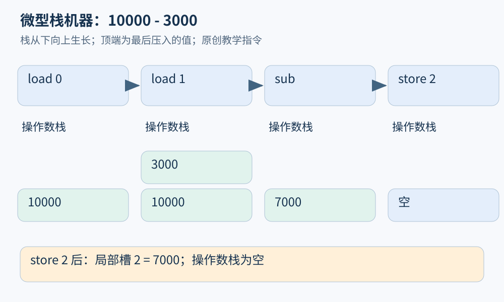
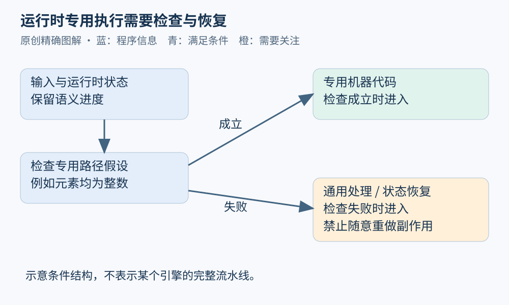

# 第 05 章 运行时：解释器、虚拟机、GC 与 JIT

源码中的一次函数调用，运行时可能经过字节码解释、类型检查、热点编译、内联、机器代码执行与垃圾回收。要解释性能波动或恢复执行轨迹，仅看源码并不总够用。运行时是语言规则与实际机器之间的重要一层。

## 解释与编译可以共存

解释器按照程序表示一步步决定下一项操作；编译器把一种表示翻译为另一种表示。二者描述的是执行或转换策略，并不天然对应两类互斥语言。一个实现完全可以先把源码编成字节码，再解释执行，运行期间又把热点编成机器代码。

虚拟机提供一组抽象指令和运行规则，不等同于“每一步都靠解释”。[JVM 规范第二章](https://docs.oracle.com/javase/specs/jvms/se21/html/jvms-2.html)定义抽象机器，同时把垃圾回收算法、内部优化等实现选择留给实现者。因此 JVM 字节码语义、某个 JIT 的优化方式和某台 CPU 的指令行为，应分层讨论。

用微型栈机器求退款剩余额度，设局部变量槽 0 存 `paid=10000`，槽 1 存 `already=3000`：

```text
load 0       // 操作数栈：[10000]
load 1       // 操作数栈：[10000,3000]
sub          // 取右值3000、左值10000，压入7000
store 2      // 栈变空，局部槽2保存7000
```

这是原创教学指令，不是完整 JVM 指令序列。它说明栈式表示为何能省略临时寄存器名字，也说明指令顺序为何重要。若交换两个 `load`，减法结果便变成 -7000。



图 05-1：操作数栈和局部变量槽是不同区域。`sub` 的两个操作数次序不能交换。

## GC 处理可达性，不替业务处理生命周期

垃圾回收器要识别哪些内存对象仍可能被程序使用，并回收符合条件的对象。典型追踪式思路从根集合出发，沿引用到达对象；根可能来自线程栈、全局区域及运行时持有的引用。不同实现的根、屏障和移动策略各异。

假定运行时根 `orders` 引用列表，列表引用订单，订单又引用日志对象。即使源码没有直接使用日志，它仍可能通过这条链可达。删掉一个局部变量名，也不等于整个对象立刻不可达；其他别名可能仍在引用它。

可达性只描述引用结构。订单已无业务用途，却被缓存长期持有，仍可能占用内存。文件对象被回收，也不适合作为“文件一定及时关闭”的工程承诺。第 04 章区分的对象和资源，在这里再次相遇。

对分析器而言，还要考虑观察本身改变程序：调试器、追踪缓存或异常对象可能延长某些引用的存活期。因此“打开分析后内存曲线变了”不必然表示原程序自然状态就是如此。Python 的[数据模型规范](https://docs.python.org/3/reference/datamodel.html)特别提醒，追踪和调试设施可能让本可回收的对象继续存活。

## JIT 利用运行信息，也必须保留语义

JIT 在运行期间生成代码。一个常见思路是观察热点和常见类型，再为有条件成立的情况建立更快路径。以教学函数 `sum(values)` 为例：若输入长期为整数数组，系统可以准备整数专用路径；遇到不符合假设的输入，必须转向仍符合语言语义的处理。

这里重要的结构是“假设—检查—专用执行—失败处理”，而不是任何特定引擎固定采用某条流水线。V8 官方的[TurboFan 介绍](https://v8.dev/docs/turbofan)与[分层设计文章](https://v8.dev/blog/turbofan-jit)展示了运行时优化器与中间表示、数值范围和目标架构之间的联系；后者是 2015 年的历史设计说明，不应当作当前完整架构清单。



图 05-2：检查使专用路径的使用条件显式化。实际去优化需要恢复执行状态，不能简单从函数头重跑，否则可能重复副作用。

若一个函数已发出退款请求，再因后续类型假设不成立而回退，系统必须保存正确的语义进度。随意重新执行函数，会让外部操作重复。由此可见，运行时优化的正确性同样是程序分析与状态恢复问题。

## 对性能和诊断有什么影响

一次冷启动测量可能同时包含解析、模块加载、编译与真正业务计算；运行一段时间后的测量则可能受热身和缓存影响。比较两个实现，应说明测量阶段、输入分布、内存压力与是否触发回收，而不是只报告一个总耗时。

源码调用栈也可能因内联而改变，移动式 GC 可能改变对象的实际存放位置，机器代码会在不同阶段被替换。分析工具依赖调试映射、运行时事件与时间线，才能把机器观察重新关联到源码。性能分析需要区分“程序做了什么”“运行时额外做了什么”以及“观察工具带来了什么”。

## 虚拟机也有观察边界

虚拟机内部的“原子一步”不必等于硬件的一条指令，更不必等于数据库事务。一条字节码可以被翻译为多条机器指令，多个字节码也可能因优化合并。分析并发时，必须依据语言或运行时承诺的同步规则；仅凭字节码看起来短，无法推出共享状态更新不可交错。

运行时还可能调用本地库。托管对象传给本地代码后，分析需要描述内存是否固定、引用如何存活、错误怎样返回，以及本地代码是否保留指针。只分析虚拟机内的指令，会在边界处失去这些行为。跨语言一章将把它展开为显式合约问题。

因此一份性能或故障记录应注明观察层次。源码级采样适合定位业务函数，字节码轨迹适合解释虚拟机操作，机器级计数适合研究缓存和指令成本。把不同层的数据关联起来很有价值，但需要映射证据，不能把数值直接相加或互相替代。

## 练习与参考答案

某程序第一次处理 1000 个订单耗时较长，第二次明显变快。能否由此断定算法复杂度降低了？至少列三种其他解释。

参考答案：不能。可能是 JIT 热身，代码或数据缓存命中，模块与连接已初始化，操作系统文件缓存，或首次运行恰好发生 GC。算法复杂度描述输入规模变化下的成本增长；判断它需要控制环境并改变规模，而不只是重复同一规模两次。

## 本章资料

- Oracle：[The Structure of the Java Virtual Machine](https://docs.oracle.com/javase/specs/jvms/se21/html/jvms-2.html)，抽象机器与实现边界。
- V8：[TurboFan](https://v8.dev/docs/turbofan)、[Digging into the TurboFan JIT](https://v8.dev/blog/turbofan-jit)，优化器资料与历史分层设计案例。
- Python：[Data model](https://docs.python.org/3/reference/datamodel.html)，对象回收与调试观察的影响。
