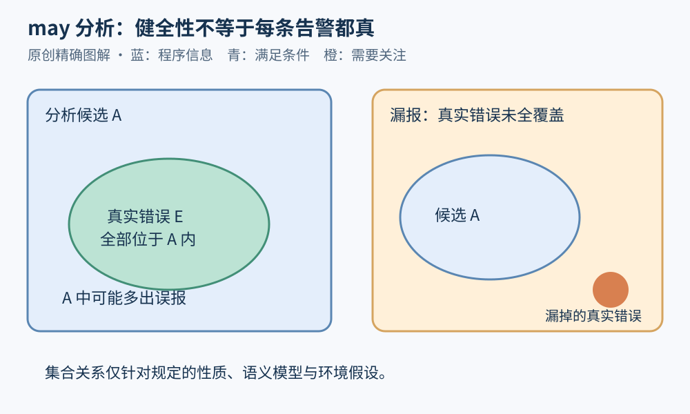

# 第 06 章 正确性、规格与分析的可信边界

“工具没有报告问题”是一项观察，“程序满足某项性质”是一项结论。二者之间缺少的，往往是规格、覆盖范围和推理依据。本章建立一套阅读分析结果的方法，后面遇到静态证明、测试通过或 AI 审查时，都用它检查结论。

## 正确性总是相对于要求

一个退款函数稳定地返回零，不会超额退款，却也永远无法完成正常退款。如果规格只有“返回值不超过剩余额度”，它可能满足规格；如果要求还包含“合法请求必须退款”，它就不正确。因此选择容易证明的性质，并不等于证明了用户真正需要的行为。

先为一个顺序、纯计算的教学命令写规格：

```text
入口：paid >= 0，0 <= already <= paid
命令：remaining := paid - already
出口：remaining >= 0
```

推导很直接：入口给出 `already <= paid`，两边作差便得 `paid-already>=0`；赋值后 `remaining` 等于该差值。把入口条件记为 `P`、命令记为 `c`、出口条件记为 `Q`，可写为 Hoare 风格的三元组 `{P} c {Q}`。此处使用数学整数且命令必然终止；真实语言若涉及溢出、异常与外部调用，需要扩充条件。

规格还应区分安全性与活性。前者约束不良事件不发生，例如累计退款不超额；后者要求某事最终发生，例如已接受请求最终获得结果。系统一直等待，可能没违反超额约束，却违反完成要求。证明活性通常还需要关于调度、服务恢复和公平性的环境假设。

## 部分正确不保证结束

部分正确性表达：若从满足入口条件的状态开始，并且命令正常终止，结果满足出口条件。总正确性还要求终止。

```text
while true do skip
```

这个命令没有正常终止状态。若只用“终止时结果不为负”的方式描述，它不会提供任何实际完成保证。小步语义能把一直可继续的执行与卡住状态区分开；参见[Software Foundations 的相关章节](https://softwarefoundations.cis.upenn.edu/plf-current/Smallstep.html)。报告中的“已证明”必须带上它究竟证明哪种正确性。

## 健全性与精确性怎样相处

对一个寻找可能错误的 may 分析，设真实可达错误集合为 `E`，工具近似集合为 `A`。这里把二者都理解为同一性质、同一标识空间中的错误位置或行为候选；若分别使用具体状态和抽象状态，则需通过具体化或报告覆盖关系比较，不能直接对不同类型的元素写集合包含。在规定模型与性质下，若 `E⊆A`，真实错误不会因为近似而被漏掉，这称为相应意义下的健全性；代价是 `A` 可能多出不真实的候选。

这与“工具每条告警都是真的”不是一回事。也不意味着实际工程工具天然满足该包含关系：超时、路径预算、未建模库、并发省略与不受支持的语法都可能改变保证。健全性应附着于明确算法、模型和使用条件，而不是工具名称。



图 06-1：左图的候选包围真实错误，可有误报；右图漏掉真实错误，不能维持同一范围内的健全性承诺。

抽象解释研究如何让抽象推理与具体语义保持可靠关系，见[Cousot 与 Cousot 的原论文](https://www.di.ens.fr/~cousot/COUSOTpapers/POPL77.shtml)。这里先记住：更精确的抽象，是在保留所需保证的前提下减少无关可能性；仅为减少告警而删除难分析路径，不是同一种改进。

## 反例也需要核实

工具给出一条路径，不代表它一定能在真实系统执行。路径条件可能互相矛盾，库模型可能过于宽泛，环境状态也可能无法到达。候选反例需要检查可满足性，并尽可能在受控环境中复现。

反过来，一次复现能证实某种行为存在，却不自动说明所有部署都受影响；一次未复现也不能直接推翻候选，因为输入、时序或配置可能不同。分析和复现各自提供不同层次的证据。

以重复退款为例：分析路径显示两个请求都读到 `paid`，随后各自发出退款。要判断是否真实，需要知道读写是否在同一事务、是否锁住同一记录、外部 API 是否按请求键去重。如果模型遗漏了实际存在的串行化保证，路径可能是误报；如果工具假定单线程而真实系统并发，静默结果又可能是漏报。


图 06-2：源码规则、环境模型、算法覆盖和实际运行证据共同决定结论范围。任何一层的缺失都应被保留为未知。

## 把未知作为正式结果

实际报告最好区分：已在限定模型内证明、已观察到反例、存在待验证候选、因限制无法判断。超时应归入无法判断，不能归入通过。未分析模块也不应从统计分母悄悄消失。

一份可审查的结论，应保留性质描述、入口假设、代码版本、环境配置、分析预算与证据路径。这样新增一个库模型或修正一个假设时，才能知道哪些结论需要重算。后面的 AI 分析章节也遵循这一要求：自然语言解释必须能回指代码与证据，表达流畅不增加证明力度。

## 规格也需要被审查

若规格与真实需求不一致，一个严格证明仍可能交付错误系统。审查规格时，应主动找“显然不合理却仍满足条件”的实现：永远拒绝请求、永远等待、只处理第一个订单，是否能通过当前条件？这些例子有助于发现缺失的功能要求和活性要求。

还应检查前提是否现实。把所有困难输入排除在前提之外，可以让证明变得容易，却可能让保证无法用于生产。前提应说明由谁建立：调用者校验、数据库约束、协议保证，还是尚未验证的假设。若调用链中无人负责，前提就是待解决的工作。

最后，证明和部署之间还存在构建与配置边界。被分析的源码版本、实际二进制、启用的条件编译和外部库是否一致，都会影响结论能否移用。程序分析并不取代工程追溯；恰恰相反，越想使用强结论，越需要把它绑定到明确的工件和环境上。

## 练习与参考答案

一个工具检查 100 个函数，80 个未告警，10 个告警，10 个超时。可以说“90% 的函数没有问题”吗？应该怎样记录？

参考答案：不能。应分别记录 80 个未告警、10 个候选告警、10 个未知；未告警是否能解释成满足性质，还取决于工具保证与建模范围。告警需核实真假，超时需保留。若用这批结果计算准确率或召回率，还需要独立真值，不能把工具自己的输出当答案。

## 本章资料

- Software Foundations：[Small-step Operational Semantics](https://softwarefoundations.cis.upenn.edu/plf-current/Smallstep.html)，终止、继续执行与卡住状态的区分。
- Patrick Cousot、Radhia Cousot：[Abstract Interpretation，1977](https://www.di.ens.fr/~cousot/COUSOTpapers/POPL77.shtml)，抽象与具体语义的联系。
- Clang：[Static Analyzer](https://clang.llvm.org/docs/ClangStaticAnalyzer.html)，工程分析器的能力与配置入口；本文没有据此宣称该工具整体具备某个无限制保证。
