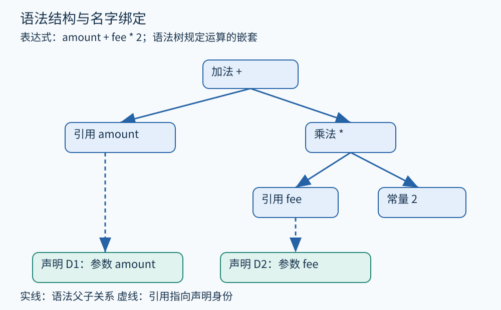

# 第 07 章 从源码到 AST 与符号表

读到 `amount + fee * 2`，人会先算乘法，再做加法。分析器却不能凭阅读习惯工作：它需要知道哪些字符组成名字，哪些名字指向同一声明，哪些运算嵌套在另一些运算里。把文本变成结构，是程序分析的第一步。

## 从字符到语法结构

考虑订单处理中的一段教学代码，金额均为整数分：

```c
int total(int amount, int fee) {
    int result = amount + fee * 2;
    return result;
}
```

词法分析先把输入分成记号，例如关键字 `int`、标识符 `result`、运算符 `+`、整数常量 `2`。空白与注释通常不参与普通表达式的语法结构，但源代码工具可能仍须保存它们，以支持格式化和重构。

语法分析根据语言的文法组合记号。具体语法树可以保留文法产生式、括号和分隔符；抽象语法树 AST 则突出声明、表达式、语句等结构。这里的“抽象”没有唯一标准：有些 AST 保留括号和隐式类型转换，有些会进一步简化。[Clang 的 AST 介绍](https://clang.llvm.org/docs/IntroductionToTheClangAST.html)明确说明，它倾向于保留接近 C++ 原文和标准的结构，因此适合源码重构。



图 07-1　原创教学图。实线是语法父子关系；虚线展示名字引用与声明的关系。这两类关系不可混为一谈。

这棵树表达的是 `amount + (fee * 2)`。若原文换成 `(amount + fee) * 2`，根节点便成为乘法。靠搜索字符 `+`，看不出这种嵌套差异；沿 AST 走访，却可以稳定找到“乘法内部包含加法”的模式。

## 名字相同，不代表是同一个变量

AST 解决“语句长什么样”，符号解析解决“名字指的是谁”。看下面的块作用域例子：

```c
int fee = 10;
{
    int fee = 20;
    consume(fee);
}
consume(fee);
```

分析器可以维护一叠作用域表。进入外层时登记声明 `D1: fee`；进入内层时新建表并登记 `D2: fee`。解析内层引用时，从最内层向外查找，首先找到 D2。离开块后弹出内层表，最后一行的引用便指向 D1。引用节点应保存声明身份，而非只保存字符串。

| 位置 | 源码拼写 | 解析结果 | 教学例中的值 |
|---|---|---|---|
| 内层调用 | `fee` | D2，内层声明 | 20 |
| 最后调用 | `fee` | D1，外层声明 | 10 |

因此，把某个局部变量安全重命名，需要修改与其声明对应的引用，不能把整份文件中同样拼写的字符串都替换。字段名、标签、类型名、宏名和普通变量也可能属于不同名字空间；具体规则必须以所分析语言为准。

## 语义信息怎样附着上来

对于 `amount + fee * 2`，还要确定每个名字的类型、运算结果的类型、是否发生隐式转换、调用是否匹配声明。语法合法不代表语义合法：给整数加上不支持此操作的对象，或者使用未声明的名字，都需要语义检查。

一个实用的表示可以包含：节点种类、子节点、源码范围、解析后的声明引用和类型。源码范围负责把后续诊断定位回用户看到的文本；声明引用帮助跨越拼写差异；类型则限定某个操作的含义。面对重载运算符时，表面上的 `+` 还可能对应函数调用，分析器不能擅自当作纯粹整数加法。

这些步骤在真实编译器中常相互交织，并非必须做成完全分离的三个程序。C++ 模板和名字查找尤其复杂；本章的作用域栈只是解释最基础的词法作用域，不足以替代完整 C++ 前端。

## 为什么构建参数也是分析输入

同一个文件可能因宏、包含路径、目标平台和语言模式而得到不同结构。例如 `#ifdef` 会让预处理阶段选择不同代码。只读取磁盘上的 `.c` 文件，却忽略编译命令，得到的可能根本不是实际构建的程序。[Clang 编译数据库规范](https://clang.llvm.org/docs/JSONCompilationDatabase.html)用工作目录、源文件和编译参数记录此类输入，工具可以据此重现前端环境。

对于初学者，已有编译器前端通常比自行解析完整工业语言更可靠。若目标是识别一种函数调用、检查 API 参数或支持安全重构，可以从 AST 开始；若问题是“这个赋值是否能到达最后的返回”，则需要下一步的控制流表示。AST 的父子边没有表达执行顺序，更不会自动列出循环运行的次数。

## 一个可以实际观察的小实验

把首段代码保存为 `total.c`，在安装了 Clang 的环境中可尝试：

```sh
clang -Xclang -ast-dump -fsyntax-only total.c
```

这是官方文档提供的 AST 观察方式；本章展示的是结构推演，没有将某个具体版本的命令输出伪装成实测结果。输出可能包含隐式转换等额外节点。先找到函数声明、局部变量声明、二元运算和引用节点，再追踪引用对应哪个声明。不要要求打印结果与图中简化树逐项相同。

## 为一个检查器选择访问方式

假设要提醒“把金额与某个费用相加之前，应统一计价单位”。可以先遍历加法节点，再查看两侧解析后的类型或注解，并把告警定位到运算符范围。若只用正则搜索 `amount + fee`，括号、别名命名和跨行格式都会干扰识别；若直接跳到机器指令，又可能已经丢失单位与源码字段名。

不过 AST 本身不会证明“单位相同”。如果程序只把所有金额都声明成 int，没有类型、契约或数据模型标明分与元，工具就必须承认信息缺失。语法结构提供定位能力，语义依据仍要从规范、类型或额外分析取得。给 AST 增添一个名为 currency 的字段，并不会让它自动知道真实业务含义。

还应避免把 AST 节点的内存地址当成跨版本身份。重新解析后，节点可能重新分配；源码编辑也会改变行列位置。需要保存长期诊断时，可同时记录文件版本、符号身份和稳定的上下文，之后再判断旧结果是否仍对应当前程序。

实际保存 AST 时，语法父子结构可以是树，声明引用等额外连接则会让完整分析数据成为图。遍历工具因此应明确沿哪些边访问，否则追进声明后又追回引用，可能重复处理甚至形成循环。

**练习。** 在内层块中把 `int fee = 20;` 改成 `int other = fee;`。初始化表达式里的 `fee` 应指向哪一个声明？若只按变量名统计赋值次数，可能出现什么错误？

**参考答案。** 内层已没有名为 `fee` 的新声明，因此引用解析到外层 D1。仅按字符串分组会把本来属于不同声明的同名变量合并，错误地传播值或统计写入；声明身份才是此处需要的连接键。

## 本章资料

- [Clang：Introduction to the Clang AST](https://clang.llvm.org/docs/IntroductionToTheClangAST.html)。用于核实 AST 的表示取舍及观察命令。
- [Clang：JSON Compilation Database Format Specification](https://clang.llvm.org/docs/JSONCompilationDatabase.html)。用于理解构建环境如何成为分析输入。
