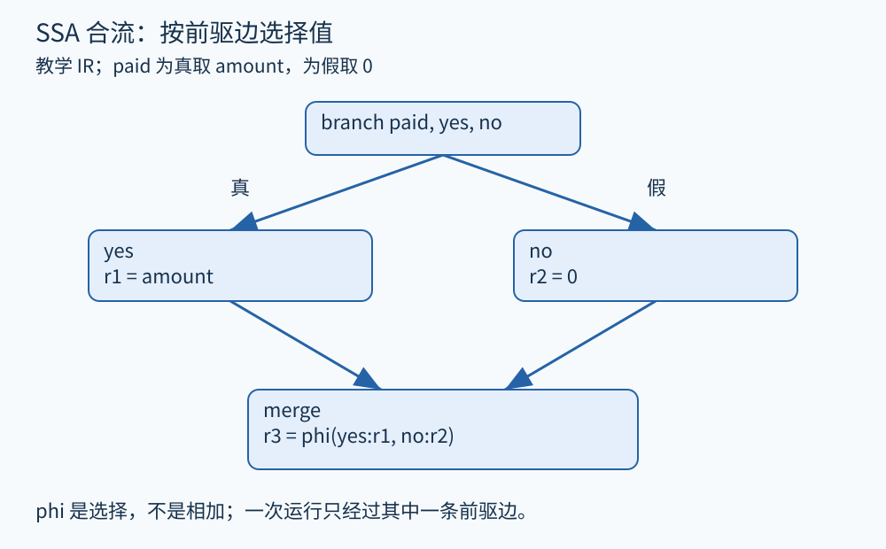

# 第 08 章 中间表示、SSA 与编译过程

AST 保留了接近源代码的结构，但不同语言表达同一件事的方式差别很大。分析器若分别处理每种循环写法、复合赋值和语法糖，会重复大量工作。中间表示 IR 的作用，是在明确语义的前提下，选择适合分析和变换的表达层次。

## 一段退款计算的两种写法

下面是整数分金额的教学伪代码，暂不涉及真实支付接口：

```text
refund = 0
if paid:
    refund = amount
return refund
```

一种接近机器执行的三地址表示可以是：

```text
entry:  branch paid, yes, no
yes:    refund = amount
        jump merge
no:     refund = 0
        jump merge
merge:  return refund
```

“最多三个地址”只是常见形式的直觉：一次指令通常写一个结果、读取少量操作数，不是要求所有 IR 指令一律只有三个字段。关键变化是条件跳转和块边界变得显式，嵌套的源码结构被展开成控制流。

IR 并不总是越低级越好。高层 IR 能保留张量、对象、异常或并行结构，让相应优化拥有直接依据；更低层 IR 则便于处理具体访存、调用约定和指令选择。LLVM 的 [MLIR 概览](https://mlir.llvm.org/docs/)展示了多层中间表示的设计方向。分析时应先问需要保留什么语义，再选表示层次。

## SSA：给每次定义一个身份

上面的 `refund` 在不同路径被赋值。普通表示里，要确定返回处读取的是哪次定义，必须沿控制流寻找。静态单赋值形式 SSA 将每个名称限制为一次定义：

```text
entry:  branch paid, yes, no
yes:    r1 = amount
        jump merge
no:     r2 = 0
        jump merge
merge:  r3 = phi(yes: r1, no: r2)
        return r3
```



图 08-1　原创教学图。`phi` 的输入与前驱边配对；它不把两个金额相加。

`phi` 应读作“根据来自哪个前驱块选择相应值”。执行从 yes 到达 merge，r3 取 r1；从 no 到达，r3 取 r2。它既不是运行时同时算两条分支，也不是取平均数。[LLVM IR 语言参考](https://llvm.org/docs/LangRef.html#phi-instruction)规定了这种前驱与值配对的语义。不同 IR 也可能通过块参数表达相同信息。

要注意，SSA 的“静态一次”指程序文本中的定义身份。循环中的同一条指令可以执行许多次，并产生许多动态值：

```text
header: i1 = phi(entry: 0, body: i2)
        branch i1 < n, body, exit
body:   i2 = i1 + 1
        jump header
```

每轮运行，phi 根据刚经过的边接收初值或上一轮的结果。SSA 从来没有禁止循环，也没有把运行次数变成一。

## 直接的收益：定义与使用相连

若 `x1 = 3`，而下一条是 `y1 = x1 + 4`，可把使用 x1 的位置直接连接到它唯一的定义，容易得到 y1 为 7。这种定义—使用关系适合常量传播、死代码消除和许多稀疏分析。这里“稀疏”强调沿相关定义与使用传播，而非机械访问所有源码位置。

但把 `x1 + 4` 换成某个常数，必须遵守该 IR 的整数宽度、溢出和未定义行为规则。真实 LLVM IR 里的标志也可能改变语义；不能把数学整数的推导原封不动套到所有机器整数上。本书简化 IR 在未特别说明时使用数学整数，机器级章节再讨论这种差异。

## 变量变单赋值，内存没有自动消失

考虑：

```text
p = address_of(order.amount)
store p, 100
x = load p
```

即使 p、x 都只定义一次，被 p 指向的存储仍会变化。给指针名字编号，无法证明两个 load 之间没有其他别名写入。这需要内存和别名分析配合。[LLVM MemorySSA](https://llvm.org/docs/MemorySSA.html)为内存操作提供类似定义—使用的组织方式，帮助查询可能的内存依赖；它不是把每个真实堆对象都完整展开成独立变量，也不会独自解决所有别名问题。

这一区别对分析报告很实际：看见 `x1` 有唯一来源，可以定位它的计算；看见一次 `load`，仍须追问读取哪个位置、可能受到哪些写入影响。

## 编译是一系列表示与语义承诺

一个便于理解的流水线是：源码经前端解析与语义检查，变成高层或通用 IR；若干分析提供事实，变换据此优化；后端再做降低、指令选择、寄存器分配和目标代码生成。工业系统会合并、重复或交错这些阶段。

分析结果还会过期。假设支配关系已算好，随后某个变换删除分支或新增边，旧结果可能不再成立。工程上的分析管理器必须知道哪些结果仍有效、哪些需要更新或重算。选择 IR 也意味着选择可维护的分析接口，不只是画出一种漂亮的数据结构。

## 同一段源码，可以有多份有用的 IR

若目标是检查“退款成功后是否更新状态”，保留对象字段与异常结构的高层表示可能最合适。若目标是判断两个 load 能否合并，则需要看到访存及别名信息。若目标是估计某段机器码的寄存器压力，接近目标机器的表示才有意义。高低层之间既有信息显式化，也有信息压缩和丢失。

可以把这种选择做成一个小练习：先在纸上把 `order.amount += fee` 拆成读取字段、加法、写回三个动作，再问某个函数调用能否插在读取与写回之间。如果调用可能修改同一对象，把这三个动作视作一个永远不可分割的操作就会产生误判。相反，如果语言或执行模型保证某个操作具有原子性，拆解后又必须保存该保证。

源码到 IR 的对应也不总是一对一。一个短表达式可能生成多条指令；优化后多行源码可能合并成一个计算。诊断应保存源位置与转换记录，明确展示当前分析在哪一层工作。仅凭 IR 中找不到某个原变量，不能断言源码逻辑已不存在；它也可能被常量替换、合并或重命名。

还可以把 IR 理解为分析器与编译器之间的一份契约：一条指令可读取哪些状态、产生什么结果、何时触发异常，均应有确定解释。只知道指令叫 add 或 call 不够。若在转换时省略一种可观察副作用，之后再精密的分析也只能证明这个被简化程序的性质。因此，阅读实际 IR 文档时，应先熟悉类型、控制转移、内存与异常，再研究优化细节。

**练习。** `if paid: x = 10 else: x = 10; return x` 转成 SSA 后，合流处是否仍必须保留 phi？若两侧分别为 10 和 20 呢？

**参考答案。** 初始构造可产生 phi，但两个输入都等于常数 10 时，可以在语义允许的条件下把结果替换成 10。输入为 10 与 20 时，普通常量传播不能认定结果为某个单独常数；若还知道 paid 的值，才可能删除不可达分支。SSA 使信息更容易使用，却没有自动提供路径条件。

## 本章资料

- [LLVM：Language Reference Manual，phi 指令](https://llvm.org/docs/LangRef.html#phi-instruction)。用于核实 SSA 合流语义。
- [LLVM：MemorySSA](https://llvm.org/docs/MemorySSA.html)。用于区分标量 SSA 与内存依赖。
- [MLIR：Documentation](https://mlir.llvm.org/docs/)。多层 IR 的延伸阅读。
