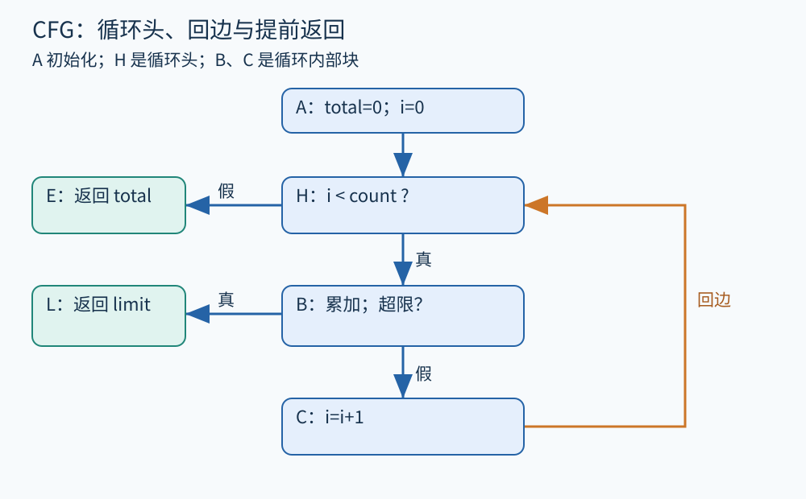

# 第 09 章 控制流、支配关系与循环

一个函数写在十几行里，执行却可能跳过其中一些行，也可能重复另一些行。控制流图 CFG 把“下一步可能到哪里”显式表示出来，为数据流、路径分析和许多优化提供共同骨架。

## 从顺序语句切出基本块

基本块是一段内部顺序执行、只从开头进入并在结尾转移出去的指令序列。这里讨论简化的普通控制流；异常、非本地跳转和异步机制需要额外建模。考虑一个将退款总额限制在上限内的教学循环，所有金额均为非负整数分。另设 `0 <= count <= len(amounts)`、`limit >= 0`，忽略并发修改与异常访存：

```text
total = 0
i = 0
while i < count:
    total = total + amounts[i]
    if total > limit:
        return limit
    i = i + 1
return total
```

可切为六块：A 初始化；H 检查 `i < count`；B 加上当前金额并检查上限；C 增加 i；L 返回 limit；E 返回 total。边为 A→H、H→B、H→E、B→L、B→C、C→H。条件边应标注真假，否则图会丢失重要信息。



图 09-1　原创教学图。橙色边回到循环头 H；L 是循环内提前返回，E 是循环条件失败后的返回。

实际构建 CFG 时，除了条件与跳转指令，还应按表示要求加入入口和出口。一个语句如果可能抛异常，其异常后继也可能重要。遗漏错误路径，资源分析便可能错误认定每次打开文件后都会关闭。

## 支配：到达这里之前，必须经过哪里

在从入口可达的 CFG 上，如果从入口到块 N 的每一条路径都经过块 D，就称 D 支配 N。每个块支配自身。这个定义谈的是所有图路径，并不是“一次执行碰巧先经过了它”。

在本例中，A 支配所有可达块，H 支配 B、C、L、E；B 支配 C 和 L，却不支配 E，因为 H 可以直接到 E。于是能回答：“循环体每次执行前，是否一定经过条件检查？”答案是 H 确实支配循环体。

对于非入口块，可以用集合方程逐步计算：

```text
Dom(entry) = {entry}
Dom(n) = {n} ∪ 交集{Dom(p) | p 是 n 的前驱}
```

取交集的原因是“必须经过”：某个候选块若只在一条前驱路径中出现，就不能说所有到达路径都经过它。有限 CFG 上，常见迭代算法从较大的候选集合开始，不断排除不满足条件的块，直到集合不再变化。第 13 章会把这种求解方式推广为数据流分析。

最近的严格支配者叫直接支配者。把每个块连向其直接支配者可得到支配树，但支配树不是 CFG：树上的边表示必经关系，不表示真实跳转。不要顺着支配树推测运行轨迹。

## 循环不等于图上随便一个圆

C→H 是本例的回边：目标 H 支配来源 C。相应自然循环包含 H、B、C；L 是离开循环后的返回块，不在循环内部。若包含一组节点的强连通区域存在多个入口，循环处理会更复杂，不能直接套单入口自然循环的全部结论。[LLVM 循环术语文档](https://llvm.org/docs/LoopTerminology.html)把单入口、头部支配及循环规范形式明确区分开来。

源代码中的一个 `while` 往往能形成自然循环，但源代码循环与优化后 IR 中的循环不保证一一对应。展开可以复制循环体，旋转可以改变条件所在位置，常量传播也可能消除循环。分析应围绕当前表示建立结构，不能只按源码关键字判断。

循环识别之所以重要，是因为很多结论要在反复执行后仍成立。把 `total` 的范围只传播一轮，可能只得到第一项金额；把它当作永远不变，又会漏掉增长。循环让信息产生反馈，需要不动点、归纳不变量或受限展开来处理。

## 后支配与控制依赖

若在明确出口模型下，从块 N 到出口的每条相关路径都经过 P，可称 P 后支配 N。常见实现会把多个正常返回连接到一个虚拟出口，再计算关系。不过不终止循环、异常退出等情况会影响定义与算法约定，必须说明哪些路径被纳入。

直觉上，某个分支决定一块代码是否执行，就可能形成控制依赖。例中 B 的条件决定去 L 还是 C；对最终返回值做切片时，这个判断往往不能删除。控制依赖并不等同“源码缩进在 if 下面”，异常和跳转会使结构更复杂。第 11 章将把它与数据依赖组合起来。

## 结构存在，不等于路径可行

CFG 包含的路径未必都能由真实输入实现。例如先有 `if is_paid`，之后又检查同一个未改变的 is_paid，两次选择不能任意组合。如果只沿图边遍历，可能得到互相矛盾的条件。CFG 为分析提供候选行为骨架，路径条件与状态推理再排除其中不可能的部分。

同样，支配结论必须基于足够完整的图。若把异常边漏掉，可能“证明”清理块总会执行；若把间接跳转目标漏掉，可能错误排除真实行为。这提醒我们：精确图算法无法修复不完整的程序模型。

## 用图检查一个直觉结论

有人可能认为“进入循环就一定执行 i 增加”。本例立即给出反例：路径 H→B→L 会提前返回，绕过 C。反过来，“执行 C 之前一定执行过 B”可以由 B 支配 C 支持。先把自然语言的“一定”绑定到目标块，再查所有路径，比凭循环外观判断更稳妥。

如果要把某个计算移到循环外，还需继续检查：计算的操作数是否循环不变，提前执行是否会引入异常或副作用，原本零次执行的循环是否可能因此触发新行为。支配和循环结构只是其中一部分依据，不能独自授权代码移动。图结构正确，是后续推理的起点。

对入口不可达的块，还要先明确处理策略。本章支配讨论限定在入口可达部分，因为不可达节点不存在通常意义的实际到达路径；若直接把空前驱集合代入交集，可能得到与读者直觉不同的结果。求解器可以先做可达性过滤，或为不可达区域单设规则，并在导出图中标记出来。

还可亲手检查 E 的支配集合：路径 A→H→E 与多轮循环后到达 E 的路径都包含 A、H、E，因此得到 `{A,H,E}`。其中没有 B 和 C，因为循环允许零次执行。这个零次路径往往正是错误代码移动和错误初始化推理遗漏的情况。

**练习。** 若在 A 和 H 之间加入一个判断，条件失败就直接返回 0，H 还支配最终的虚拟出口吗？H 是否仍支配 B？

**参考答案。** H 不再支配虚拟出口，因为新增路径可绕过 H。只要所有进入 B 的路径仍先经过 H，H 继续支配 B。支配是针对具体目标的关系，不能笼统说某个块“是支配块”。

## 本章资料

- [LLVM：Loop Terminology and Canonical Forms](https://llvm.org/docs/LoopTerminology.html)。用于核实循环头、支配、回边和规范形式。
- [LLVM：Language Reference Manual](https://llvm.org/docs/LangRef.html)。基本块与终结指令的实际 IR 参照。
