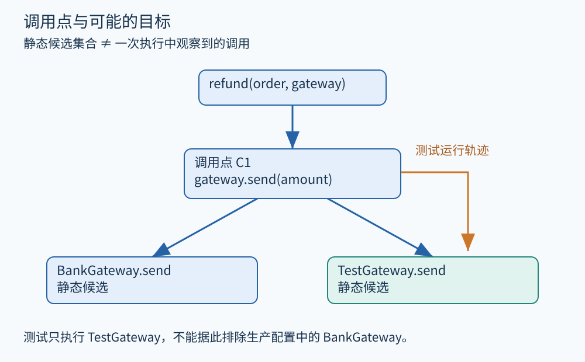

# 第 10 章 调用图、动态分派与跨函数边界

分析一个函数时，可以把函数体画成 CFG；分析整个应用时，还需要知道调用可能进入哪些函数。调用图以函数或方法为节点，以可能的调用关系为边。它回答的是跨函数连接，却不自动包含完整参数、返回值和状态变化。

## 先从一个确定的调用开始

考虑订单退款服务的简化伪代码：

```text
refund(order, gateway):
    if order.state != paid:
        return rejected
    result = gateway.send(order.amount)
    if result == success:
        order.state = refunded
    return result
```

假设 gateway 可能是 `BankGateway` 或 `TestGateway`。调用 `refund` 的函数体只有一个 `.send` 位置，但运行时目标可能不同。静态调用图应根据采用的模型保留相关候选边。实际只执行一次时，则只会看到这次所选目标。



图 10-1　原创教学图。蓝色边是静态候选；橙色强调一次具体运行。候选数与实际调用次数是不同概念。

若先假定参数的类型层次完整，一种粗略方法是枚举接收者声明类型的可用实现。若进一步知道整个分析范围内只分配过某些类的实例，可减少候选；若跟踪此处 gateway 引用具体可能指向的对象，还可继续缩小范围。这几种思路都依赖封闭世界、入口集合和运行时机制等前提，不存在脱离语言语义的万能目标解析。

对于 Java 一类语言，编译期的方法选择与运行时定位覆盖实现是不同阶段。[Java 语言规范的方法调用章节](https://docs.oracle.com/javase/specs/jls/se25/html/jls-15.html#jls-15.12)对两者分别规定。本书的 gateway 示例借用面向对象分派直觉，并不是任何具体 Java 程序的逐字转换。

## 多一条边与少一条边的后果

如果把不可能到达的实现也放进图里，后续分析可能报告一条实际无法发生的状态变化，这是精度损失。如果漏掉真实实现，后续分析可能根本看不到其中的资源释放或错误返回，这是覆盖缺口。

必须区分“已证明该目标不可能”和“工具暂不支持解析”。面对反射、插件加载、回调注册或本地代码，可靠的工程实现应明确未知边界，可采用保守未知目标、外部摘要或覆盖声明，而不是默默删去关系。

动态调用图也有边界。用测试环境运行退款，可能只观察到 TestGateway；这不证明生产环境中的 BankGateway 不可达。动态数据可帮助排序候选、解释常见路径，但要把“观察到的图”和“模型允许的图”分开保存。

## 跨过边界，要搬运什么信息

调用边建立后，至少还有四种对应关系：调用者实参到被调用者形参，返回值到接收位置，异常到处理路径，以及全局或堆状态的读写。对上例，只传播 `result` 而不传播 order 的状态，可能丢失真正影响业务的效果。

可以把一个已知实现概括为：成功时返回 success，失败时返回 failure；调用可能访问外部服务；不直接改动 order。这样的摘要让分析无需每次进入完整实现，但摘要也有前提。若另一个实现会抛异常，或者会调用用户提供的回调，复用前一份摘要就不成立。

| 边界信息 | 本例中的问题 | 漏掉后的风险 |
|---|---|---|
| 参数关系 | send 收到哪个金额？ | 错连金额来源 |
| 返回关系 | 哪个结果决定状态更新？ | 把失败也视作成功 |
| 堆效果 | 谁能修改 order？ | 沿用过期状态 |
| 异常与回调 | 是否存在正常返回之外的转移？ | 漏掉清理与重入路径 |

## 调用和返回必须匹配

假设两个调用点都调用 `validate`：第一次校验金额，第二次校验账户。如果把调用者 CFG 与被调用者 CFG 简单拼接，可能出现“从第一次进入，却返回到第二次后面”的虚假路径。真实执行通常需要匹配调用栈；跨过程分析要用摘要、上下文或其他结构处理这种匹配，不能只做任意图可达性。

递归进一步让调用栈无界。函数 f 调用自身，并不需要无限复制函数节点；调用图可以有自环。真正困难的是分析状态与上下文怎样概括。把所有调用合并会更便宜，却可能让不同订单或不同参数的事实互相污染；分得越细，成本通常越高。第 16 章将比较具体的上下文选择。

## 图的边界也是系统的边界

实际项目还有框架入口：HTTP 路由、任务调度器、GUI 事件和消息消费者，可能都由框架间接调用。若只从 `main` 中显式出现的函数向下追踪，却不了解注册机制，就会错过业务处理函数。对库项目，也可能不存在单一 main，需要声明公开 API 为入口，并规定外部调用者可以提供什么状态。

因此，一份调用图报告应至少附带：语言与构建配置、入口集合、库和框架模型、未知调用处理方式。没有这些信息，单独统计“解析出多少条边”很难说明质量；更多边既可能代表覆盖扩大，也可能代表模型过粗。

## 把调用图当作可追问的结果

面对一条候选边，工具最好能说明它来自直接名字解析、继承层次、指向集合、配置模型还是动态观察。这样，读者看到 gateway 的两个候选实现时，可以沿证据回查：究竟是运行时真的允许两者，还是分析器无法继续区分？

同样，一份“没有发现违规调用”的结论，应能回答未知库怎样处理。若未知函数可能保存订单引用，后续再次访问订单时就不能继续假定只有当前函数能修改它。把外部函数一律当作无副作用虽然会让结果更干净，却把缺失模型变成了错误假设。明确标记边界，才能知道补充哪份摘要最有价值。

调用边还应保留调用点身份。同一个函数里两次调用 send，图上都连到同一个目标，但参数与后续处理可能不同；只保存函数到函数的一条边，会失去诊断定位和返回匹配所需的细节。

**练习。** 测试运行只观察到 TestGateway.send，而源码中 BankGateway 可以由配置加载。能否删除 BankGateway 边？怎样才能合理缩小候选？

**参考答案。** 不能仅凭这次测试删除。若分析范围明确限定为固定测试配置，并验证该配置及加载机制排除了 BankGateway，可以在这个范围内缩小候选；报告必须保留该前提。若分析生产应用，则仍需考虑其真实配置和扩展机制。

## 本章资料

- [Java Language Specification §15.12：Method Invocation Expressions](https://docs.oracle.com/javase/specs/jls/se25/html/jls-15.html#jls-15.12)。编译期选择与运行时调用的规范参照。
- [LLVM：Alias Analysis Infrastructure](https://llvm.org/docs/AliasAnalysis.html)。指针关系与调用副作用查询的延伸入口。
