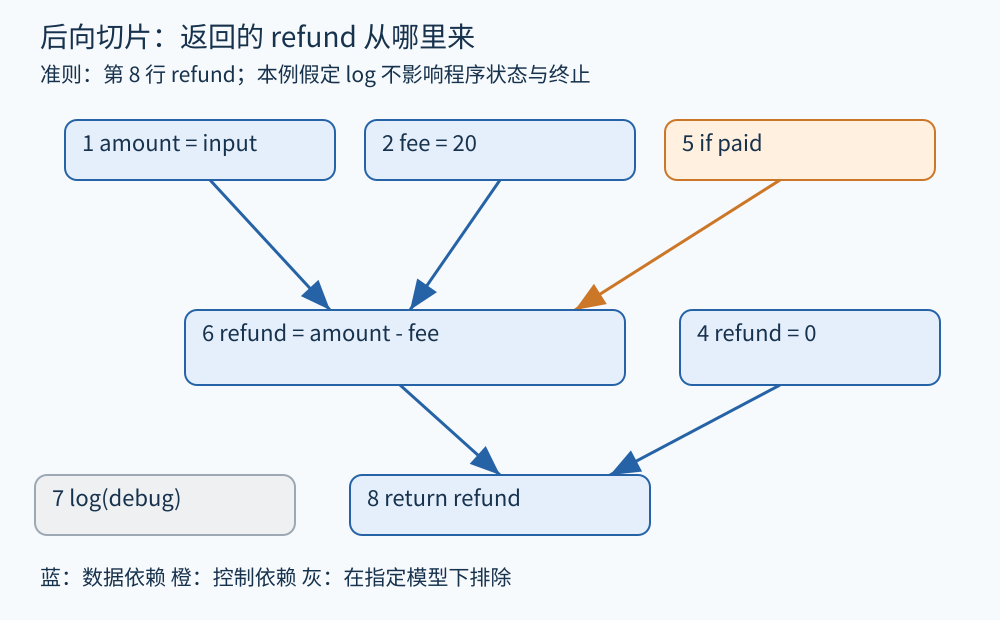

# 第 11 章 依赖图与程序切片

退款金额异常时，读完整个服务未必是最有效的起点。我们可能只想知道：在某个返回位置，哪些语句可能影响这个金额？程序切片把这种问题转成围绕某个观察点的相关代码集合。切片的质量取决于“相关”的定义、程序模型与分析精度。

## 从结果往回追

看下面的教学伪代码，假定普通顺序执行、数学整数、无隐藏调用效果：

```text
1 amount = input_amount
2 fee = 20
3 debug = input_debug
4 refund = 0
5 if paid:
6     refund = amount - fee
7 log(debug)
8 return refund
```

切片准则是“第 8 行读取的 refund”。先找它可能的定义：第 4 行以及第 6 行。第 6 行使用 amount 和 fee，因此加入第 1、2 行。第 6 行是否执行取决于第 5 行，因此还要保留 paid 的条件及其来源。第 7 行只记录 debug，在本例规定的无干扰模型下，不影响该返回值。



图 11-1　原创教学图。蓝色边表示数据依赖，橙色边表示控制依赖，方向均为依赖来源→受影响操作；后向切片反向遍历这些边。灰色日志分支在本章指定模型下不属于该切片。

这比“搜索 refund 出现在哪里”更有解释力：amount、fee、paid 的拼写都不是 refund，却影响它的值或定义选择。真正的分析单位是关系，而非关键词。

## 数据依赖与控制依赖

如果一处写入产生的值可能被另一处读取，且中间没有覆盖这个值的相关写入，可建立定义—使用意义上的数据依赖。控制依赖则表达某个判断对另一操作是否执行的影响。两种关系放在一起，形成程序依赖图 PDG 的核心。[Ferrante、Ottenstein 与 Warren 的原始论文](https://research.ibm.com/publications/the-program-dependence-graph-and-its-use-in-optimization)明确使用数据与控制依赖组织计算及优化。

依赖图不是 CFG 的换一种画法。CFG 边表示可能的下一步执行，依赖边表示计算上的相关性。第 1 行与第 6 行之间隔了多条语句，仍可有直接数据依赖；第 2 行与第 3 行相邻，却可能互不依赖。

还要说明使用的是哪一种“数据依赖”。编译优化讨论指令重排时，会关注真依赖、反依赖和输出依赖：先写后读、先读后写、先写后写分别约束重排。用于值解释的定义—使用图常突出第一种。若不注明边的含义，读者可能把“这个值来自哪里”误读成“这些操作能否并行”。

## 静态与动态切片

静态切片通常考虑所声明输入范围内的可能执行。上例同时保留第 4 和第 6 行，因为 paid 可能真假。动态切片固定某次输入和执行轨迹，针对实际观察值解释来源；若该次 paid 为真，实际返回金额来自第 6 行。

然而动态切片仍须定义是否考虑控制、地址、异常及其他依赖，不能机械地把“没执行的行”删掉就称为正确动态切片。一次轨迹中没有出现的代码，也可能在另一输入下影响结果。动态切片更适合解释特定故障，静态切片更适合覆盖一组可能行为，两者证据范围不同。

| 方向 | 从哪里出发 | 常见用途 |
|---|---|---|
| 后向切片 | 某处变量、输出或状态 | 追溯结果来源、缩小故障排查范围 |
| 前向切片 | 某个输入、定义或改动 | 寻找可能受影响的计算与输出 |
| 两端约束的相关区域 | 来源与目标共同限定 | 聚焦两者之间可能的传播关系 |

前向可达性也不等于实际影响。例如 amount 改了，但退款最终被上限截断，某次输出可能不变。依赖路径提供“可能相关”的候选；判定具体变化是否发生，还需要值、路径和规格推理。

## 内存与调用让关系变复杂

若第 7 行不是纯日志，而是 `log_and_update(order)`，它可能通过共享引用改写退款状态，原先排除它的理由便失效。若第 6 行读取 `order.amount`，另一别名可能在之前改写同一字段；仅跟踪局部变量定义会漏掉这种依赖。

跨函数切片还必须处理参数、返回值、堆效果和调用返回匹配。一个函数的返回值与传入对象状态可能分别承载不同信息。把调用图连通部分全收进切片虽然简单，却可能让结果膨胀到几乎整个项目；过度收缩则可能删掉关键行为。

对于并发程序，还会出现线程间读写及同步相关性。本章的顺序切片不能直接证明多线程排查结论。分析报告应把语言、异常、终止、并发和外部调用的假设写清楚。

## 切片不是自动修复

“最小切片”听上去诱人，但通常不存在一个与问题无关、成本又低的唯一最小答案。为了可扩展性，工具常提供保守相关集合；它可以包含并非真正根因的语句。删除切片之外的代码，也未必得到能独立编译、保持全部行为的程序：声明、类型和构建依赖仍需补足。

实用方式是把切片当作可解释的导航结果。查看每一条边为什么存在，给出对应定义、控制条件或内存模型；先用它缩小阅读范围，再通过测试、路径约束或规格判断确认问题。这样即使切片不够精确，也能知道下一步应补什么证据。

## 让切片结果能被人核验

一个有用的切片界面应允许选择观察点、变量和分析配置，并按边解释保留原因。例如点击 fee，可看到“第 6 行读取 fee，其结果可能到达第 8 行”；点击 paid，可看到“第 5 行决定第 6 行是否执行”。这种解释比单纯给代码涂色更有教学意义。

若结果过大，可以逐步引入输入约束、函数摘要或更精确的别名关系，再观察哪些边消失。每次缩小都应有新增依据，不应只是为了让图好看而删边。切片因此既是程序理解工具，也是检查分析模型是否足够精确的一种窗口。

**练习。** 若第 7 行改成 `refund = clamp(refund, 0, amount)`，还可从第 8 行的后向切片中删除它吗？fee 是否必然影响每一次实际返回？

**参考答案。** 不能删除第 7 行，它定义了最终返回使用的值，还引入 clamp 的语义与参数依赖。fee 在 paid 为真时可能参与计算，但某些输入会被截断到 0，另一些运行 paid 为假；“静态切片包含 fee”不表示每次运行改变 fee 都会改变输出。

## 本章资料

- [Ferrante、Ottenstein、Warren：The Program Dependence Graph and Its Use in Optimization，1987](https://research.ibm.com/publications/the-program-dependence-graph-and-its-use-in-optimization)。PDG 的原始研究。
- [LLVM：MemorySSA](https://llvm.org/docs/MemorySSA.html)。内存定义与使用关系的工程参照。
