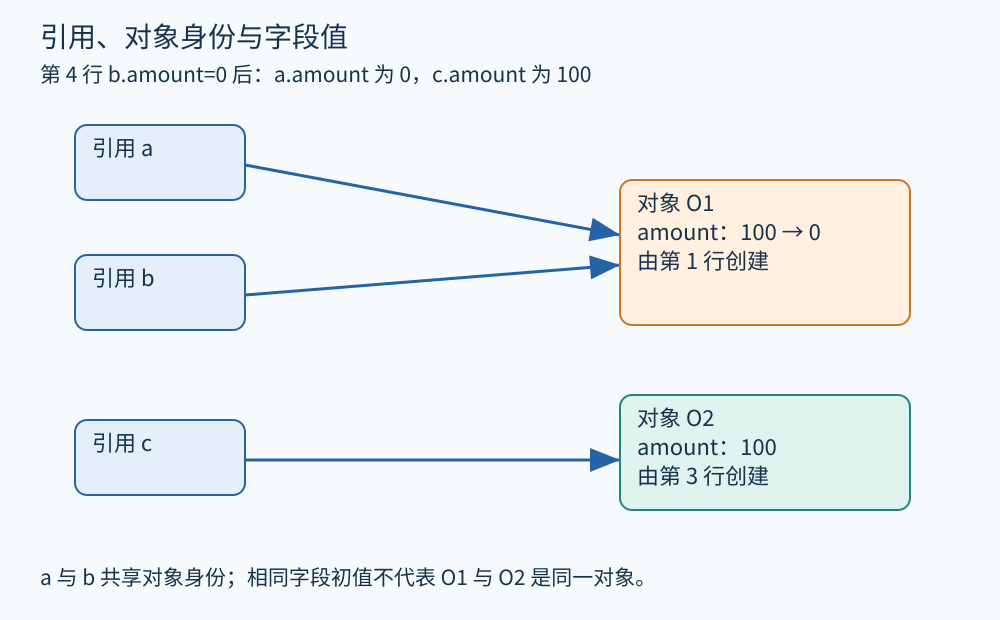
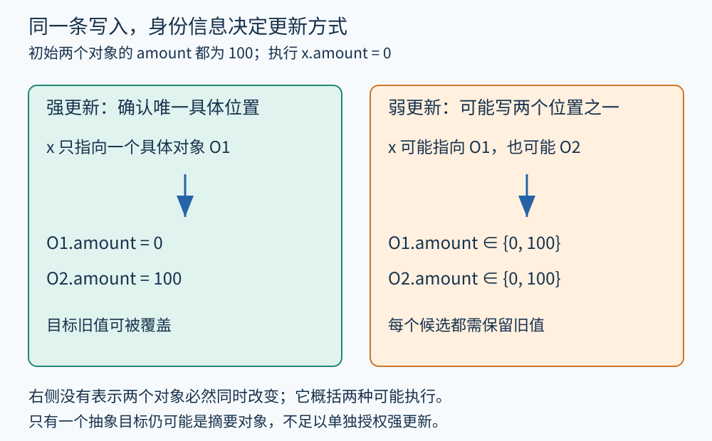

# 第 12 章 指针、别名、堆与对象模型

两个名字可以指向同一个订单。修改其中一个名字访问的字段，另一个名字再读取时也会看到变化。程序分析若把名字当成互不相关的盒子，就会在对象和内存面前失去依据。

## 先分清引用与对象

以下是引用语义的教学伪代码，`new` 创建具有身份的新对象：

```text
1 a = new Order(amount=100)
2 b = a
3 c = new Order(amount=100)
4 b.amount = 0
5 print(a.amount)
6 print(c.amount)
```

第 2 行复制引用，没有复制 Order 对象。因此 a 与 b 指向同一个对象 O1，c 指向另一个对象 O2。第 4 行修改 O1 的字段，随后两次输出分别为 0 和 100。这是模型推演，不是对所有语言赋值运算的统一规定；值类型、复制构造或显式克隆可以有不同语义。



图 12-1　原创教学图。对象身份与字段值分开表示；两个对象初始金额相同，并不意味着它们具有相同身份。

指向分析常为每个引用维护一个可能目标集合，例如 `Pts(a)={O1}`。若两集合不相交，在该模型成立的前提下可排除指向同一抽象对象的可能；若有交集，则通常只能说可能别名。因为抽象对象可能代表多个具体对象，集合相交并不足以证明真实引用必然相同。

## 别名查询是在问什么

[LLVM 别名分析接口](https://llvm.org/docs/AliasAnalysis.html)区分无法重叠、可能重叠、必然同起始位置以及部分重叠等结果，并把访问位置及大小纳入考虑。这里的“内存访问范围是否重叠”比简单的对象身份问题更具体。两个地址不同，也可能访问重叠范围；同一大对象中的不同字段，则可能是互不重叠的位置。

因此，学习时可先用“两个引用是否可能指同一个对象”建立直觉；面对 C/C++ 真实内存操作，还要考虑偏移、访问宽度、布局、对象生命周期及语言规则。不能把名字不同推成不别名，也不能把所有属于同一个结构体的访问都当成必然同一地址。

## 无穷多次分配怎样放进有限模型

循环可以在一个 `new Order` 位置创建任意多个对象。分析器通常不能为每次潜在分配建立独立静态节点，常用做法是按分配点合并：该源码位置创建的对象都由抽象节点 H1 表示。不同分配位置可分别形成 H1、H2。

这种合并牺牲了身份精度。若循环里创建了两张订单，它们是不同具体对象，却可能都归入 H1。当两个引用的指向集合都为 `{H1}` 时，不能直接断言它们指向同一个具体订单。还可按调用上下文、对象创建上下文或其他区分条件细化，但状态数量与求解成本会增加。

字段也能选择分开或合并。字段敏感模型区分 `order.amount` 与 `order.state`；字段不敏感模型把它们并入较粗的存储单元。数组可逐索引区分，也可用一个摘要元素代表多个位置。选择取决于想验证的性质：追踪订单状态时把全部字段混在一起，通常会制造很多无关传播。

## 强更新和弱更新

现在改一个例子：

```text
x = choose(a, c)
x.amount = 0
```

若只知道 x 可能指向 O1 或 O2，写入不能把两个对象都认定为已置零。对每个候选，真实执行也可能写到了另一个对象，因此需保留旧值并加入新值，这叫弱更新。O1、O2 的 amount 都可能是 100 或 0。

如果在某处确定写入的抽象位置只代表一个有效具体位置，且写入完整覆盖所关注单元，才可能做强更新，用新事实替换旧事实。仅有“指向集合大小为一”还不够：这个唯一抽象节点可能是分配点摘要，代表许多活对象。强弱更新决定资源状态、污点或数值信息能否被可靠覆盖，是分析精度的重要开关。



图 12-2　原创教学图。右侧分别概括每个对象可能的值，没有宣称一次执行把两个对象都改为 0。

## 对象模型还要容纳生命周期

对象分配、字段修改、销毁和引用逃逸是不同事件。一个引用离开局部作用域，不意味着堆对象立刻消失；另一个引用可能仍持有它。相反，某种资源被关闭后，其包装对象仍可存在，只是协议状态已经改变。

分析文件句柄时，应把“对象可达”与“资源仍打开”分开。GC 可以回收不再可达的内存，但不能据此假设外部文件、事务或锁都在业务所需的时刻自动释放。语言的所有权和借用规则可以减少某些共享与生命周期歧义，却仍需要准确处理 FFI、内部可变性及相关运行时机制。

还有“逃逸”这一问题：对象引用是否离开当前函数或线程。若对象只在函数内部使用，有时可证明其他未知代码无法访问它，从而简化副作用分析或支持优化；若把它存入全局容器或传给未知回调，就应重新评估这些结论。逃逸分析与别名分析相关，但问的并非同一个问题。

## 如何判断一个模型够不够用

在报告中写下：如何标识抽象对象，是否区分字段和数组元素，是否区分流程与上下文，未知调用会修改哪些位置。模型粗糙并不自动意味着结果无用；模型精细也不保证更适合整个项目。关键是目标性质是否仍能得到有依据的回答，以及成本是否可承受。

## 从对象图走向副作用摘要

对于 `adjust(order)`，若摘要声明只写 amount 字段，调用后可以保留关于 state 的事实；若只声明“可能写整个对象”，则 state 也可能失效。前者需要字段级依据，后者更保守。未知调用若还可能把引用保存到外部，影响又会延伸到未来执行，不能只在当前调用点清空一次事实就结束。

因此，对象图、别名查询和函数摘要应使用兼容的内存单位。一个模块按字段区分，另一个模块却把对象整体合并，交换结果时必须说明如何映射。精度丢失常发生在这种接口处，而非某个孤立算法内部。

**练习。** 若 a 与 b 都指向分配点摘要 H1，能否在 `b.amount = 0` 后断言 `a.amount == 0`？还缺什么信息？

**参考答案。** 不能仅凭共享抽象节点断言。H1 可能代表多个对象，a、b 可能分别指向其中不同对象。需要更强的具体身份或必别名信息，以及写入范围和生命周期前提；否则应保守保留 a 的旧值可能性。

## 本章资料

- [LLVM：Alias Analysis Infrastructure](https://llvm.org/docs/AliasAnalysis.html)。用于核实别名查询、访问范围与副作用接口的含义。
- [LLVM：MemorySSA](https://llvm.org/docs/MemorySSA.html)。用于理解别名信息如何与内存依赖查询协同。
