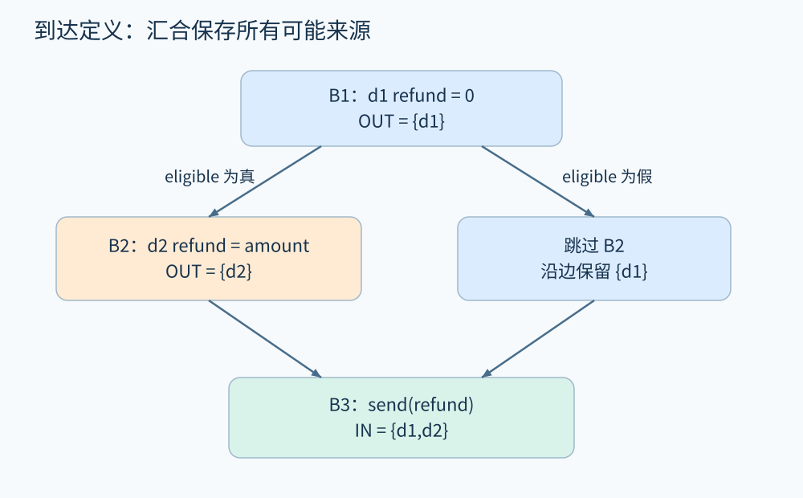
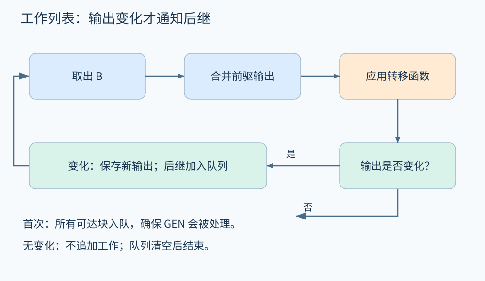

# 第 13 章 数据流分析与工作列表

订单系统里有一行 `send(refund)`。到这里时，`refund` 可能由哪一次赋值产生？回答这个问题不必先运行订单服务。我们可以沿控制流图传播“赋值的编号”，把所有可能到达此处的定义收集起来。这就是数据流分析的一种：**到达定义分析**。

本章使用数学整数和单线程教学程序；变量都已声明，没有异常、别名或隐式写入。真实语言中的调用副作用需要额外模型。下面的代码编号指向定义的位置，不是执行次数。

```text
B1: d1: refund = 0
    if eligible goto B2 else B3
B2: d2: refund = amount
    goto B3
B3: send(refund)
```

`eligible` 为假时，`send` 读取 d1 的值；为真时，它读取 d2 的值。我们希望在 B3 入口得到 `{d1,d2}`。这个集合表示“可能来自两者之一”，没有宣称两次赋值会同时成为一次读取的来源。

## 13.1 先定义事实，再定义传播

数据流事实可以是定义编号、活跃变量、可能的常量，也可以是资源状态。选择事实之前，应先说清要回答的问题。同一张图可以运行多个分析，而每个分析的集合含义不同。[Clang 的数据流入门](https://clang.llvm.org/docs/DataFlowAnalysisIntro.html)用抽象值与控制流传播说明这类方法；下面的退款例子和推演是本书自行构造的。

对一个基本块 B，定义两个集合：`GEN[B]` 是块执行后新产生、仍然有效的定义；`KILL[B]` 是被这个块内的确定赋值覆盖的其他定义。本例 B2 写入 `refund`，因此产生 d2，并杀死 d1。一般块中同一变量有多次赋值时，不能把所有赋值都放进 GEN：前面的定义可能已被后面的赋值覆盖。

使用如下方程：

\[
IN[B]=\bigcup_{P\in pred(B)}OUT[P],\qquad
OUT[B]=GEN[B]\cup(IN[B]\setminus KILL[B]).
\]

入口前没有本例中的定义，边界值设为空集。其余集合从空集开始迭代。若输入参数也属于分析对象，可以为它们建立入口伪定义，而不是把“没有本地定义”错误理解为“没有值”。

| 基本块 | GEN | KILL | 稳定后的 IN | 稳定后的 OUT |
|---|---|---|---|---|
| B1 | {d1} | {d2} | ∅ | {d1} |
| B2 | {d2} | {d1} | {d1} | {d2} |
| B3 | ∅ | ∅ | {d1,d2} | {d1,d2} |



图 13-1　蓝色、橙色区分两次定义；汇合处保留二者作为可能来源。原创精确示意。

## 13.2 工作列表为什么反复处理同一个块

直接把所有块从头到尾扫描一遍，仅在图恰好按依赖顺序排列、且没有回边时才可能足够。加入循环后，后面的块会把新事实送回已经处理过的块。**工作列表**记录哪些块需要重新计算。

```text
for each reachable block B:
    IN[B] = OUT[B] = empty
work = all reachable blocks
while work is not empty:
    B = pop(work)
    IN[B] = union(OUT[P] for P in predecessors(B))
    next = GEN[B] union (IN[B] minus KILL[B])
    if next != OUT[B]:
        OUT[B] = next
        add successors(B) to work
```

伪代码中的入口另按边界条件处理。把所有可达块先入队，可以保证即便某块的输入始终为空，它自己的 GEN 仍会被计算；也可以从入口触发，但须正确处理“首次访问”和“状态没有变化”的区别。

对退款例子，假设处理顺序是 B3、B1、B2：第一次 B3 得到空集；B1 得到 `{d1}`，使 B3 与 B2需要处理；B2 将输入中的 d1 替换成 d2；B3 再计算时得到 `{d1,d2}`。处理次序改变中间步骤与工作量，不应改变这个有限、单调框架的最终最小解。



图 13-2　只在输出变化后通知依赖者。图中是算法调度状态，并非程序执行轨迹。原创精确示意。

这里有一个容易误解的细节：虽然转移函数中有“杀死”，迭代仍然可以单调。若输入集合 A 包含于 B，则 `GEN∪(A\KILL)` 也包含于 `GEN∪(B\KILL)`。KILL 是固定转移规则，不是任意删除迭代历史的操作。本例事实宇宙有限，每个块的结果只能增加有限次，因此迭代终止。无限抽象域则需要下一章的其他办法。

## 13.3 向前、向后，可能、必然

到达定义顺着赋值到使用的方向传播。活跃变量则从未来的使用反向传播：若某个变量的当前值沿至少一条后继路径会被读取，并且此前没有被覆盖，它在此处就是活跃的。其经典方程为：

\[
OUT[B]=\bigcup_{S\in succ(B)}IN[S],\qquad
IN[B]=USE[B]\cup(OUT[B]\setminus DEF[B]).
\]

这里 USE 指块内在局部定义之前被读取的变量。退款程序中，`refund` 在 B3 入口活跃；B2 中的新赋值会覆盖旧值，因此 B2 入口不需要保留旧 `refund`。这能帮助编译器判断某些存储是否无用，却不能据此删除 `amount` 的计算：还须检查副作用、异常及语言规则。

“可能成立”的性质通常在分支汇合时使用并集；“每条路径都成立”的性质常用交集，但必须连同集合含义、顺序和初始值一起定义。不能看到交集就机械判断算法更精确。对于“必然已经初始化”，一条分支未初始化就足以让结论消失。

## 13.4 从图上的结果回到程序

到达定义可以支持使用—定义关系、重构和缺陷解释，但它本身不证明业务逻辑正确。即使 d1 与 d2 都是合法来源，`refund=amount` 是否满足退款规则仍依赖规格。普通 CFG 也可能包含不可行路径：如果某个分支条件与之前的条件矛盾，单纯合并定义仍会把它算进去。

当出现 `*p=...`，KILL 能否确定取决于别名分析；当出现外部调用，哪些变量会变化取决于调用摘要。基础方程没有失效，困难转移到了“这条语句究竟影响什么”的建模上。[MLIR 的数据流教程](https://mlir.llvm.org/docs/Tutorials/DataFlowAnalysis/)也把抽象状态、汇合操作与传播驱动分开，便于把不同性质放进同一基础设施。

## 路径解与方程解的距离

还可以设想沿每条入口路径分别计算转移，最后再汇合，称为路径汇合解。工作列表求的是数据流方程的稳定解；两者不总相同。若转移对汇合满足分配律，就能在相应框架下得到相同结果；一般单调转移在提前合并后可能丢失关联。即使二者相同，CFG 路径也可能不可行，因此仍不等于真实执行的精确结果。

调试时可先选无循环的小图，手工列出全部路径，再与方程结果比较；如果只是工作列表处理顺序变化便让结果不同，应先检查初始化、变化检测和依赖通知，而非立刻增加更复杂的抽象域。

## 13.5 动手推演

把 B2 改为 `tmp=amount`，但保留 B3 的 `send(refund)`。B3 的 `refund` 来源还有 d2 吗？如果 B3 之后再增加 `refund=5`，是否应把这条赋值反向加入 B3 入口？

**参考答案：**修改后 d2 定义的是 tmp，不能杀死 d1；B3 对 refund 的读取仅由 d1 到达。后续赋值属于未来，不能反向成为当前读取的来源。要把定义所属变量也纳入事实模型，仅使用“块里出现过赋值”会产生错误。

## 本章资料

- [Clang：Data flow analysis: an informal introduction](https://clang.llvm.org/docs/DataFlowAnalysisIntro.html)。数据流、抽象值与控制流传播的官方讲解。
- [MLIR：Writing DataFlow Analyses](https://mlir.llvm.org/docs/Tutorials/DataFlowAnalysis/)。抽象状态与传播框架的工程实例；具体 API 随版本检查。
- 本章代码、集合表与调度轨迹为自包含教学推演，未宣称运行了 Clang 或 MLIR。
