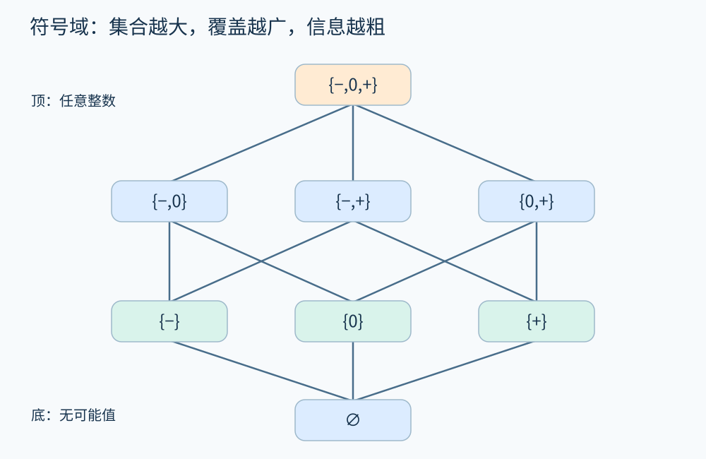
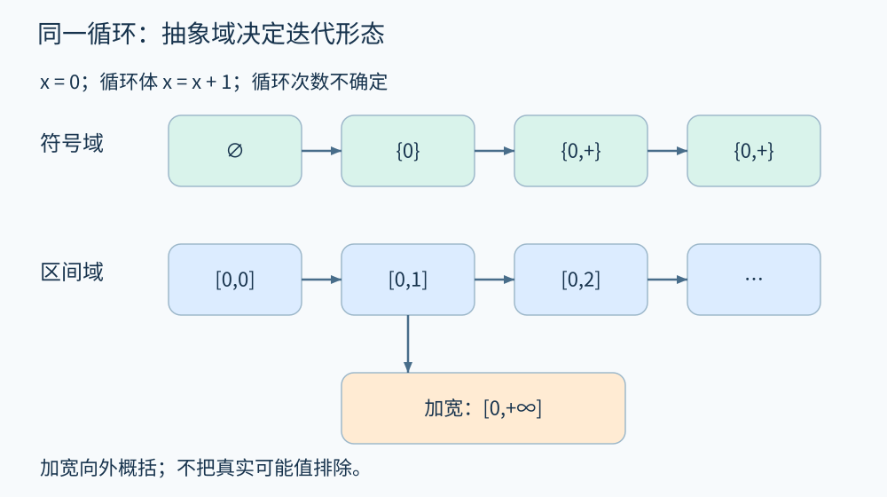

# 第 14 章 格、不动点与抽象解释

假设一个订单程序执行 `refund=paid-coupon`。我们只想知道 `refund` 是否可能为负，不必记住每一笔订单的所有金额。可以让分析器保存“负、零、正”这样的概括。问题随之而来：概括丢掉了哪些信息？分支汇合后怎样合并？什么时候可以相信分析给出的安全结论？

**抽象解释**为这些问题提供统一语言。Cousot 夫妇在[1977 年的奠基论文](https://www.di.ens.fr/~cousot/COUSOTpapers/POPL77.shtml)中，用抽象对象上的计算近似程序语义，并把全局性质联系到不动点。下面从自行构造的符号例子理解这套语言。

## 14.1 抽象值是一组可能状态的简写

取整数集合为具体值空间。令抽象值为符号类别集合：

\[
A=\mathcal P(\{-,0,+\}).
\]

例如 `{0,+}` 表示所有非负整数；`{+}` 表示所有正整数；空集表示没有可能值。具体化函数 γ 把抽象值解释成整数集合。抽象函数 α 则收集一个具体集合里出现的符号类别。

本章统一采用**可能集合包含顺序**：

\[
a\sqsubseteq b \iff a\subseteq b.
\]

因此，向上意味着覆盖更多可能情况、信息更粗；向下意味着范围更小、信息更精确。底元素 ⊥ 是空集；顶元素 ⊤ 是 `{- ,0,+}`，表示任意整数。顶并不表示“程序安全”，而是分析无法进一步排除数值。



图 14-1　符号域的八个元素。连线向上对应集合包含关系；这里省略箭头以保持清晰。原创精确示意。

任意两个元素都有最小上界（join，⊔）和最大下界（meet，⊓），这样的偏序结构称为格。本例 join 是并集，meet 是交集。`{-}⊔{+}={-,+}`，不能写成 `{0}`，也不能因为程序有两个分支而把两边“平均”。

工程实现还可能单设“尚未计算”的标记。它是求解器的调度状态，不一定等同于语义上的不可达 ⊥。若把二者混为一谈，便可能漏掉第一次需要执行的转移。

## 14.2 在抽象值上执行赋值

考察 `x=2; y=x-3`。符号域先得到 `x={+}`；计算“正数减正数”时，结果可能负、零或正，因此 `y=⊤`。具体程序的 y 明明等于 -1，为什么分析不知道？因为符号抽象已经把“2”和“3”各自压成了正数。

这是一个精度损失，不是计算错误。分析器若直接声称 y 为正，才遗漏了真实行为。用 F 表示具体状态转换，用 F# 表示抽象转换，覆盖式安全分析要求：

\[
F(\gamma(a))\subseteq\gamma(F^\#(a)).
\]

左边是抽象输入允许的所有具体执行结果；右边必须把它们包住。把结果包得更大仍可能 sound，却会增加误报。此处 soundness 的对象是指定整数语义下的数值转换，不自动覆盖真实程序的溢出、异常和外部环境。

如果已经证明 `paid≥coupon≥0`，关系型抽象可能证明退款非负；只有单个变量的符号则往往不够。这正是下一章要讨论的抽象域选择。

## 14.3 循环为什么变成不动点

考察数学整数程序：

```text
x = 0
while choose():
    x = x + 1
```

把循环头的可能值集合记作 H。第一次进入的 0 与循环体返回的结果都必须包含在 H 中，因此：

\[
H=\{0\}\cup\{n+1\mid n\in H\}.
\]

从空集开始反复应用右侧，依次得到 `∅`、`{0}`、`{0,1}`、`{0,1,2}`……数学上最小不动点是全部非负整数。最小的意思是：它是在当前顺序下最小的闭合解，而不是执行次数最少。

换成符号域，迭代只需要 `∅ → {0} → {0,+} → {0,+}`。抽象状态稳定下来时，新的循环信息已被已有状态覆盖。循环可能无限运行，但分析可以有限结束；两种“终止”讨论的是不同过程。



图 14-2　有限符号域会自然稳定；区间链可能不断增长。加宽主动跳到更粗的上界。原创精确示意。

## 14.4 不动点存在，不等于简单迭代会结束

若使用区间 `[下界,上界]`，同一循环会得到 `[0,0]`、`[0,1]`、`[0,2]`……区间域虽然有顶、底与汇合操作，但存在无限上升链，不能只凭单调性保证朴素求解终止。

一种解决办法是**加宽**（widening，▽）。简单的区间加宽规则是：下界一旦继续下降就改成负无穷，上界一旦继续上升就改成正无穷。因此 `[0,0]▽[0,1]=[0,+∞]`。这保留了非负性质，却放弃有限上界。实际分析器可延迟加宽或使用阈值保留更多精度；不能把加宽理解为“再算几轮就一定准确”。

找到覆盖转换结果的状态，即 `F#(a)⊑a`，便得到一个归纳不变量候选。经检查成立的后不动点可以用于覆盖式证明，不必等于最精确的抽象解。随后进行有条件的**收窄**可能恢复部分边界，但没有保证找回所有丢失的信息。

## 14.5 数学结构如何帮助调试分析器

分析器不是只要写了格就自动可靠。需要逐项检查：抽象值含义是否一致；join 是否确实覆盖两个输入；赋值、分支和调用是否覆盖真实操作；入口条件是否完整；加宽是否保证稳定；报告规则是否从结果中作出了合法推断。

例如 `x=⊤` 只说明“可能为任意整数”。遇到 `assert x>=0`，应当报告无法证明或潜在违例，不能把“无法证明”包装成已发现真实反例。若要给出具体反例，需要再验证路径、数值和环境假设。[Clang 的入门材料](https://clang.llvm.org/docs/DataFlowAnalysisIntro.html)同样使用抽象状态帮助解释实际分析；本章给出的符号格与循环序列是为阅读而简化的模型。

## 抽象需要覆盖语义细节

这里的符号类别只覆盖整数。若换成浮点数，正负零、无穷和 NaN 都可能影响操作；例如比较运算遇到 NaN 时，不遵循整数的全序直觉。若分析语言支持异常，一个算术操作的结果也不只有正常值，还可能包含异常出口。把这些行为先从具体模型里删掉，再声称抽象完全覆盖程序，会让公式看似正确、结论却不适用。

因此应先固定具体语义，再设计抽象。一个域对教学整数程序可靠，并不能靠更换数据类型名称就成为真实语言分析器。局部转换规则的检查，是全局不动点计算之前的工作。

## 14.6 动手推演

符号域中，`x={-}`、`y={+}`。执行 `z=x+y` 应得到什么？执行 `w=x*y` 呢？把 `z` 的结果记为 `{0}`，是精度提高还是错误？

**参考答案：**z 应为 `{- ,0,+}`，因为不同绝对值组合会得到三种符号；w 为 `{-}`。把 z 写成 `{0}` 排除了真实的正、负结果，违反覆盖条件。允许误报的近似可以扩大结果，不能任意缩小结果。

## 本章资料

- [Patrick Cousot、Radhia Cousot：Abstract interpretation: a unified lattice model…（POPL 1977）](https://www.di.ens.fr/~cousot/COUSOTpapers/POPL77.shtml)。原论文、摘要与出版信息。
- [Clang：Data flow analysis: an informal introduction](https://clang.llvm.org/docs/DataFlowAnalysisIntro.html)。面向实现者的抽象状态解释。
- 本章统一使用“可能集合越大越粗”的顺序；其他文献可能采用对偶约定，比较公式前须先对齐顺序。
