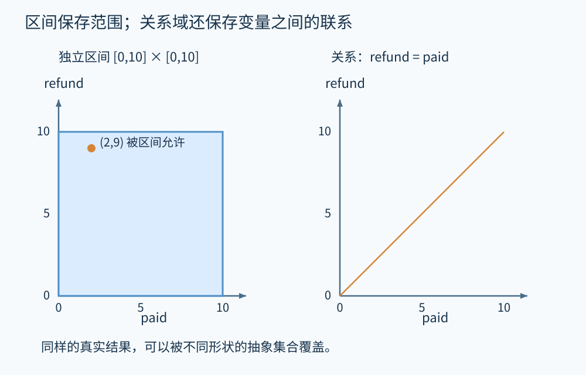
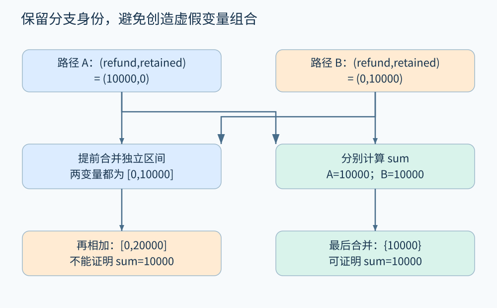

# 第 15 章 数值抽象、关系与路径敏感性

退款金额采用整数分，规格要求 `0≤refund≤paid`。若分析器只知道 `paid` 与 `refund` 各自在 `[0,10000]`，能证明规格吗？不能。两个变量分别合法，不代表它们之间的关系合法。例如 paid 为 100 分、refund 为 9000 分，就满足两个区间，却违反退款上限。

数值分析的关键选择，是保存什么信息以及何时合并。以下使用无溢出的数学整数；把同样算法直接套在机器整数上，必须补上回绕、未定义行为或检查异常的语义。

## 15.1 区间：便宜地保存上下界

区间 `[l,u]` 表示 `l≤x≤u`；空区间是 ⊥，`[-∞,+∞]` 是 ⊤。赋值 `x=y+3` 把 `[l,u]` 转为 `[l+3,u+3]`；分支 `x≥0` 可以把区间与 `[0,+∞]` 求交。分支约束的是这条边上的状态，不能直接覆盖另一条分支。

```text
assume 0 <= paid <= 10000
refund = paid
assert refund <= paid
```

复制后，非关系区间分析得到 `paid∈[0,10000]`、`refund∈[0,10000]`。为了证明断言，它要排除 `refund>paid` 的状态，但区间允许这类组合。差值的区间是 `[-10000,10000]`，无法证明恒非正。

**关系型抽象**可记住 `refund-paid=0`。它不需要枚举一万零一种金额，而是保存一条约束。[APRON 官方文档](https://antoinemine.github.io/Apron/doc/)列出的数值域包括区间、八边形、多面体等，用来在表达能力与成本间选择。这里的金额例子独立构造，用于比较同一事实的不同表示。



图 15-1　蓝色方框允许大量不符合 `refund=paid` 的组合；橙色直线保留二者的相关性。坐标仅展示一个缩小的教学范围。原创精确示意。

## 15.2 关系不是越多越好

常见数值域的差别可以从“能写下什么条件”理解：

| 抽象方式 | 能保留的典型事实 | 典型局限 |
|---|---|---|
| 符号 | `x≥0` 的符号类别概括 | 缺少具体范围 |
| 区间 | `0≤x≤100` | 不保留 x、y 的相关性 |
| 同余 | `x≡0 (mod 4)` | 单独使用时缺少上下界 |
| 八边形 | `±x±y≤c` | 一般系数关系表达受限 |
| 凸多面体 | 多变量线性不等式 | 维数、运算与加宽成本可能较高 |

如果只检查索引是否落在固定数组范围，区间可能足够；如果检查 `offset+length≤capacity`，保存关系会更有帮助。但“能表达”不代表“分析必然推得出”：分支合并、循环加宽、调用模型和变量遗忘都可能丢失关系。

还可以组合抽象域。设区间知道 `x∈[0,10]`，同余知道 x 为偶数。二者共同允许 `{0,2,4,6,8,10}`。若后续区间收紧为 `[1,9]`，利用同余可再收紧成 `[2,8]`。这种相互传递信息的组合，比仅把两份互不交流的报告并排展示更有用；实现时仍须保证每次收紧都不排除真实状态。

## 15.3 路径敏感性：暂时保留分支身份

下面程序所有真实路径都得到 `sum=10000`：

```text
if eligible:
    refund = 10000
    retained = 0
else:
    refund = 0
    retained = 10000
sum = refund + retained
assert sum == 10000
```

若分支结束时分别合并变量区间，refund 与 retained 都变成 `[0,10000]`，sum 变成 `[0,20000]`。这个结果包含了两变量同时为零、同时为一万的虚假组合。

有两条改进路线。关系分析可以在汇合点保留 `refund+retained=10000`；路径分区则保留两个状态 `{(10000,0),(0,10000)}`，在每个状态中计算 sum，再合并两个相同常量。两者针对同一次精度损失，却使用不同表示，不应混称为一个开关。



图 15-2　先逐分支计算再汇合，能在本例中保留 sum 的常量；逐变量提前合并则扩大结果。原创精确示意。

## 15.4 不可行路径与分支预算

再看 `if x>0` 之后嵌套 `if x<0`。忽略条件的 CFG 上存在通往内层分支的路径，真实整数状态却不存在。把条件与当前约束相交会得到 ⊥，因此可以停止传播。

但是分析器不会无限保留所有历史条件。连续 n 个独立二分支可能产生最多 `2^n` 个路径组合，即使有些路径最终不可行，处理中间状态也可能昂贵。工程上可只按关键条件分区，在循环头汇合，或达到预算后合并状态。报告应说明预算耗尽后发生的是保守合并、停止探索还是其他退化策略：它们对精度与覆盖的影响不同。

路径分区也会遇到外部世界的问题。两次调用 `eligible()` 未必返回相同值，除非函数契约或程序状态能证明它稳定。把名称相同的条件当成同一个布尔值，会在并发、I/O 或可变对象存在时错误删去路径。

## 15.5 先确定性质，再花精度预算

检查退款上限时，可重点保留金额变量关系；检查订单状态转换时，数值多面体可能不是主要帮助。分析器可以按需对某个函数、某个循环或某条报告提高精度，而无需让整个项目都使用最重的域。

精度改进还需要可比较的基线：在同一程序模型下，新增关系是否减少了不可证断言？成本增加多少？有没有因配置变化漏掉函数？“结果更少”不自动等于误报更少，可能只是分析范围缩小。

实际整数语义也会改变证明。数学上 `x+1>x` 恒成立；无符号机器整数到最大值时会回绕，结论不成立。有符号整数溢出在不同语言中可能有不同语义。先核实语言规则，再选择抽象转换，不能让好看的区间图替代语义。

## 凸关系也会填补不真实的空隙

关系域仍然是一种近似。例如两个分支分别得到 `(x,y)=(0,0)` 和 `(10,10)`，凸多面体的汇合可能保留 `x=y` 与范围，却也允许直线中间的点。它比独立区间精确，但没有记住“只有两个离散点”。若后续性质依赖 x 只能为 0 或 10，仍可能需要同余、析取或路径分区。

这说明精度不是一个总能排成单列的等级。不同域保留不同结构，组合与选择须围绕性质进行；比较前还要保持相同的语言模型与分析范围。图中画出更窄的集合，只能说明这一个例子的覆盖更紧。

本章比较的是抽象表达能力，尚未测量实现性能。对真实工具选型，应使用代表性的变量维数、循环和调用结构测试，不能根据域的名称推断固定速度差。

## 15.6 动手推演

已知 `x∈[0,10]`，执行 `y=x+1`。非关系区间能否证明 `y>x`？保存 `y-x=1` 后能否证明？如果 x、y 是 8 位无符号整数，且 x 允许达到 255，结论如何改变？

**参考答案：**单独区间只给 `y∈[1,11]`，允许 x=10、y=1 的抽象组合，无法证明。保存差值关系后，在数学整数语义下可证明。8 位无符号语义中，x=255 时 y=0，命题本身为假，不能靠提高精度把它证明为真。

## 本章资料

- [APRON Numerical Abstract Domain Library](https://antoinemine.github.io/Apron/doc/)。数值域、语义操作和实现接口的官方资料。
- [Cousot、Cousot：Abstract interpretation（POPL 1977）](https://www.di.ens.fr/~cousot/COUSOTpapers/POPL77.shtml)。抽象近似的理论起点。
- 金额、分支分区与机器整数对照均为本书教学推演；未宣称运行 APRON 或测得性能。
