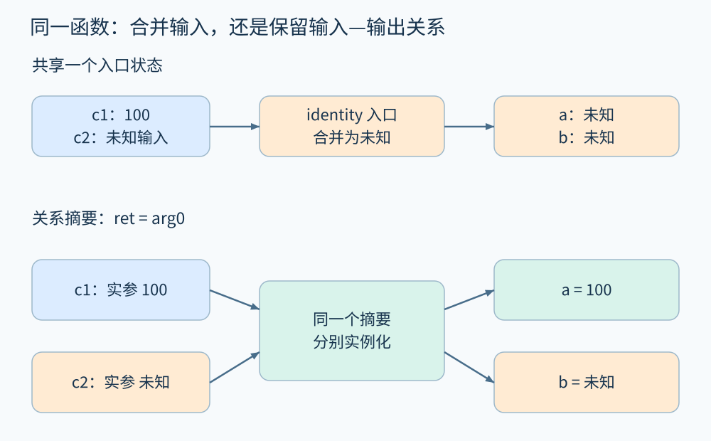
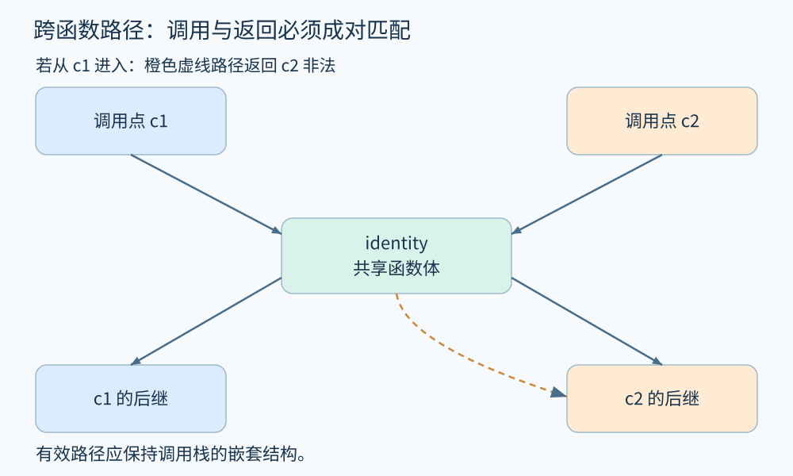

# 第 16 章 跨函数摘要与上下文敏感性

一个函数单独看很简单，放进调用链后却可能难以理解。下面的 `identity` 只是返回参数：

```text
function identity(v):
    return v

a = identity(100)       // 调用点 c1
b = identity(input())   // 调用点 c2
send_refund(a)
```

如果把两次调用的参数混在一起分析，函数入口同时收到常量 100 和未知输入，返回值被合并为未知。接着 a 与 b 都变成未知。真实程序里 a 明明始终是 100，信息为何消失？因为分析器忘了**哪个输入属于哪次调用，哪个返回应该交给哪个调用者**。

## 16.1 函数摘要保存输入与输出的关系

最简单办法是把被调函数展开到每个调用位置。这样容易保留局部信息，但同一个大函数被调用一百次，就可能被分析一百次；递归还不能无限展开。[Clang 的跨函数分析实现文档](https://clang.llvm.org/docs/analyzer/developer-docs/IPA.html)讨论了内联、调用进入和退出，以及实际预算限制，说明这里存在明确的工程取舍。

另一种办法是建立**摘要**。identity 的摘要不是“返回值未知”，而是关系 `ret=arg0`。在 c1 实例化后得到 `ret=100`；在 c2 则返回 input 的抽象信息。摘要可以用等式、状态转换、事实之间的边或前置—后置条件表示。



图 16-1　上半展示共享入口状态造成的精度损失；下半展示同一关系摘要对不同实参分别应用。原创精确示意。

摘要还必须覆盖副作用。考虑 `refund(order)` 修改 `order.state` 和 `order.refunded_amount`，却不改变 `order.paid_amount`。只记录返回值会遗漏主要行为；把整个堆都改为未知虽可能保守，却损失许多精度。需要表达读写集合、资源转移、异常出口以及未修改部分。后者常称为框架条件：分析器必须知道哪些状态保持不变。

## 16.2 上下文敏感性有哪些选择

**上下文**是区分不同调用环境的抽象标签。它不一定等于完整调用栈。

| 方式 | 用什么区分调用 | 代价与盲点 |
|---|---|---|
| 上下文不敏感 | 一个函数共用状态 | 成本较低，容易混合不同调用 |
| 调用串敏感 | 保留最近 k 个调用点 | k 越大可能越贵；较早历史仍被合并 |
| 对象敏感 | 用接收者的抽象对象区分方法调用 | 依赖堆抽象；同一分配点可能代表许多对象 |
| 值上下文 | 按抽象参数状态复用结果 | 输入状态种类多时摘要数量增长 |

调用串中 `k=1` 可以区分本例 c1 与 c2；若两个入口都通过同一个包装函数、最后一次调用点相同，则还可能被合并。对象敏感中的“对象”通常是抽象堆对象，不是给每个真实对象保留无限唯一编号。

敏感性也有不同轴。流敏感指区分语句先后；路径敏感指区分条件路径；上下文敏感指区分调用环境。提高一个轴不自动提高其他轴：精确区分调用点的分析仍可能把函数内两个互斥分支合并。

## 16.3 调用与返回必须匹配

把所有函数 CFG 连成一张大图后，若只做普通图可达性，可能从 c1 进入 identity，却沿 c2 的返回边离开。这是一条图上存在、程序执行不允许的路径。调用和返回像成对括号，退出应对应最近尚未返回的调用。



图 16-2　同一函数被两个位置调用；实线对应候选调用与返回边；橙色虚线展示从 c1 进入后却返回 c2 的非法串线。原创精确示意。

[Reps、Horwitz、Sagiv 的 IFDS 原论文](https://research.cs.wisc.edu/wpis/papers/popl95.pdf)针对有限事实集合、且转移函数对汇合运算满足分配律的一类问题，将跨函数数据流分析化为符合调用—返回结构的图可达性。这里的“精确”相对于所选事实与有效调用路径，并非恢复全部真实程序语义；不可行分支、调用图与堆模型仍可能引入近似。

这一区别很实用：如果 a 的告警来自错误返回串线，应改进跨函数求解；如果来自遗漏的业务条件，应改进路径或规格模型。统称“模型不够聪明”不能定位精度损失。

## 16.4 递归摘要也需要不动点

考虑递归遍历目录或树。函数摘要依赖自身摘要；互相调用的几个函数也会形成环。可以先把调用图分成强连通分量，在分量内反复更新摘要，直到稳定。若摘要域无限，仍需加宽或其他终止策略。

摘要缓存也不能只按函数名索引。函数实现、依赖摘要、语言配置、抽象域或关键假设变化，都可能使旧结果不再适用。若摘要声称“参数指针不为空时安全”，使用它之前必须检查调用点的前置条件；不能拿带条件的结论当作无条件保证。

对没有源码的库函数，需要外部模型。未知调用可能修改哪些可达对象、抛出什么异常、是否回调，必须明确选择。忽略未知调用的副作用容易漏报；无差别遗忘全部状态可能造成大量误报。报告应把这类假设暴露给读者。

## 16.5 一个退款摘要

给教学函数设定：订单金额是数学整数；初始状态为 paid；`0≤amount≤order.paid_amount`；调用期间没有并发修改。摘要可以写为：

```text
前置：state == paid 且 0 <= amount <= paid_amount
正常返回：state' == refunded 且 refunded_amount' == amount
保持：paid_amount' == paid_amount
写集合：{state, refunded_amount}
```

这还没有说明持久化失败会怎样，也没有覆盖第二次调用。若函数允许失败出口，就要分别记录失败后状态；若远端支付已执行而本地写入失败，抽象一个内存字段不足以表达真实业务效果。摘要的价值来自明确边界，而不是用几行契约压缩掉所有现实复杂性。

摘要也可按需计算：先从一个告警或查询出发，只分析相关调用和参数维度。需求驱动减少工作量，但查询边界必须覆盖性质所需的依赖；不能把未被请求分析的部分默认判成安全。批量扫描与按需查询可以共用摘要缓存，却应分别记录覆盖范围。

## 16.6 动手推演

函数 `same(v)` 返回 v。两处调用分别传入“用户输入”和“固定常量”。上下文不敏感的污点分析把函数返回值统一标为可能污点，固定常量调用也告警。可以只把函数加入全局“可信函数名单”吗？

**参考答案：**不能。这样会同时抹掉用户输入调用的污点，造成漏报。可保存“返回值继承参数污点”的参数化摘要，或按调用上下文分别分析。需要保留输入—输出关系，不能仅把整个函数贴成安全或危险。

## 本章资料

- [Reps、Horwitz、Sagiv：Precise Interprocedural Dataflow Analysis via Graph Reachability，POPL 1995](https://research.cs.wisc.edu/wpis/papers/popl95.pdf)。IFDS 的问题条件与有效调用路径。
- [Clang：Inlining](https://clang.llvm.org/docs/analyzer/developer-docs/IPA.html)。跨函数内联的工程模型与限制。
- 本章摘要是教学规格，未验证任何真实订单实现。
