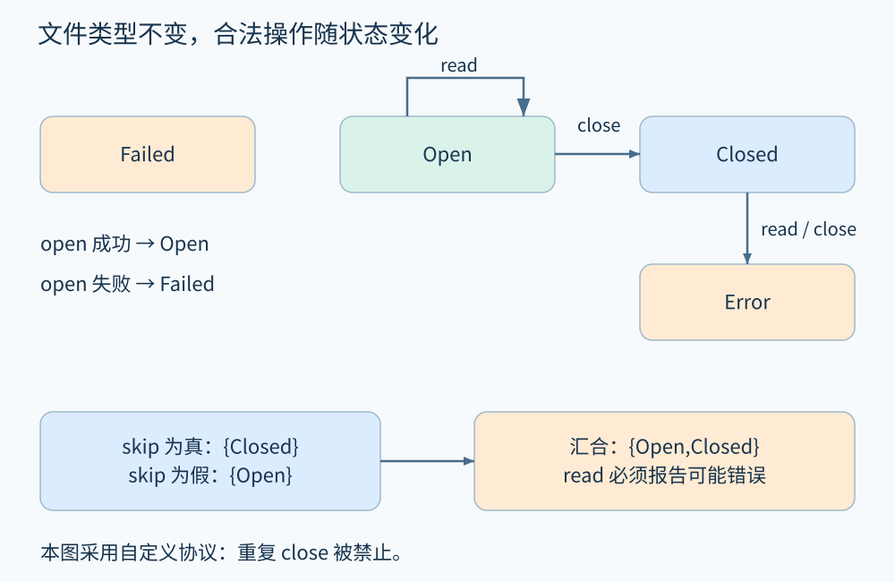
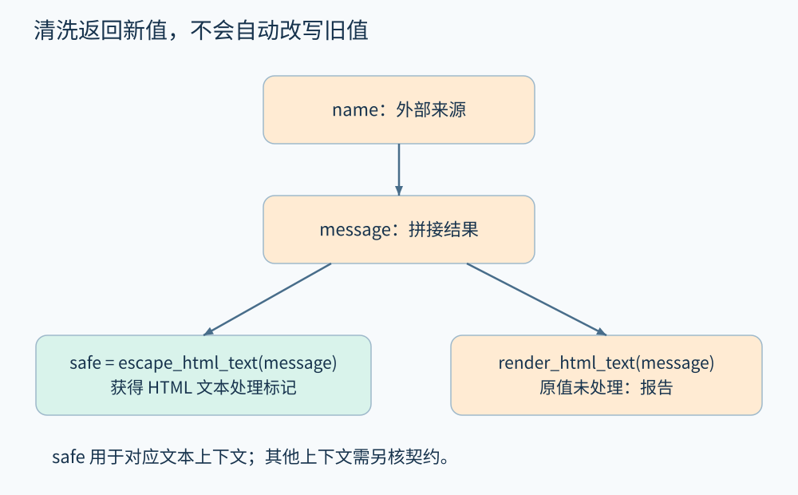

# 第 17 章 类型状态、资源与污点分析

变量的静态类型可能一直是 `File`，但刚打开和已经关闭的 File 允许的操作不同。对象类型回答“它是什么”，**类型状态**进一步回答“它现在允许做什么”。[Strom 与 Yemini 的原论文](https://research.ibm.com/publications/typestate-a-programming-language-concept-for-enhancing-software-reliability)把这类依赖上下文的合法操作纳入编译期检查。

与此同时，污点分析追踪数据来源及传播。它与类型状态都可以用事实传播实现，但追踪的性质不同。把它们组合起来很有帮助，把所有问题都改称 source 到 sink 则容易丢掉真正的规格。

## 17.1 为文件画一个小协议

先约定一个自定义文件 API，而不声称它等同于所有操作系统接口。`open` 成功产生 Open 状态，失败产生 Failed；`read` 只允许 Open；`close` 将 Open 变成 Closed；Closed 上再次 read 或 close 都是协议错误。

```text
f = open(path)
if f.failed:
    return
if skip:
    close(f)
read(f)
close(f)
```

成功路径上，f 初始为 `{Open}`。经过 skip 分支汇合，状态集合变为 `{Open,Closed}`。read 对 Closed 没有合法转换，因此分析器应报告“存在可能在关闭后读取的路径”，并给出 skip 为真的分支证据。不能因为集合里也有 Open 就接受整个操作。



图 17-1　协议图定义合法转换；下半的集合是静态分析结果。Closed 状态上的 read 会进入错误状态。原创精确示意。

如果协议允许重复 close，报告规则应相应改变。分析器检查的是指定 API 契约，不应把某个库的习惯推广成所有资源的普遍定律。

## 17.2 资源属于对象，不属于变量名字

将 `g=f` 后调用 `close(g)`，f 指向的资源也已关闭。只为变量名保存状态，会错误允许 `read(f)`。正确做法通常需要通过别名关系找到抽象资源对象，再更新资源状态。

若 g 可能指向两个文件，而当前模型不能判断究竟是哪一个，则把两个文件都确定改为 Closed 也可能错误；需要保留每个对象原状态和关闭后的可能状态，即弱更新。只有能确定目标代表单个相关对象时，才适合强更新。对象生命周期与抽象分配点之间的差别，也会影响这个判断。

资源泄漏更依赖**责任**。函数返回一个仍打开的文件，不一定泄漏，可能把关闭责任转交调用者。检查器需要知道借用、拥有和转移，不能简单规定“函数出口还有 Open 就报警”。异常、提前返回、取消与回调也必须纳入控制流；仅分析正常返回会漏掉常见清理路径。

## 17.3 污点是带有来源含义的事实

考虑自包含的日志展示功能：用户输入先拼接前缀，再交给 HTML 页面渲染。这里要检查的性质是“未经适合 HTML 文本上下文处理的数据，是否进入对应展示位置”。抽象事实可以记录 `user-controlled`，并为不同输出上下文保留处理标签。

```text
name = request_name()          // 外部可控来源
message = "Hello " + name     // 传播
safe = escape_html_text(message)
render_html_text(safe)        // 该上下文接受已转义文本
render_html_text(message)     // 需要报告未处理的数据流
```

例子的重点是：一次清洗返回了新值 safe，并不自动清洗原来的 message。[Clang 污点配置文档](https://clang.llvm.org/docs/analyzer/user-docs/TaintAnalysisConfiguration.html)把来源、传播、敏感使用位置和过滤规则分开建模；实际项目还须核实函数参数位置及语义。



图 17-2　青色路径获得 HTML 文本处理标记；橙色路径仍携带未经处理的来源。处理标记有上下文范围。原创精确示意。

把 source、sink、sanitizer 译成来源、敏感使用点和清洗操作有助于入门，但“敏感”依赖威胁模型。金额用于退款未必涉及字符串清洗；它可能需要范围、权限和订单身份验证。把 `int()` 当作通用 sanitizer，无法证明金额非负，更无法证明调用者有退款权限。

## 17.4 清洗、验证和隐式流

清洗改变数据表示，验证通过条件约束数据，二者不一定有相同模型。`if valid(name): render(name)` 的有效性仅沿条件为真的分支成立；把 `valid` 每次调用都无条件视为去污会错删风险。

处理能力也不能全局通用。HTML 文本转义的结果用于 URL、脚本或其他上下文时，需要重新检查契约。编码、解码、拼接与字符串切片还可能改变先前成立的保证。保留“适用于哪个上下文”的事实，往往比一个二元“干净/脏”标签更准确。

污点传播还分显式流和隐式流。`out=secret` 是显式传值；`if secret: out=1 else: out=0` 通过控制选择传递信息。只沿赋值数据边传播的分析可能漏掉后者。是否追踪隐式流取决于目标：严格信息流性质与常规输入传播检查所需的模型不同，开销和告警数量也不同。

## 17.5 组合状态，保留各自含义

文件路径既可能来自外部，也可能经过路径策略验证；文件句柄还具有 Open/Closed 状态；操作另需调用者权限。可以把这些维度组成乘积状态，但每个维度应保持明确含义。

例如“外部来源、已验证在允许目录内、句柄已关闭”同时成立时，路径策略没问题，read 仍违反生命周期协议。反过来，句柄处于 Open 也不意味着打开它的权限检查充分。报告应指出违反哪条性质、依赖哪个模型，避免把“可控”直接等同于“存在漏洞”。

现实工具常采用有限路径、库模型和启发式，不应仅因采用污点或类型状态方法就推断覆盖完备。对报告的复核应检查：对象身份是否正确、错误路径是否可行、外部模型是否符合实现、规格是否确实要求禁止该操作。

对订单状态也能建立类似协议：paid 允许发起退款，refunded 禁止重复执行同一退款动作。但真实幂等性还涉及请求身份和外部效果。只看到内存字段转成 refunded，无法证明网络重试不会重复付款。类型状态图适合表达局部协议，跨服务效果仍需更完整的状态与事件模型。

## 17.6 动手推演

`f=open_ok(); g=f; close(g); read(f)` 是否正确？如果污点字符串 x 经 `y=escape_html_text(x)` 处理，x 是否也取得相同处理保证？

**参考答案：**按本章文件协议，f 与 g 指向同一对象，read 违反关闭后的使用规则。字符串例子中，除非 API 明确原地修改 x，否则只给返回值 y 添加保证。两题共同要求追踪“哪个对象或值改变”，不能根据函数名称把相关变量全部改写。

## 本章资料

- [Strom、Yemini：Typestate: A Programming Language Concept for Enhancing Software Reliability，1986](https://research.ibm.com/publications/typestate-a-programming-language-concept-for-enhancing-software-reliability)。类型状态概念的一手出版页面。
- [Clang：Taint Analysis Configuration](https://clang.llvm.org/docs/analyzer/user-docs/TaintAnalysisConfiguration.html)。来源、传播、过滤及敏感点的官方模型说明。
- 文件协议与日志展示均为本书构造的教学模型，不代表对真实项目的安全结论。
