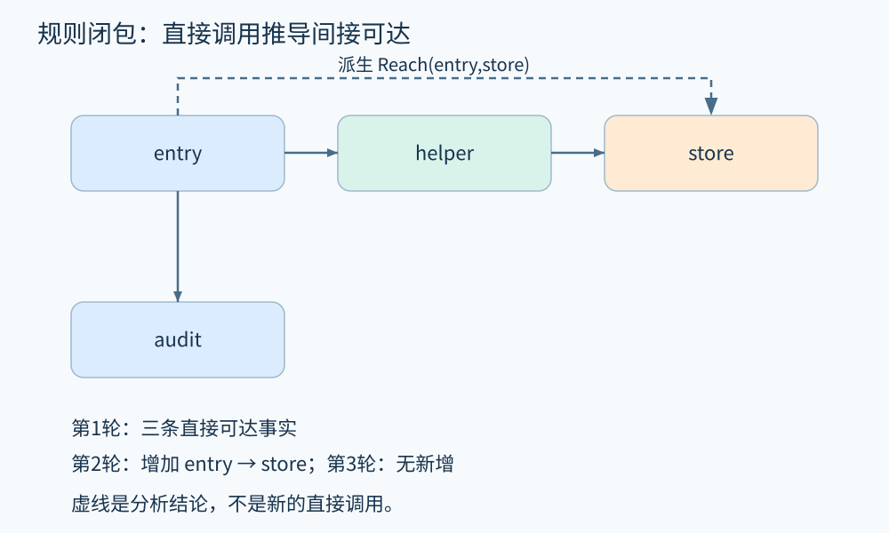
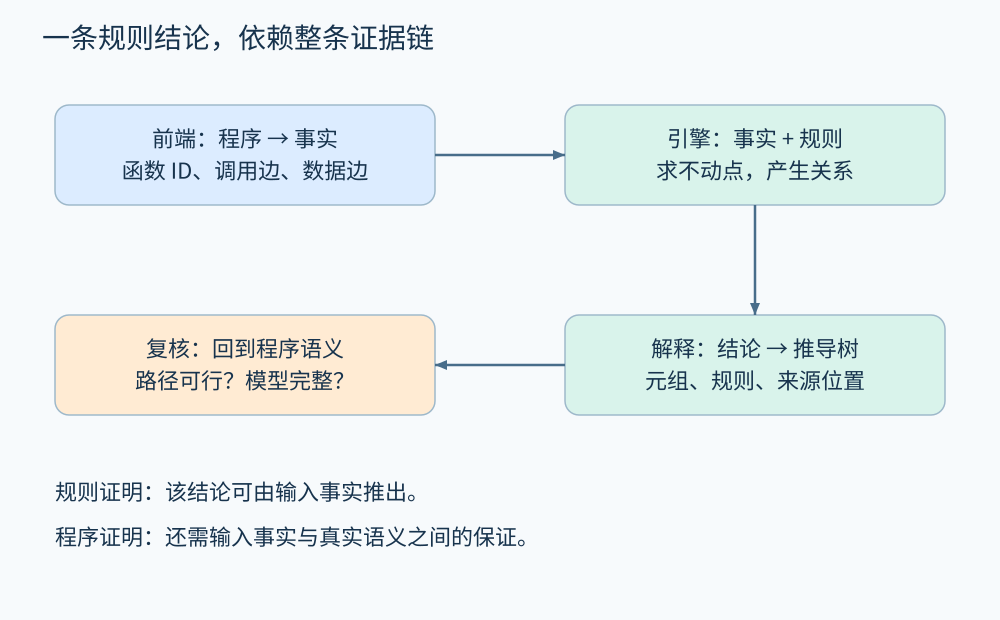

# 第 18 章 规则、Datalog 与查询式分析

前几章把分析写成循环和集合操作。另一条路线是先把程序转换成事实，再用规则声明“满足哪些关系就能推出什么”。分析器负责计算规则闭包，作者专注于性质。

这并没有消除算法。工作列表、不动点、索引和增量计算仍在引擎里。声明式表达改变的是职责分配：前端提取事实，规则描述推理，引擎安排求解，报告层解释结果。

## 18.1 从程序结构提取事实

考虑订单处理链：入口读取参数，helper 做金额校验，store 更新订单。先只讨论“可能调用到”，不声称调用会实际发生。

```text
Call("entry", "helper").
Call("helper", "store").
Call("entry", "audit").
```

每一行是关系表的一条元组。字符串可以换成稳定函数 ID，避免同名函数混淆。调用边可以来自语法、类型与指针分析；事实提取本身就可能存在近似。

以下使用 Soufflé 风格，定义非空调用路径的传递闭包：

```text
.decl Call(src:symbol, dst:symbol)
.decl Reach(src:symbol, dst:symbol)
.output Reach

Call("entry", "helper").
Call("helper", "store").
Call("entry", "audit").

Reach(x, y) :- Call(x, y).
Reach(x, z) :- Reach(x, y), Call(y, z).
```

`:-` 左边是结论，右边是条件；逗号表示这些条件都要成立。同名变量要求值相等。第二条规则说：如果 x 能到 y，且 y 直接调用 z，就能推出 x 能到 z。这是一段教学规则，读者运行时需安装兼容的 Soufflé；本章不声称已经在本机执行了该引擎。

[Soufflé 官方教程](https://souffle-lang.github.io/tutorial)提供了传递闭包及数据流规则示例。上面的程序对象与后续推演由本书自行构造。

## 18.2 一轮一轮推出新事实

初始 Reach 为空。第一轮根据直接调用得到三条事实；下一轮根据 entry→helper 与 helper→store，增加 entry→store；再下一轮没有新事实，达到不动点。

| 阶段 | 新增的 Reach 元组 |
|---|---|
| 初始 | ∅ |
| 直接边 | (entry,helper)、(helper,store)、(entry,audit) |
| 间接推导 | (entry,store) |
| 稳定 | 无新增 |



图 18-1　虚线表示从两条直接边推出的间接关系，不是源码里新增了一次函数调用。原创精确示意。

在有限域、没有生成无限新值的正 Datalog 中，事实只增不减，可能元组总量有限，因此这种求闭包过程会终止。工程求解器可使用半朴素求值，让新一轮围绕新增事实推导，减少重复工作。索引帮助匹配共享变量，规则连接顺序也影响成本。

但是使用扩展算术不断生成新数值，就可能失去终止保证。不能因为工具名字里有 Datalog，就假定所有扩展程序都必然结束。递归关系的规模还可能是输入规模的高次方：少量规则不等于小内存。

## 18.3 用规则表达事实传播

假设 `Flow(a,b)` 表示信息可以从值 a 传播到值 b，`Source(a)` 标记外部来源。可以写：

```text
.decl Flow(src:symbol, dst:symbol)
.decl Source(v:symbol)
.decl Tainted(v:symbol)

Tainted(x) :- Source(x).
Tainted(y) :- Tainted(x), Flow(x, y).
```

若事实包含 `Source("name")`、`Flow("name","message")`，便能推出 message 携带该来源。但是 Flow 必须来自语义模型：赋值、字段、返回、容器和调用都可能需要不同提取规则。只从变量名相似推边，得到的是可达关系的精确闭包，却不一定是正确的程序分析。

还要注意覆盖。把同名局部变量跨函数合并，会制造虚假传播；完全遗漏反射调用，则可能缺失真实传播。求解器对输入事实忠实，不等于输入事实对真实程序完整。



图 18-2　一个派生结论需要回溯到事实及其源码位置；最终可信度受整个链条约束。原创精确示意。

## 18.4 否定为什么需要格外小心

可以在确定的有限函数集合中查询“没有调用边到外部”的函数，但“数据库里没有记录”与“真实程序绝不发生”是两回事。前者使用当前事实集的闭世界解释；后者需要证明事实提取足够完整。

规则层的否定也受限制。[Soufflé 规则文档](https://souffle-lang.github.io/rules)要求否定满足分层约束，且否定中的变量需要被正向条件约束。直观上，先把被否定关系算稳定，再判断某个元组是否不存在；不能让两个关系通过否定互相递归、彼此撤销结论。

清洗规则更不能随意写成“有一条 clean 路径就不算污点”。在可能污点分析中，只要仍有一条未清洗的可行路径，风险就未被排除。若要把清洗位置建成传播屏障，应在明确的程序点和状态上限制边，或为已处理与未处理路径建立不同事实。把整个变量全局标为 clean，往往丢掉赋值时间和分支条件。

## 18.5 查询结果怎样变成可复核报告

假设引擎推出 `Tainted("message")`。报告还应该能回答：哪条 Source 事实触发？经过哪些 Flow？每条事实对应哪段源码？哪些边来自库模型？有没有在调用图中使用可能边？

这种推导依据称为 provenance，常译为溯源或推导来源。[Soufflé 的 provenance 文档](https://souffle-lang.github.io/provenance)描述了用证明树解释派生元组的机制。不过规则证明树仍不是实际执行轨迹：如果规则没有约束路径可行性，树中可能同时组合不相容的分支事实。

规则式分析适合结构化查询、关系闭包和一组共享事实上的多种检查。复杂数值关系、机器指令语义和时序协议则可能需要其他求解器或更丰富的事实编码。合理架构往往让图查询、数据流、约束求解和动态验证各自承担擅长的部分。

还应为事实保留版本。源码变化后新增调用边，正向闭包可以追加推导；删除边则可能使旧结论失效，不能只继续增加事实。需要重新计算受影响关系，或使用能处理删除的增量维护机制。规则自身变更同样会改变结论含义，应与输入版本一并记录。

调试一条错误报告时，先检查最底层事实，再检查连接条件和规则层次。如果前端把两个不同字段合成一个符号，修改最终报告文案不会恢复精度；如果事实正确而规则遗漏了参数位置，扩大事实集也不能修正错误连接。清楚划分责任能缩短定位过程。

## 18.6 动手推演

在调用事实中新增 `Call("store","helper")`。Reach 是否包含 `(helper,helper)`？是否包含 `(audit,audit)`？这份闭包能否证明 entry 每次都会调用 store？

**参考答案：**helper 经 store 再回 helper，存在非空环，因此包含 `(helper,helper)`；audit 没有回路，规则也没有加入零长度路径，因此不包含 `(audit,audit)`。Reach 表示可能沿调用边到达，不能证明每次执行都经过 store；还需分支条件和执行语义。

## 本章资料

- [Soufflé：Tutorial](https://souffle-lang.github.io/tutorial)。Datalog、闭包与数据流分析的官方教程。
- [Soufflé：Rules](https://souffle-lang.github.io/rules)。规则、变量约束与分层否定。
- [Soufflé：Provenance](https://souffle-lang.github.io/provenance)。派生元组的解释机制。
- 本章规则与元组序列为阅读推演，没有以理论推演冒充工具实测。
