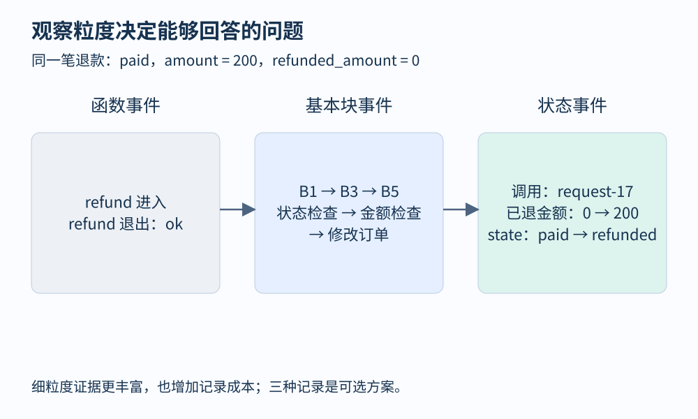
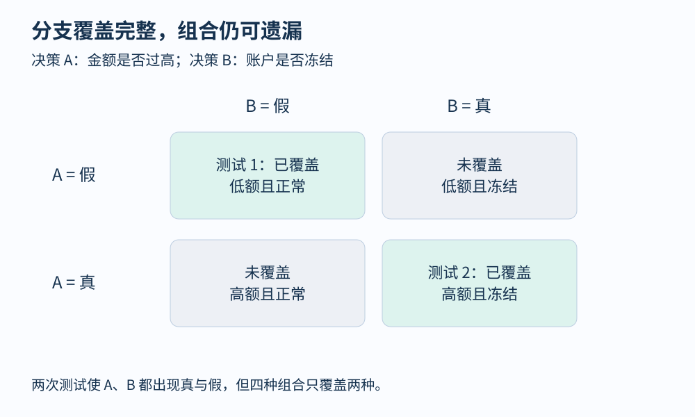

# 第 19 章 插桩、轨迹与覆盖率

程序图说明“可能发生什么”，执行记录则说明“这一次发生了什么”。动态分析的第一步通常是选择观察点，把原本转瞬即逝的行为变成证据。观察点放在哪里、记录什么、漏掉什么，直接决定后续结论的含义。

## 从一笔退款留下的记录开始

下面是本书订单服务的简化版本。金额以整数分计，单线程调用，字典读取不会产生外部副作用。

```python
def refund(order, amount):
    if order["state"] != "paid":       # B1
        return "state-error"           # B2
    if amount <= 0:                     # B3
        return "amount-error"          # B4
    order["refunded_amount"] += amount         # B5
    order["state"] = "refunded"
    return "ok"
```

输入 `state="paid", refunded_amount=0, amount=200` 时，块轨迹可以记为 `B1, B3, B5`。如果改为记录分支，则留下 `B1→B3, B3→B5`。如果还想解释退款金额如何变化，就需要增加前后状态、订单标识和本次调用标识。只记录函数进入退出，无法回答金额在第几步发生了错误。

**插桩就是在选定位置加入观测动作。** 可以修改源码，在编译器的 IR 中插入计数器，也可以在运行时、二进制翻译器或虚拟机层捕获事件。不同位置看到的对象不同：源码便于关联业务，IR 便于统一语言结构，机器层更贴近实际指令，但恢复变量含义更费力。事件不一定写入日志，也可能只增加内存中的计数。



图 19-1：进入函数、基本块与状态事件的粒度不同。最右列只是教学日志格式，不代表应在生产记录全部业务数据。

[Clang 的源码覆盖率文档](https://clang.llvm.org/docs/SourceBasedCodeCoverage.html)展示了“编译插桩—执行生成 profile—汇总报告”的工作流。它还说明未插桩代码不会进入覆盖统计。因此，报告的统计总体必须明确，不能把一个已插桩模块的结果当成整个应用的结果。

## 覆盖率是一组不同的问题

语句覆盖关心语句是否执行过，分支覆盖关心分支结果是否出现过，路径覆盖关心完整的决策序列。条件覆盖与 MC/DC 则进一步区分复合条件中各个条件的作用。它们不能仅凭一个“百分比”互相替代。

假设退款策略包含两个独立决策：金额是否超过上限、账户是否被冻结。四个组合是“低额且正常、低额且冻结、高额且正常、高额且冻结”。两次测试分别使用第一、第四个组合，两个决策都见过真和假，但另两个组合从未执行。**分支覆盖完整，并不意味着路径组合覆盖完整。** 加上循环后，路径数还会随迭代次数增长。

| 观测指标 | 能支持的判断 | 不能直接支持的判断 |
|---|---|---|
| 函数覆盖 | 某函数曾进入 | 函数中的关键分支已测试 |
| 分支覆盖 | 被统计分支的结果曾出现 | 所有分支组合与状态都已测试 |
| 计数 | 某位置执行频次 | 具体调用顺序和因果关系 |
| 完整轨迹 | 被记录事件的先后次序 | 未记录事件没有发生 |

[SanitizerCoverage](https://clang.llvm.org/docs/SanitizerCoverage.html)提供面向检测与测试的覆盖插桩机制。这里需要区分“作为测试反馈的边覆盖”和“供人阅读的源码覆盖报告”：二者用途相邻，数据形式和统计语义未必相同。

## 一份小报告怎样读

教学上可以把覆盖信息写成集合。设控制流边全集为 `E`，各次执行观测到的边集为 `E1, E2, …`，累计边覆盖是这些集合的并集，再与 `E` 比较。关键是分母是否确实已知：动态加载模块、禁用插桩的依赖和生成代码都可能使统计边界发生变化。

```python
seen = set()
for trace in test_traces:
    seen.update(zip(trace, trace[1:]))
```

这段代码只计算记录中相邻块对。真实分析器必须处理函数边界、递归、异常跳转和缺失事件，否则两个不同调用可能被误连成一条不存在的边。事件流还应携带线程与调用身份，不能把所有线程的块号直接拼接。



图 19-2：两个测试覆盖两个决策的真、假结果，但只访问了四种结果组合中的两种。覆盖率的意义来自统计定义。

## 记录本身会改变系统

频繁写日志会增加延迟、竞争与内存占用；插桩还可能改变调度，使原本偶发的问题暂时消失。性能诊断常用采样降低开销，但采样可能错过很短的函数和罕见事件。完整轨迹保留更多细节，却需要处理大数据量、缓冲区溢出和时钟关联。

事件设计宜从问题倒推：验证退款状态转换时，记录转换前后状态与调用标识；研究 CPU 热点时，采样调用栈可能更合适。对敏感字段只保留分析必需的最小信息。跨进程单调时钟通常不能直接比较，墙钟接近也不等于因果先后，关联请求身份比简单按时间排序更可靠。

一份可复查的动态报告应说明构建版本、输入、观测范围、采样或丢弃策略、工具配置及失败现象。缺了这些条件，“没有看到错误”可能只是没有观察到相关代码。动态证据最有价值的地方，是把推理约束到一条真实发生过的轨迹，再用静态结构定位尚未探索的分支。

## 轨迹完整性也是一个需要验证的性质

设本来执行了 `B1,B3,B5`，缓冲区却丢掉 `B3`，分析器会把相邻事件误连成 `B1→B5`。这条边可能根本不存在。较好的格式包含序号与丢失标记，让下游把该段解释为“不完整”，并回到控制流图检查，而不是默默补齐。日志聚合发生重复时，计数也可能被放大，因此需要明确事件是否去重、批次是否幂等。

对覆盖率还应说明统计层次：同一源码位置经过内联可能产生多个实例，优化也可能折叠分支。两个不同构建的边标识通常不能直接拼到一起。比较覆盖变化时应固定代码版本或建立可靠映射，保存原始计数和定义，再讨论百分比。一个新版本增加了许多未执行代码，即使旧测试完全没有退步，覆盖比例也可能下降。

## 观察练习

把退款函数中的两个检查位置互换。对“状态错误且金额为零”的输入，原版本和新版本分别返回什么？如果测试只断言“退款失败”，语句覆盖也完整，能否发现行为变化？

参考答案：原版本返回 `state-error`，新版本返回 `amount-error`。粗粒度断言无法区分它们；覆盖率也不包含返回值规格。应先明确错误优先级是否属于对外契约，再增加相应断言。观察点、输入与判定标准缺一不可。

## 本章资料

- [Clang：Source-based Code Coverage](https://clang.llvm.org/docs/SourceBasedCodeCoverage.html)。覆盖统计的实际流程与边界。
- [Clang：SanitizerCoverage](https://clang.llvm.org/docs/SanitizerCoverage.html)。编译器级覆盖插桩。
