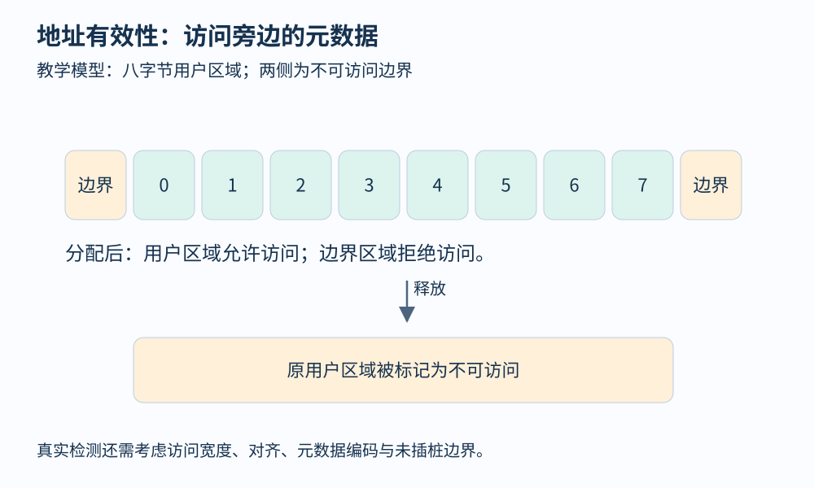
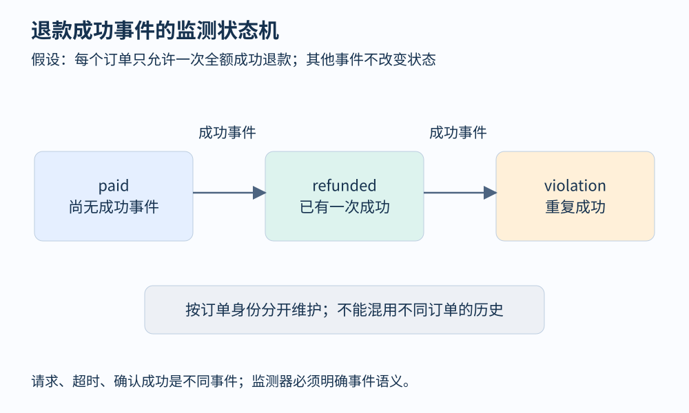

# 第 20 章 动态检测、Sanitizer 与运行时验证

知道某行代码执行过，还不足以判断它是否正确。动态检测在事件发生时检查额外性质：这次访问是否越过对象边界，这两个线程的访问是否存在同步关系，这个订单是否进行了非法状态转换。检测器能够发现什么，取决于它维护的元数据与规则。

## 在普通访问旁边维护另一份状态

设一个文件处理程序分配了长度为八的缓冲区。程序本身只保存地址；检测器还可以保存“哪些地址目前允许访问”。分配时将相应区域标记为可用，释放时改为不可用，每次被插桩的访问先查询标记。它让机器原本不会立刻拒绝的错误，在更接近发生位置的地方暴露。

[AddressSanitizer 官方文档](https://clang.llvm.org/docs/AddressSanitizer.html)说明它由编译器插桩与运行时库组成，可检测多类越界和释放后使用等内存错误。这里以“有效性地图”解释思路，真实实现使用更紧凑的影子内存编码，并非给每个字节配置一个独立对象。



图 20-1：教学图以八格表示用户区域。检查依据包含访问宽度；开始地址可用不代表整个多字节访问都有效。

动态检测往往需要维护程序原本没有的信息。检测未初始化值，需要追踪值的初始化状态；检测资源误用，需要追踪资源生命周期；检测数据竞态，需要记录访问与同步。它们不是把某个开关调高就能统一解决的问题。

| 检查方向 | 所需信息 | 一个典型局限 |
|---|---|---|
| 地址有效性 | 分配、释放与访问范围 | 业务上读错了合法对象，可能不报警 |
| 未初始化值 | 值的初始化来源与传播 | 未插桩边界可能丢失信息 |
| 数据竞态 | 访问身份、线程与同步关系 | 只有执行中相关访问被观测，才有证据 |
| 业务状态 | 状态机与事件身份 | 规格写错也会产生误判 |

## 使用时应保留定位证据

以下是给自己项目构建检测版本的常见形式，命令说明用途，未声称在本书环境中执行过：

```bash
clang -O1 -g -fsanitize=address -fno-omit-frame-pointer file.c -o file-check
./file-check
```

符号与栈信息有助于将报告映射回源码。出现报告后应保留触发输入、构建标识、分配栈、释放栈与访问栈，再定位根因。报告指出“此处发生非法访问”，并不自动指出“哪次更早的所有权转移设计错了”。修掉报警位置而不检查生命周期，可能只是改变错误出现方式。

有些运行时不能组合使用，有些检查具有平台与构建限制。应按工具文档分别配置检测构建，验证依赖是否也得到合适插桩。不能把调试构建的运行时间直接与正常发布版本比较，更不能把检测器当成生产隔离机制。动态检测的目标是暴露缺陷，并非保证在恶意输入下继续安全服务。

## 把业务规则编成监测器

退款服务还需要一条内存检测器无法理解的规则：“同一订单至多成功退款一次”。假设业务仅允许全额退款，事件中记录订单标识和状态，便可以设计三态监测器：`paid`、`refunded`、`violation`。第一次成功事件将状态变为 `refunded`，第二次成功事件进入 `violation`。

```python
def observe(state, event):
    if event != "refund_success":
        return state
    if state == "paid":
        return "refunded"
    return "violation"
```

这里的状态属于监测器，并不直接等同于数据库字段。若监测器只读取应用自己报告的“成功”，应用漏报事件就会制造盲点；若允许部分退款，三态规格又太粗。规格应结合支付协议与业务约束，而不是套用一个通用名字。



图 20-2：监测器按订单分别维护状态。一次事件的合法性依赖过去已经观测到的历史。

对于单个监测器实例，上述规则针对有限事件前缀就能发现违规，这类性质适合在线报警。但“一个已接受任务最终完成”涉及未来：如果任务尚未完成，系统可能只是还在工作。超时规则能建立实用边界，却把“最终”改成了“在给定期限内”。这一差异在第 24 章讨论安全性与活性时会再次出现。

## 检测无异常与程序正确之间还有多远

一次检测运行无异常，至少受三类条件限制：相关路径是否执行，相关位置是否可观测，相关性质是否在检测范围内。合法地址中的错误金额、正确同步下的重复退款，都可能越过内存和竞态检查。

动态检测适合与回归测试结合：先保留能够稳定触发问题的最小测试，再修复原因，最后确认修复前后的行为差异。若问题依赖偶发调度，还应保留调度或重放证据。对不可复现报告，不应仅凭一次“现在没报”就关闭问题。

运行时监测也有工程成本。按订单保存无限历史会耗尽内存；删掉旧状态又可能漏掉很晚到达的重复事件。因此需要明确保留窗口、订单终结条件、持久化与恢复策略。分析方法落地以后，分析器自身也是一个需要保证正确性的程序。

## 合法地址中的错误更需要语义

考虑一个结构体同时保存 `paid_amount` 和 `refunded_amount`。程序原本应读取后者，却误读前者；地址完全有效，两个字段也都初始化过。即使内存检测器没有报警，退款计算仍可能出错。类似地，在一个较大的分配对象内部越过逻辑子区域边界，未必触及检测器所维护的对象边界。这提醒我们先确定检测器“对象”的定义，再解释阴性结果。

状态监测可以补上部分语义，但需要明确资源身份。文件描述符关闭后可能被重新分配；若仅按整数编号串联全部历史，就可能把新文件当成旧文件的复活。订单也可能有版本、分片或重建过程。将编号与生命周期世代联系起来，才有机会正确判断先后与责任。这些细节连接了本章的动态检测与前面介绍的对象模型。

## 观察练习

监测器把 `refund_requested` 当成成功事件。第一次请求网络超时后，用户重试并真正成功，监测器报告“重复退款”。这属于什么问题？

参考答案：事件语义与规格不匹配。请求不等于提交成功，超时也不等于失败。需要区分请求、外部确认、提交结果及幂等键，按明确协议判断；简单屏蔽第二次事件会掩盖真实重复成功。这个例子也说明误报可能源于环境建模，而非检测算法本身。

## 本章资料

- [Clang：AddressSanitizer](https://clang.llvm.org/docs/AddressSanitizer.html)。检测能力、编译方式及使用限制。
- [Clang：ThreadSanitizer](https://clang.llvm.org/docs/ThreadSanitizer.html)。并发数据竞态检测的官方说明。
