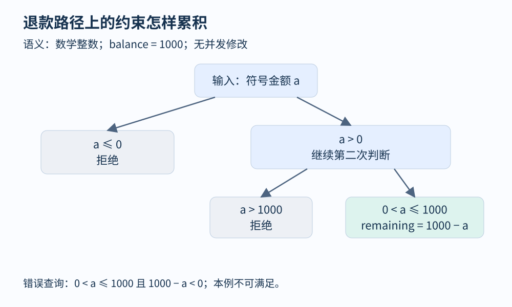

# 第 21 章 符号执行、SMT 与路径爆炸

普通执行给金额赋值 `200`，符号执行则暂时保留一个未知量 `a`。遇到分支时，不急着挑一个方向，而是记录“什么输入能走到这里”。这样，一条执行路径就变成了一组约束；求解约束可以生成输入，也可以证明某条候选路径在当前模型下不可行。

## 把退款条件变成公式

下面使用数学整数，忽略并发与外部支付副作用。初始余额 `balance=1000`，要求退款金额为正且不超过余额。

```text
if a <= 0:
    return reject
if a > balance:
    return reject
remaining = balance - a
assert remaining >= 0
```

执行器的状态至少包含当前位置、符号存储和路径条件。进入第一个分支时分成两条：`a≤0` 返回，`a>0` 继续。第二条再分成 `a>1000` 返回，以及 `a≤1000` 继续。于是抵达断言的条件是 `0<a≤1000`，存储中 `remaining` 对应表达式 `1000-a`。

检查断言的方法是询问：路径条件与断言的否定能否同时成立？

`0<a≤1000 ∧ 1000-a<0`

它不可满足，因此当前路径中该断言成立。这个结论只涵盖已建模的路径、数学整数语义和明确前提，不能直接推到固定宽度整数、外部函数或所有未来版本。



图 21-1：灰色路径正常拒绝；蓝色路径抵达断言。检查不是猜一个输入，而是求解路径条件与错误条件的合取。

## SMT 求解器做了哪一部分工作

SMT 是在背景理论下判断逻辑公式能否满足。理论可以描述整数、实数、位向量、数组等。[Z3 作者的教程](https://z3prover.github.io/papers/programmingz3.html)解释了这些对象与求解接口。程序分析器负责把程序行为编码为公式，求解器负责回答编码后的问题；如果编码遗漏副作用，求解器并不会替作者补齐。

在安装相应 Python 包后，可以用下面的教学片段表达刚才的问题；这里展示接口和预期逻辑结果，未将其记为环境实测。

```python
from z3 import Int, Solver
amount = Int("amount")
s = Solver()
s.add(amount > 0, amount <= 1000)
s.add(1000 - amount < 0)
print(s.check())  # 此公式预期为 unsat
```

`sat` 意味着找到满足赋值，通常可以提取一个模型作为候选输入；`unsat` 意味着给定公式不可满足；`unknown` 则需要检查原因，例如理论限制或资源预算。超时也不能改写成“没有问题”。求解器返回的模型还应在真实程序中重放，检查环境编码是否吻合。

数学整数没有机器整数的宽度限制。若分析八位无符号计数器，`255+1` 的机器结果与整数理论不同；若使用 C 有符号数，还要考虑语言对溢出的规定。位向量可表达固定宽度运算，却不自动包含全部语言规则。选择理论本身就是语义建模的一部分。

## 路径数量为何迅速失控

若有 `n` 个可独立取真假的分支，完整组合最多有 `2^n` 个。循环把分支继续复制，递归、符号指针、外部环境又增加选择。实际路径之间可能存在矛盾，因此执行器需要求解后剪枝，但每次剪枝也消耗时间。

[KLEE 的官方入门教程](https://klee-se.org/tutorials/testing-function/)以符号输入探索函数的不同分支，并提示较大程序可能因资源限制留下未完成路径。使用符号执行时应记录未完成情况，而不是只展示生成了多少测试。

| 控制策略 | 得到的好处 | 必须保留的限制说明 |
|---|---|---|
| 限制循环展开深度 | 将搜索规模约束在预算内 | 更深执行仍未探索 |
| 优先新代码或目标位置 | 更快获得有用测试 | 排队较后的路径可能长期遗漏 |
| 状态合并 | 减少独立状态数 | 表达式可能更复杂、更难求解 |
| 函数摘要或环境模型 | 减少重复展开 | 结论依赖摘要与模型的准确性 |


图 21-2：合并状态减少队列项，却可能把多条路径编码进更大的公式。限制深度保留的是有界结论。

符号执行还可以用于构造正常边界测试。例如求“合法的最小正退款金额”，或比较修订前后函数是否存在返回不同的输入。并不是所有任务都要从“找到崩溃”出发。把目标写成明确性质，往往比漫无目的探索所有路径更有教学和工程价值。

## 环境调用与符号内存是第二道难关

假设退款前需要查询 `is_frozen(account)`。若执行器把它无条件替换成假，模型就删除了冻结分支；若把结果视为任意布尔值，又可能生成真实服务永远不会返回的组合。前者可能遗漏行为，后者可能引入不可实现路径。函数模型应说明依赖哪些参数、读取哪些状态、可能修改什么，并保留真实重放作为核对步骤。

指针同样不能只当普通整数。对 `p[i]` 的一次读取，需要知道对象大小、索引范围、有效生命周期及可能指向的对象。若 `p` 可能指向多个对象，执行器可以分叉选择，也可以使用更复杂的内存表达式；无论哪种方式都要付出成本。路径数量只是规模困难的一部分，单条路径上的公式也可能非常昂贵。

候选反例中还应保存路径前提。例如求解器找到 `a=1001`，只说明它满足某个查询；如果函数入口本来规定 `a≤1000`，但编码忘了加入这个前置条件，反例就不适用于该接口。反过来，错误添加入口不存在的限制，又会掩盖真实问题。检查公式的来源与检查求解结果同样重要。

符号分析结果可以按证据强度整理：尚未求解的候选位置、在模型中可满足的错误路径、真实程序中可重放的失败，以及修复后保留下来的回归案例。四者不应全部统计为“确认缺陷”。对不可满足路径，也应保留查询所属的构建和前提；程序变化后，旧的不可达结论可能需要重新计算。

## 练习：一道不可行路径

设 `a` 是数学整数，执行 `if a>100` 后，真分支内部又执行 `if a<50`。内层真分支为什么不能靠增加随机测试到达？如果变量在两次判断间被其他线程修改，结论是否保持？

参考答案：同一个不变符号值需要同时满足 `a>100 ∧ a<50`，公式不可满足。随机测试无法命中不存在的输入。但如果两次读取来自可变共享位置，应分别建模读到的值和同步条件；把它们擅自当成同一个符号，会错误剪枝。路径约束的正确性首先取决于状态建模。

## 本章资料

- [Bjørner 等：Programming Z3](https://z3prover.github.io/papers/programmingz3.html)。SMT 理论、模型与交互式求解。
- [KLEE：Testing a Small Function](https://klee-se.org/tutorials/testing-function/)。符号输入、分支探索与测试生成。
