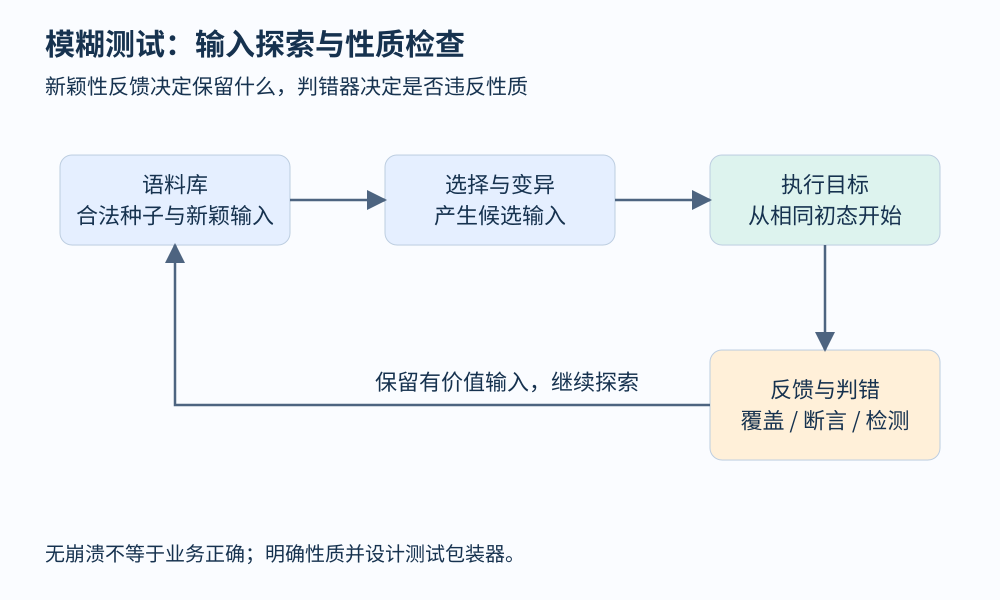
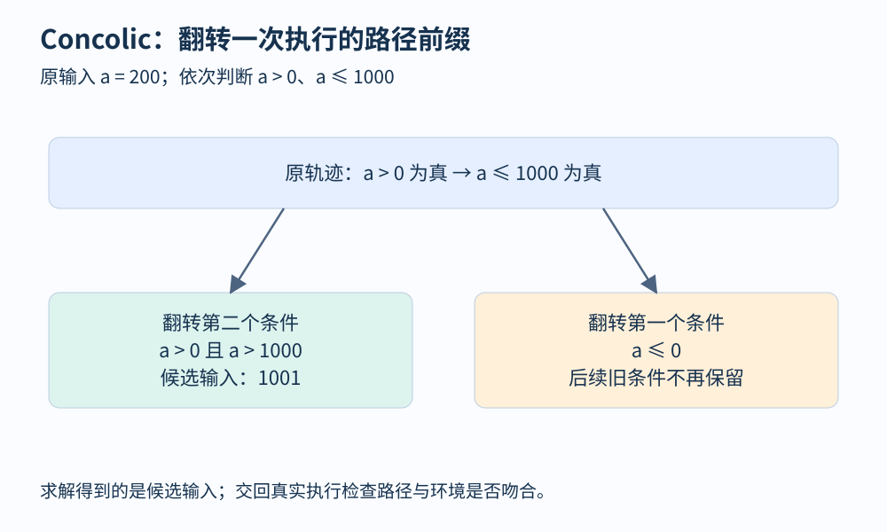

# 第 22 章 模糊测试、Concolic 与混合分析

动态检测器能够判断一次执行是否违反某类规则，但它通常不负责选择下一次输入。模糊测试把输入生成、程序执行和反馈组成循环：不断尝试新输入，保留有价值的发现，再以这些发现继续探索。它与符号执行的一个重要区别，是可以直接依靠真实执行提供大量反馈。

## 从随意输入变成有方向的探索

假设我们有一个自写的小型订单消息解析器。输入格式是三字节标记 `ORD`，随后是两字节金额；解析器必须拒绝短消息，并把合法金额交给退款规则检查。教学中只测试这个自包含程序，不连接真实支付或外部服务。

纯随机五字节输入大多在标记检查处返回。覆盖引导的变异式模糊测试可以从合法种子出发，改变其中少量字节；若新输入触达此前未见的边，便保留到语料库。语料库保存的是未来探索的起点，不是每一次执行的全部记录。

图 22-1：反馈环把“哪些输入值得继续探索”变成持续决策。判错规则与新颖性反馈承担不同职责。

[AFL++ 官方文档](https://aflplus.plus/docs/)将插桩、准备、运行与管理测试活动分开说明。对实践而言，先把目标函数封装正确，与选择变异策略同样重要：每轮应能在相同初态下重放同一输入，避免上一次测试留下的状态支配下一次结果。

例如，若解析器内部累计退款总额，每轮不重置订单，语料文件单独运行可能成功，在长时间测试中却失败。这可能暴露真正的序列问题，也可能是测试包装器违反了目标接口约定。必须先说明测试的是“独立请求”还是“请求序列”，两种任务不能混在一个模糊的初始条件里。

## 进入新路径不等于发现错误

覆盖反馈告诉测试器“这里比较新”，判错器才告诉它“这里违反性质”。判错器可以是崩溃、Sanitizer 报告、断言、超时或业务不变量。它们的语义不同：超时可能来自慢路径、死循环或环境抖动；两个实现输出不同，也需要规格判断谁错。

对订单解析器，可以明确三条性质：任何输入均不得造成非法内存访问；被接受的金额必须为正；被拒绝输入不得改变订单状态。后一条需要比较执行前后状态，操作系统不会自动替我们判定。

| 输入生成方式 | 优点 | 常见困难 |
|---|---|---|
| 字节变异 | 起步简单，可直接作用于文件 | 容易破坏结构或校验字段 |
| 语法/结构生成 | 更容易进入深层语义处理 | 语法与生成模型需要维护 |
| 状态化序列生成 | 可以探索跨请求性质 | 状态重置、序列最小化更复杂 |
| 约束求解生成 | 可跨越某些难满足条件 | 编码、环境模型与求解成本较高 |

## Concolic：带着实际值做符号记录

Concolic 将 concrete 与 symbolic 结合。一次运行仍采用具体输入，同时为被支持的输入相关表达式维护符号约束。运行结束后，可以选择一处分支，保留它之前的路径条件，把该分支条件取反，求得下一组候选输入。

用极简整数例子观察：程序先检查 `a>0`，再检查 `a<=1000`。输入 `a=200` 走过两个真分支，记录 `a>0 ∧ a<=1000`。若要探索第二个判断的假分支，求解 `a>0 ∧ a>1000`，例如得到 `1001`。若翻转第一个判断，则只需 `a<=0`，不应继续强加原来第二个分支的条件。

图 22-2：翻转第 k 个条件时保留此前路径前缀。后续条件属于旧路径，不能机械照搬。

## 混合分析怎样交换信息

一个实用的组合是让快速变异承担广泛探索，再把长时间受阻的局部分支交给符号组件。符号组件产生候选输入后，交回真实执行验证，并把有用输入加入语料。也可以反过来用静态切片缩小求解范围，用动态轨迹确定调用环境。

交换的对象应具体：输入、构建标识、目标位置、路径前缀、必要环境和性质，而不只是一个“可疑”的自然语言标签。若符号模型把校验函数简化为总是成功，得到的输入可能无法通过真实解析器；真实重放正是模型核对步骤。

混合并不保证全面。某个组件的盲区可能沿接口传递：静态筛选漏掉一个候选，后续动态组件就从未得到它；符号求解超时，变异器也未必最终进入深层状态。因此应分别报告执行预算、覆盖变化、求解失败、不可重放结果和已确认问题。

发现一个失败后，还要最小化。最小化尝试删除或简化输入，同时保留同一个判错条件。它能帮助定位必要因素，但最短输入不一定最能说明业务意图。应同时保留原始发现和适合回归的解释性案例，不按崩溃栈完全相同就武断认定根因相同。

## 怎样安排一次可解释的测试活动

开始前固定目标版本和构建方式，准备少量能够覆盖不同正常结构的种子，并加入明显不合法的短输入、空输入和边界金额。随后核对测试包装器确实调用到目标逻辑：如果所有输入都因配置缺失提前返回，再长的运行也只是在测试入口错误处理。对依赖状态的接口，应明确每轮重置还是保留序列。

结束时报告预算和结果分布，而非只报“跑了很多次”：执行了多久、覆盖了哪些目标区域、有多少可重放失败、哪些失败因环境不稳定尚待确认。比较两种策略时固定预算并重复运行，因为种子选择和变异存在随机性。某次运行先发现一个问题，并不能单独证明策略普遍更好。评估分析器时还会系统讨论这些实验条件。

## 观察练习

种子中只有合法 `ORD` 消息，测试一个小时后覆盖不再增长。能否断言解析器已测充分？下一步应该先增加随机强度吗？

参考答案：不能。应检查入口是否覆盖所有消息类型、格式与状态是否被包装器固定、反馈是否正常，以及判错器能否识别目标性质。增加结构化种子、序列测试或对受阻条件做局部求解，都可能比盲目加大变异更有价值。覆盖停滞描述搜索状态，不能证明全部行为正确。

## 本章资料

- [AFL++：Documentation](https://aflplus.plus/docs/)。测试活动的准备、反馈与管理。
- [KLEE：Testing a Small Function](https://klee-se.org/tutorials/testing-function/)。可与动态测试配合的约束驱动输入生成。
