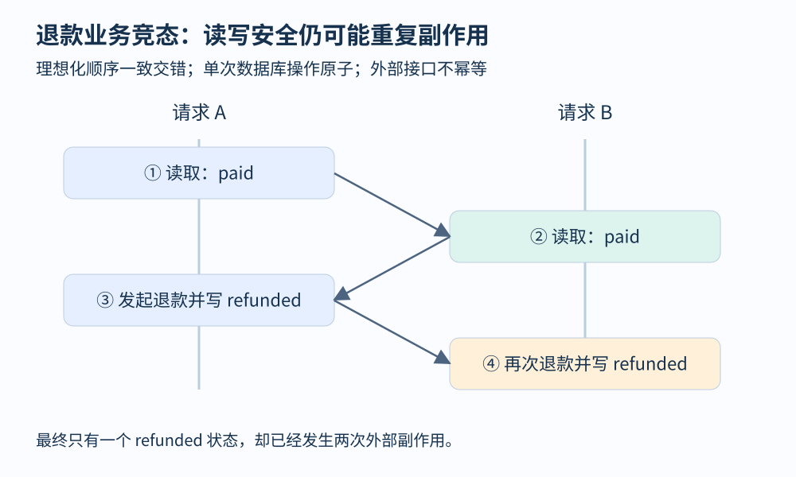
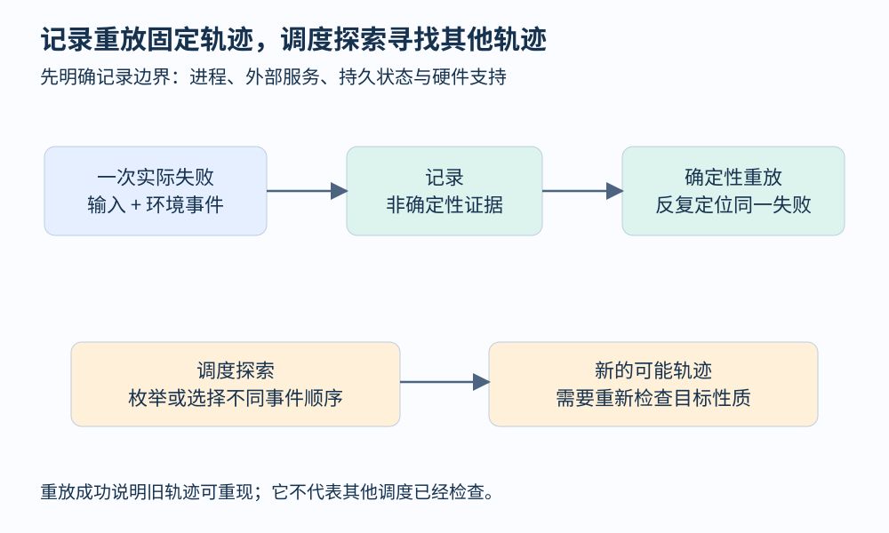

# 第 23 章 并发、异步与记录重放

同样的输入，两次运行却可能得到不同结果。线程调度、异步响应、时钟、随机数和外部 I/O 都可能带来差异。分析这些程序时，“输入”需要扩展为初始状态与环境事件；只保存请求内容，往往保存不住失败条件。

## 一个没有数据竞态的业务竞态

设两个退款请求都可以调用同一订单。下面以理想化的顺序一致执行说明问题：每一次数据库读写本身是安全、原子的，但整段流程不是事务。

```text
state = database.read(order_id)
if state == paid:
    issue_refund(order_id)
    database.write(order_id, refunded)
```

请求 A 读到 `paid`，请求 B 也读到 `paid`；A 发起退款，B 也发起退款；最后两个请求都把状态写成 `refunded`。最终状态看起来正确，但外部退款副作用发生了两次。



图 23-1：每个单独读写都可以合法，组合后的业务性质仍会被破坏。图中假设外部退款不自带幂等保证。

这叫竞态条件：结果依赖操作的时序。数据竞态则是语言内存模型中的更具体概念，涉及缺少规定同步关系的冲突内存访问。上面的数据库示例可能完全没有语言层数据竞态，因此不能期待线程检测器自动证明它安全。

解决办法也应对准性质。只给最后写状态加锁，不能阻止两个请求此前都完成检查。将检查与状态转换放入同一个原子协议，可以阻止重复领取；但外部支付调用与本地提交仍可能跨越不同系统，需要幂等键、恢复状态或事务协议。不能用“加了锁”替代完整的失败语义设计。

## 分析的是偏序，不只是时间线

并发事件至少有两类顺序：同一个线程内部的程序顺序，以及锁、消息等机制建立的同步顺序。把这些关系组合起来，可以讨论 happens-before，即“先发生”关系。它不是根据日志时间戳数值大小定义的。

[ThreadSanitizer 官方说明](https://clang.llvm.org/docs/ThreadSanitizer.html)将其定位为数据竞态检测器，采用编译器插桩与运行时支持。检测报告提供的是被观测访问与同步关系的证据；它不等于业务协议检查，也不穷尽所有未来调度。

若两个线程都读取共享只读配置，并没有冲突写访问；若同一对象的所有访问都受同一互斥锁保护，可以建立相关顺序。但锁保护了哪些字段、锁对象是否相同、对象发布是否正确，都需要明确。把两个名字都叫 `mutex` 的锁当成同一个锁，会给分析器制造虚假保证。

事件循环也有类似问题。单线程异步程序在 `await` 处让出控制权，另一个任务可能在恢复前修改共享状态。没有同时执行的 CPU 指令，仍可能出现“检查时成立、使用时已变”的逻辑竞态。协程身份与恢复点因此是轨迹中有用的信息。

## 记录重放要保存哪些不确定性

普通日志只保存挑选过的消息，记录重放则试图保存足够的非确定性，使执行能在支持范围内重现。例如系统调用结果、信号、输入数据及调度相关信息。它通常不需要逐条保存全部机器指令，而是结合确定性执行与外部事件恢复轨迹。

[rr 项目](https://rr-project.org/)的目标是记录一次失败，然后确定性重放并借助调试器反向执行。其支持的平台与工作负载存在具体条件，不能推广为任何操作系统、GPU 与分布式服务都可直接完整重放。



图 23-2：重放固定一条已经发生的轨迹；探索调度则寻找其他轨迹。二者回答不同问题。

对退款案例，应用级重放可以保存请求序列和模拟支付响应，却不自动恢复真实数据库内部调度。进程级重放能更接近一次本地执行，但外部服务仍有边界。分布式重放还要面对跨节点消息、持久状态和故障时机，不能把一个请求关联 ID 当成完整记录。

## 重现失败与探索失败

重放帮助回答“错误状态从哪里来”，调度探索帮助回答“还有哪些顺序会失败”。如果只有两个线程各执行两步，保留线程内部顺序的交错已有六种；步骤增多后组合迅速膨胀。系统化测试可以限制切换次数、枚举部分调度，或者利用独立性减少等价交错。

减少搜索的前提应可解释。两个事件若作用于独立对象、不会影响对方后续行为，交换它们可能不影响性质；两个退款对同一订单的操作显然不能据此合并。真实弱内存还会带来超出简单交错模型的行为，本章的顺序一致例子不能代替第 32 章的内存模型。

调试材料应保留代码版本、输入、初始持久状态、线程或任务身份、同步事件及外部结果。增加日志后故障消失，说明观测改变了时序，不说明问题已修复。更合适的策略是降低观测扰动、保存可重放证据，再围绕根因建立稳定回归。

## 原子操作的边界必须覆盖目标性质

一种修订是把订单从 `paid` 原子地改为 `pending`，只有成功修改者能够发起外部退款。它缩小了重复领取窗口，却引出恢复问题：若状态改好后进程崩溃，订单可能长期停在 `pending`；若外部成功后本地确认丢失，重试仍需识别同一操作。安全性与可恢复性应一起设计，不能用一处原子更新推导端到端恰好一次。

异步队列也类似。任务出队、标记处理中、执行副作用和确认完成，是不同的协议步骤。分析时先把每一步画出来，再标注哪些操作不可分割、哪些地方会失败或恢复。这样可以直接看出锁、事务或消息确认究竟保护了什么，也方便把实际轨迹与设计协议对照。

## 观察练习

两个请求的最终日志都写着“订单状态为 refunded”，数据库里也只有一条订单记录。为什么这些证据不能排除重复退款？

参考答案：最终状态会合并历史，无法区分一次或两次外部副作用。需要检查支付操作身份、幂等协议、确认事件及状态转换的原子边界。验证“最终状态正确”和验证“副作用至多发生一次”是两条不同性质。

## 继续阅读

线程交错之外，持久状态与外部服务会带来崩溃窗口。[分布式、持久化与崩溃恢复](49.md)用有限状态例子说明重复重送及去重假设。

## 本章资料

- [Clang：ThreadSanitizer](https://clang.llvm.org/docs/ThreadSanitizer.html)。数据竞态检测及限制。
- [rr：Recording & deterministic debugging](https://rr-project.org/)。记录、重放与反向调试。
