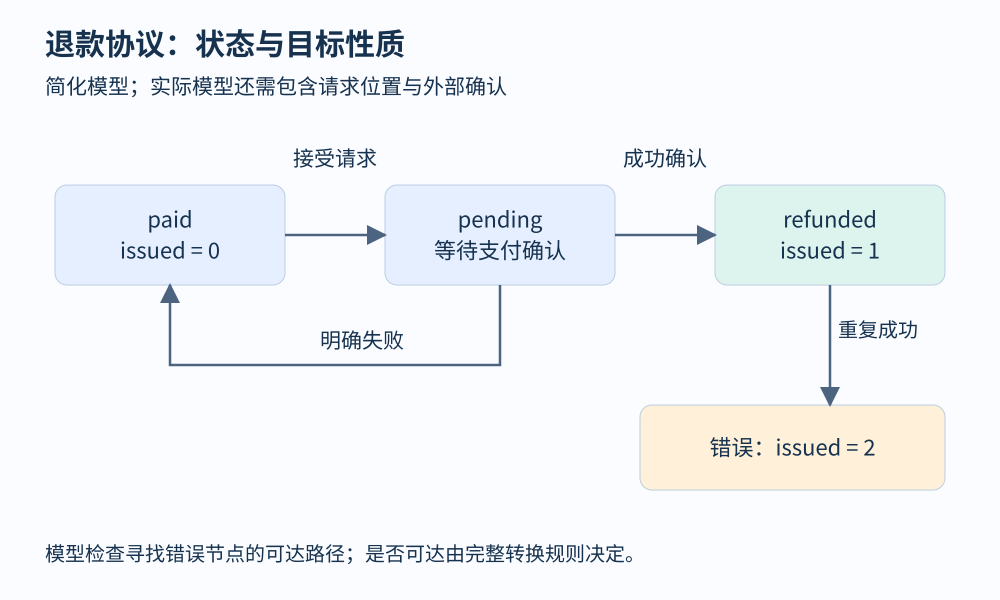
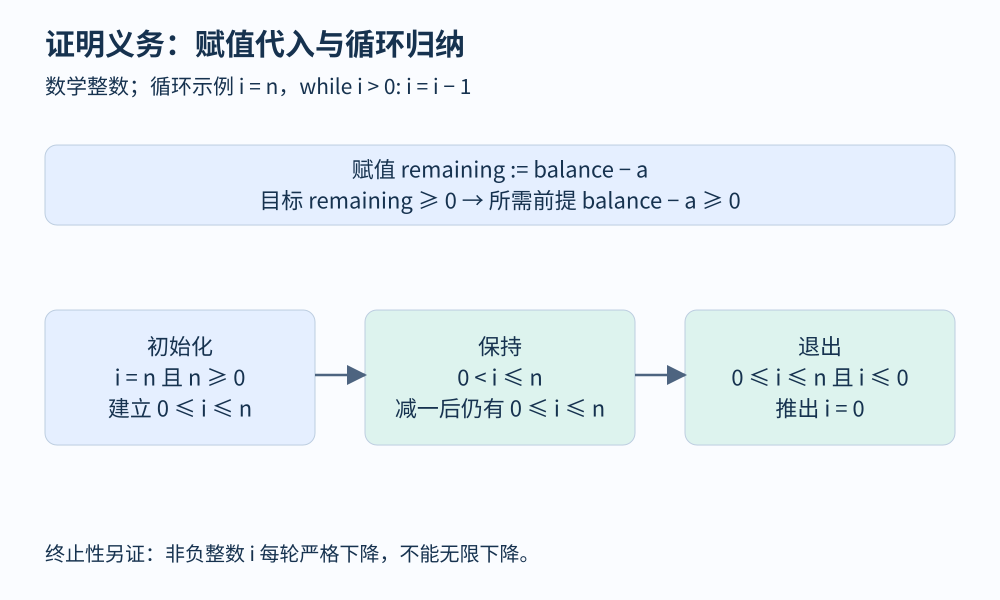

# 第 24 章 模型检查、契约与演绎验证

测试展示若干次运行，验证则尝试对明确模型中的一组行为建立结论。验证并不是一个不带条件的“正确”按钮：先要说清楚系统是什么、环境能做什么、希望保持什么，以及实际程序如何对应模型。

## 把退款协议缩成有限状态

设订单初始状态为 `paid`，收到合法退款请求后进入 `pending`，支付方确认成功后进入 `refunded`；若明确失败则回到 `paid`。为了讨论重复执行，我们再增加变量 `issued`，记录成功副作用次数。希望任何可达状态都满足 `issued≤1`。

状态并不是只有订单字段，还要包含正在进行的请求位置和外部响应。若模型只保留 `paid/refunded`，把外部调用细节全部压成一个原子转换，就可能从建模开始排除第 23 章的重复退款交错。模型越简洁越便于探索，但不能删掉与目标性质有关的区别。



图 24-1：错误节点表示被性质排除的状态。是否存在到达它的路径，需要结合完整的转换规则判断。

模型检查从初始状态出发，按转换规则探索可达状态，并检查性质。发现违反时，反例是一条具体的状态序列。若有限状态空间被完整、正确地探索且没有反例，可以对这个模型和性质给出结论。若只展开到一定步数，所得结论必须保留这个界限。

[SPIN 官方手册](https://spinroot.com/spin/Man/Manual.html)介绍了面向并发模型的模拟与验证；[Lamport 的《Specifying Systems》](https://lamport.azurewebsites.net/tla/book.html)则把状态、动作与系统规格联系起来。学习时应区分随机模拟一条轨迹与验证模型性质，它们不是同一种覆盖保证。

## 安全性与活性需要不同证据

“不会重复成功退款”属于安全性：一旦第二次成功出现，有限历史已经足以构成反例。“每个已接受请求最终得到明确结果”属于活性：一个很长的等待前缀本身不能说明永远不会完成。

活性结论往往需要环境和调度假设。例如支付方永久不回复，系统不能仅靠本地代码保证最终收到回复；一个任务一直可运行却永远不被调度，也无法完成。公平性描述某些动作不能无限期被忽视，但不同公平性条件强度不同，不能把“系统看起来公平”当作证明前提。

| 性质 | 反例形态 | 应追问的环境条件 |
|---|---|---|
| 成功退款次数至多为一 | 第二次成功出现的有限轨迹 | 外部接口是否幂等 |
| 余额始终非负 | 第一次出现负值的轨迹 | 金额与整数语义 |
| 每个接受任务最终完成 | 永久停滞或循环行为 | 调度、故障与回复假设 |

## 用契约限定函数责任

契约把函数的责任分成前置条件与后置条件。以数学整数退款计算为例：前置条件 `0<a≤balance`，后置条件 `remaining=balance-a ∧ remaining≥0`。调用者负责建立前置条件，函数负责在此前提下保证后置条件。

用 Hoare 三元组表示就是 `{P} C {Q}`。若命令是 `remaining := balance-a`，为了保证 `remaining≥0`，代入可得执行前需要 `balance-a≥0`。这种从目标反推前提的方法，是最弱前置条件思想的直观入口。

```text
前置条件：balance >= 0 且 0 < amount <= balance
remaining := balance - amount
后置条件：0 <= remaining < balance
```

这里金额为正，因此严格小于初始余额也成立。若允许零金额，后置条件就要相应修改。契约写得过强会拒绝合法调用，写得过弱则允许不希望的行为；证明通过不能代替规格审查。



图 24-2：循环需要不变量连接任意多次迭代。终止性还需要独立的下降度量。

## 循环为什么需要不变量

考虑把非负整数 `n` 倒数到零：初始 `i=n`，循环条件 `i>0`，每步 `i=i-1`。要证明退出时 `i=0`，可以选不变量 `0≤i≤n`。首先初始化满足它；其次在 `i>0` 时减一仍保持非负且不超过 `n`；最后将不变量与退出条件 `i≤0` 合并，得到 `i=0`。

这三步证明部分正确性，仍需解释循环会不会永远执行。`i` 是非负整数且每轮严格下降，可以作为终止度量。如果换成 `i=i+1`，某些不变量也许仍能成立，但下降证明失效。[Dafny 官方教程](https://dafny.org/dafny/OnlineTutorial/guide)把前后置条件、循环不变量和终止检查组织成可操作的验证流程。

本章推导使用数学整数和顺序执行，不包括机器溢出、外部异常及并发修改。演绎验证通常将程序与注解转换为验证条件，再交给求解器。未能证明既可能意味着程序有错，也可能意味着不变量不足、模型缺失或求解器资源耗尽，需要查看具体失败义务。

模型检查擅长显式行为组合与反例，演绎验证擅长利用归纳断言处理广泛输入和循环。它们可以组合：先用小模型发现协议缺陷，再为核心函数建立契约，并用测试核对实现与模型之间的连接。

## 反例先检查模型，再检查实现

小模型给出重复退款轨迹后，应逐步核对：初始状态能否在真实系统出现，动作是否对应可执行操作，环境回复是否满足实际协议。若模型把不可能的回复当成任意选择，反例可能是抽象带来的伪反例。修订模型需要有依据，不能仅因反例令人不便就删除行为。

无反例时也要反向核对：是否遗漏了重试、崩溃与恢复，是否把多步操作错误声明为原子，是否对队列长度和请求数量设了过小上界。抽象可以帮助证明，但需要解释抽象模型怎样覆盖实现行为。验证结果越强，对假设与对应关系的记录就越应清楚。实际项目通常把模型、契约、测试与运行证据并置，让不同方法检查彼此的盲区。

## 观察练习

验证器证明“前置条件成立时退款金额不超过余额”。实际接口从未检查这个前置条件。能否说接口已经安全？

参考答案：不能。函数结论是条件性的，入口必须检查输入，或由其他可靠机制建立条件。还要检查调用链、异常和外部效果是否符合模型。一个局部证明可以很强，但组合系统需要把每一段的假设真正接起来。

## 本章资料

- [SPIN：Basic Manual](https://spinroot.com/spin/Man/Manual.html)。并发模型与验证流程。
- [Leslie Lamport：Specifying Systems](https://lamport.azurewebsites.net/tla/book.html)。系统规格与活性、公平性的进一步阅读。
- [Dafny：Getting Started](https://dafny.org/dafny/OnlineTutorial/guide)。契约、循环不变量与终止性。
