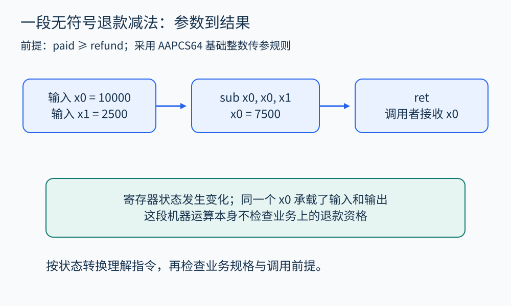
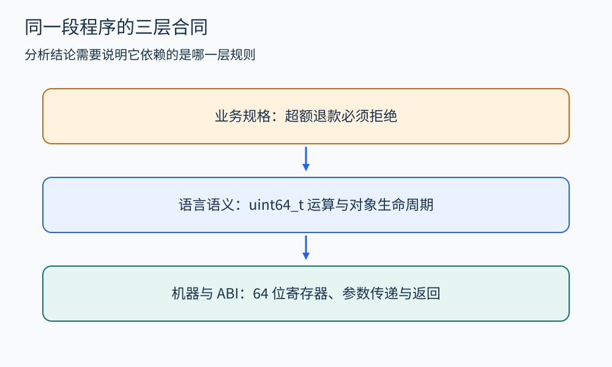

# 第 25 章 CPU、ABI 与机器级程序行为

一段退款代码在源码里只有一次减法。执行时，它却要经历参数传递、整数运算、返回，以及可能的内存访问。分析源码能保留订单的业务含义，分析机器代码则能看见真实的位宽、调用约定和访存行为。两种视角之间需要一座桥。

## 先规定我们在观察哪一层

可以把一个简化机器状态写成 `〈PC, R, M〉`：PC 是下一条指令的位置，R 是寄存器集合，M 是内存。每条指令把旧状态转换成新状态。这里先忽略异常、向量寄存器和并发，让读者看清最小模型；遇到浮点、设备或多线程程序时，必须补足相应状态。

CPU 的指令集架构（ISA）规定软件可以依赖的指令行为；具体芯片内部怎样调度、缓存和预测，是微架构问题。分析一个函数的整数结果通常主要依赖 ISA；分析耗时则往往还要知道微架构、输入和运行环境。把“指令执行三步”直接换成“耗时三个周期”，就跨越了尚未建立的假设。

## 从函数签名走到寄存器

下面使用无符号 64 位整数表示金额，调用前已经检查 `refund <= paid`。整数单位是分。

```c
#include <stdint.h>
uint64_t remaining(uint64_t paid, uint64_t refund) {
    return paid - refund;
}
```

在采用 AAPCS64 基础调用规则的 AArch64 环境中，这两个整数参数可分别经 `x0`、`x1` 传入，结果经 `x0` 返回。对应函数可以具有如下指令形态。它是教学推演，并非对某次编译输出的实测记录。

```asm
remaining:
    sub x0, x0, x1
    ret
```

[Arm 的 AAPCS64](https://github.com/ARM-software/abi-aa/blob/main/aapcs64/aapcs64.rst) 给出了参数、结果和寄存器保存责任等规则。这里选定了明确的函数签名；结构体、可变参数以及平台附加规则需要另行处理，不能推广成“所有参数都这样传”。

令传入状态为 `x0=10000, x1=2500`。执行 `sub` 后，`x0=7500`，控制流尚未返回；执行 `ret` 才把控制权交还调用者。分析器可以为函数提取摘要：输入两个 64 位值，输出它们的模 `2^64` 差，且这个指令序列没有显式数据内存访问。业务上的非负金额性质还依赖前述调用前提。若输入退款额大于实付额，机器照样计算，并不会替应用程序拒绝退款。



图 25-1　同一个寄存器可以先承载参数，再承载结果；寄存器名不是源码变量身份。

## ABI 是组件之间的合同

ABI 还约定栈对齐、哪些寄存器由调用方保存、哪些由被调用方恢复，以及复合数据怎样布局和传递。分析跨函数边界时，既要知道调用目标，也要知道它遵守哪一套合同。错误地把调用后仍存在的寄存器值当作原值，会制造虚假的数据流。

栈帧也不等于“每个函数一定在栈上分配一块”。叶函数可能不需要栈帧，内联后原函数边界甚至会消失。局部变量可以驻留寄存器，可以被常量折叠，也可能只在部分路径存在。因此，从机器代码恢复源码变量通常没有唯一答案。[GCC 优化选项说明](https://gcc.gnu.org/onlinedocs/gcc/Optimize-Options.html) 也明确指出优化会改变调试体验；调试信息能够提供线索，却不能保证每个源码对象在任何时刻都有独立存储位置。

## 位宽改变了问题

假设分析器先把所有整数当成数学整数，则 `0-1=-1`。对无符号 64 位机器值，同样的减法得到 `2^64-1`。如果反编译器把它恢复成带符号的 C 表达式，又可能引入不同的语言层约束。分析时应分别记录：操作数位宽、符号解释、溢出规则，以及结果最终怎样被使用。[LLVM 语言参考](https://llvm.org/docs/LangRef.html) 对整数类型与指令语义的区分，可作为阅读这类中间表示的依据。

同一块内存的解释也受字节序和对齐约束影响。文件里的四个字节、CPU 寄存器里的一个整数、语言里的一个结构体，只有在编码约定一致时才对应。跨平台移植时，可以保持加减乘除的表面形式，却因结构体布局、指针宽度或外部接口不一致而改变行为。



图 25-2　行为分析需要保留层次：业务前提、语言规则和机器规则各自承担不同责任。

## 怎样用这一层知识做分析

拿到一个机器级异常，先列出目标架构、操作系统、ABI、编译选项和输入，再把有关指令转换成状态变化。随后沿调用边界检查参数与返回值，沿访存检查地址、长度和对象生命周期。最后回到源码或规格，判断这些状态变化是否符合预期。

这套方法适合定位跨平台调用错误、理解优化后代码、检查二进制接口。它并不自动解决外部函数语义、设备行为或并发问题；不完整的机器模型也会遗漏真实行为。

## 用小状态表连接源码与指令

为前面的例子准备一张检查表，就能把汇编阅读变成有步骤的分析。

| 检查点 | 已知事实 | 还不能推出的结论 |
|---|---|---|
| 进入函数 | 两个寄存器携带参数位模式 | 参数已经通过业务校验 |
| 执行减法 | 输出遵循选定指令的位宽规则 | 退款请求是否合法 |
| 函数返回 | 调用者按约定获取结果 | 调用者一定正确使用该结果 |

如果有一个外部调用插在减法之前，便不能原样沿用旧表：需要先知道调用可能改写哪些寄存器、是否修改相关内存、会不会异常退出。若调用目标未知，可以保守地使相应值失去精确信息，而不是默认为它什么也没做。

跨架构移植同样可以这样拆开。先确认原程序依赖的可观察行为，再明确新平台的表示与接口。逐条转换机器指令能帮助保存局部计算，却不会自动补出系统调用、设备寄存器或图形接口的语义。机器指令、ABI 与系统服务是相邻但不同的合同，迁移报告应分别列出已覆盖和仍缺失的部分。

## 观察练习

把例子的前提去掉，输入 `paid=100, refund=200`。机器结果是什么？这能否证明业务允许负余额？

参考答案：无符号 64 位结果是 `2^64-100`。它说明机器执行了模运算，不能证明业务允许任何余额；业务规格若要求拒绝超额退款，缺失的是相应检查。分析报告应同时给出机器事实和违反的业务前提。

## 本章资料

- [Arm：AAPCS64](https://github.com/ARM-software/abi-aa/blob/main/aapcs64/aapcs64.rst)：调用约定。
- [GCC：Optimize Options](https://gcc.gnu.org/onlinedocs/gcc/Optimize-Options.html)：优化与调试关系。
- [LLVM：Language Reference](https://llvm.org/docs/LangRef.html)：类型和指令语义的参考。
