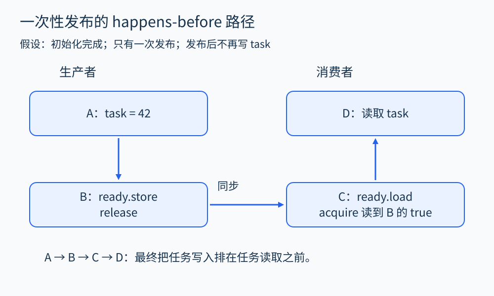
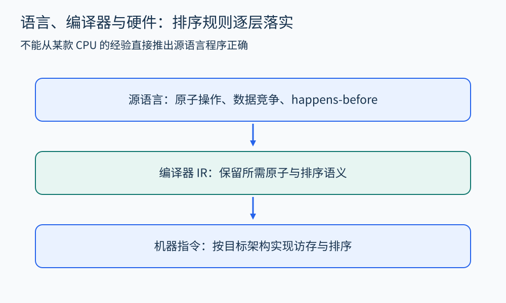

# 第 32 章 内存模型、原子操作与可见性

任务队列里，生产者先填入任务，再把“就绪”标志设为真。消费者看到标志后读取任务。代码顺序很自然，但它是否建立了跨线程的有效交接，需要由内存模型回答。

## 三种顺序不能混在一起

源码书写顺序、语言模型允许的执行关系、硬件内部的实际执行顺序并不等同。编译器在语言规则内变换代码，处理器可能以不同内部顺序推进指令；最终必须满足适用的架构规则。程序员首先要写出符合语言并发语义的程序，不能用“这台 CPU 一般不会这样”替代证明。

缓存一致性也不能单独给出所有答案。即使对某个地址的写入能形成一致顺序，多个不同地址之间的发布与读取仍然需要适当的同步关系。本章用 C++ 的一次性交接说明这个问题，不试图列举某款处理器的全部弱内存行为。

## 一个有明确前提的发布协议

```cpp
#include <atomic>
int task = 0;
std::atomic<bool> ready{false};

// 生产者，只执行一次
void produce() {
    task = 42;
    ready.store(true, std::memory_order_release);
}

// 消费者，只执行一次
int consume() {
    while (!ready.load(std::memory_order_acquire)) {}
    return task;
}
```

假设两个对象在启动线程前已经初始化；只有这个生产者写 `task`；消费者退出循环后读取；之后没有重置或复用。本例只讨论安全性，未承诺自旋的公平性或及时完成。

生产者写 `task` 在 release 存储之前。消费者的 acquire 加载若读到了这次 release 存储的值，就建立相应的同步关系。结合线程内顺序，可以得到从写 `task` 到读 `task` 的 happens-before 路径。[C++ 工作草案的原子顺序条款](https://eel.is/c++draft/atomics.order) 是这一步推理的依据。



图 32-1　关键是 acquire 读取到了对应 release 发布的值；两个操作名称出现了，并不自动连成同步边。

可以把证明拆成四步：写入任务、发布标志、观察发布、读取任务。前后两段是线程内关系，中间一段是线程间关系。消费者并非因为“等待了足够久”而读对，而是因为读取发生在协议保证的顺序之后。

## 原子性没有自动覆盖整个对象

如果把两个内存序都改为 relaxed，标志本身的访问依然具有原子性，但这次标志交接不再建立所需的 release/acquire 同步。对普通变量 `task` 的并发写读若没有其他同步，就可能构成数据竞争；C++ 对此不提供“只是读到旧值”的普遍保证。[数据竞争条款](https://eel.is/c++draft/intro.races) 规定了冲突访问、同步关系和未定义行为的边界。

同理，把 `ready` 改成普通 `bool`，或仅加上 `volatile`，都不能据此得到这个线程交接协议。一个标志变量是原子的，也不意味着它保护的复合状态会自动原子化。分析器必须关联访问、对象和顺序，不能只搜索 `atomic` 关键字。

如果生产者继续把 `task` 改成 43，而消费者仍可能读取，那么原来的“一次性交接”证明已经失效。重用槽位需要额外协议，例如锁、序号、所有权交接，或经完整推理的队列算法。看似无关的生命周期假设，常常决定并发代码是否正确。

## 从源语言下降到硬件

在机器层，编译器可能选用具有一定排序语义的指令，或组合普通访存与屏障来实现语言操作。映射依赖架构、操作和工具链。不能固定认为“一次 acquire 就是一条屏障”，也不能把某架构的较强排序推广到另一架构。

[LLVM 原子指令说明](https://llvm.org/docs/LangRef.html#atomic-memory-ordering-constraints) 展示了编译器 IR 如何显式表达不同排序要求。这有助于解释分析工具的层次：源码分析器追踪语言关系，IR 分析器处理其中间语义，二进制工具则要识别机器指令及其排序效果。



图 32-2　每层都需要自己的语义。硬件屏障是否足够，必须联系编译后的实际访存和语言约束判断。

## 分析并发时需要的证据

对一个可疑共享对象，至少记录它有哪些读写、由哪些线程执行、哪些锁或原子协议建立顺序，以及对象何时创建和销毁。动态竞态检测可从实际运行获取访问与同步事件；静态分析需要估计潜在并发关系。两者都可能受未建模的自定义同步、外部库和调度覆盖影响。

顺序一致原子操作提供更便于推理的约束，但不是业务正确性的总开关。即便所有计数器更新都原子化，先检查库存再扣减的复合流程仍可能不满足业务规格；即便无数据竞争，也可能死锁或违反任务处理顺序。内存模型解决的是一类底层行为问题。

## 原子更新与业务原子性

设两个工作线程同时执行“若订单为 paid，则发起退款，再写 refunded”。即使状态字段的单次读写都是原子的，二者仍可能都观察到 paid，然后各自退款。底层访问没有撕裂，并不表示整个状态转换只发生一次。这里需要把允许的状态迁移、唯一执行权和外部付款系统的幂等协议一起设计。

可以把性质拆成三项分别检查：内存访问是否有数据竞争；本地状态迁移是否互斥或具有合适的线性化点；外部效果能否在重试时去重。第一项属于内存模型的重要范围，后两项还需要程序逻辑和系统协议。仅通过竞态检测，并不能代替后两项验证。

使用互斥锁通常更容易建立整段临界区的顺序，但也要检查锁覆盖范围与锁顺序。一个无数据竞争的程序仍可能让两个线程分别持有一把锁、等待对方。分析时把内存顺序、互斥与进展性质分开记录，能够避免把“线程安全”当成没有边界的总评语。

## 观察练习

在 `produce()` 发布之后增加 `task=43`，消费者仍按原代码运行。能否根据它已经看到 `ready=true`，断言返回值必定为 42？

参考答案：不能。新写入没有被原来的发布协议覆盖，它与消费者读取之间也没有建立新的顺序。必须重新设计重用或后续修改协议，不能只枚举期望返回 42 或 43。

## 本章资料

- [C++ 工作草案：Order and consistency](https://eel.is/c++draft/atomics.order)。
- [C++ 工作草案：Data races](https://eel.is/c++draft/intro.races)。
- [LLVM：Atomic Memory Ordering Constraints](https://llvm.org/docs/LangRef.html#atomic-memory-ordering-constraints)。
