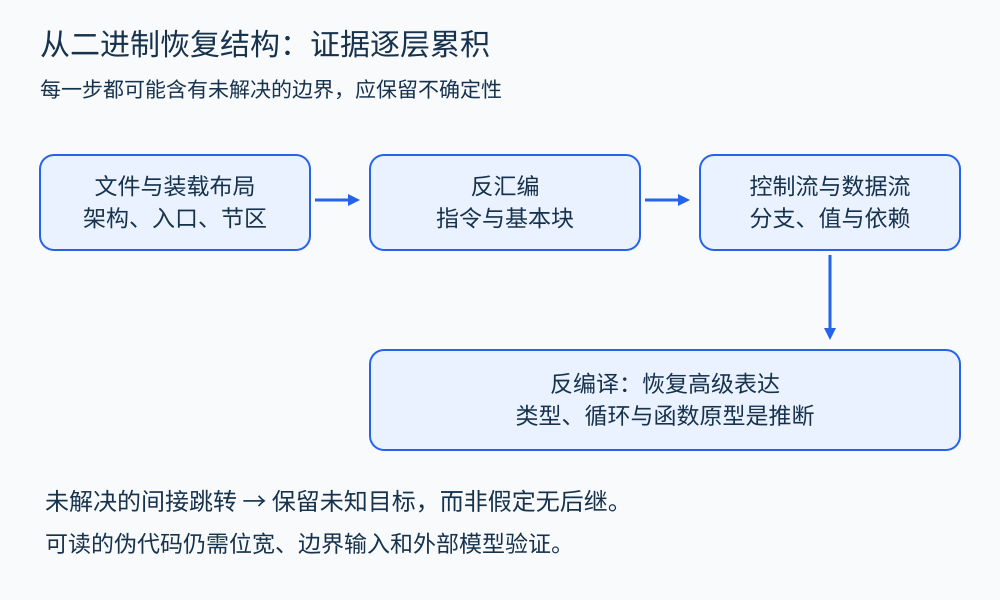
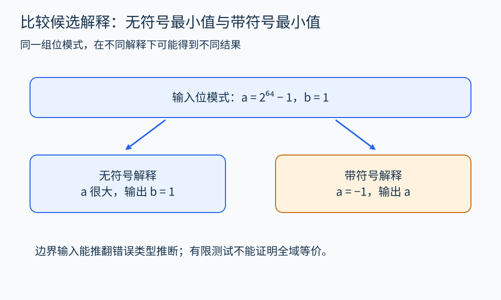

# 第 37 章 逆向、反汇编与反编译

一个旧程序只有可执行文件，源码已经丢失；另一个程序有源码，却需要确认实际发布包到底包含什么。这些情形都需要从二进制出发理解行为。这里的目标是分析自己持有并有权检查的软件，重建可验证的语义证据。

## 从字节开始，逐层恢复信息

反汇编把机器编码解释为指令。反编译继续推断控制结构、数据类型和表达式，输出接近高级语言的表示。二者都需要上下文：架构、执行模式、代码入口、文件装载方式与调用约定。文件中的字节不天然带有“这是一条指令”的标签。

可以沿着“文件与装载布局—指令—基本块—控制流—数据流—高级结构”逐层分析。上一层推断错误，会影响下一层结果。一个不确定的间接跳转目标，应保留为不确定性；把它随意补成一条边，会给后续结论制造虚假的确定感。



图 37-1　高级结构来自推断；每一步都应保留它依赖的证据和未解决的边界。

## 同一个语义不只有一种源码

看一段刻意选得很简单的 AArch64 教学指令：

```asm
    cmp x0, x1
    csel x0, x0, x1, ls
    ret
```

[Arm 的 CSEL 指令说明](https://developer.arm.com/documentation/dui0801/f/A64-General-Instructions/CSEL) 规定了条件选择的两个来源。在这里，`cmp` 设置比较条件，`csel` 根据无符号“小于或等于”条件选择原 `x0` 或 `x1`。结果是两个无符号参数的较小值；`ls` 的条件含义可对照 [Arm 条件码说明](https://developer.arm.com/community/arm-community-blogs/b/architectures-and-processors-blog/posts/condition-codes-1-condition-flags-and-codes)。读者可以用三个输入验证推演：`(3,8)` 得 3，`(9,2)` 得 2，`(5,5)` 得 5。

反编译器可能把它写成 `a <= b ? a : b`，也可能写成一个 `if`。两种写法都可能表达相同结果。原作者究竟使用哪一种形式，单靠这几条指令无法唯一恢复。源码中的名字、注释和设计意图，更不会自动从比较条件里出现。

如果把比较误解释成带符号关系，那么最高位为 1 的输入就会暴露差异。比如原参数分别是 `2^64-1` 与 1，无符号最小值为 1；带符号解释却把前者看成 -1。因而一份反编译伪代码应该同时接受位宽、符号和边界输入的检查。

## 提升到中间表示

机器指令常同时修改多个状态，例如计算结果和条件标志。为了重用分析算法，工具会把它提升为更小、更统一的操作。[Ghidra 的 P-Code 参考](https://ghidra.re/ghidra_docs/languages/html/pcoderef.html) 说明了寄存器传输式表示以及从指令到基本操作的转换。

对上面的例子，可以使用下面的教学关系，而不声称这就是某个工具的精确输出：

```text
a = input_x0
b = input_x1
cond = unsigned_le(a, b)
out = select(cond, a, b)
```

这样便能使用此前的常量传播、数据依赖和切片方法。切片若关注 `out`，会保留两个输入和选择条件；如果某条无关日志调用不影响该值，就可能被排除。分析方法能够跨表示复用，前提是提升保留了有关语义。

## 编译优化让对应关系变复杂

函数可能被内联，多个源码分支可能合并成条件选择，循环可能展开或向量化。一段机器代码也可能共享多个源码位置的信息。[GCC 的优化说明](https://gcc.gnu.org/onlinedocs/gcc/Optimize-Options.html) 可帮助理解优化与调试位置之间的关系。由此产生两个不同任务：恢复“可能的高级表达”，以及证明“恢复表达与机器行为一致”。看起来像源码，只完成了前一个任务的一部分。

编译时未定义行为也要谨慎处理。二进制里的某条机器运算具有明确的位级效果，不代表能将其随便转写为可能触发 C 未定义行为的表达式。[LLVM 语言参考](https://llvm.org/docs/LangRef.html) 提供了阅读 IR 时需要核对的操作语义；反编译得到的代码若要重新编译，必须重新检查目标语言规则。



图 37-2　先比较可观察输出，再扩大输入集合；测试未发现差异仍不是全域等价证明。

## 一套可复查的分析记录

先保存文件散列、架构和装载信息，再记录关注的函数范围与调用约定。对每个重要结论，附上机器地址或稳定标识、相应指令、提升后的关系和待验证假设。可以用自编小程序构造类似模式，比较未优化与优化版本；也可以在受控环境中跟踪输入输出，验证候选解释。

动态执行只能观察实际走过的路径；符号等价检查也依赖指令语义、外部调用模型与资源上限。遇到自修改代码、动态装载、异常控制流和未解决间接跳转时，应缩小结论范围。未知目标不等于没有调用，未恢复的路径不等于不可达。

这类能力有助于软件维护、兼容性检查、移植和发布审计。它也提醒我们：二进制分析最有价值的产物是证据与约束，而不仅是一段读起来流畅的伪代码。

## 恢复控制流也要记录条件

设一个间接跳转使用表项决定下一地址。要恢复它的后继集合，分析器需要知道索引范围、表的位置、表项的编码方式，以及运行时是否可能改写表。如果索引仅有范围 0 到 3，且四个表项不可变，就可以在这些假设下添加四条候选边；如果表项来源于外部可变内存，则不能照搬同样结论。

这里有两个常见混淆。第一，候选目标集合包含四个地址，不表示某次执行会经过全部地址。第二，当前只能恢复两个地址，不表示剩余两个不可能。控制流过度近似会让后续切片更大、告警更多；控制流缺失则可能让分析错误地“证明”某些行为不存在。

验证恢复结果时，可先用自己编写的有限分支程序作对照，保留源文件、编译选项与二进制。这样既知道预期语义，又能观察优化怎样改变形态。随后再进入缺失源码的情形，便能明确哪些判断来自工具输出，哪些来自可复查的指令与接口事实。

## 观察练习

反编译器为 `out=a+b` 推断了带符号 32 位类型，但机器指令实际只保留低 32 位。选什么测试能快速检查这个推断的边界？

参考答案：选接近符号边界或溢出边界的值，例如最大正 32 位整数与 1。机器按指令规则保留位模式，带符号 C 加法则可能触发未定义行为。应恢复合适的无符号或显式位向量语义，并进一步核对后续比较方式；一个测试足以暴露候选问题，却不足以证明整个函数等价。

## 继续阅读

恢复较高层结构并不自动证明变换等价。[程序等价、精化与编译变换验证](41.md)进一步说明观察、状态对应和目标语义的责任。

## 本章资料

- [Ghidra：P-Code Reference Manual](https://ghidra.re/ghidra_docs/languages/html/pcoderef.html)。
- [Arm：AAPCS64](https://github.com/ARM-software/abi-aa/blob/main/aapcs64/aapcs64.rst)：解释函数接口的约定。
- [GCC：Optimize Options](https://gcc.gnu.org/onlinedocs/gcc/Optimize-Options.html)。
- [LLVM：Language Reference](https://llvm.org/docs/LangRef.html)。
