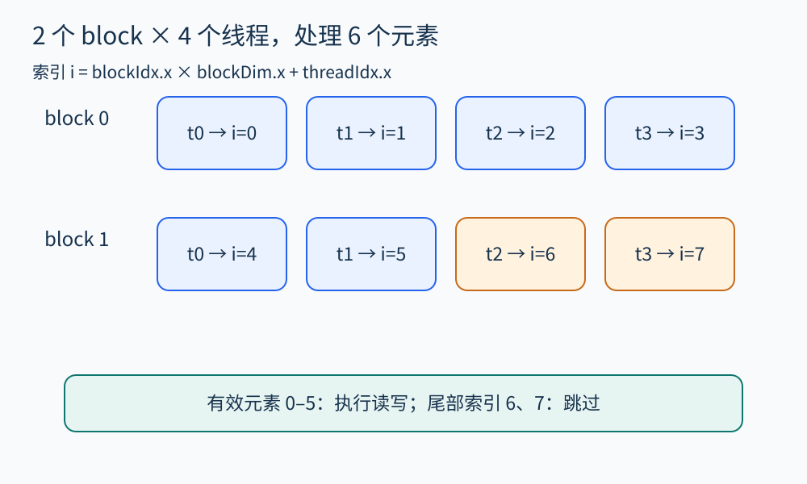
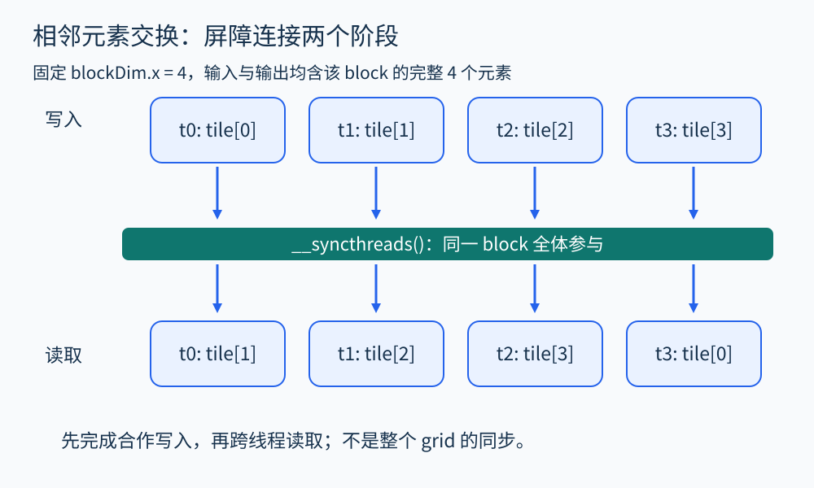

# 第 28 章 GPU：SIMT、内存与同步

把处理数组的循环搬到 GPU，只是并行化的起点。分析还必须回答：每个线程处理哪个元素，是否越界，谁会同时访问同一位置，合作线程之间用什么方式交接数据。本章以 CUDA 为具体模型；其他 GPU 平台的术语、执行宽度和同步接口需要查各自规范。

## 从循环索引变成线程索引

先看一个独立元素计算：

```cpp
__global__ void add(const float* a, const float* b,
                    float* out, int n) {
    int i = blockIdx.x * blockDim.x + threadIdx.x;
    if (i < n) out[i] = a[i] + b[i];
}
```

这里假设 `n>=0`，三个数组都具有至少 `n` 个可访问元素，输出不与输入产生不安全的重叠，且索引计算没有整数溢出。采用一维 grid，每 block 放 4 个线程，处理 6 个元素时启动 2 个 block。第一个 block 得到索引 0、1、2、3，第二个得到 4、5、6、7；条件让后两个线程不访问数组。

[CUDA 入门文档](https://docs.nvidia.com/cuda/cuda-programming-guide/02-basics/intro-to-cuda-cpp.html) 给出了线程、block 和索引的基本接口。分析本例时，除了证明 `i<n`，还要结合非负索引和数组前提，检查读写范围；若调用方只分配 5 个元素，kernel 内的判断并不能自动补救。



图 28-1　线程数量可以大于元素数量，尾部保护是执行映射的一部分。本图的 4 线程 block 仅为便于推演。

## SIMT 不等于任意时刻共同前进

CUDA 把线程分组为 warp 来执行 SIMT 工作。线程仍有各自的状态和逻辑索引。分支可能令一组线程执行一个方向，另一组执行另一个方向，影响执行效率。某些架构采用更灵活的线程调度，不能依赖“同一个 warp 所以天然同步”的旧式直觉。[CUDA Programming Guide](https://docs.nvidia.com/cuda/cuda-c-programming-guide/) 的 SIMT 与独立线程调度说明提供了背景；实际开发应结合对应架构与当前指南核对。

这里要分清三种事情：多个线程执行同一份代码、它们在某个时刻执行同一条指令，以及它们之间形成了可依赖的内存同步。前者不能自动推出后两者。分支分歧也并非正确性错误；错误来自程序依赖了未保证的顺序或参与关系。

## 合作需要明确同步范围

下面是教学用的相邻元素读取。固定每个 block 有 4 个线程，并要求调用方为每个 block 提供完整的 4 个输入与输出，输入输出缓冲区彼此不重叠，启动维度均为一维。

```cpp
__global__ void neighbor(const float* in, float* out) {
    __shared__ float tile[4];
    int t = threadIdx.x;       // blockDim.x 必须为 4
    int base = blockIdx.x * 4;
    tile[t] = in[base + t];
    __syncthreads();
    out[base + t] = tile[(t + 1) % 4];
}
```

若输入一块为 `[10,20,30,40]`，在四个写入都发生并经过 block 屏障后，输出应为 `[20,30,40,10]`。去掉屏障，线程 0 读取 `tile[1]` 时，线程 1 的写入没有得到相应同步保证。

`__syncthreads()` 的范围是整个 block。warp 范围的 `__syncwarp(mask)` 只对规定的参与线程建立相应同步，不能替代跨 warp 的 block 屏障。反过来，也不能把 block 屏障当成整个 grid 的屏障。对于这种简单合作模式，让 block 全体线程无条件到达同一个屏障点，最便于检查；边界线程若提前返回，应重新审查合作协议。[CUDA 的 block 同步说明](https://docs.nvidia.com/cuda/cuda-programming-guide/02-basics/intro-to-cuda-cpp.html) 应与代码参与集合一起阅读。



图 28-2　屏障之前每个线程写自己的位置，屏障之后才读取别人的位置；图中的同步仅覆盖该 block。

## 内存空间也是分析信息

寄存器、共享内存和全局内存具有不同用途与访问范围。`__shared__` 数组供同一个 block 合作使用；全局数组可能被多个 block 访问。分析器若把所有内存统一成一个抽象对象，会丢失范围信息；若误认为共享内存是线程私有，又可能漏掉竞争。

原子操作能保护某个更新，却不能独自替代多阶段算法的同步协议。浮点并行归约还涉及运算顺序：即使访问安全，结果也可能因舍入次序改变，不能直接按实数加法的结合律证明位级相同。

## 如何分析和检查

先验证 host 端分配、传输和启动参数，再分析线程索引、访问区间和同步参与集合。随后检查跨线程读写是否冲突，以及 host 何时观察结果。[Compute Sanitizer](https://docs.nvidia.com/compute-sanitizer/ComputeSanitizer/index.html) 提供内存、共享内存访问危险和同步等不同检查工具；它们各有范围，运行未报告问题不等于证明所有输入和配置都安全。

本章代码用于语义推演，未在 GPU 上实测。阅读不要求购买 GPU；若动手运行，应在具备兼容硬件和工具链的环境补全分配、启动、错误检查与结果校验。

## 把多线程访问写成关系

在加法例子中，线程的写地址可以记为 `W(b,t)=out[4b+t]`，其中 `b` 是 block 编号，`t` 在 0 到 3 之间。两个合法线程若写到同一位置，就必须满足 `4b+t=4b′+t′`。在这个范围内，该等式只可能对应同一个索引。结合尾部保护与数组不重叠前提，可以解释为什么不同线程的输出写入互不冲突。

这种“索引表达式加取值范围”的方法，比看到并行循环就笼统地说安全更有内容。若把写入改成 `out[t]`，所有 block 的相同线程号就指向同一地址，原有证明立即失效；若改成 `out[0] += a[i]`，又引入共享更新及归约协议。

对共享内存的相邻读取，则需要再加一项时间关系：写入阶段必须在读取阶段之前完成。地址关系说明哪些线程会相遇，同步关系说明它们能否正确合作。GPU 分析经常需要同时处理这两张关系网。

## block 之间不能假设执行先后

两个 block 的编号相邻，不表示编号小的必定先完成，也不能把它们想成固定占住两颗处理单元。普通 kernel 的算法设计应使各 block 能按允许的调度独立推进。若第二个 block 等待第一个 block 在全局内存写一个标志，就要完整论证内存顺序与进展条件，不能套用本章的 block 屏障证明。

较容易分析的多阶段方案，是先让一个 kernel 完成一轮工作，再通过明确的执行依赖启动下一轮。这样阶段边界有清楚的含义，但仍需核对 stream、事件和实际同步规则。更细的跨 block 合作存在专门机制和启动约束，应作为额外模型加入。并行范围越大，所需合同往往越多。

## 观察练习

在独立元素加法例子中，删除 `if (i<n)`，仍用 8 个线程处理 6 个元素。是哪一类前提失效？加一个 block 屏障能修复吗？

参考答案：线程 6、7 的数组访问超出约定的有效范围；这是索引与分配大小不一致。屏障只能建立适用范围内的同步关系，不能改变访问地址是否有效，应保留尾部保护或改变数据与启动配置。

## 本章资料

- [CUDA：Intro to CUDA C++](https://docs.nvidia.com/cuda/cuda-programming-guide/02-basics/intro-to-cuda-cpp.html)。
- [CUDA：Programming Guide](https://docs.nvidia.com/cuda/cuda-programming-guide/) 与 [旧版指南的 SIMT 说明](https://docs.nvidia.com/cuda/cuda-c-programming-guide/)。
- [NVIDIA：Compute Sanitizer](https://docs.nvidia.com/compute-sanitizer/ComputeSanitizer/index.html)。
