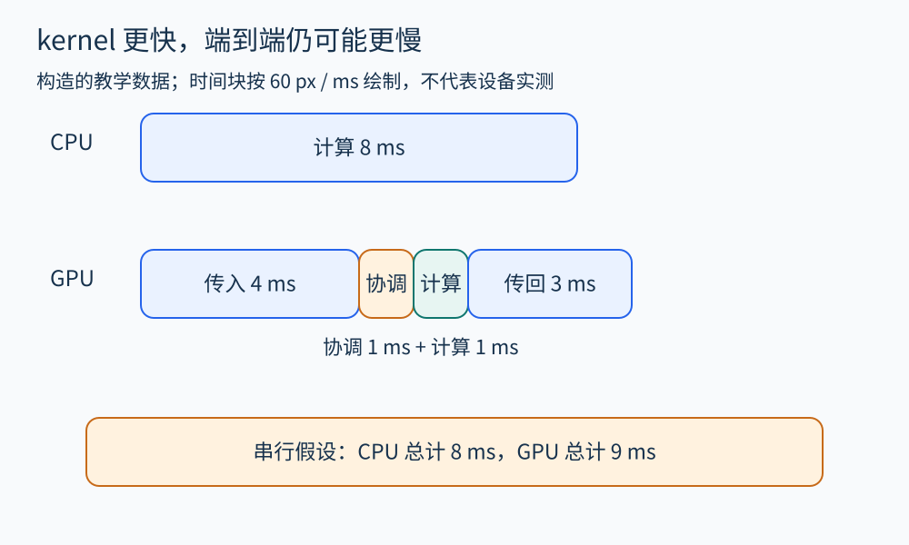
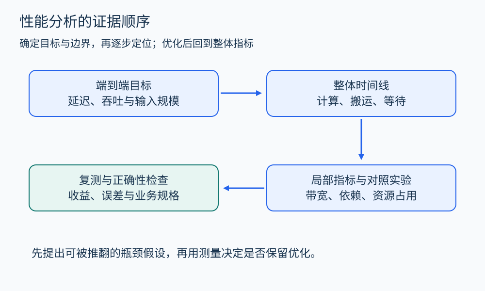

# 第 35 章 性能分析：CPU、GPU 与数据搬运

“这个循环可以并行”是结构结论，“搬到 GPU 会更快”则是性能假设。两者之间还隔着数据准备、传输、启动、同步和结果消费。程序分析可以帮助估计工作量与依赖，性能工具则用具体运行检验瓶颈。

## 先界定要优化的时间

一个文件处理服务可能包括读取、解码、计算、写回与排队。若用户关心整个请求延迟，只计计算 kernel 会遗漏大部分路径；若关心持续吞吐，则需要观察多批任务重叠后的稳定状态。启动一次与连续处理一千次，是两种不同实验。

先为关键阶段画时间线，标出哪些阶段有依赖，哪些可能重叠。[Nsight Systems 用户指南](https://docs.nvidia.com/nsight-systems/UserGuide/index.html) 介绍了在 CPU 与 GPU 活动之间建立系统级观察的方法。时间线上一段 GPU 空白可能来自 host 准备不足、同步等待或没有足够工作，不能仅凭一张利用率截图断定算力不足。

图 35-1　数字是构造的教学假设，不是设备测量；时间块按每毫秒 60 像素绘制。kernel 缩短不保证整个请求变快。

## 一个可计算的迁移决定

假设 CPU 完成某批计算需要 8 毫秒。GPU 方案中，准备与传入数据 4 毫秒、启动与协调 1 毫秒、kernel 1 毫秒、传回结果 3 毫秒；此处假设它们串行，合计 9 毫秒。kernel 本身比 CPU 快八倍，整体却更慢。

若连续十步都可以留在 GPU 上完成，且输入输出只搬运一次，并假定十步融合为一次启动、启动与协调合计仍为 1 毫秒，则同样的简化模型给出 `4+1+10×1+3=18` 毫秒；CPU 需要 `10×8=80` 毫秒。这不是保证结果，而是把“减少搬运可能更重要”的假设变成可检验数字。真实系统还需考虑每步启动、内存容量、重叠程度和准备工作。

[NVIDIA 的 Best Practices Guide](https://docs.nvidia.com/cuda/cuda-c-best-practices-guide/) 将端到端评估与减少 host/device 搬运列入性能实践。对统一内存或共享物理内存系统，也应检查真实的数据驻留、迁移与访问代价，不能只凭“统一”二字假设代价消失。

## 两个上界帮助过滤无效优化

先用 Amdahl 模型估计整体收益。如果只有占原始总时间 40% 的部分能够加速十倍，其余不变，理想整体加速为：

\[
S=\frac{1}{0.6+0.4/10}=1.5625.
\]

这给出一个有假设的预算：继续把这一部分优化到无限快，整体也只能到约 1.67 倍。若业务需要三倍提速，就必须寻找其他阶段或改变算法与数据组织。

再看算术强度，即“完成的运算量 / 搬运的字节数”。教学上取 `out[i]=a[i]+b[i]`，每元素一次浮点加法，理想化地读两个 4 字节浮点数、写一个 4 字节结果，得到 `1/12 FLOP/byte`。若有效带宽为 `B`，在忽略缓存复用、额外传输和其他开销的简化模型中，吞吐上界为 `B/12 FLOP/s`。这个式子说明应关注内存访问，但实际物理流量仍需测量。

Roofline 把计算上界与带宽上界放在一起看；[Nsight Compute 的性能分析指南](https://docs.nvidia.com/nsight-compute/ProfilingGuide/index.html) 介绍了相关指标与分析视图。处于带宽一侧不意味着“永远无法优化”，它可能提示合并操作、提高数据复用或减少读写。

图 35-2　性能分析沿证据缩小范围；每个局部优化都要重新验证整体指标与正确性。

## CPU 和 GPU 各有哪些常见问题

CPU 上，长依赖链限制并行，差的局部性增加等待，锁竞争和伪共享可能让多核收益下降。GPU 上，分支分歧、访存组织、寄存器与共享内存占用会共同影响执行。较高 occupancy 只是某类资源驻留指标，不能独自证明 kernel 更快。

这些概念可指导假设，却不能用作套话。若报告写“缓存不友好”，应说明访问模式、有关计数器或对照实验；若写“GPU 没吃满”，应区分任务太小、依赖等待、带宽饱和与计算资源饱和。不同瓶颈对应不同改法。

## 怎样做一次可信的实验

固定输入规模、数据分布、软件版本与设备配置；分别记录首次运行和预热后的运行；重复测量并报告分布。异步 GPU 调用的 host 返回时间通常不是 kernel 完成时间，应选择合适的设备计时或完成同步，把测量边界说清楚。

采样、跟踪、性能计数器也会扰动运行，某些指标需要重放采集。[Nsight Compute 文档](https://docs.nvidia.com/nsight-compute/ProfilingGuide/index.html) 明确讨论了采集与开销。因而可以先用较轻的整体观测定位，再收集必要的局部指标，最后在较少干扰的条件下复测。

性能变好之后，还要验证结果：浮点容差、订单金额精确性、任务处理顺序与错误路径都不能悄悄改变。程序分析在这里的作用，是帮助提出和限制优化，而性能实验负责检验所选环境中的收益。

## 用对照实验拆解瓶颈

若怀疑搬运占主导，可以保留同一 kernel 和输入规模，比较每次都传输与数据驻留两种模式；若怀疑启动开销，可以比较多个小任务与合并后的任务。每次改变一个主要因素，并核对输出一致性。任务合并也可能增加延迟或内存峰值，因此吞吐变好后仍要检查原先的业务指标。

还可以把问题从“机器为什么慢”改写成“工作量是否必要”。文件处理流水线若连续两步都扫描同一缓冲区，分析它们的依赖与副作用后，或许能融合遍历；若中间结果根本没有消费者，则可能删除整个阶段。这类变换首先依赖程序语义，随后才由测量确认收益。

记录实验时，把估计值、仪器观测值与解释分开。例如，“理论读取十二字节每元素”是模型，“计数器显示某范围流量”是观测，“缓存复用不足”是待验证解释。三者写在一起却不区分来源，会让后续复现者无法知道应该重算公式、重跑实验，还是推翻假设。

## 观察练习

假设计算阶段占总耗时 20%，把它提速五倍，其余不变且无新增开销。整体加速多少？如果新方案多花原总耗时 10% 搬数据呢？

参考答案：前者为 `1/(0.8+0.2/5)≈1.19` 倍；加上搬运后为 `1/(0.8+0.04+0.1)≈1.06` 倍。需要进一步检查用户收益是否值得新增复杂度。

## 继续阅读

测量热点与推导成本上界提供不同证据，可结合[终止与资源复杂度](45.md)阅读。数值结果的容差与算法稳定性则见[浮点专题](48.md)。

## 本章资料

- [NVIDIA：Nsight Systems User Guide](https://docs.nvidia.com/nsight-systems/UserGuide/index.html)。
- [NVIDIA：CUDA Best Practices Guide](https://docs.nvidia.com/cuda/cuda-c-best-practices-guide/)。
- [NVIDIA：Nsight Compute Profiling Guide](https://docs.nvidia.com/nsight-compute/ProfilingGuide/index.html)。
