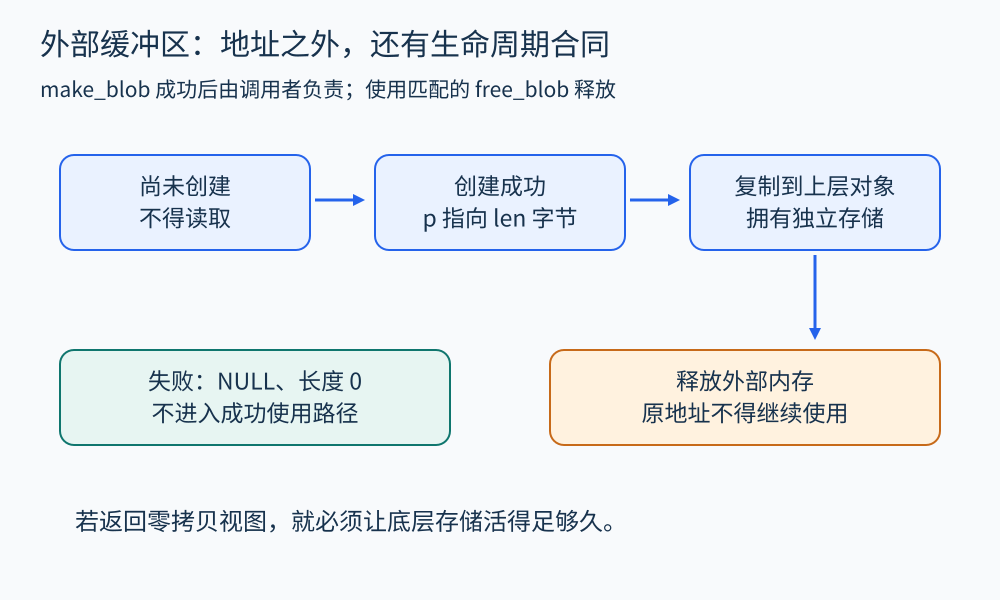
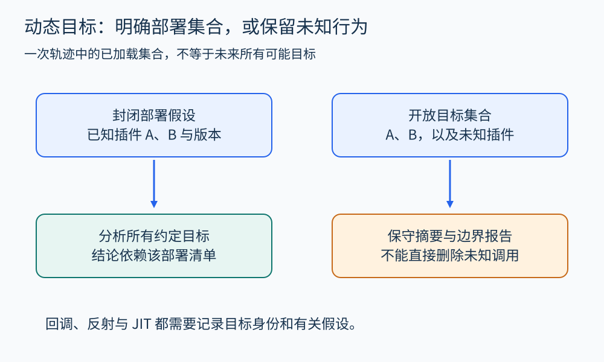

# 第 30 章 跨语言、FFI 与动态机制

一个 Python 服务调用 C 库解码文件，再把缓冲区交给 GPU。每一段局部代码都可能看起来正确，问题却出现在边界：长度使用什么单位，内存由谁释放，调用何时真正完成，回调还能不能访问原对象。跨语言分析的核心是重建这些合同。

## 签名只是合同的开头

设 C 库提供下面的教学接口：

```c
int make_blob(unsigned char **out, size_t *len);
void free_blob(unsigned char *p);
```

我们为它明确规定：返回 0 表示成功，成功后 `*out` 指向 `*len` 字节的有效内存，调用者必须使用 `free_blob` 恰好释放一次；失败时输出为 `NULL` 与 0。库保证数据在释放前有效，且不会异步保存调用者的输出参数。

函数声明本身没有表达这些保证。它也没有说明能否多线程调用、零长度是否允许空指针，以及分配失败如何处理。分析器只看到签名时，应把这些内容记为待建模信息，不能猜成有利条件。[Rustonomicon 的 FFI 章节](https://doc.rust-lang.org/nomicon/ffi.html) 展示了调用约定、外部声明及安全封装所承担的责任。



图 30-1　跨语言传递了地址与长度，也转移了责任；合同应标明成功、失败与释放后的状态。

## 逐步检查一条安全使用路径

包装层先调用 `make_blob`，检查返回值；仅在成功后读取输出。它确认长度转换没有截断，把内容复制为上层语言拥有的字节串，再保证无论后续操作是否失败，都调用 `free_blob`。复制完成后，上层字节串拥有自己的存储，外部缓冲区便可以释放。

这条路径至少涉及四种分析事实：状态机确认“成功创建之后才能读取”；范围分析确认只读 `len` 字节；所有权分析确认释放者唯一；异常路径分析确认复制失败也不遗漏释放。最后一项常被正常流程图掩盖。

若为了零拷贝直接把外部地址暴露为上层视图，就必须把释放时机与视图生命周期绑定。若还要异步传输给 GPU，则“C 函数返回”“传输入队”“设备不再访问缓冲区”可能是不同事件。此时必须等待适当的完成条件，才能释放原内存。优化改变了合同，分析也要跟着更新。

## 数据布局、调用约定与异常

跨语言的 `int`、`long`、布尔值、结构体和字符串不应只按名字对应。要核对位宽、符号、对齐、编码与终止方式；结构体还要检查字段偏移与填充。[Python ctypes 文档](https://docs.python.org/3/library/ctypes.html) 提供了 C 兼容类型和函数参数、返回类型的显式声明机制。错误声明可能绕过上层语言原本的检查，因而边界包装代码值得独立审查。

调用约定还涉及 ABI；异常与语言运行时也有各自规则。外部调用若可能抛出异常、触发 panic 或回调上层，必须按接口允许的方式传播或转换错误。不能把“返回一个整数”当作所有退出路径的完整描述。

回调增加了反向调用边：库不仅被上层调用，还可能稍后调用上层函数。包装层需要保持回调对象和用户数据有效，明确在哪个线程执行，以及取消之后是否保证不会再回调。静态调用图若只连接直接调用，就会在这里中断数据与生命周期推理。

## 动态加载与 JIT 使程序边界移动

插件、反射和动态加载会让调用目标在运行时决定。分析可以选择约定插件集合、为未知实现使用保守摘要，或结合运行时观测补全线索。加载配置、版本和能力范围应成为分析输入，而不是隐含背景。

JIT 还可能生成新的机器代码，并在假设失效时切换执行方式。静态源码、运行时优化代码和一次轨迹是不同证据，记录时应带上代码版本或稳定身份。只观察某次已加载的插件，无法证明以后加载的任意插件也满足同一性质。



图 30-2　未知目标不能直接删去；要么限定部署集合，要么保留摘要和未解决边界。

WebAssembly 等结构化目标可提供明确的模块、导入和执行语义，[WebAssembly 核心规范](https://webassembly.github.io/spec/core/) 是相关分析的基础。然而，模块内部的检查仍不能替代对宿主导入函数的建模。分析一个模块与分析包含数据库、文件和网络服务的整套应用，具有不同边界。

## 给边界建立摘要

一个实用摘要可按“输入有效性—读取范围—写入范围—所有权—错误与异常—线程与异步—回调—外部效果”记录。不是每个接口都需要长文，但每项假设都应能找到规范、实现或验证依据。

跨语言分析不必从第一天就统一所有语言的完整语义。可以先把关键边界建模清楚，让已有分析结果可靠地越过边界，再逐步增加精度。若外部函数暂时未知，应如实报告未知影响；空摘要看起来安静，却可能让整条证明失去依据。

## 给一个接口写可复用摘要

对前面的 `make_blob`，可以用下面的小表作为跨语言分析的共同输入。

| 事件 | 抽象状态变化 | 后续责任 |
|---|---|---|
| 成功返回 | 新建对象 O，范围为 len 字节 | 使用匹配函数释放 |
| 失败返回 | 无可读取的新对象 | 处理错误，避免读取 |
| 复制完成 | 上层对象 U 拥有独立副本 | U 与 O 分别管理 |
| 释放 O | O 转为失效状态 | 清除有关存活假设 |

若库的真实失败行为并不保证清空输出，就应修改摘要，而不能为了表格整齐而补造保证。如果函数会保存输入指针，摘要还要标记逃逸；如果释放只能由指定线程执行，则要加上线程前提。摘要的价值来自忠实，而不是简短。

同一个摘要可以被不同语言前端消费：Python 端检查引用与异常路径，Rust 端检查安全包装的责任，机器层检查 ABI 对应。它们无需把各自全部类型系统统一起来，但必须对同一外部对象身份、长度和释放事件达成一致。对象身份若在边界被丢失，生命周期证明就容易断裂。

## 观察练习

C 库返回的地址被包装为上层只读视图，包装函数退出前便调用 `free_blob`。只读能否保证视图安全？

参考答案：不能。只读只限制通过该视图写入，并不延长底层存储的生命周期。返回后访问可能使用失效内存。可以复制数据，或让拥有外部内存的对象与视图共同存活，并确保最后一个使用者结束后再释放。

## 本章资料

- [Rustonomicon：Foreign Function Interface](https://doc.rust-lang.org/nomicon/ffi.html)。
- [Python：ctypes](https://docs.python.org/3/library/ctypes.html)。
- [Arm：AAPCS64](https://github.com/ARM-software/abi-aa/blob/main/aapcs64/aapcs64.rst)。
- [WebAssembly：Core Specification](https://webassembly.github.io/spec/core/)。
