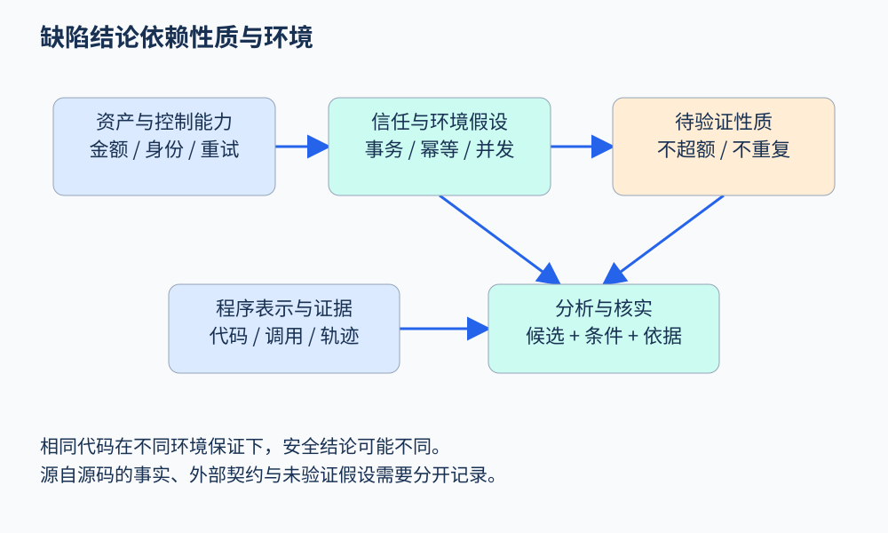

# 第 50 章 缺陷、安全性质与威胁模型

订单服务收到第二次退款请求时，再退一次钱，可能没有空指针、越界或类型错误；程序甚至完全符合语言规范。错误来自它违背了业务约定：退款总额不能超过已支付金额。要发现这样的错误，分析器首先需要知道“正确”指什么。

## 先把问题写成性质

设一个订单已支付金额为 `paid_cents`，累计退款为 `refunded_cents`，单位均为整数分。可先写出不变量：

```text
0 <= refunded_cents <= paid_cents
```

不变量描述每个被允许的可观察状态都应满足的条件。但它没有说明谁能退款、请求如何去重，以及状态何时提交。因此还需补充协议性质：相同幂等键至多产生一次退款效果；只有被授权的操作者能改变退款状态。金额性质、权限性质与协议性质分别需要不同的信息。

“安全性质”在形式化语境中通常指坏事永不发生，不应与“网络安全问题”画等号。例如“同一工作项不会被完成两次”也属于安全性质；“排队任务最终得到处理”则涉及活性。一个系统可能一直不退款，因此不超额退款，却永远无法完成合法请求。只验证前者不能说明服务正确。

## 缺陷应从多个轴观察

| 观察轴 | 例子 | 需要的证据 |
|---|---|---|
| 语言与运行时 | 越界、未定义行为、资源泄漏 | 语言语义、地址与生命周期 |
| 接口与协议 | 关闭后写入、重复提交 | 合法调用顺序与状态机 |
| 业务规格 | 超额退款、折扣错误 | 金额关系、领域约定 |
| 安全与信任 | 越权修改其他人的订单 | 身份、控制能力与授权边界 |
| 并发与分布式 | 两次检查都通过后重复退款 | 原子性、事务与事件顺序 |

这些分类可以重叠。同一重复退款既是业务错误，也可能由并发交错触发；是否构成可利用的安全风险，又取决于外部主体能否触发该交错。把“低级错误”和“业务错误”排成单一等级，会掩盖它们所需证据的差异。



图 50-1：先明确环境与控制能力，再选择性质和分析；缺陷名称本身不能代替威胁模型。原创教学图。

## 威胁模型改变了分析问题

[OWASP 的威胁建模说明](https://community.owasp.org/Threat_Modeling)强调把系统、假设、潜在威胁、缓解与验证放在一起。对本例，可以明确：资产是订单金额和退款记录；普通用户只能操作自己的订单；用户可重试请求；网络可能重复传递消息；数据库支持事务，但外部付款接口与本地提交并非同一个事务。

现在审查下面的伪代码：

```text
if order.refunded_cents + amount <= order.paid_cents:
    payment.refund(order.id, amount)
    order.refunded_cents += amount
    save(order)
```

单线程内看似保持金额上界，但“检查—外部效果—写回”之间存在多个边界。两个执行都读取旧值时，各自检查成立，合计效果仍可能超限。进程在外部成功后、本地保存前退出，也会让重试看见旧状态。静态分析可识别共享状态与效果顺序；执行轨迹可显示一次实际重复；事务和幂等协议的规格才能决定方案是否足够。

修复也要对应性质。把加法换成更大的整数类型能减少溢出风险，却解决不了重复外部效果。给接口增加幂等键，需要进一步说明键的作用域、保存期限和冲突处理；“有一个键”并不是完整证明。

## 为什么 source、sink、sanitizer 不够

污点分析适合追踪某种影响是否传播到敏感操作，例如外部输入能否影响文件路径。但退款金额来自用户并不天然错误：合法业务本来就接收用户请求。问题在于授权、余额关系、历史状态和效果次数。

同样，“经过校验”必须指明校验了什么。非负检查只支持非负性质，不能自动推出授权成立；字符串转整数改变表示，也不自动保证范围安全。分析器应保存校验条件、支配关系和适用对象，避免把任意验证函数都视为万能清洗器。

## 一份可审查的报告

本书建议报告至少包含：违反的性质、相关代码和状态、环境假设、得到结论的方法、尚未验证的条件。对上述案例，可以报告“在允许并发请求且缺少外部幂等保证的模型下，检查与退款效果之间未形成原子协议”，并附两次请求交错的状态表。不要把抽象图中的一条路径直接称作真实发生过的事故。

一个有价值的后续动作，是让维护者确认付款接口已有的保证。它可能使候选问题消失，也可能暴露当前分析缺失的关键模型。确认模型不是降低分析价值，而是把结论绑定到真实系统。

## 把边界变成一张检查表

对一次退款，可以按执行步骤列出检查对象：入口确认调用者身份；查订单时确认归属；计算金额时检查单位与范围；产生外部效果前确认合法状态；效果与本地提交之间处理重试；最终对账检查累计关系。每一步都需要明确对象。例如，入口验证了账户 A，不代表后续从请求中取出的订单 B 已属于 A。

若分析器只追踪变量名，可能把对旧订单对象的检查错误地用于重新读取的新对象。若只看调用顺序，又可能忽略校验失败分支仍然继续执行。因而对象身份、控制依赖与状态变化需要共同进入模型。书中前几篇的图结构与抽象方法，正是在这些实际问题中组合起来。

威胁模型也要能更新。原本内部串行调用的函数后来暴露为并发接口，源码可能一行未变，但原先的环境假设已经不成立。分析结果应记录所依赖的部署与调用条件，让维护者知道何时需要重新评估。

## 练习

若接口保证同一订单、同一幂等键只退款一次，是否已经证明不会超额退款？

参考答案：没有。不同键仍可能对同一订单产生多次退款；还要检查金额累计、并发控制和幂等键与业务请求的对应关系。接口保证只消除其中一类重复效果。

## 本章资料

- [OWASP：Threat Modeling](https://community.owasp.org/Threat_Modeling)：系统、假设、缓解与验证的组织方式。
- [Lamport：Specifying Systems](https://lamport.azurewebsites.net/tla/book.html)：用状态与行为描述系统性质的进一步阅读。
