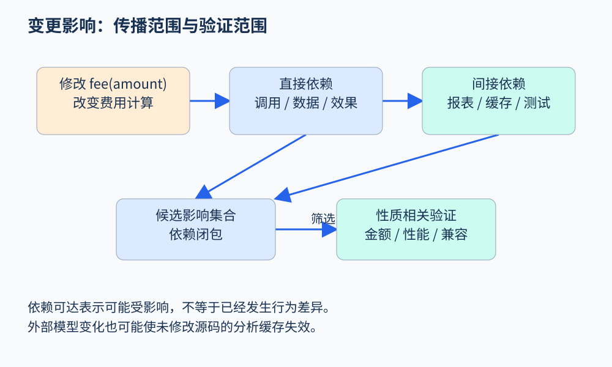

# 第 51 章 优化、维护与变更影响分析

分析程序不仅为了报警。编译器希望删掉不必要的计算，维护者希望知道一次修改会影响哪里，性能工程师希望把时间花在真正昂贵的路径上。这些任务共享依赖与行为模型，但允许做出的动作不同：报告一个候选通常可交给人复核，自动改写程序则必须满足更严格的等价条件。

## 从常量传播到优化决策

考虑以整数分计算退款手续费的教学代码：

```text
rate = 0
fee = amount * rate
net = amount - fee
return net
```

在无限精度整数、没有运算副作用的模型下，常量传播得到 `rate=0`，从而折叠 `fee=0`，再简化 `net=amount`。这里其实有两个动作：分析先推导事实，变换再利用事实修改程序。LLVM 把分析与变换组织为不同 pass，官方[分析与变换列表](https://llvm.org/docs/Passes.html)展示了这种分工。

把模型换成真实语言后，条件必须重新检查。例如浮点数的 NaN、无穷和带符号零会让某些看似自然的代数化简改变行为；带副作用的表达式即使结果不用，也不能随意删掉。优化依赖语言语义，而不只依赖数学恒等式。

## 死代码也有不同含义

```text
value = read_sensor()
value = 7
return value
```

第一次赋值产生的值没有被读取，属于死存储候选；但 `read_sensor()` 可能读取设备、记录事件或抛出异常。删掉赋值结果与删掉整个调用是不同变换。活跃变量分析提供“值是否还会使用”的信息，效果分析补充“执行是否还会被观察到”。

再看不可达块。若入口条件在语言语义下恒假，则分支中的操作不会发生；若它只是测试中从未出现，则仅说明缺少动态覆盖。把测试未执行到的路径当作可删除代码，会把罕见的错误处理一起删掉。



图 51-1：影响范围是待检查集合，实际行为差异还需条件与验证。原创教学图。

## 变更影响从哪里传播

假设把 `fee(amount)` 从固定费改成比例费。最直接受影响的是调用者；进一步还包括使用净额的报表、以结果为键的缓存、以及依赖旧边界值的测试。调用图提供第一层传播，但仅有调用关系不够：一个调用者可能丢弃返回值，却仍受异常或外部效果变化影响。

可以把工作分成三步。先定位变化的语义单元，是函数体、类型布局、配置还是协议；再沿相关依赖计算候选范围；最后按性质筛选，需要检查金额精度、性能还是兼容性。不同性质对应不同依赖边，因此不存在适用于所有改动的唯一“受影响文件列表”。

程序切片在这里很实用。以“最终到账金额”为观察点，反向切片帮助找出相关定义与条件；以“费率配置”为起点，前向切片帮助找出潜在影响。不过，若调用图遗漏反射调用，切片也会遗漏。图的完整性是结果可信度的一部分。

## 增量分析不是只扫描改动行

一个未修改的调用者，可能因被调用函数摘要变化而得到新结论。可靠的增量系统需要记录依赖：某份结果用了哪个函数摘要、库模型、配置和规则版本。输入变化时，失效相关缓存并重新计算，直到依赖重新稳定。

若仅以源文件内容作为缓存键，外部头文件、编译宏或库模型变化就可能复用过期结论。相反，所有变化都重跑全项目虽简单，却浪费稳定部分。增量化的核心是对依赖负责，而非把扫描范围压得越小越好。

## 性能优化如何结合证据

某段循环静态上执行次数很多，不表示它占据最大运行时间。真实时间还取决于输入分布、缓存、向量化、同步和数据搬运。可以先用剖析定位热点，再用程序分析解释热点为何存在，最后对改写前后做同条件测量。

例如，把退款汇总中的重复查询移出循环，必须确认查询结果在循环期间不会因其他操作改变。若涉及数据库事务或跨线程更新，简单的循环不变式判断可能依赖外部一致性模型。性能提升也不能以改变账务结果为代价。

## 自动重构要保存什么

重命名变量看似纯语法，却可能涉及反射字符串、序列化字段和外部 API。更复杂的提取函数、修改参数类型或并行化循环，需要检查作用域、求值顺序、异常和资源生命周期。自动重构系统应说明支持范围，并在不能建立必要条件时拒绝变换。

对维护者而言，最有用的结果往往是“哪些行为可能变化、哪些证据保持有效”。把这份说明和测试选择一起保存，可避免一次局部修改后盲目运行所有测试，也避免只跑最邻近的测试造成遗漏。

## 用一个小实验区分影响与回归

设手续费从固定一分改成按百分比取整。先保留输入集合：零金额、一分、边界金额和普通金额；分别记录修改前后的输出。输出不同不自动等于回归，因为改动本来就要改变手续费。需要根据新的业务规格判断差异是否被允许，再检查不应变化的性质，例如净额不能超过原金额、同一配置下结果确定。

这里有三份互补证据：依赖分析说明哪些地方需要关注，差分运行展示哪些输入发生变化，规格判断哪些变化正确。只使用其中一份都会产生偏差。差分测试没覆盖的输入仍可能变化，依赖图列出的候选也可能始终输出相同结果。

对库接口，还应检查下游是否依赖旧的异常类型和舍入方式。类型签名不变，只说明接口形状相同；它不保证行为兼容。一次好的维护分析应同时保存结构依赖与可观察行为约定。

## 练习

`x = log_event(); x = 0; return x` 中，第一次写入是死存储。能否据此删掉 `log_event()`？

参考答案：不能。死存储结论只涉及结果值；调用可能具有外部效果、异常或不终止行为。只有进一步建立所需的效果与终止条件，才可能删去调用。

## 继续阅读

大型工程怎样只重算受到影响的结论，见[增量分析与摘要失效](50.md)；从修改候选到规格检查的循环，见[程序合成与自动修复](51.md)。

## 本章资料

- [LLVM：Analysis and Transform Passes](https://llvm.org/docs/Passes.html)：分析与变换的实际组织。
- [LLVM：Language Reference](https://llvm.org/docs/LangRef.html)：理解优化所依赖的 IR 语义。
