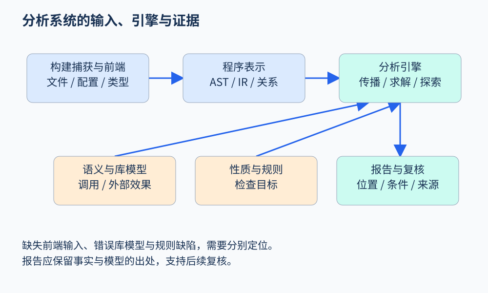

# 第 33 章 代表工具与分析架构

选择工具之前，先问输入是什么、目标性质是什么、需要什么证据。某个工具能显示漂亮的调用图，不代表它能证明业务不变量；某个工具报告很少，也可能只是没有覆盖目标代码。工具名称适合作为方法的实例，不能代替对模型和假设的理解。

## 先认识几类架构

| 工具或框架 | 适合观察的架构特点 | 需要注意的边界 |
|---|---|---|
| Clang Static Analyzer | 在编译器基础设施上进行路径相关检查 | 受检查器、模型与资源预算影响 |
| CodeQL | 提取程序关系，再用查询与库分析 | 提取完整性与库模型影响结果 |
| Soufflé | 以 Datalog 规则求关系闭包 | 事实如何正确提取仍需设计 |
| KLEE | 基于 LLVM 的符号执行 | 环境、约束求解与路径规模有限制 |
| LLVM Sanitizer 家族 | 编译插桩与运行时检测 | 依赖实际执行与所选检测性质 |
| Ghidra | 机器码提升、反编译与人工检查 | 恢复表示不等于原始源码 |

表中列的是方法入口，不是排名，也不承诺它们支持每一种语言和构建方式。实际采用时要按当前官方文档确认版本、平台与许可。本章不要求一次安装全部工具。

## 用 CodeQL 看“数据库式分析”

CodeQL 官方把工作分为[数据库准备、查询执行和结果解释](https://codeql.github.com/docs/codeql-overview/about-codeql/)。这与直接逐行匹配文本不同：提取器先保存语法、绑定及其他程序关系，查询再利用这些关系描述目标模式。

例如，在退款服务里关注“哪个外部参数影响了退款金额”，可以把参数、赋值和实参传递建成关系，再沿流传播。但需要知道包装函数是否保留值、数据库读取是否被建模，以及哪个字段代表该笔订单。查询可复用并不意味着模型无需维护。

CodeQL 的[数据流说明](https://codeql.github.com/docs/writing-codeql-queries/about-data-flow-analysis/)区分程序语法与值的传播关系。读工具文档时，应该检查局部/全局分析、数据流/污点流等概念在该工具中究竟如何定义，避免仅凭同名术语推断实现完全一致。

图 33-1：规则、程序表示和环境模型共同产生结果；展示层不应掩盖缺失输入。原创教学图。

## 一个通用分析系统的六个部件

第一是输入与构建捕获。分析器需要知道文件、依赖、宏、生成代码与编译选项。第二是表示层，维护 AST、IR、CFG、调用和源位置映射。第三是语义模型层，补充库、框架、外部效果与运行环境。

第四是引擎，执行工作列表、关系求解、符号探索或动态事件处理。第五是性质与规则，定义所关心的状态和违反条件。第六是结果与验证，把抽象结论转成维护者可审查的证据，并记录确认、驳回和模型修订。

这个拆分有助于定位问题。若某个文件没有被提取，增加规则无法补回；若 `refund_wrapper` 缺少摘要，扩大遍历预算也未必有用；若规格错误，求解器再精确也只是在回答错误的问题。

## 一份报告怎样穿过系统

以“除数可能为零”为例：前端定位除法表达式和分母；表示层识别到达该点的赋值；引擎求得分母抽象值包含零；规则产生候选；展示层提供相关定义、控制条件与源位置。若具体路径条件彼此矛盾，后续可行性检查可能驳回候选。

这一过程应保留出处。报告中的一条边来自源码赋值、手写库模型还是启发式补边，可信度不同。只展示最终红色标记，会让使用者无法判断应修代码还是修模型。

## 怎样选择起步方案

如果目标是学习数据流，先在受限 IR 上实现工作列表；若目标是团队现有代码的规范检查，优先利用已有编译器前端和语义信息；若需要跨过程查询，考虑已有数据库与规则生态；若问题只在运行时出现，安排插桩和复现环境。自行重写解析器、类型系统和构建捕获，通常会把方法实验变成语言工程项目。

生产环境还需考虑可复现构建、规则回归、缓存失效、报告去重与误报处置。它们不像算法新颖，却决定分析器是否能长期使用。一个结果必须能追溯到代码提交、配置、模型和工具版本，否则很难解释它为何突然消失。

## 用代表性小项目验证工具适配

正式接入前，可准备四个微型样例：正常路径、明显违反目标性质的路径、经包装函数传播的路径，以及依赖配置才能判断的路径。先看工具是否成功读入，再看结果和证据。这样能分别发现前端问题、规则问题、库模型缺失与环境假设错误，避免用一个大型仓库的总警告数作唯一判断。

还可以故意删除一个库模型，观察报告如何变化；切换一个构建宏，检查被提取代码是否改变。工具应当把失败和缺失清楚展示，而不是输出一个没有解释的零。如果模型缺失时仍显示绿色通过，使用者很容易把覆盖不足误解成已验证安全。

工具接入也需要退出路径。保留原始结果、稳定位置映射和机器可读格式，可在规则升级时进行根因级对照。若结果完全依赖某个图形界面的瞬时状态，日后的复核、协作和回归都会困难。

工具选型还应检查团队能否维护自己的模型。项目框架经常比语言规范变化更快：新增一个队列包装器、替换数据库访问层，就可能改变跨函数传播。能否为这些接口编写小型回归样例，比一次演示检出率更能反映长期成本。将模型与业务代码共同审查，也有助于在接口变更时及时发现分析保证失效。

## 练习

同一项目在本地有报告、CI 没有报告，应先检查哪些信息？

参考答案：先对齐代码提交、构建配置、被提取文件、依赖及模型、规则与工具版本，再比较预算和过滤设置。不要立即把差异归因于算法随机性。

## 本章资料

- [CodeQL：About CodeQL](https://codeql.github.com/docs/codeql-overview/about-codeql/)。
- [CodeQL：About data flow analysis](https://codeql.github.com/docs/writing-codeql-queries/about-data-flow-analysis/)。
- [Clang Static Analyzer](https://clang.llvm.org/docs/ClangStaticAnalyzer.html)、[Soufflé](https://souffle-lang.github.io/)、[KLEE](https://klee-se.org/docs/)、[Ghidra](https://ghidra-sre.org/)：对应工具的官方进一步阅读入口。
