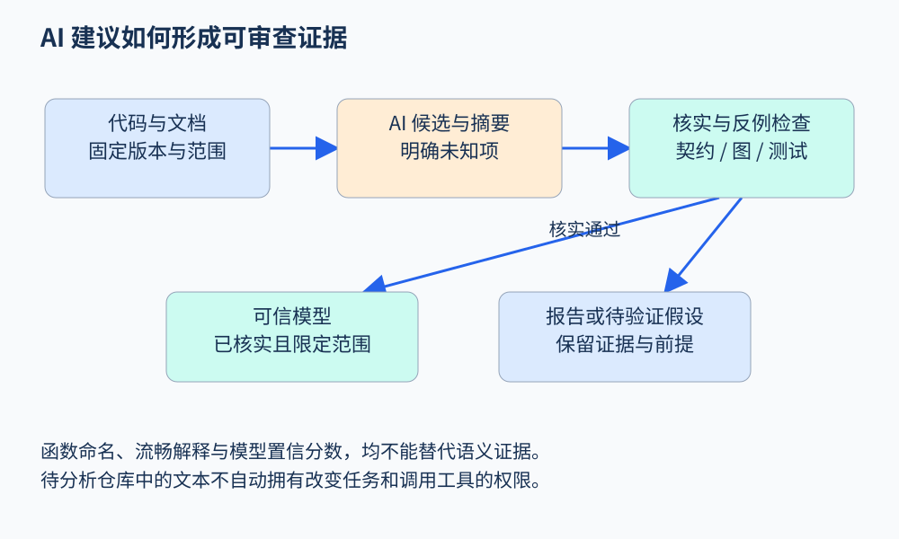

# 第 49 章 AI 辅助分析与证据管理

程序分析需要理解语言语义，也经常面对没有写全的环境知识：某个包装函数是否写文件，某个业务状态是否允许退款，一段自然语言文档描述了什么前置条件。AI 可以帮助整理这些信息，但自然语言解释流畅，并不自动使推理链成立。

## 先给 AI 一个明确角色

把“让模型看看代码有没有问题”拆开，可以得到不同任务：识别候选的输入与敏感操作；为外部函数提出摘要；把业务文档转成待确认的契约；优先审查某些候选；解释已有数据流证据；为已知性质生成测试。每个角色都应有自己的输入、输出和验收方式。

例如，让模型判断 `submit_refund` 的效果时，可以要求输出“读取哪些状态、写入哪些状态、是否产生外部效果、证据位置、未知项”。若模型只能依据函数名猜测，就把摘要标为假设，不能直接纳入可信语义库。确定性引擎使用错误摘要时，仍可能稳定地产生错误结论。

[NIST 的生成式 AI 风险资料](https://www.nist.gov/publications/artificial-intelligence-risk-management-framework-generative-artificial-intelligence)把可靠性、评估与风险管理放在完整生命周期中。本章据此采用一个工程原则：明确模型作用范围，保存可检查证据，并持续测量，而不是只评价一次回答是否像专家。

## 一条有出处的候选链

设模型阅读到下面的教学伪代码：

```text
if order.status == "paid":
    gateway.refund(order.id)
    order.status = "refunded"
```

模型可能提出“并发调用会重复退款”。这只是起点。要形成可审查结论，还需知道：对象是否共享；请求是否串行；状态读写是否处于事务；网关是否提供幂等保证；不同工作进程看到的是不是同一状态。

因此可以把证据拆成三类：源码可直接确认的事实、可信文档或配置支持的环境保证、仍需验证的假设。候选报告引用这三类证据，并明确结论依赖哪些假设。这样即使模型提出了正确方向，后续读者也无需相信模型的全部叙述。



图 49-1：AI 可提出候选与摘要，只有经过适当核实的部分才进入可信模型。原创教学图。

## 让输出成为接口

一个便于复核的摘要可采用结构化记录：

```json
{
  "subject": "gateway.refund",
  "claim": "external_payment_effect",
  "evidence": ["api-contract:refund/v2"],
  "assumptions": ["contract matches deployed gateway"],
  "status": "needs-review"
}
```

这里的 `status` 比一个孤立的置信分数更有用。置信分数只能表示某种内部估计；它不能替代对应部署版本的契约，也不能证明调用链完整。对金额、权限和幂等性等关键性质，应要求可核查的依据。

给模型的上下文也需要记录：代码提交、实际提供的文件、截断情况、提示模板、模型标识、工具调用和生成参数。若只保存最终结论，之后无法判断差异来自代码、上下文遗漏还是模型行为变化。记录应遵循项目的数据访问与保留规则，避免无目的收集整个仓库与运行秘密。

## 程序内容也是不可信输入

分析器会读注释、文档、测试数据和仓库说明。这些内容可能包含指令式文本。它们属于待分析的数据，不能自动成为改变任务、获取凭据或执行外部动作的授权。AI 辅助分析系统应把读取代码与执行工具的权限分开，让结果遵守既定任务和访问范围。

这种隔离也有助于可复现性：规则由维护者选择，仓库里的字符串只影响程序语义和证据，不能悄悄改写评估流程。对自动生成的补丁同样要检查差异、运行验证并留存来源，不能因为模型附上“测试通过”就跳过真实执行。

## 怎样知道 AI 真有帮助

需要与相同预算的基线比较。若基线只分析十个文件，而 AI 版本读取整个项目，改善不能简单归因于语义能力。可比较纯规则、规则加排序、规则加模型摘要、完整组合；同时记录有效候选、人工复核时间和调用成本。

还要按错误来源分类。模型误解业务文档、遗漏调用者、编造库保证、路径组合不可行，是不同问题。只汇总一个准确率，无法决定该改提示、补模型还是增强引擎。AI 的价值常体现为减少人工整理与搜索时间，未必体现为替代形式推理。

## 把验证反馈送回正确位置

如果复核发现重复退款候选被网关幂等契约排除，应修订该网关模型并记录契约版本，而不是简单把文件加入忽略名单。若发现模型把变量 `user_id` 误当成经过认证的身份，应修正证据抽取和角色识别。反馈落到不同位置，才能改善后续分析；只把警告关闭，会丢失学习机会。

另一种常见情况是候选正确、解释错误：工具确实找到了状态不一致，但模型编造了一条不存在的调用边。此时应保留有依据的结论，重新生成解释并标明真实证据。报告评估可以分别衡量缺陷判断、位置定位和解释忠实度，避免一句总评掩盖不同质量。

如果用 AI 排序候选，还应保存未进入前列的样本进行抽查。只复核前十条会让系统看似越来越准，却无法发现排序模型长期压低了哪类真实问题。排序优化的是人工预算，不能偷偷改变所声称的覆盖范围。

对高价值性质，可以采用双向核对：先由分析证据生成解释，再检查解释中的每个事实是否能回指证据。如果解释声称“所有调用者都检查权限”，却没有完整调用者集合，应该降级该表述。这种检查不要求模型永远正确，而要求系统能阻止未经支持的语言结论越过证据边界。

## 练习

模型说“这个函数已校验用户权限”，唯一证据是函数名 `safe_refund`。应如何处理？

参考答案：保留为待验证假设，定位实际身份与订单归属检查，确认控制关系和适用对象。函数名可用于候选排序，不能作为授权成立的证明。

## 继续阅读

AI提出证明脚本之后，仍需检查具体形式陈述和证明依赖。[Lean实作](39.md)展示目标与证明项；[可信计算基础](42.md)解释内核检查和外部模型之间的边界。

## 本章资料

- [NIST：Generative Artificial Intelligence Profile](https://www.nist.gov/publications/artificial-intelligence-risk-management-framework-generative-artificial-intelligence)：生成式 AI 生命周期风险与评估。
- [CodeQL：About data flow analysis](https://codeql.github.com/docs/writing-codeql-queries/about-data-flow-analysis/)：对照确定性数据流证据与自然语言建议。
