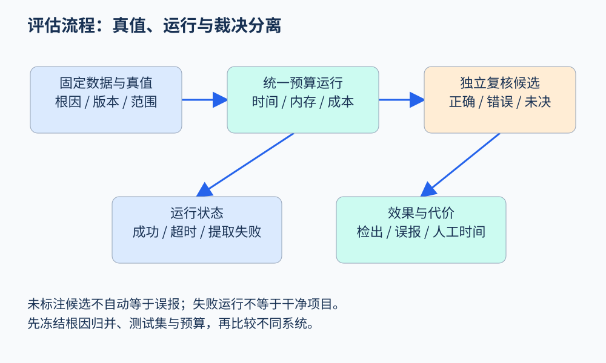

# 第 54 章 评估分析器与实验设计

一个分析器在演示项目里找到三个问题，只说明它能处理这些例子。若要声称新方法比旧方法更有效，需要知道它分析了什么、哪些问题本来存在、哪些结果真实，以及付出了多少成本。评估的第一步是定义任务和计数单位。

## 先确定什么算一个结果

同一个资源泄漏可能在五条路径上触发十条报告。按报告条数计数会把输出更吵的工具误认为更强。可以把“根因级缺陷”作为主计数单位，另外报告位置数、路径数和原始警告数；归并规则必须在比较前确定。

同样，源码行、函数、缺陷和仓库是不同分母。按函数计算的准确率，不能直接与按缺陷计算的召回率比较。对跨文件问题，应记录根因位置和必要证据位置，避免为了适应单行标签而把真实关系剪断。

## 真值怎样建立

[NIST SARD](https://samate.nist.gov/SARD/)提供带有已记录弱点的测试程序，适合检查分析能力与回归。但合成样例的命名和结构可能比真实工程规整，不能直接代表生产效果。本书建议组合三类材料：小型机制测试、带独立审查的真实案例、以及目标环境中的正常项目样本。

真实修复提交也需要审查。修复发生在某个版本，不自动证明指定基线中已有同一根因；重构和新增检查也不一定对应可确认缺陷。建立真值时应记录版本、性质、必要前提和证据，再由独立于工具输出的审查确认。不要先看工具报了什么，再只为它报出的结果制作标签。



图 54-1：固定任务与预算，分别记录运行状态和语义裁决，避免把失败运行当成干净结果。原创教学图。

## 一个具体的混淆矩阵

设评测范围内已确认有二十个根因，分析器报告十二个不同根因候选，其中九个确认成立、三个误报；另有十一个已知根因未被报告。则：

```text
precision = 9 / (9 + 3) = 75%
recall    = 9 / (9 + 11) = 45%
```

这只在真值范围明确时成立。若真实项目没有穷尽标签，未报告问题的数量未知，就不能给出可信的全量召回率。可改为报告“对已确认集合的检出比例”，并明确集合如何形成。也不要把未标注警告直接计为误报，它可能是新发现，也可能确实错误，需要裁决。

若工具崩溃、超时或未能提取项目，应该单独记录。把它们当作“未发现问题”会掩盖可用性问题；将它们全部剔除又可能偏向只在简单项目成功的工具。主结果应展示成功率、缺失原因，以及在统一范围上的效果。

## 成本与预算是结果的一部分

记录墙钟时间、CPU 时间、峰值内存、模型调用数、输入输出量、人工复核时间，以及环境配置。冷启动与缓存运行分开；并行度与超时固定。比较时可给相同时间预算，也可给相同成本预算，但要说明选择。

对带随机性的系统，多次运行并报告分布。平均数之外，展示中位数、尾部耗时和不确定性；如果样本数很小，就如实呈现原始结果，避免精致的统计图制造过强结论。项目间相关性也要考虑：同一代码复制出的几十个样例并不等于几十个独立工程。

## 消融实验回答组件价值

假设系统由程序分析引擎、AI 摘要与候选排序组成。可比较：仅引擎、引擎加摘要、引擎加排序、完整系统。保持输入、预算与裁决流程一致，并记录新增正确结果来自哪里。若去掉某组件后其他组件也失去输入，就要解释依赖，不能把不可运行的配置当作公平基线。

还应防止数据泄漏：按根因、项目家族或时间切分，避免训练示例与测试样例只是变量重命名。提示模板和规则开发也属于调参，应使用开发集；测试集只在冻结方案后运行。公开基准可能被模型预训练见过，因此公开分数与新收集样本的表现需要分开理解。

## 从分数回到工程选择

一个高召回、低精度的系统可能适合离线研究，却让日常 CI 难以使用；一个快速的增量检查器可能覆盖窄，但在提交时很实用。因此结论应对应应用目标：在什么项目、性质和预算下，它减少了多少人工工作，仍漏掉哪些类别。

## 保留一份可复核的实验记录

每次运行至少关联代码版本、输入清单、工具与模型版本、配置、时间限制、退出状态、原始报告与裁决记录。裁决记录应说明为什么成立或不成立，而不是只写一个布尔值。遇到审查者分歧时，保留争议和依据，必要时把样本列为未决；强行把难例塞进正负标签，会让分数精确而意义模糊。

实验报告还应展示按性质与项目类别分组的结果。平均检出率可能主要由大量简单算术样例贡献，而跨函数资源问题几乎没有改善。分组能揭示方法的真实适用区域，也为下一轮研究提供方向。分组必须有足够样本，并避免根据结果临时挑选最有利类别。

最后，保留失败案例比只展示成功案例更有助于研发。注明是表示缺失、抽象太粗、预算不足还是规格不全，才能把下一阶段投入对准实际瓶颈。

工程报告可以把“每小时复核得到的有效根因数”作为辅助指标，但仍要公布计算方式。该指标混合了报告排序、界面质量、审查者经验与问题难度，因此不能独自证明分析算法更强。保留分项数据，才方便其他团队判断结果能否迁移到自己的工作流程。

## 练习

新工具找出九个已知问题和两个未经审查的候选，旧工具找出八个已知问题。能否称新工具找到十一个真实问题？

参考答案：不能。先把两个候选列为未裁决，并确认九个与八个是否按相同根因和范围计数。运行失败、预算与人工确认成本也应一起报告。

## 本章资料

- [NIST：Software Assurance Reference Dataset](https://samate.nist.gov/SARD/)：带已记录弱点的测试材料。
- [NIST：SAMATE](https://www.nist.gov/itl/ssd/software-quality-group/samate)：软件保证工具与评估的官方入口。
