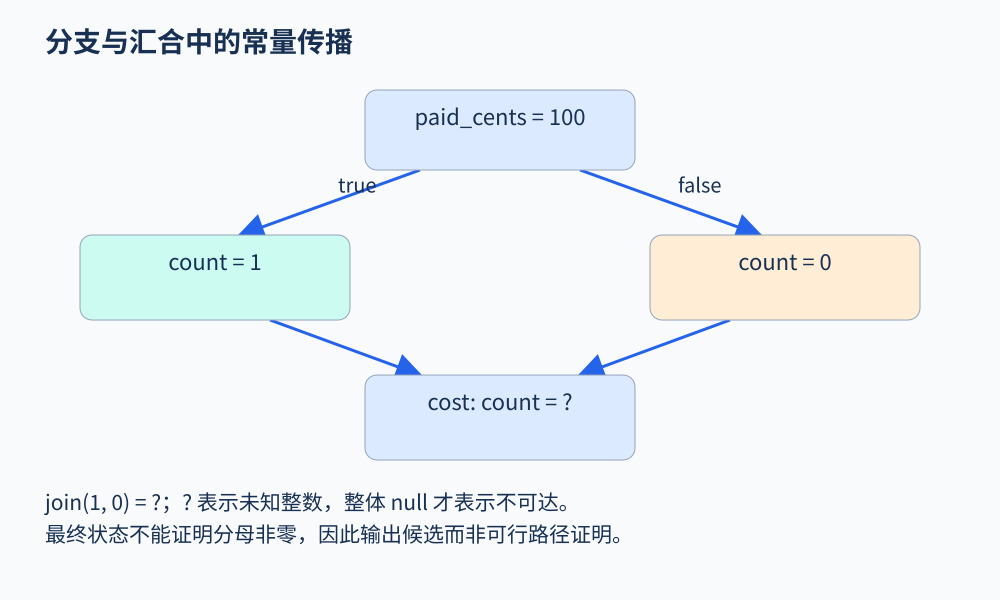

# 第 51 章 搭建一个可运行的教学分析器

本章把前面的表示、抽象域、工作列表和报告串成一个小系统。工程中的 `examples/analyzer.py` 已实现并运行测试。它分析显式控制流 JSON IR，进行常量传播，并给出“除数或断言操作数可能为零”的候选。它没有 Python/C 源码前端，也不证明退款业务正确。

## 把范围写进输入语言

IR 每个节点是一条指令，以名字连接后继。支持整数常量、未知输入、复制、四种算术、分支、跳转、非零断言与停止。例如：

```json
{"op":"div", "dst":"average", "a":"paid_cents",
 "b":"count", "next":"done"}
```

这里的整数是无限精度整数，除法使用 Python `//` 的向负无穷取整，不同于 C 有符号整数除法向零截断。没有溢出、函数、堆、异常或并发；变量在入口均可能为任意整数，因此不检测未初始化读取。未知指令与缺失跳转目标会被拒绝，避免静默跳过不理解的代码。

`branch` 有 `cond`、`true` 和 `false` 字段，但本版总是保留两条边，不利用条件精化状态。`assert_nonzero` 只是检查点，失败时也不删后继。除零后传播未知结果，是保守继续策略，不是具体执行。明确这些选择，读者才能解释警告。

## 抽象域：常量或未知

每个变量的抽象值是一个整数常量，或表示任意整数的 `"?"`。环境不可达用整体 `None` 表示，输出 JSON 时成为 `null`。不可达与未知完全不同：前者没有到达状态，后者有状态但不知道值。

```text
join(7, 7) = 7
join(7, 8) = ?
join(?, 7) = ?
join(不可达, S) = S
```

两个常量运算时计算结果；有未知操作数时一般返回未知。这个版本故意不做 `0 * ? = 0` 等额外精化，虽然不够精确，但便于观察基本框架。算术转移和汇合在此域上保持单调；固定变量集合下，每个程序点可从不可达进入常量状态，再丢失精度到未知，因此循环不需要不断枚举整数。

Clang 的[数据流入门](https://clang.llvm.org/docs/DataFlowAnalysisIntro.html)也用逐步传播与汇合建立直觉；这里的代码是为本书独立编写的更小实现，并未调用 Clang。



图 51-1：这是控制流简图，省略了 input retry 与独立的 branch 节点；常量赋值指令本身不会分支。两条分支分别给出 1 和 0，汇合后 count 为未知；分析器据此提出候选。原创教学图。

## 从退款例子观察状态变化

`examples/refund.json` 先设 `paid_cents=100`，读入未知的 `retry`，再沿两条边分别设置 `count=1` 与 `count=0`，最后计算平均金额。注意它只是借用退款命名的算术例子，不代表完整退款协议。

工作列表初始只有入口。处理入口后，把 `paid_cents=100` 传播给下一节点；处理分支后，两条后继均进入队列。第一条路径到达 `cost` 时，可能暂时得到 `count=1`；第二条路径到达后，汇合将它提升为未知，`cost` 需要再次计算。最终报告阶段读取稳定状态，而不是把中间暂存值当成最终事实。

这也是实现中把报告生成放在求解之后的原因。遍历顺序可以改变中间状态和工作步数，但不应改变在此框架下得到的最终抽象结论。

## 运行和验证

在项目根目录执行：

```bash
python3 examples/analyzer.py examples/refund.json
python3 -m unittest discover -s examples -p 'test*.py' -v
```

需要 Python 3.10 或以上，仅使用标准库。示例运行的 `cost` 输入状态中，`paid_cents` 为 100，`count` 为 `"?"`；报告状态为 `unknown-may-be-zero`。这说明当前抽象不足以证明非零，并非分析器已经输出可行的具体路径。

八项测试覆盖：不同常量汇合到未知；相同常量保持精度且不报除零；已知零操作数保留候选；不可达节点不报警；循环丢失常量后收敛；非法指令与目标明确拒绝；畸形字段统一抛出明确错误；即使条件为常量，仍按设计不裁剪分支。这些测试针对模型边界和求解性质，比只验证一条直线代码更有用。

## 理解“已知零”的限制

若分母在抽象状态中为零，报告使用 `known-zero-in-abstract-state`。这只描述该程序点的抽象操作数，不能省略“抽象状态”几个字。由于分支条件没有求解，该点可能只经由不可行的具体路径到达。所有报告仍需结合具体可达性复核。

同理，没有报告不等于整个程序无缺陷。当前检查只关注两个非零性质，且只适用于这个 IR；内存泄漏、越权和重复退款根本不在它的语义中。一个诚实的小工具，应让能力边界与代码同样容易找到。

## 怎样继续扩展

合适的下一步是增加边上的条件精化，例如把非零分支中的变量限制为非零；这需要更丰富的抽象域，而不仅是在输出里加一句描述。再往后可加入源位置、稳定报告标识和简单函数摘要。每增加一种语义，先定义具体行为，再设计抽象转移与测试。

若加入真实语言前端，应优先复用成熟解析和语义基础设施，并处理异常、整数语义、求值顺序与库模型。直接把 Python AST 中未识别的节点忽略，会得到看似支持整门语言、实际漏洞百出的工具。

## 沿着实现定位各个概念

`validate` 负责保证输入属于教学语言；`successors` 定义图边；`transfer` 承担单条指令的抽象语义；`join` 合并不同前驱；`analyze` 维护状态和队列，稳定后生成报告。读者可以先分别阅读这几个函数，再看它们怎样组合，避免从命令行入口一次读完整文件。

队列可以重复包含同一节点，这会增加工作量，但不改变单调求解的目标。本版选择简单实现；优化时可以维护在队集合去重，但应先保留测试，确认只减少工作量而没有漏掉变化传播。输出的 `worklist_steps` 用于观察求解过程，不是不同分析器之间公平的性能分数。

若希望理解保守性，可把两个分支都改成非零但不同的值，例如一和二。当前域会把它们汇合成未知，仍提出候选；更丰富的非零抽象或有限集合域可以保留信息。改进方向因此来自模型损失，而不是把警告文本改得更自信。

扩展前还应固定错误策略：遇到不支持语法就拒绝，遇到预算限制就输出未知，遇到非法输入就返回明确错误。不要让这些状态都变成空报告。这样的接口约定虽然简单，却能防止教学实验接入更大工程后被误读为完整的通过结论。

## 练习

把 `repeat` 中的 `count=0` 改成 `count=1`，结果怎样变化？若只把 `retry` 固定为 1 呢？

参考答案：前者两条路径汇合仍为 1，平均值成为 100，候选消失；后者候选仍存在，因为本版不利用分支条件裁剪路径。工程测试包含这两种对照。

## 继续阅读

本章Python分析器已经过测试，并未得到整套实现的形式化证明。[证明分析器](42.md)另外定义了更小的抽象模型，展示转移覆盖与有限多步覆盖应怎样陈述和检查，二者不可混同。

## 本章资料

- [Clang：Data flow analysis, an informal introduction](https://clang.llvm.org/docs/DataFlowAnalysisIntro.html)：数据流、抽象值与汇合的官方说明。
- 本书源码：`examples/analyzer.py`、`examples/refund.json`、`examples/test_analyzer.py` 和 `examples/README.md`。
