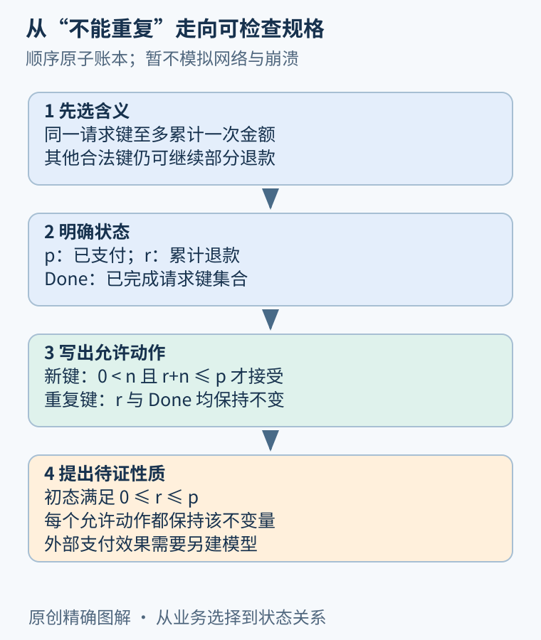
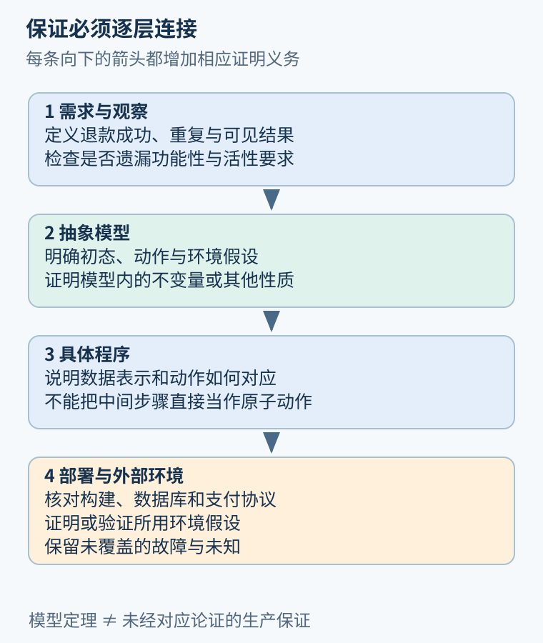

# 第 25 章 形式化方法的地图与规格细化

前面已经用控制流、状态机、约束与契约理解程序。本篇再向前走一步：把“我们希望成立什么”写成精确对象，并让机器检查论证。先解决的不是证明语法，而是规格到底覆盖了什么。

## 从一句承诺拆出三个问题

“退款不能重复”看起来清楚，却有多种含义：同一请求不能累计两次金额，同一订单不能部分退款多次，支付服务不能收到重复消息，还是最终到账金额只能计算一次？它们要求不同，有的甚至互相冲突。支持部分退款的系统，显然允许同一订单出现多次合法操作。

先选一个明确范围：顺序、原子的教学账本；金额为自然数分；`p` 是已支付金额，`r` 是已累计退款，`Done` 是已完成请求键集合。暂时只研究账本状态，不模拟网络和崩溃。

```text
初态：r = 0，Done = ∅，p 固定
接受新请求(k,n)：
  k ∉ Done，0 < n，r + n ≤ p
  r' = r + n，Done' = Done ∪ {k}
重复请求(k,n)：
  k ∈ Done
  r' = r，Done' = Done
其他非法请求：状态保持不变
```

撇号表示一步后的值。本例只是教学关系，不是完整 TLA+ 语法。TLA+ 的[官方符号概要](https://lamport.azurewebsites.net/tla/summary-standalone.pdf)可用于核对状态、动作和时序运算的区别。规格中的每一条边都在声明允许发生什么，未声明的失败路径不能被读者自行补上。



图 25-1：先选观察对象与边界，再把需求拆成状态、动作与性质。精确写法并不能替代业务选择。

## 把证明义务从规格中取出来

希望维持不变量 `I ≡ 0 ≤ r ≤ p`。证明分成两部分：初态满足 I；每一种允许动作都保持 I。初始化有 `r=0`，而 `p` 是自然数，所以成立。接受请求时，守卫已经给出 `r+n≤p`，相加后仍非负；重复和非法请求都不改 r，因此保持原性质。

这项证明依赖“接受动作整体原子”的假设。若实现把检查与累加拆开，两个请求可能都看到旧值，再分别写入或产生外部效果。账本规格没有自动证明这种实现。这里需要建立实现步骤与抽象动作之间的对应，后续的精化章节会进一步处理。

再检验重复键：从 `r=0, Done=∅` 出发，接受 `(A,300)` 后得到 `r=300, Done={A}`；再次输入 `(A,300)` 时不改变状态。但若第二次输入 `(A,500)`，上述规格仍只保证金额不增加，没有规定返回哪个结果或是否报告冲突。发现这个空白，正是写规格的价值。若要求返回首笔结果，需要把集合扩成“键到请求内容及结果”的映射。

## 四条相互配合的路线

| 路线 | 核心对象 | 本例可以怎样使用 |
| --- | --- | --- |
| 精确规格 | 状态、动作、契约 | 排除对“重复”的歧义 |
| 模型检查 | 有限或受约束的状态空间 | 枚举小金额、小请求集合，寻找反例 |
| 演绎验证 | 程序与证明义务 | 从前提证明每个动作保持不变量 |
| 交互式证明 | 定理、定义与证明项 | 逐步构造一般性论证并交给内核检查 |

这些路线可以组合。模型检查发现遗漏分支，促使修改规格；证明助手帮助处理参数化结论；契约验证器把代码转换为条件，再交由求解器处理。[Dafny 官方入门](https://dafny.org/dafny/OnlineTutorial/guide)展示了前置、后置条件怎样连接调用者责任与实现责任，但不同工具的证明基础和自动化机制仍需分别理解。



图 25-2：每一层都增加不同的论证义务。模型中的定理，不应直接改写成生产系统保证。

## 规格细化应补充责任，而非只加符号

需求到状态机是一种细化：把含糊语言中的选择显式化。状态机到具体实现则需要解释数据表示、允许的中间步骤以及失败恢复。越靠近实现，越要面对有限位宽、容器行为、异常和持久化。某些实现细节可以隐藏，但必须证明隐藏后观察到的行为符合上层要求。

例如为重复请求新增缓存，只是一种实现策略。缓存淘汰后同一键能否再次执行？键的唯一性按用户、订单还是全局计算？重启是否保留 Done？这些问题会改变承诺本身。规格细化不能把它们全部压成“调用去重库”。

也应主动测试规格是否过弱。一个永远拒绝请求的实现满足“不超额”与“不重复累计”，却没有提供退款服务。若系统还应完成合法请求，需补功能性条件；若要求最终完成，则还涉及活性和外部服务假设。单独的不变量不能承担这些任务。

## 让形式化投入有明确边界

初次采用时，可以选择错误代价高、边界稳定的一段逻辑：计费规则、权限决策、状态转换或关键数据结构。写出少量有用性质，比给整个应用铺满符号更容易形成可检查成果。之后记录每项假设由谁保证：类型、数据库约束、调用者校验，还是尚待验证的环境条件。

不满足假设的运行没有获得同一保证；这不表示任意失败都能归咎于使用者。前提也要接受合理性审查。如果规格要求输入永远合法，实际接口却直接接受不可信输入，系统仍缺少建立前提的步骤。形式化方法应把这种责任暴露出来。

## 用一条具体轨迹审查抽象

取已支付额一千分，依次提交三百、四百、四百三个不同键请求。前两步累计为三百和七百；第三步因一千一百超过上限而保持七百。把状态序列写出来，可以同时检查守卫、单位和非法动作。若读者算出的结果不同，应先澄清规格，再讨论工具。

接着增加一次网络超时，就会发现当前模型没有描述它。正确做法是显式扩展动作或说明范围；不能把外部服务的实际效果自动当成账本赋值。一个在纸上很短的轨迹，往往能暴露跨层保证被省略的位置。

## 练习与参考答案

把接受请求的条件从 `r+n≤p` 改成 `n≤p`，其余不变。不变量还能保持吗？再说明为什么“请求键唯一”不能单独补救。

参考答案：取 `p=1000`，先以键 A 退款 700，再以键 B 退款 700，两次均满足单笔不超过 1000，累计却为 1400。键唯一只排除重复身份，不能限制不同合法请求的金额之和。接受条件必须连接新金额与已有累计值。

## 本章资料

- Leslie Lamport：[Summary of TLA+](https://lamport.azurewebsites.net/tla/summary-standalone.pdf)，状态、动作与时序运算的符号参照。
- Dafny：[Getting Started with Dafny](https://dafny.org/dafny/OnlineTutorial/guide)，契约、验证与调用者责任的工具实例。
