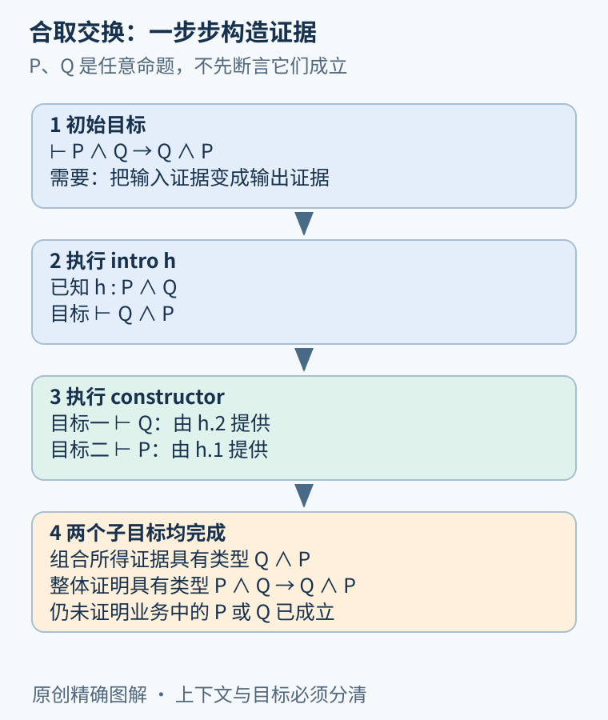
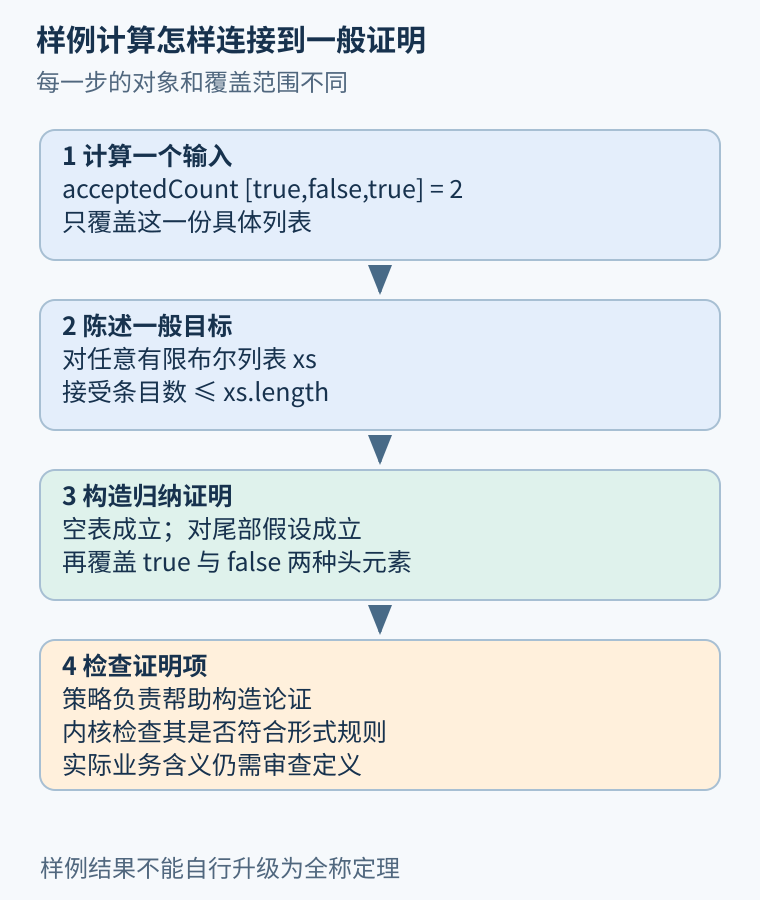

# 第 26 章 命题、类型与证明助手

在程序中，`count : Nat` 表示 count 是自然数。在 Lean 中，`h : P` 可以表示 h 是命题 P 的一个证明。理解这种联系，就能把证明助手看成一种严格管理证据的语言：结论需要什么类型的证据，手头有哪些证据，下一步如何组合。

## 命题与证据不是同一件事

令 P 表示“请求已认证”，Q 表示“金额已校验”。写出 P 并没有让请求通过认证；同样，声明想证明 P 也不等于已有证明。要获得 `h : P`，必须从定义、假设或已证明结论构造证据。[Lean 官方教材的命题与证明章节](https://lean-lang.org/theorem_proving_in_lean4/Propositions-and-Proofs/)用这种命题即类型的视角解释证明项。

有了 `h : P ∧ Q`，便能分别取出 P 和 Q 的证据。若要证明 `Q ∧ P`，再按反顺序组合即可：

```lean
theorem and_swap (P Q : Prop) : P ∧ Q → Q ∧ P := by
  intro h
  constructor
  · exact h.2
  · exact h.1
```

冒号右侧是待证命题，`by` 后是构造证明的步骤。`intro h` 暂时接受一个同时包含两种证据的输入；`constructor` 把合取目标拆成两个目标；`h.2` 和 `h.1` 分别提供所需证据。这里没有证明 P、Q 在业务上确实成立，只证明“如果已有二者，则可以交换顺序”。



图 26-1：已知条件在上方累积，待证目标逐步拆解。每个子目标都必须获得类型匹配的证据。

## 逻辑符号对应怎样的操作

| 命题形状 | 构造证明时需要什么 | 使用已有证明时能做什么 |
| --- | --- | --- |
| `P ∧ Q` | 分别证明 P 与 Q | 取出左、右两部分 |
| `P → Q` | 给定 P 的证据，构造 Q | 把 P 的证据交进去得到 Q |
| `∀ x, R x` | 对任意 x 证明 R x | 选择某个 x 获得 R x |
| `∃ x, R x` | 给出见证 x 及 R x 的证明 | 取得某个见证和它满足的性质 |

全称与存在的次序不能随意交换。“每个请求都有某个有效令牌”，并不意味着“存在同一个令牌适用于所有请求”。证明语言迫使我们保留这种区别。[Lean 的量词与相等章节](https://lean-lang.org/theorem_proving_in_lean4/Quantifiers-and-Equality/)详细说明了量词的引入与使用规则。

蕴含也不应被误读成时间顺序。`P → Q` 只说明从 P 可导出 Q，并不表示系统先发生 P 再发生 Q。描述未来最终响应需要时序模型；描述调用产生副作用需要程序语义。逻辑符号简洁，但不能凭外形让它承担额外含义。

## Bool 与 Prop 分别负责什么

`true : Bool` 是一个计算值，`P : Prop` 是一个命题。一个函数可以计算请求是否通过检查，并返回 Bool；要证明这段检查与某个业务性质一致，还需要建立二者关系，例如“函数返回 true 当且仅当请求满足条件”。只看到输出 true，并不自动获得对任意输入都成立的规格定理。

同样，`#eval check input` 是一次计算；`theorem correct : ∀ input, ...` 是带全称量化的结论。二者可以配合：先用计算发现规格错误，再尝试一般性证明。它们的覆盖范围不同，不能把很多次计算压缩成未经论证的全称结论。

## 相等也有不同的使用方式

某些等式可由定义直接计算出来，例如自然数 `2+3=5`。另一些等式则需要归纳或已有定理，例如对任意 n 证明两种递归计数方式一致。Lean 的 `rfl` 能处理定义展开后相同的两端，却不是万能等式求解器。

如果已知 `h : a=b`，可以用它替换目标或假设中的 a。这种重写必须依据已有等式；不能因为两段程序看起来接近，就任意交换副作用或忽略异常。程序等价往往还需要定义观察行为，才谈得上等式或关系的证明。



图 26-2：有限计算给出样例结果，全称命题描述范围，证明项提供一般性论证，内核负责检查形式规则。

## 递归定义为什么连接到归纳

有限列表要么为空，要么由头元素与较短列表组成。若函数按这两种情况递归，证明其性质通常也可按同样结构展开：证明空列表；假设较短列表已满足性质，再证明加一个头元素仍满足。这个假设只用于较小结构，不允许把当前完整目标直接当真。

例如“接受条目数不超过列表长度”：空表的两个数都为零；头部为 true 时两边同时加一；为 false 时接受数不变，长度加一。下一章会把这段口头推理变成可检查文件。这里计数的是条目，不是独立请求身份；重复业务事件仍需其他模型。

## 自动化的职责与信任边界

证明助手的策略可以搜索证明、重写或简化目标。标准的策略证明最终交给内核检查证明项，具体哪些扩展路径或外部机制被使用仍要查看工具与依赖。Lean 的[策略教材](https://lean-lang.org/theorem_proving_in_lean4/Tactics/)说明了策略是构造证明项的指令，不是绕过逻辑的口令。

内核能检查形式陈述与形式证明，却不能判断“请求已认证”这个名字是否对应真实认证流程。因此审查仍包括命题定义、显式前提、依赖公理与程序建模。写出形式化文件，只是让这些对象更清楚、更便于机器检查，并没有消除对需求的判断。

## 用业务含义检查逻辑结构

设 `Valid k` 表示键 k 对应合法请求。命题“存在一个合法键”只要求给出某个见证；命题“所有已接受键都合法”还需要描述集合成员与合法性的关系。若只证明前者，系统仍可能接受其他非法键。逻辑结构决定了结论的强度，变量名无法补足缺失的量词。

再看反方向：已知金额在允许范围，并不能推出请求经过了认证。两性质即使都与同一对象有关，也没有天然蕴含关系。证明失败有时不是缺少某个策略，而是目标在当前假设下根本不成立。先尝试构造反例，通常比盲目寻找证明更有效。

数值类型的选择也属于陈述的一部分。Lean 的自然数减法在不足时截断为零；若用它定义剩余额度，异常超额状态可能被隐藏成零。要研究负余额，应选整数或保留 `already≤paid` 前提，不能让类型选择悄悄改变业务问题。形式化时，选类型与写证明同样需要思考。

## 练习与参考答案

已知 `hpq : P → Q` 和 `hqr : Q → R`。怎样证明 `P → R`？如果没有 P 的证据，能否直接得到 R？

参考答案：先接受 `hp : P`，构造 `hpq hp : Q`，再构造 `hqr (hpq hp) : R`。于是得到一个从 P 到 R 的证明函数。没有额外 P 证据时，不能仅凭这两条蕴含得出 R；它们没有承诺 P 本身成立。

## 本章资料

- Lean：[Propositions and Proofs](https://lean-lang.org/theorem_proving_in_lean4/Propositions-and-Proofs/)、[Quantifiers and Equality](https://lean-lang.org/theorem_proving_in_lean4/Quantifiers-and-Equality/)，命题、证据与量词。
- Lean：[Tactics](https://lean-lang.org/theorem_proving_in_lean4/Tactics/)、[Inductive Types](https://lean-lang.org/theorem_proving_in_lean4/Inductive-Types/)，策略与结构化定义。
