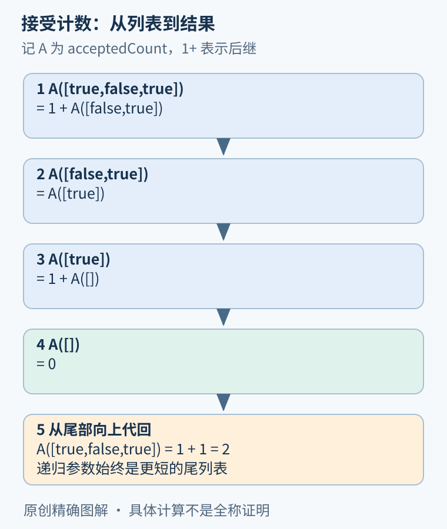
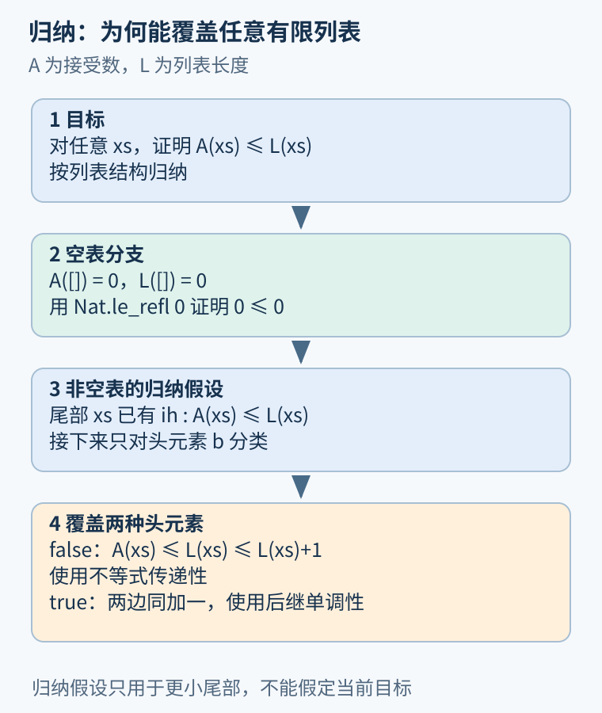

# 第 27 章 Lean 实作：从定理陈述到内核检查

现在把上一章的证据规则落到真实文件。目标很小：实现一个统计接受条目数量的函数，并证明对任意有限列表，计数不超过列表长度。小目标使定义、归纳假设和每一步依据都能完整展示。

## 先固定工具和证明对象

本书示例文件是 [Foundations.lean](../examples/lean/Foundations.lean)，固定使用 Lean 4.19.0，只导入 `Std`，不依赖 Mathlib。应先确认运行工具的版本，再从项目根目录执行：

```sh
lean --version
lean examples/lean/Foundations.lean
```

直接调用路径里的另一个 Lean 不会自动遵守口头版本约定；若通过工具链管理器运行，也应确认项目选择了对应工具链。命令成功完成、没有证明占位或未解决目标，才能把该文件记录为已检查。本书已用 Lean 4.19.0 实际检查此文件，退出状态为零，计算例输出二；四项定理的公理查询均报告没有公理依赖。详细命令与环境说明见[验证记录](../references/foundations-lean-validation.md)。

这里的 `Nat` 是无固定机器位宽的自然数，`List Bool` 是有限布尔列表。布尔值代表条目被接受或拒绝。模型没有订单编号、外部付款和并发，因此不证明重复退款被禁止，也不证明机器计数器永不溢出。先把范围写清楚，比先追求复杂定理更重要。

## 定义沿列表结构递归

```lean
def acceptedCount : List Bool → Nat
  | [] => 0
  | true :: xs => Nat.succ (acceptedCount xs)
  | false :: xs => acceptedCount xs
```

`[]` 是空列表，`::` 把头元素接到尾列表前。空列表接受数为零；头为 true 时在尾部计数上加一；头为 false 时保持尾部计数。递归调用的参数是更短的尾列表，因而符合结构递归。

对 `[true,false,true]`，按定义可逐层展开：最外层贡献一，false 不贡献，最后一个 true 再贡献一，空表为零，结果为二。文件中的 `#eval` 展示这个有限计算，而下一项定理处理所有列表。



图 27-1：每次递归只处理一个头元素；尾列表严格变短。计算结果二，不是全称性质的替代证明。

## 定理和两层分类

```lean
theorem acceptedCount_le_length (xs : List Bool) :
    acceptedCount xs ≤ xs.length := by
  induction xs with
  | nil =>
      exact Nat.le_refl 0
  | cons b xs ih =>
      cases b with
      | false =>
          exact Nat.le_trans ih (Nat.le_succ xs.length)
      | true =>
          exact Nat.succ_le_succ ih
```

`induction xs` 首先建立空表与非空表两种目标。空表时，定义计算把目标化为 `0≤0`；`Nat.le_refl 0` 正好提供它。

非空表时，`b` 是头元素，`xs` 是尾部，`ih` 是对尾部的归纳假设：`acceptedCount xs ≤ xs.length`。注意这里的局部 xs 已代表较短尾部，不是把整个原列表的目标直接拿来使用。接着按 b 的两种构造分类。

- b 为 false：新计数仍为 `acceptedCount xs`，新长度是 `Nat.succ xs.length`。先由 ih 到尾部长度，再由 `Nat.le_succ` 到新长度，用传递性接起来。
- b 为 true：新计数与新长度都加一。`Nat.succ_le_succ ih` 将较短列表的不等式提升到当前列表。

这段证明没有枚举列表长度，也没有把测试结果提升为定理。它利用列表的构造方式覆盖任意有限长度。[Lean 官方归纳与递归教材](https://lean-lang.org/theorem_proving_in_lean4/Induction-and-Recursion/)解释了相应递归描述最终怎样转换为内核可检查的项。



图 27-2：归纳假设只属于尾部。false 分支使用传递性，true 分支使用后继保持不等式的定理。

## 先读目标，再选策略

证明失败时，先检查当前上下文与目标。若目标是合取，通常要提供两部分；若是蕴含，可以引入前提；若涉及递归列表，可以按构造分类或归纳。不要一开始就堆叠自动化命令，让错误信息越来越远离定义。

文件还包含 `and_swap`、`implication_chain` 与 `twoPerItem_eq_add`。前两项对应上一章的证据组合；最后一项证明递归“每项加二”的计数等于 `n+n`，展示自然数归纳。它在后继分支用显式等式链、归纳假设与自然数加法规则推导，提醒读者：`rfl` 能处理定义上相同的表达式，却不能替代全部代数推理。

读这些例子时，把源码中的每个策略与“目标发生什么变化”相连，而不是只记命令拼写。证明助手返回的局部上下文，是发现自己误解陈述或遗漏条件的直接工具。

## 检查通过之后，还要看依赖

文件末尾使用 `#print axioms` 查看各定理的公理依赖。导入库与定理实际使用了哪些基础依赖，是两件需要分别审查的事。某些标准逻辑扩展本身具有明确含义；自己把目标直接声明成公理，则没有完成要做的证明。[Lean 的公理与计算章节](https://lean-lang.org/theorem_proving_in_lean4/Axioms-and-Computation/)解释了相关基础选择。

本文件不使用 `sorry`、`admit` 或自设公理，也不借助原生计算证明策略把外部执行当作本章核心论证。证明的有效性仍相对于 Lean 逻辑基础及内核正确性；工具链、已检查源码和最终应用之间的对应，在后续可信基础章节继续讨论。

## 一次可重复的检查应保留什么

保存验证结果时，至少记录工具版本、文件路径、源码版本、完整命令、退出状态与诊断。只截取最后一行“计算得到二”，不能证明其余定理已检查；只看到编辑器没有红线，也不代表另一台机器采用了同一依赖。文件越小、依赖越少，越容易复查这些条件。

本例可以做一个有意失败的实验：在副本中把 true 分支改成每次加二，再尝试检查原定理。取单元素 `[true]`，函数得到二而长度为一，已经给出反例，所以不应试图通过增加假设之外的“捷径”来消除错误。应恢复实现，或者明确修改规格。正式随书文件保留正确版本，实验副本不应混入交付。

还可以有意删掉归纳假设的使用，观察 true 分支剩下什么目标。你会看到：知道尾列表计数不超过长度，是把递归计算连接到当前结论的关键。若只按 Bool 分类而不按列表归纳，就没有这份对任意尾部成立的证据。

这个过程给程序分析提供了实用习惯：把复杂结论拆成小而稳定的辅助定理，让失败位置尽量接近错误假设。后续证明状态转换和分析器时，规模会扩大，但仍然需要同样的目标阅读、定义核对与证据追踪。

## 练习与参考答案

把 false 分支的定义也改成 `Nat.succ (acceptedCount xs)`。原来的“不超过长度”仍能成立吗？它还准确描述“接受条目数”吗？

参考答案：不超过长度仍可成立，因为函数现在恰好统计所有条目；两个头部分支都可用 `Nat.succ_le_succ ih`。但“统计接受条目”的功能规格已不满足。取 `[false]` 即可看出应返回零却返回一。这说明一个通过检查的不等式，还不足以完整刻画函数意图。

## 本章资料

- Lean：[Induction and Recursion](https://lean-lang.org/theorem_proving_in_lean4/Induction-and-Recursion/)，递归定义与归纳原则。
- Lean：[Tactics](https://lean-lang.org/theorem_proving_in_lean4/Tactics/)，局部目标与策略操作。
- Lean：[Axioms and Computation](https://lean-lang.org/theorem_proving_in_lean4/Axioms-and-Computation/)，公理依赖与计算边界。
- 随书源码：[Foundations.lean](../examples/lean/Foundations.lean)，完整定理、计算例与依赖查询。
