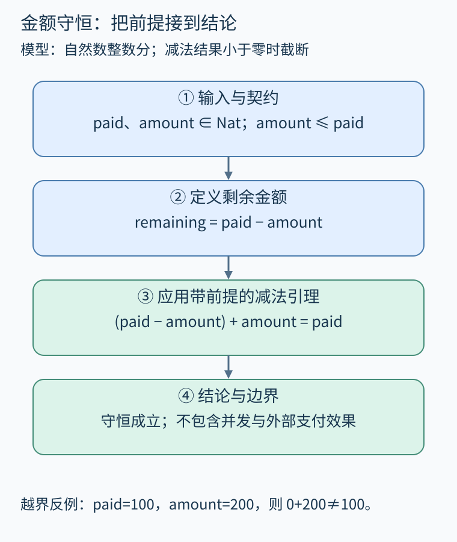
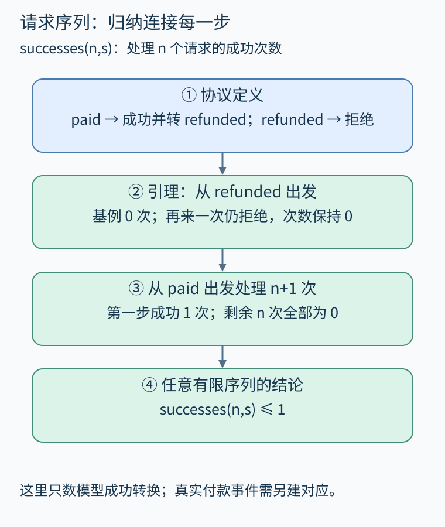

# 第 28 章 证明程序满足规格：归纳、契约与状态转换

“金额不会算错”与“同一订单不会重复退款”都像正确性要求，但证明对象不同。前者可以是一个算术函数，后者涉及允许哪些状态转换、怎样累计外部效果。正式证明先把这些含义拆开，再把函数、规格和证明放到同一个可检查的语言中。

本章配套文件为 [ProgramProofs.lean](../examples/lean/ProgramProofs.lean)，只使用 Lean 核心与 Std。它定义极小的纯函数和顺序状态机；真实订单服务的数据库、网络、并发和崩溃恢复没有被放进这个模型。这个边界不是附带说明，而是定理陈述本身的一部分。

## 28.1 金额守恒需要什么前提

设 paid 是已支付金额、amount 是本次退款金额，都用自然数表示整数分。剩余金额定义为 `paid-amount`。希望证明：剩余金额加退款金额，正好等于原支付金额。

```lean
def remaining (paid amount : Nat) : Nat := paid - amount

theorem refund_conservation (paid amount : Nat)
    (h : amount ≤ paid) :
    remaining paid amount + amount = paid := by
  exact Nat.sub_add_cancel h
```

陈述中 `paid amount : Nat` 覆盖任意自然数，而不仅是某几笔订单；h 是必须由调用环境建立的前提。证明调用标准库关于自然数减法的定理，交给检查器核对参数和结论是否吻合。[Lean 官方文档](https://lean-lang.org/theorem_proving_in_lean4/Inductive-Types/)解释了自然数等归纳类型与递归、归纳原则的关系；本章代码则是独立的订单模型。

为什么要写 h？Lean 的自然数减法在结果为负时截断成零。令 paid=100、amount=200，剩余为0，于是 `0+200≠100`。只证明“剩余金额非负”几乎没有信息，因为任意 Nat 天生非负；守恒等式加合法范围才刻画了我们真正关心的行为。



图 28-1　输入、函数展开、标准库引理和结论逐步衔接；越界输入展示前提不可删除。原创精确示意。

这也提醒我们警惕空洞证明。假如前置条件错误写成 `amount≤paid ∧ amount>paid`，从矛盾可以推出任何结论，形式证明仍可能成立，但没有合法输入能满足前提。规格审查要检查前提是否可实现、是否对应真实调用者，而不只是观察证明有没有通过。

## 28.2 把合法操作写成状态转换

现在建立只有 paid 与 refunded 的状态类型。请求在 paid 上成功，转为 refunded；在 refunded 上返回 none，表示拒绝。Option 将成功后状态与拒绝区分开，不把失败伪装成一个新的成功状态。

```lean
inductive State where
  | paid
  | refunded
  deriving DecidableEq, Repr

def refundStep : State → Option State
  | .paid => some .refunded
  | .refunded => none
```

`refundStep .refunded = none` 可以通过展开定义证明。它说明局部转换拒绝重复请求，尚未说明任意长请求序列至多成功一次。后一个性质需要把每一步连接起来。

配套文件定义 `successes n s`：从状态 s 开始处理 n 个请求，成功时加一，并在后继状态继续；拒绝时保持原状态继续。递归参数 n 每轮减一，因此定义是有限序列上的总函数。这个 n 是请求数量，不是金额，也不是数据库版本。

## 28.3 对请求数量做归纳

首先证明从 refunded 出发，无论再来多少请求，成功次数都为零。基例 n=0 没有请求，自然为零；归纳步处理一个新请求，它被拒绝，剩余 n 个请求由归纳假设给出零。

再证明 paid 状态下至少一个请求会产生恰好一次成功：第一步转入 refunded，以后全部为零。最后按初始状态和 n 是否为零分类，得到：

```lean
theorem at_most_one (n : Nat) (s : State) :
    successes n s ≤ 1 := by
  cases s with
  | paid =>
      cases n with
      | zero => simp [successes]
      | succ n => simp [paid_successes]
  | refunded => simp [refunded_successes]
```

这里的 `paid_successes` 与 `refunded_successes` 是配套文件中先建立的引理。证明分解让最后定理短小，但没有绕过关键步骤；检查器会沿依赖确认每个引理的证明。



图 28-2　先处理“已退款状态永不再成功”，再把首次成功与剩余序列组合。原创精确示意。

归纳并不是把0、1、2各测一次后猜测规律。归纳假设描述任意 n 的情形，再证明 n+1，因此覆盖所有有限请求数量。若要讨论无限运行中的最终完成，还需要新的执行与时序性质，不能从这个计数定理直接推出活性。

## 28.4 从局部契约组合系统保证

金额函数与状态机目前独立。若把它们组合成退款操作，调用者要建立状态为 paid、金额合法；成功出口要保持守恒并转换状态；拒绝出口要说明金额和状态均未改变。堆对象、异常出口和外部调用加入后，契约还需说明哪些字段可写、哪些资源转交。

Hoare 三元组 `{P} C {Q}` 常用于表达这种责任：前提成立且执行按所选终止语义完成时，结论成立。部分正确性不包含终止保证；总正确性还要证明终止。Lean 里的总函数递归检查解决的是这里所定义函数的终止，不能替外部支付接口保证会返回。

还有一个重要对应问题：配套状态机把一次退款步骤视为不可分割的纯转换。真实程序若先读状态、再发付款、最后写状态，两个请求可以都读到 paid。顺序模型的定理没有错，但实现没有满足模型的原子性假设。证明并发实现需要扩大状态与操作语义，或证明实现正确地精化了这个抽象步骤。

## 28.5 怎样阅读一份证明成果

先读定理的量词和假设，再读定义，最后看证明技巧。检查器接受一个证明，只意味着指定逻辑里的结论由这些定义与依赖成立。若证明对象用 Nat，实际实现却用固定宽度整数，溢出对应关系仍需建立；若计数表示模型中的成功转换，它与真实支付成功事件的联系也不能省略。

本章的练习文件包含完整证明体。本次制作已用Lean 4.19.0实际检查该文件，返回成功；读者可按项目说明执行 `lean examples/lean/ProgramProofs.lean` 复查。这个结果确认的是所附模型与定理，不能扩展成真实支付程序已验证。检查版本、命令、环境适配及公理依赖另在检查报告记录，便于读者独立复现。

## 28.6 练习与答案

把 `refundStep .refunded` 改成 `some .refunded`，其他定义不变。`successes 2 .paid≤1` 还成立吗？只证明最终状态为 refunded 能否发现差别？

**参考答案：**两次请求都走成功分支，成功次数为2，因此计数性质失败；最终状态仍是 refunded，单独检查最终状态无法区分一次与两次成功。规格必须保留所关心的历史或效果，不能指望证明助手从字段名称补出业务意图。

## 本章资料

- [Lean：Inductive Types](https://lean-lang.org/theorem_proving_in_lean4/Inductive-Types/)。归纳数据与命题的构造、消去及归纳原则。
- [Lean：Induction and Recursion](https://lean-lang.org/theorem_proving_in_lean4/Induction-and-Recursion/)。递归定义与归纳证明的官方延伸阅读。
- [配套证明文件](../examples/lean/ProgramProofs.lean)。本章对应金额守恒、状态转换、成功计数三组定义与定理。
