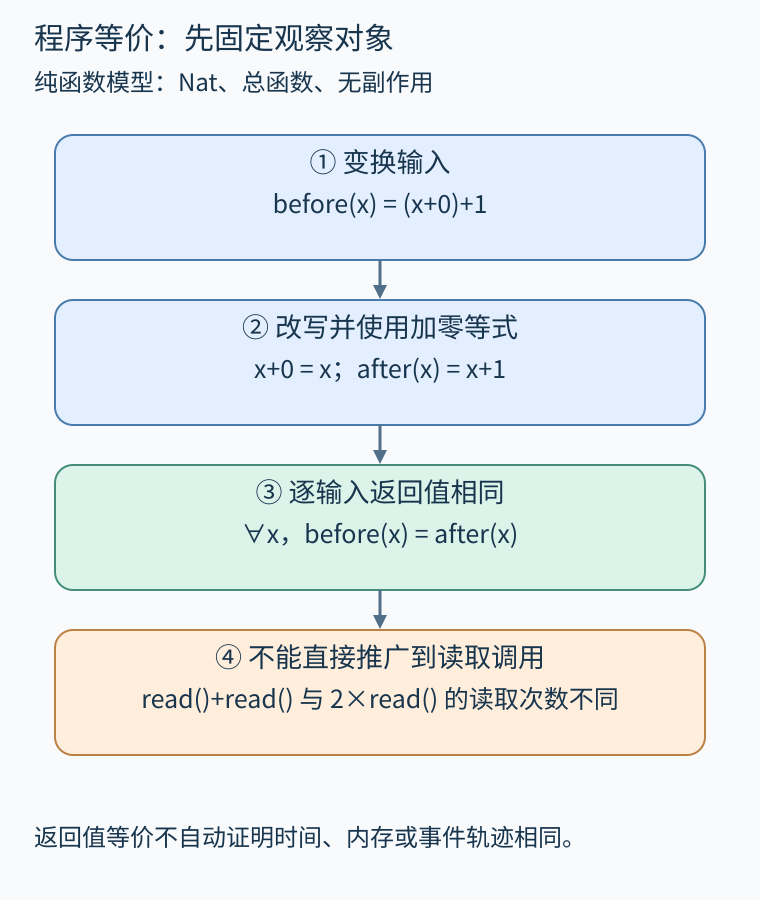
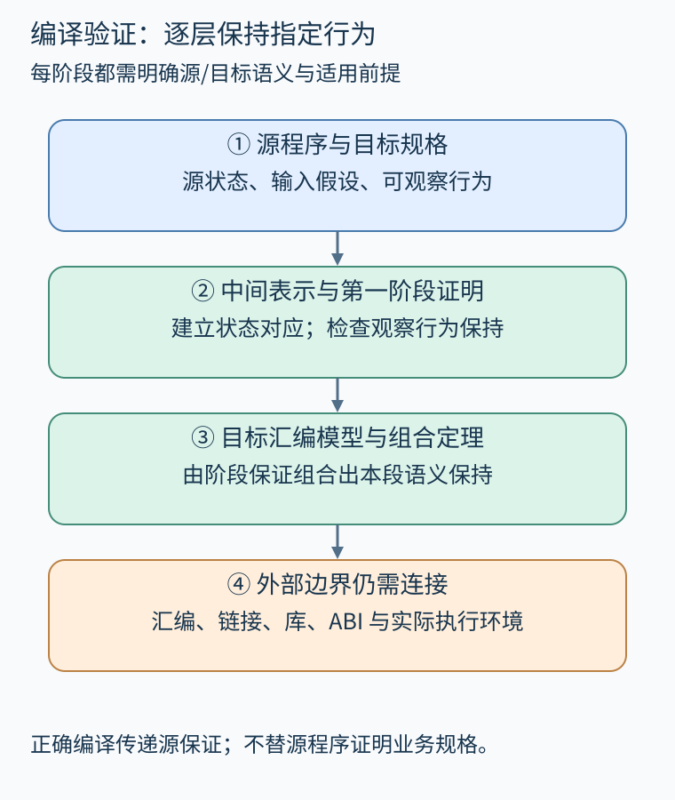

# 第 29 章 程序等价、精化与编译变换验证

“优化前后输出一样”听起来足够明确，实际却需要回答三个问题：对哪些输入一样，观察哪些行为，以及是否允许实现减少原程序的选择。把这些边界写清楚，才有可验证的程序等价与编译正确性。

本章从一个极小纯函数出发，再扩展到带副作用、非确定性和未定义行为的程序。配套证明不验证通用编译器，只证明其中一个自然数函数改写；真实工具用于说明更大规模工程怎样组织这些义务。

## 29.1 等价从明确的观察开始

在数学自然数上，两个总函数分别为 `(x+0)+1` 与 `x+1`。两者对每个 x 返回同一自然数。配套文件中可以写：

```lean
def before (x : Nat) : Nat := (x + 0) + 1
def after (x : Nat) : Nat := x + 1

theorem remove_zero_correct (x : Nat) :
    before x = after x := by
  simp [before, after]
```

`simp` 展开定义并使用已有等式化简。证明结论只观察返回值，因为定义没有I/O、异常、时钟、可变内存和非终止。它也没有证明 after 更快：运行时间属于另一个成本语义，需要另设度量并比较。

若把表达式中的 x 换成函数调用 `read()`，改写 `read()+read()` 为 `2*read()` 就不再自动成立。两次读取可能返回不同输入，甚至各自产生外部效果。相同的代码文本不保证相同值；公共子表达式消除需要分析可观察副作用和依赖。



图 29-1　自然数函数可用逐输入等式描述；读取次数变化必须纳入观察轨迹。原创精确示意。

观察也可以只关心返回值与最终堆，或把输出事件、异常及终止方式纳入。选择观察集合不同，“等价”可能得到不同答案。例如两个排序实现输出相同数组，但临时内存和运行时间不同；功能等价不自动涵盖资源消耗、实时性或侧信道。

## 29.2 精化不是双向完全相同

设一个规格允许返回1或2，实现固定返回1。在简化的全定义行为集合模型中，规格行为是 `{1,2}`，实现行为是 `{1}`。实现没有制造规格禁止的行为，所以可以视为精化；两集合不相等，不能说完全等价。

如果所有规格允许行为都满足安全性质P，那么行为集合的子集也满足P。这解释了为什么精化能把某些性质从规格传给实现。但不该直接把所有活性或概率性质都当成普通集合筛选：公平性、阻塞以及概率分布需要相应语义。本章的集合包含图只说明最简单的全定义观察模型。

编译变换通常允许选定求值顺序、消除内部步骤或更改表示，因此不要求每一个内部状态完全相同。证明可建立源状态与目标状态的关系：源执行一步时，目标执行若干步后达到相关状态，且可观察事件匹配。具体使用向前模拟、向后模拟还是双模拟，取决于语义与目标结论，不能把任意一个“能模拟”都当成等价。

## 29.3 编译正确性要跨越哪些表示

[CompCert 手册](https://compcert.org/man/manual001.html)把语义保持陈述在源语言与目标汇编的形式化语义之间，并明确讨论允许行为、运行时错误及证明覆盖的工具链阶段。它展示了把编译过程分解为多个变换，再组合各阶段保证的工程路线。本书的自然数改写只演示其中最小的一类局部义务。

例如源表达式 `x+0` 被翻译成一个寄存器值。源变量环境与寄存器映射并不相同，证明要先建立“该寄存器当前表示x”的关系；若寄存器分配让两个仍活跃的值冲突，算术化简再正确也救不了后续结果。局部证明依赖必须在整条链上接起来。



图 29-2　每阶段证明保持指定观察，并说明输入前提；外部汇编、链接与运行环境另有边界。原创精确示意。

编译正确也不同于源程序正确。把一个错误算法忠实翻译成机器码，只说明错误没有来自这次翻译。若先证明源程序满足规格，再有适用的语义保持定理，才有机会把规格保证传到目标；还要确认链接库、ABI和硬件执行符合使用条件。

## 29.4 未定义行为改变改写问题

在全定义的自然数例子中，所有输入都有结果。LLVM IR、C等语义还含有更复杂的未定义行为或中间语义对象，不能只比较正常输入的一个返回值。若优化引入了源程序在某些已定义输入上没有的未定义行为，便可能破坏正确性；反方向的“把错误行为变得更确定”是否允许，也要按所选精化定义判断。

类似地，浮点加法不能一般性地重新结合。`(a+b)+c` 与 `a+(b+c)` 可能由于舍入返回不同结果；若编译选项放宽语义，允许的变换集合又会变化。必须把目标精度、异常、NaN、溢出和选项纳入适当层次，而不能拿自然数定理替代。

指针同样如此。把地址看成整数后做代数相等，并不自动证明对象来源、生命周期和访问有效性保持。编译验证需要核对语言真正允许的行为，不仅是机器偶然给出的数值。

## 29.5 验证变换规则还是核对这次输出

一种路线证明变换算法：对所有满足前提的输入程序，该算法产生的输出都正确。另一种路线做翻译验证：对本次输入与本次输出检查所需关系。后者可以容纳复杂、未经证明的优化器，但仍需信任或验证检查器，并处理不支持的语义与资源预算。

[Alive2 官方项目](https://github.com/AliveToolkit/alive2)提供LLVM变换的精化检查与翻译验证工具，同时列出支持边界。这里引用的是其方法与职责，不把某次局部检查扩大为整条构建链证明，也没有在本书环境中运行Alive2。

检查结果还应记录：输入输出版本、前提、语言选项、内存模型、求解范围及超时。检查失败可能是真实反例，也可能来自不支持的变换；检查通过也只覆盖明确编码的问题。对带循环的有界检查，应保留展开范围，不能省略界限再宣称全程序等价。

## 29.6 练习与答案

程序A允许返回任意正整数，程序B固定返回1，程序C固定返回0。按本章简化行为集合模型，B是否精化A？C呢？如果观察目标加入“每个正整数以相同概率出现”，原来的集合模型还够用吗？

**参考答案：**B的行为属于A允许集合，因此精化；C产生被禁止的0，不精化。概率要求需要分布语义，而且无限正整数不存在每个元素具有相同正概率的均匀概率分布；只写行为集合无法表达这类规格，首先需要修正规格本身。

## 本章资料

- [CompCert：A trustworthy compiler](https://compcert.org/man/manual001.html)。语义保持、可观察行为和证明覆盖边界。
- [Alive2 官方仓库](https://github.com/AliveToolkit/alive2)。LLVM优化精化检查、翻译验证及限制。
- [配套证明文件](../examples/lean/ProgramProofs.lean)。`remove_zero_correct`仅针对纯自然数函数。
