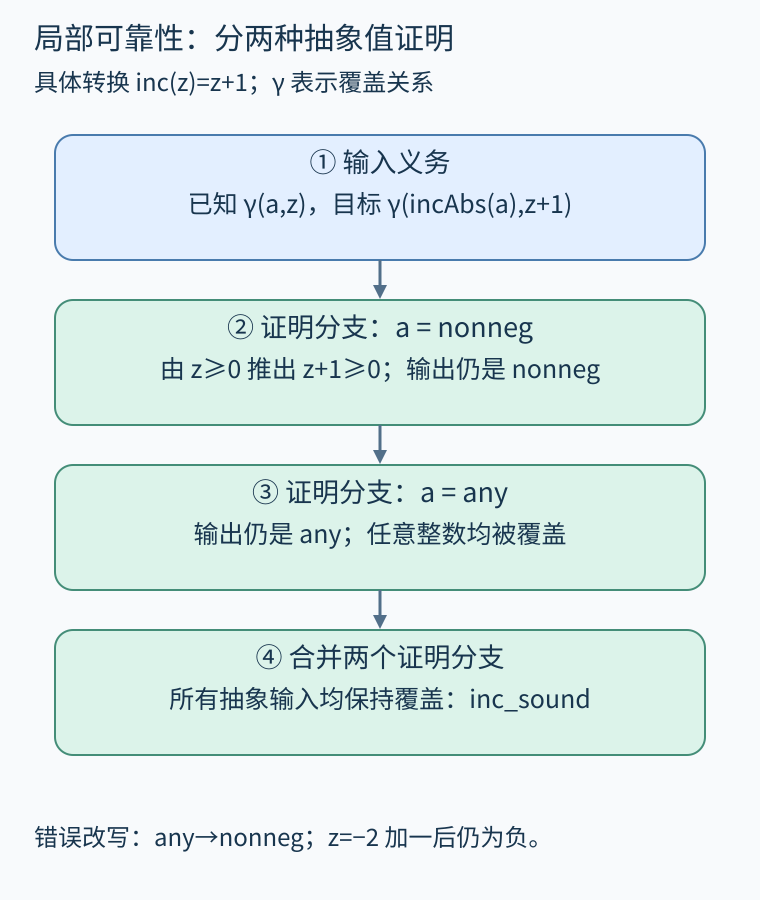
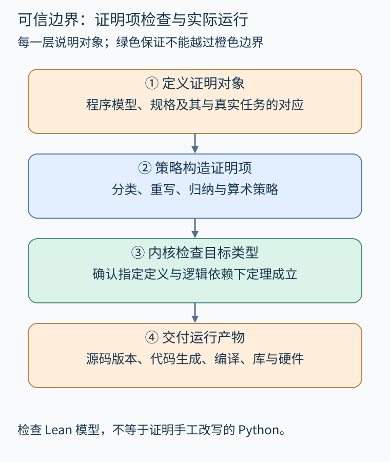

# 第 30 章 证明分析器与理解可信计算基础

静态分析器报告“没有越界”，这个结论能信到什么程度？即使算法来自严谨论文，代码仍可能把区间下界写反、遗漏调用边或错误复用摘要。我们既可以分析被检查程序，也可以把分析器本身作为程序，证明它的推理不会排除真实行为。

本章只验证一个极小的抽象执行模型：数学整数反复加一，抽象状态记录“非负”或“任意整数”。它没有解析器、控制流图、堆、分支或工作列表。因此它是理解soundness证明的练习，不是对书中Python分析器的认证。

## 30.1 先给抽象值一个精确定义

具体值z属于Int。抽象域只有两个元素：nonneg表示所有非负整数，any表示所有整数。具体化函数γ说明一个具体值是否被某个抽象值覆盖：

```lean
inductive Abs where
  | nonneg
  | any
  deriving DecidableEq, Repr

def gamma : Abs → Int → Prop
  | .nonneg, z => 0 ≤ z
  | .any, _ => True
```

真实转换为 `inc z=z+1`，抽象转换规定 nonneg仍为nonneg，any仍为any。any可能包含负值，转换后仍然无法统一保证非负；例如输入-2，加一得到-1。我们选择保持粗概括，而不凭空缩小。

局部可靠性定理写成：如果输入z被a覆盖，那么输出inc(z)被incAbs(a)覆盖。

```lean
theorem inc_sound (a : Abs) (z : Int)
    (hz : gamma a z) :
    gamma (incAbs a) (inc z) := by
  cases a with
  | nonneg =>
      change 0 ≤ z at hz
      change 0 ≤ z + 1
      omega
  | any => trivial
```

nonneg分支使用整数线性算术；any分支的目标是True。它不证明输出恰好等于抽象集合，也不承诺最精确结果，只证明覆盖不丢失。[Lean官方的归纳类型文档](https://lean-lang.org/theorem_proving_in_lean4/Inductive-Types/)说明这种枚举分类的证明基础；配套程序的具体整数语义是本书自己定义的。



图 30-1　输入覆盖关系经两条转换保持到输出。any分支保留全部整数，可能粗但仍可靠。原创精确示意。

## 30.2 局部正确怎样提升到多步

定义runConcrete(n,z)反复执行n次inc，runAbstract(n,a)反复执行n次incAbs。希望得到：若初始覆盖成立，则任意有限步数后覆盖仍成立。

基例n=0，两边保持输入，直接用原假设。归纳步先用inc_sound连接第一次转换，再把结果交给归纳假设处理剩下n步。重要的是归纳假设要适用于任意中间状态，而不只是固定的原始z和a；配套证明使用 `induction n generalizing a z` 保留这种一般性。

```lean
theorem run_sound (n : Nat) (a : Abs) (z : Int)
    (hz : gamma a z) :
    gamma (runAbstract n a) (runConcrete n z) := by
  induction n generalizing a z with
  | zero => exact hz
  | succ n ih =>
      change gamma (runAbstract n (incAbs a))
        (runConcrete n (inc z))
      exact ih (incAbs a) (inc z) (inc_sound a z hz)
```

这说明逐步覆盖可以组合，尚未涉及“怎样自动找到循环不变量”。完整抽象分析器还须验证分支过滤、汇合、循环求解、加宽和报告规则。单独证明一个区间加法函数，不能跳过其余部分就宣称分析器可靠。

## 30.3 证明算法与检查证书

可靠性可以通过不同架构取得。一种是把求解算法及其实现纳入证明；另一种是让复杂求解器提出候选不变量，再由较小检查器验证：入口状态被覆盖，所有转换保持不变量，且不变量蕴含目标性质。

例如候选不变量为 `z≥0`，检查器验证初始z=0满足它，以及 `z≥0⇒z+1≥0`。求解器即使猜错，检查器也应拒绝错误证书。这个方案不要求候选生成器永远成功；它可以超时或找不到证明，但不能通过错误证书。检查器的接受规则和实现则仍要有足够保证。

[Verasco原论文](https://davidpichardie.github.io/papers/popl15.pdf)展示了对C子集静态分析器进行机械化可靠性证明的工程实例，包含多种抽象域及模块组合。它说明程序分析的数学基础可以继续落实到实现证明；其语言支持边界也提醒我们，保证范围必须与实际模型对应。

## 30.4 可信计算基础包含什么

**可信计算基础**（TCB）是我们仍依赖其正确性来接受结论的组件和假设集合。采用证明助手可以缩小人工检查负担，却不会让这组依赖自动消失。



图 30-2　内核检查证明项；语义、映射、构建与运行环境各有职责。绿色区域的证明不能自动覆盖橙色边界。原创精确示意。

在典型Lean证明流程中，策略负责搜索证明项，内核负责核对证明项是否具有目标类型。策略搜索出错通常会导致检查失败，而不是凭一句“我证明了”取得信任。但若使用绕过通常检查路径的机制、额外公理或依赖外部计算结果，就须重新审视信任边界，不能沿用原先的口号。

[Lean关于公理与计算的官方章节](https://lean-lang.org/theorem_proving_in_lean4/Axioms-and-Computation/)解释了逻辑扩展与计算的区别。配套文件使用 `#print axioms` 查看重要定理的依赖；它没有自设业务公理，没有用sorry或admit填补待证明结论。本次实际检查打印出的主要依赖是propext，算术及多步可靠性定理另含Quot.sound。这些是Lean标准逻辑基础中的依赖，不是作者额外假定业务结论；也不能据此把文件称为“无任何公理”。检查显示哪些逻辑依赖，与“这些依赖适合什么目标”是两项判断。

## 30.5 从形式模型走到运行产物

即使run_sound已经被检查，仍要确认我们检查的是计划交付的文件、工具链和依赖版本。证明源文件的哈希、检查日志和构建命令可以建立可复查联系；但哈希只标识对象，没有独立证明代码语义。

若将Lean模型手工重写为Python，重写后的实现没有自动继承定理。若通过代码生成得到可执行文件，还需考虑代码生成器、编译器、库、链接和硬件的适用保证。若解析器把真实源码转错，后端对错误模型的完美证明也不能保证原程序。

因此应把结论逐层陈述：抽象转换可靠；有限重复执行覆盖成立；某检查器验证了某份证书；某程序在某语义下满足某性质。每层都具体，才能组合；笼统说“形式化过”反而掩盖了对应关系。

本书配套证明只承担前两项练习。本次已用Lean 4.19.0实际检查配套文件并成功；检查命令与环境适配由统一报告记录。检查成功不能自动扩大证明对象，纸面可读与机器核对也应始终分别记录。

## 30.6 练习与答案

把incAbs的any分支改为nonneg。分析器每次结果都更精确了，可靠性是否更强？再假设一个证书生成器总输出 `z≥0`，为什么小检查器仍可能有价值？

**参考答案：**改写不可靠，a=any、z=-2时输入被覆盖，但输出-1不在nonneg中。结果集合缩小并不总是合法精度改进。生成器的猜测可以错误；若检查器完整核对入口、转换保持与性质，它会拒绝不适用证书。可靠性来自接受条件，不来自候选看上去合理。

## 本章资料

- [Jourdan等：A Formally-Verified C Static Analyzer，POPL 2015](https://davidpichardie.github.io/papers/popl15.pdf)。Verasco的模块架构与可靠性证明。
- [Lean：Axioms and Computation](https://lean-lang.org/theorem_proving_in_lean4/Axioms-and-Computation/)。公理、证明与计算的信任边界。
- [配套证明文件](../examples/lean/ProgramProofs.lean)。inc_sound与run_sound只针对本章极小模型。
