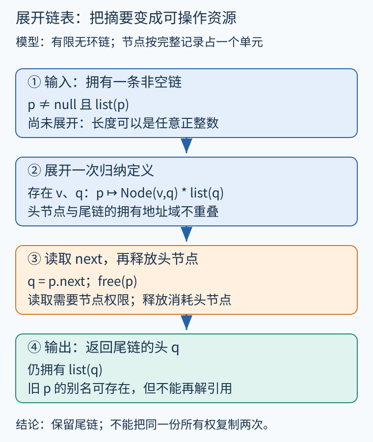
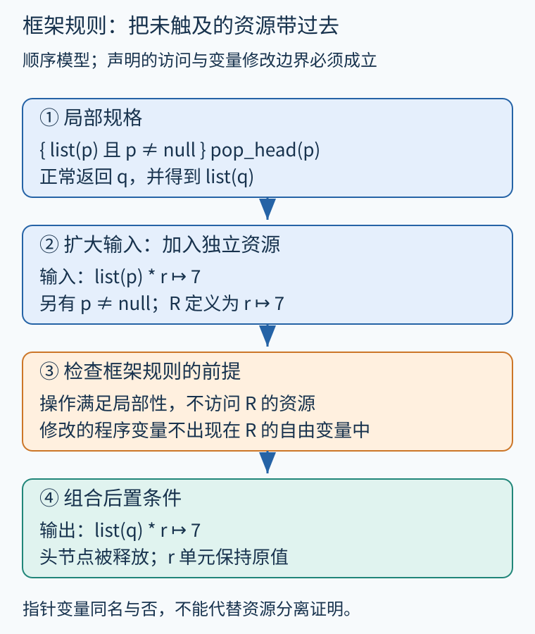

# 第 41 章 形状分析、分离逻辑与内存所有权

只知道指针可能指向哪些分配点，还不足以证明链表没有环、两个队列没有共享可写节点，或者删除头节点后其余结构仍完整。本章把内存从“若干可能目标”推进到“带有结构和使用权限的区域”。

## 堆的形状包含什么

设每个链表节点有 value、next 两个字段，null 不是可解引用的节点。一次具体执行的堆可以画出所有地址，但静态分析必须概括任意长度的链表：前端两个节点可以显式保留，后续任意多个节点则由摘要表示。形状分析关心可达性、共享、环和结构不变量，可能把多个具体堆归为同一个抽象形状。

同样的“p 可到达 q”，既可能来自一条无环链，也可能来自带回边的结构。合并时若丢掉是否共享的信息，就不能继续把两个子结构当作独立可写区域。要恢复精度，可以细分形状或在解引用前展开摘要；每次展开都需要维护所代表的全部具体堆。

## 分离合取表达的是可拆分资源

[《Separation Logic Foundations》的堆谓词定义](https://softwarefoundations.cis.upenn.edu/slf-current/Hprop.html)把堆解释为位置到值的有限映射。本章采用其中最基础的、独占可写单元模型：`p ↦ v` 描述拥有 p 这一单元且其值为 v；emp 描述空堆；`P * Q` 表示当前所描述的堆可拆成地址域不重叠的两部分，分别满足 P 和 Q。

这个星号不是普通逻辑“并且”。`p↦10 ∧ p↦10` 可以重复描述同一单元，而 `p↦10 * p↦10` 在该模型下不能成立：无法把同一地址拆成两个独占单元。反之，变量 a 与 b 可以同时保存 p，`a=b` 与拥有 `p↦10` 完全兼容。分离限制的是断言所拥有的资源重叠，不是禁止程序里存在任何别名。



图 41-1　原创步骤图。先有抽象链，再展开头部；头节点和尾链所拥有的单元不重叠，但 next 可以保存尾部地址。

纯事实如 `n>=0` 不占用堆单元，可以与堆断言组合。进阶逻辑还能用分数权限表达共享只读；它有自己的资源代数与规则，不能把本章的独占解释机械套到所有分离逻辑系统。[Reynolds 的原始论文](https://www.cs.cmu.edu/~jcr/seplogic.pdf)是理解这类局部内存推理的经典一手资料。

## 从一个节点推到任意长链表

为便于阅读，用一个节点单元表示完整记录，定义有限无环链：

```text
list(null) = emp
list(p) = exists value, q.
          p ↦ Node(value,q) * list(q)      当 p != null
```

这是归纳定义，不是允许任意自引用等式。非空情况消耗一个节点，再要求剩余堆满足尾链；有限构造及资源分离共同排除尾部再次拥有头地址。因此循环链表需要不同谓词，不能假装同样满足此处的 list。

考虑删除头节点，返回新头：

```text
pop_head(p):
    assume p != null
    q = p.next
    free(p)
    return q
```

前置为 `p!=null` 且 list(p)。第一步展开得到 `p↦Node(v,q) * list(q)`；第二步读取 next，保留两部分所有权；第三步 free 只消耗 p 的节点单元，留下 list(q)；最后把 q 返回。原先另一个变量 b 即使仍保存旧 p，也不能再凭这个地址读取已经释放的单元。别名没有消失，解引用权限已经消失。

这段推演假定顺序执行、没有其他线程干扰，free 与字段访问符合所声明的小语言语义；它没有证明具体 C 实现的布局、分配器和整数转换。

## 框架规则让局部证明可以复用

若已证明 `{P} C {Q}`，希望在旁边还有资源 R 时推出 `{P*R} C {Q*R}`，就要保证 C 的语义支持局部性：它只能依赖和改变许可的资源，不会偷偷写到框架部分。对带可变程序变量的经典表述，还要求 C 修改的变量不出现在 R 的自由变量中。具体证明系统的条件以其语义为准，不能只背一条符号公式。

例如有 `list(p) * r↦7`，且 pop_head 不修改 r 的绑定、不访问 r 单元，就可把 r↦7 保留到调用之后。若 R 写成 `r↦x`，而 C 修改程序变量 x，原断言的含义也跟着改变，简单照抄 R 就不合法。[该教材的推理规则章节](https://softwarefoundations.cis.upenn.edu/slf-current/Rules.html)说明规则必须从指定语言的语义获得依据。



图 41-2　原创步骤图。黄色步骤只消耗头节点；框架区域保留依赖局部性和变量条件。

框架不是“没在源码中看见那个变量就保证不变”。未知函数若能经别名修改资源，或发生并发写入，必须有相应契约、权限转移或同步协议。局部推理缩小证明范围，但没有取消环境建模。

## 自动分析与人工规格怎样协作

形状分析器可以尝试推导“这里是一段链”、检查操作前置条件，或从函数摘要中推导缺失的堆条件。分离逻辑也能用于人工书写规格，再由验证器检查实现。二者相互支持，却不表示所有形状分析都采用分离逻辑，或所有分离逻辑证明都能自动搜索完成。

选择何种谓词决定能表达什么。只保存 list(p) 可以说明结构，却未保存元素总和；要证明队列金额总和非负，应给谓词加入序列或数值参数。要区分已分配与已关闭的资源，还需组合生命周期协议。结构、内容、权限是三个维度，逐步组合比给一个节点贴上笼统的“安全”标签更有用。

## 用一个共享尾部检查断言

设两条路径分别是 `a→x→null` 与 `b→x→null`，a、b 是不同头节点，尾部 x 却相同。分别检查两条路径，可以得到“各自有限且无环”的结构观察；但独占模型中的 `list(a) * list(b)` 不能成立，因为两边都要拥有 x。若程序只是读取共享尾部，可以换用许可共享读取的逻辑模型；若将其中一条链全部释放，另一条路径就会留下悬空引用。

这个例子也说明，只证明“每条链分别无环”仍不足以证明“释放一条链不影响另一条”。想使用框架保留另一条链，必须先获得资源分离或其他合法权限证据。图里的两种颜色应该代表已经建立的资源关系，而不能只由绘图者按变量名随意分配。

若想看这些资源断言怎样连接到真实C函数，可阅读[VST案例](55.md)。那里把机器整数范围、指针访问和循环不变量放进Clight函数规格，再用一个单独的有限堆模型展示局部写入为何保留框架。分离逻辑的概念、具体VST证明和纯Rocq练习的覆盖范围会逐一分开。

**练习。** 已知 `a=b=p`，并拥有 `p↦Node(10,null)`。这是否违反资源分离？执行 free(p) 后能否继续读 b.value？若旁边还有 `r↦20`，保留它需要什么条件？

**参考答案。** 两个变量保存同一个地址不违反分离；当前只有一份节点所有权。free 消耗该所有权，b 虽仍保存旧地址，也不能再合法读取。保留 r 单元需保证它与被释放节点分离、操作满足局部性，且框架断言涉及的程序变量未被不当地改写；并发环境另需干扰控制。

## 本章资料

- [Software Foundations：Heap Predicates](https://softwarefoundations.cis.upenn.edu/slf-current/Hprop.html)。堆、分离合取与纯事实的形式化定义。
- [Software Foundations：Reasoning Rules](https://softwarefoundations.cis.upenn.edu/slf-current/Rules.html)。语义与推理规则的关系。
- [John C. Reynolds：Separation Logic，LICS 2002](https://www.cs.cmu.edu/~jcr/seplogic.pdf)。局部内存推理的原始论文。
