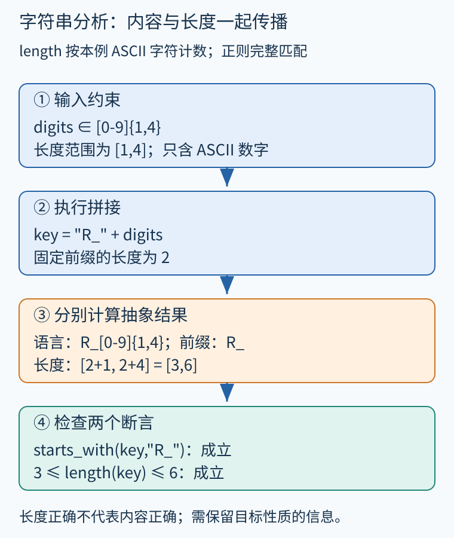
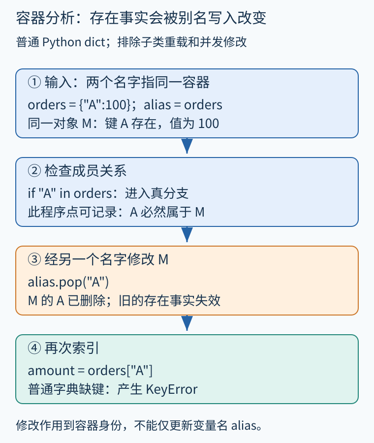

# 第 42 章 字符串、容器与数据结构分析

订单号、日志键、路径和消息字段都是字符串；订单缓存、任务列表和权限集合又把这些值装进容器。把它们统统记成“某个对象”，分析容易失去最需要的细节。本章讨论如何在可控成本下保存内容、长度、成员及对应关系。

## 一个字符串可以代表一个语言

设系统要求订单展示键形如 `R_` 加一至四位 ASCII 数字。输入 digits 满足完整匹配 `[0-9]{1,4}`，教学函数执行：

```text
key = "R_" + digits
assert key starts_with "R_"
assert 3 <= length(key) <= 6
```

只存“未知字符串”无法证明这些结论。可选抽象包括常量集合、前缀、后缀、长度区间，或用有限自动机表示一组可能字符串。这里“语言”指字符串的集合，与 Python、Go 这样的程序语言不是同一层含义。

在该例中，长度域给出 `len(digits)∈[1,4]`，拼接后得到 `[3,6]`；前缀域记住 `R_`；正则语言抽象给出 `R_[0-9]{1,4}`，还保留剩余字符都是数字。正则表达式在这里描述整串，不等同于实际库中“在任意位置搜索匹配”的 API。



图 42-1　原创步骤图。相同输入经不同抽象得到互补事实；长度正确没有单独证明字符类别。

[SMT-LIB 字符串理论](https://smt-lib.org/theories-UnicodeStrings.shtml)定义字符串拼接、长度及正则语言成员关系等操作，可以把字符串条件与整数条件放在一起求解。不过抽象分析采用自动机，不代表每个转换都是精确的；实际求解器也有支持范围和资源预算。

## 长度、编码和边界不是同一件事

本例只用 ASCII，所以码点数与 UTF-8 字节数相同；一般字符串则不同。分析“显示多少字符”“切片访问是否越界”“网络缓冲区需要多少字节”可能需要不同单位。组合字符和显示字形还会让用户感知长度不同于码点计数。SMT-LIB 的 str.len 计算该理论字符序列的长度，不能直接当成 UTF-8 编码字节数。

拼接通常容易概括，子串、替换、大小写转换、格式化和解析更复杂。例如，取 key 的前两个字符可得 `R_`；截去这两个字符后的剩余串长度为1–4。若取最后两个字符，本例长度固定为2，但当 digits 只有一位时结果还会包含下划线。具体切片规则仍须按语言语义核对。某些替换会改变长度或字符类别，先前的保证不能无条件沿用。

若分支一产生 `R_1`，另一分支产生 `X_99`，只保留公共前缀会退化为空前缀；保留常量集合则仍精确。集合越来越大时，可以主动合并成较粗语言。关键是合并后包含全部真实字符串，不能为了方便只留下更常见的一支。

## 容器分析要同时回答成员与取值

看一个普通 Python 字典例子，明确排除子类自定义行为及并发修改：

```python
orders = {"A": 100}
alias = orders
if "A" in orders:
    alias.pop("A")
    amount = orders["A"]
```

条件刚成立时，A 确实存在；但 alias 与 orders 是同一字典，pop 删除该键，后续索引会引发 KeyError。[Python 普通字典文档](https://docs.python.org/3/library/stdtypes.html#mapping-types-dict)分别规定了成员测试、删除与缺键索引的行为。把“之前检查过”当作永久有效事实，就会遗漏这个错误。



图 42-2　原创步骤图。键存在性必须随同一个容器对象的修改更新，不能只附着在变量拼写上。

一种抽象容器状态可以同时存：必然存在的键集合、可能存在的键集合、已知键到抽象值的映射，以及其他键的摘要值。对确切键 A 插入，可更新它的存在性与值；对未知键插入，要考虑它与已有键相等的可能。删除经别名发生时，也必须作用到同一抽象容器身份。

## 列表和映射分别丢失什么

列表常有两种表示：按已知索引区分元素，或用一个摘要表示所有元素。若已知 items 为 `[10,20]`，索引敏感表示能推出 items[0] 为 10；摘要只能得到元素可能为 10 或 20。若保存“所有元素非负”的整体不变量，则即便列表很长，仍可证明遍历累加不引入负项，前提是遍历期间没有破坏此性质的修改。

映射需要键与值的相关性。把键集合 `{A,B}` 与值集合 `{0,100}` 分开保存，会允许 A 对应 100、B 对应 0 等额外组合，可能无法证明“只有 B 可退款”。这与数值区间丢失变量关系相同，只是关系发生在容器内部。

浅拷贝还会制造分层共享：两个字典本身不同，但对应值可能引用同一个可变订单。修改容器成员关系与修改成员对象字段必须区分。仅看到 `copy()` 就把所有嵌套对象也视为独立，会破坏堆模型。

## 选择抽象要服从要证明的性质

若只验证日志键长度，长度区间可能够用；若验证协议格式，需要字符语言；若验证缓存命中后访问安全，需要容器身份、键存在性和修改效果。字段间还有关系时，可把字典内容转换成记录或为关键键分区，而将其他键摘要化。

完整内容追踪的成本可能随容器规模、字符串长度或自动机状态迅速增长。分析器可给关键字面量键保留精度，对其他值采用摘要；也可按需把某条报告交给字符串约束求解器复核。超时应保留“未确定”，不应自动解释为不可能或已安全。

## 用反例判断抽象是否足够

设订单映射只有 `{A:0, B:100}`，规格要求查询 A 始终得到零。按键区分的状态立即支持结论；统一元素摘要只知道结果可能为零或一百，会产生一个虚假候选。这时应提升键相关精度，而不是把告警阈值调低。

另一方面，若查询键本来就来自任意用户输入，可能缺键的路径是真实存在的，增加值域精度不能让它消失。分析应先证明成员关系，或检查缺键处理分支，再讨论取出的金额范围。容器摘要与数值域协作时，只有在对应键确实存在的路径上，才能把其值约束用于后续断言。把两个模块的结论直接相交之前，必须核对它们描述的是同一个容器、同一个程序点和同一条条件路径。

**练习。** 已知 digits 恰为两位 ASCII 数字，key 为 `"R_"+digits`。能否证明长度为 4、前两字符为 R_、后两字符一定是 00？另外，将上例 `alias.pop("A")` 改成 `other=dict(orders); other.pop("A")`，普通字典 orders 中的 A 是否仍存在？

**参考答案。** 前两个结论成立，最后一个不成立，后两位可为任意数字组合。浅拷贝生成另一个容器，删除 other 的键不删除 orders 的键，A 仍存在；但若值是可变对象，两个容器中的对应值仍可能共享其身份，不能由此推出成员对象互不影响。

## 本章资料

- [SMT-LIB：Unicode Strings Theory](https://smt-lib.org/theories-UnicodeStrings.shtml)。字符串、长度与正则语言操作的规范。
- [Python：Mapping Types — dict](https://docs.python.org/3/library/stdtypes.html#mapping-types-dict)。普通字典的成员、修改、复制与缺键行为。
