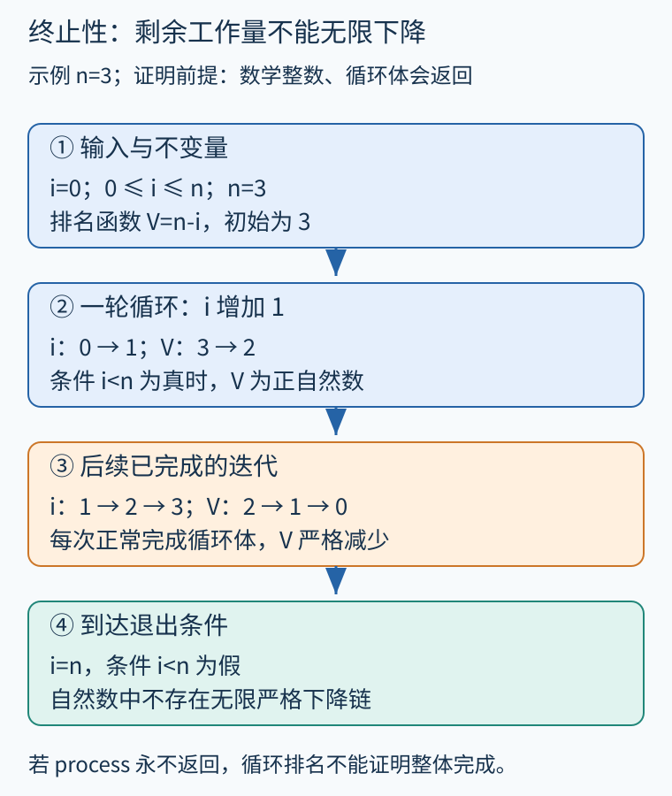
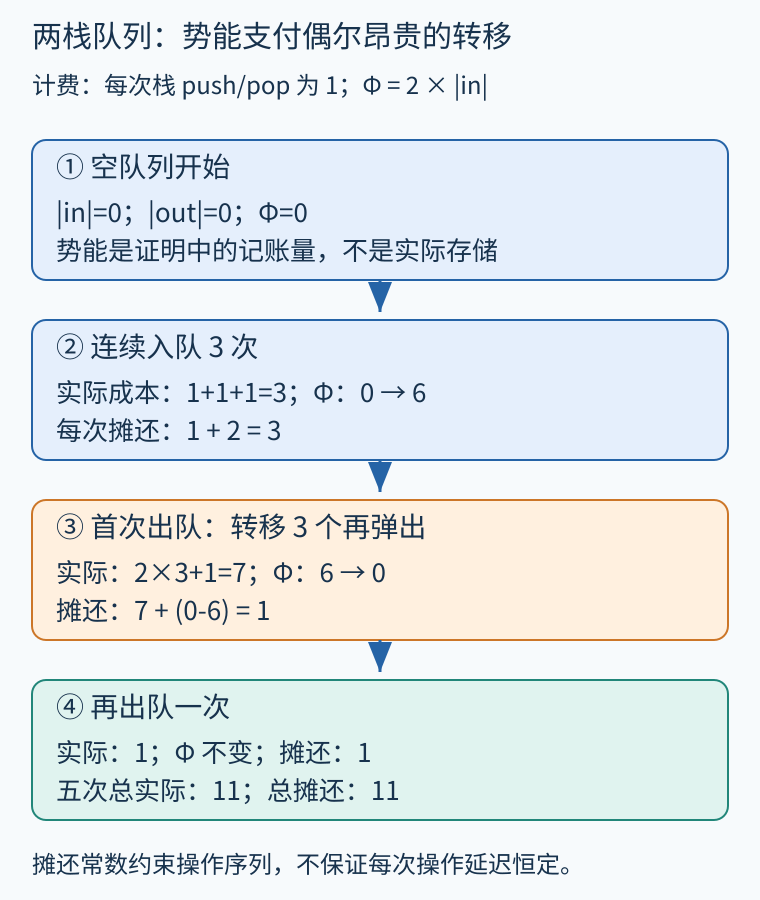

# 第 43 章 终止性、递归与资源复杂度

“如果函数返回，结果正确”还没有说明函数一定返回；“总会返回”也没有说明它能在预算内完成。终止性、操作次数、空间占用与实际延迟是不同问题，需要分别给出模型和证据。

## 找到不能无限下降的量

设数学整数 `0<=n<=len(items)`，函数逐项处理固定长度数组；数组不被并发修改，process 不改动 i、n 且每次都会返回：

```text
i = 0
while i < n:
    process(items[i])
    i = i + 1
```

循环不变量为 `0<=i<=n`。取排名函数 `V=n-i`：进入循环时它是正整数；循环体正常完成后减少 1；自然数不存在无限严格下降链，所以循环不能无限执行。排名函数不要求某个程序变量直接减小，i 明明在增加，剩余工作量却在减少。



图 43-1　原创步骤图。示例 n=3 展示 V 的变化；证明依赖任意非负 n 的不变量与严格下降。

[Dafny 终止性教程](https://dafny.org/latest/OnlineTutorial/Termination)用 decreases 标注表达这类度量，并支持数值、序列与组合度量。本章提供纸上推演，未把它标为某个工具实际检查过的证明。

若循环体可能阻塞在永不返回的 process，排名函数只证明循环自身不会发生无限多次已完成的迭代，不能证明整个函数终止。机器整数溢出也可能破坏不变量与下降关系。环境和调用契约同样是证明的一部分。

## 为什么严格下降还不够

数学整数上 `x=x-1` 永远严格下降，却可以向负无穷继续；正实数上 `x=x/2` 始终变小，也可能无限趋近零而不等于零。度量应进入良基关系，即不存在无限下降链的关系。自然数的通常小于关系是入门时最方便的选择。

嵌套循环有时需要字典序对 `(outer, inner)`：先比较 outer；若第一项不变，再要求 inner 下降。inner 在 outer 下降时可以重置为较大值，只要两项都处于适当自然数域。不能把字典序随意当作分量同时下降，也不能从一幅有限执行轨迹猜测所有输入都会满足它。

递归证明也可以使用规模。处理有限无环链表时，每次递归进入尾链，长度减一；若输入允许环，下一次调用未必更小，原论证就失效。数据结构的形状不变量因此直接影响终止证明。

## 终止证明没有给出全部成本

一个函数若递归调用自身两次，两个实参都从 n 减到 n-1，则单条调用链深度至多 n，但整个递归树仍可能有指数多个节点。深度与总调用数不能混用。即使都终止，两段程序也可能相差很多数量级。

为了计算资源，先规定成本模型。例如把每次节点访问记作一个单位，忽略整数位宽变化和外部 I/O；对长度 n 的链表求和，递推为 `T(0)=c0`、`T(n)=T(n-1)+c1`，于是 `T(n)=c0+n*c1`。若递归时复制整个剩余列表，单层成本就不再固定，可能形成平方级总量。

空间也须明确测量什么。逐项遍历可以只保存当前节点与累加器；递归实现可能保留 n 层调用帧。语言是否保证尾调用优化会改变实现成本，不能仅凭函数写成尾递归就断言常数栈空间。数学整数的加法若按位计费，也不能永远视作常数时间。

## 用势能解释偶尔很贵的操作

考虑由 in、out 两个栈组成的队列。入队把元素压入 in；出队在 out 非空时直接弹出，否则把 in 全部转移到 out 再弹出。假设串行执行、成功操作，栈的每次 push/pop 计一单位，不计其他控制指令；空队列出队单独处理。

取势能 `Φ=2*|in|`，初始为空。定义一次操作的摊还成本为：

```text
摊还成本 = 实际计费次数 + Φ_after - Φ_before
```

入队实际为 1，势能增加 2，摊还成本 3。若直接从 out 弹出，实际为 1，势能不变，摊还成本 1。若转移 k 个元素再弹出，实际为 `2k+1`，势能减少 `2k`，摊还成本仍为 1。



图 43-2　原创步骤图。三次入队积累 6 单位势能，第一次出队花费 7 次栈操作；减去势能变化后为 1。

对一串操作求和，势能差会望远镜式抵消。因为最终势能非负、初始势能为零，总实际计费次数不超过总摊还成本。这证明序列层面的线性总量，没有证明每次出队都具有常数最坏延迟。[自动摊还资源分析研究](https://www.cambridge.org/core/journals/mathematical-structures-in-computer-science/article/two-decades-of-automatic-amortized-resource-analysis/9A47A8663CD8A7147E2F17865C368094)进一步把势能与程序结构结合，用约束推导资源上界。

## 从上界到工程预算

一个已证明的操作次数上界，可以支持资源配额、嵌入式预算与性能回归检查。但要转成毫秒，还需要目标平台、调度、缓存、分配器和外部服务的假设；一次基准测试也不能直接替代所有输入的上界证明。

分析失败还要区分三种情况：程序确实不终止；程序终止但当前排名模板不够强；工具在预算内没有完成推导。递归深度上界、总工作量和峰值内存可能各需不同抽象与不变量。对长期运行的服务器，终止往往不是目标，反而应验证单请求完成、响应性或某种进展性质。

## 多阶段工作如何选择度量

例如任务按批次处理，外层还剩两批、内层已经归零时，可以进入下一批并把内部剩余量重置为五。字典序度量沿 `(2,0)→(1,5)→(1,4)` 严格下降：第一步第一项减小，第二步第一项相等而第二项减小。若只看内层变量，会错误认为重置导致证明失败；若只看外层变量，又无法解释批次内部的进展。

成本上界还需知道每批最多处理多少任务。只知道批次数有限、每批工作也会终止，并不能推出一个与输入规模相关的实用常数界。分析报告应分别展示排名度量、用于成本推导的规模参数，以及单步收费约定，让“会完成”和“需要多少资源”各自有清楚依据。

**练习。** 上述两栈队列连续入队 3 次，再出队 2 次。每次实际栈操作数、势能与摊还成本分别是多少？第一次出队是否具有常数最坏成本？

**参考答案。** 三次入队实际均为 1，势能依次为 2、4、6，摊还均为 3。第一次出队转移三个元素，实际 7，势能降为 0，摊还为 1；第二次实际 1，势能仍为 0，摊还为 1。总实际 11，等于总摊还 11。一般首次出队实际为 `2k+1`，随积累元素数增长，摊还常数没有消除单次长延迟。

## 本章资料

- [Dafny：Termination](https://dafny.org/latest/OnlineTutorial/Termination)。下降度量与递归终止检查的官方教程。
- [Hoffmann 等：Two Decades of Automatic Amortized Resource Analysis](https://www.cambridge.org/core/journals/mathematical-structures-in-computer-science/article/two-decades-of-automatic-amortized-resource-analysis/9A47A8663CD8A7147E2F17865C368094)。资源分析研究者对势能与成本语义的综述。
