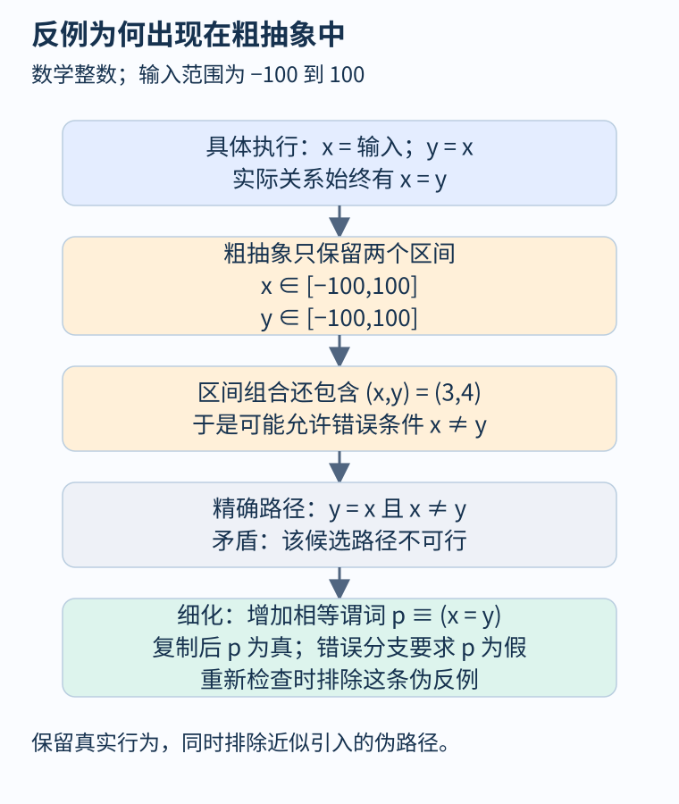
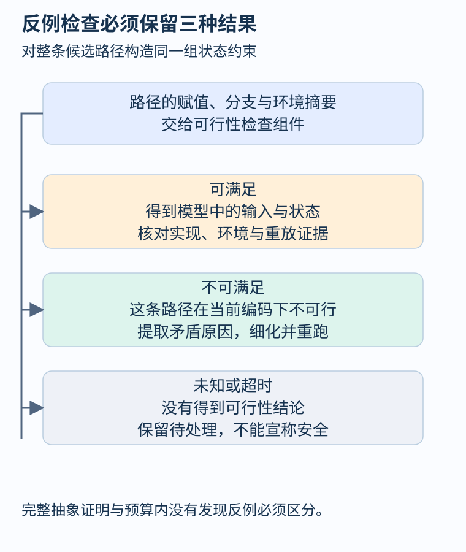

# 第 46 章 反例解释、可行性检查与抽象细化

分析器画出一条通往错误的路径，不一定意味着程序能沿它执行。前面的抽象解释用近似控制计算规模，近似也会让本来互斥的状态混在一起。本章把“这条报告是真的吗”变成一个可推演的闭环：先检查反例，再修正导致它出现的抽象，而不是简单屏蔽报警。

## 一条由信息丢失产生的错误路径

考虑一个自包含的教学程序。输入是范围为负一百到一百的数学整数，单线程执行，不涉及溢出和外部修改。

```text
x = input_integer(-100, 100)
y = x
if x != y:
    error
```

具体执行中，复制后两个值必定相等。若分析器只保存各变量的区间，状态可能写成 `x∈[-100,100], y∈[-100,100]`。这个状态不仅表示真实的 `(3,3)`，也包含不真实的 `(3,4)`；变量关系已经丢失。因此分析器可能允许 `x!=y` 成立，产生“输入—复制—错误分支”的候选反例。

这里没有实际发生错误，区间分析也未必算错。它保守地容纳了更多状态，问题在于当前抽象无法区分所需关系。[Clarke 等人的 CEGAR 原始论文](https://www.cs.cmu.edu/~emc/papers/Conference%20Papers/Counterexample-guided%20Abstraction%20Refinement.pdf)提出迭代检查抽象反例，并以伪反例指导细化的框架。本章使用更小的原创例子展示这一思想，不复刻论文的具体实现。



图 46-1：细化不是删除不方便的错误分支，而是补充使真实执行与候选解释能够区分的信息。

## 检查整条路径能否由同一组状态实现

把路径上的赋值与条件串成公式。令输入值为 `x0`，复制后的值为 `y1`，则错误路径要求：

\[
-100\le x_0\le100\quad\land\quad y_1=x_0\quad\land\quad x_0\ne y_1.
\]

公式不可满足：复制关系与错误条件直接冲突。不能只分别检查每条抽象边是否存在；“某个状态允许第一条边，另一个状态允许第二条边”不等于存在一条首尾连贯的具体执行。

反例检查会得到不同结果。可满足时，可以提取输入与中间状态，继续核对真实实现和环境模型；不可满足时，说明这条路径在当前精确编码下不可行；若超时或返回未知，就还不能归入前两类。把求解器未知当作伪反例，然后屏蔽路径，会破坏后续结论。

对我们的例子，细化可以增加谓词 `p ≡ (x=y)`。经过 `y=x` 后，谓词为真；进入错误分支则要求它为假，两个条件无法同时满足。重新分析后，这条候选反例消失，而且所有真实执行仍得到保留。

## CEGAR 循环的四个责任

CEGAR 的名称来自 Counterexample-Guided Abstraction Refinement，即反例引导的抽象细化。[Ball 的研究报告](https://www.microsoft.com/en-us/research/publication/formalizing-counterexample-driven-refinement-with-weakest-preconditions/)把类似过程与最弱前置条件及插值联系起来。实现方式各不相同，但可以用下面的责任分解理解：

| 环节 | 输入与产出 | 必须守住的条件 |
|---|---|---|
| 构造抽象 | 具体模型 → 较小模型 | 保留目标性质所需的真实行为 |
| 检查抽象 | 抽象模型 → 结论或反例 | 完整证明与预算内搜索分开报告 |
| 检查反例 | 路径 → 可行、不可行或未知 | 编码覆盖赋值、约束及环境语义 |
| 细化并重跑 | 不可行原因 → 新抽象 | 排除伪路径，同时保留真实行为 |

一个常见细化办法是增加谓词，另一些办法会拆分抽象状态、改进堆模型或细化调用上下文。选择依据应是反例在哪一步变得不可能，而不是把整个项目无差别提升到最昂贵精度。增加所有变量关系，可能让分析很快耗尽预算。



图 46-2：未知结果进入待处理队列，不进入“安全”或“伪反例已排除”的计数。

## 什么情况下可以说性质已证明

本章关注不可达坏状态这类安全性质。若抽象确实过近似具体行为，且抽象模型经过完整有效的检查、坏状态不可达，便可以把该性质传回具体模型。结论还依赖模型与实现的对应、工具编码和所用逻辑规则。

“搜索十分钟没找到反例”则是预算描述。即使已经消除二十条伪反例，队列中仍有未探索状态，也不能改写成证明。一般程序上的细化循环没有无条件终止保证：可能不断出现新谓词，可能求解变难，也可能目标性质本身超出当前方法能力。

真实环境模型尤其容易混淆结果。若文件读取被建模成任意字节序列，某条反例在模型中可行，但部署接口可能提供更强格式保证；若分析器错误地假定读取永远成功，又可能漏掉真实失败。要修改的是有依据的合同，不能靠几次重放失败就删掉模型行为。

## 从报告到可复查证据

每次细化宜记录模型版本、性质、抽象配置、候选路径、求解公式及结果、增加的谓词或拆分理由。真实可行反例还应记录输入与环境前提。这样才能检查某次精度改进究竟排除了什么，以及增量分析能否复用旧结论。

在开发工具时，可以保留复制例子作为正向回归：粗抽象应允许候选，精确可行性检查应拒绝候选，加入相等谓词后应得到更强结果。再加入 `y=x+1` 的变体，确认细化器没有把真正的错误路径也删除。分析器的安静程度无法独自证明可靠，能够保留真实问题同样重要。

## 细化之前先定位矛盾来自哪里

在复制例子里，矛盾来自 `y=x` 与 `x!=y`，所以补相等关系很直接。若路径经过多次赋值，就要给每次写入不同的状态身份；否则把旧值和新值都叫作 `y`，可能制造假的矛盾。若反例经过函数调用，还应把实参与返回值、堆变化及异常路径连在同一个公式中。

只提高路径长度限制并不等于细化。它扩大搜索深度，却未必消除变量关系丢失；只增加测试次数也不是对抽象有效性的证明。不同改进分别作用于搜索预算、语义模型和抽象精度，报告应标明本次到底修改了哪一项。

## 观察练习

把程序改为 `y=x` 后调用未知函数 `change(&y)`，再检查 `x!=y`。求解器仍使用公式 `y=x` 并判断路径不可行。这个“证明”哪里失效？

参考答案：公式遗漏了未知函数可能修改 `y` 的效果。应引入调用后状态与相应摘要；若函数允许改变值，错误分支就可能可行。细化只能在正确语义模型上增加精度，不能修复被编码悄悄删去的行为。

## 本章资料

- [Clarke、Grumberg、Jha、Lu、Veith：Counterexample-guided Abstraction Refinement](https://www.cs.cmu.edu/~emc/papers/Conference%20Papers/Counterexample-guided%20Abstraction%20Refinement.pdf)。
- [Thomas Ball：Formalizing Counterexample-driven Refinement with Weakest Preconditions](https://www.microsoft.com/en-us/research/publication/formalizing-counterexample-driven-refinement-with-weakest-preconditions/)。
