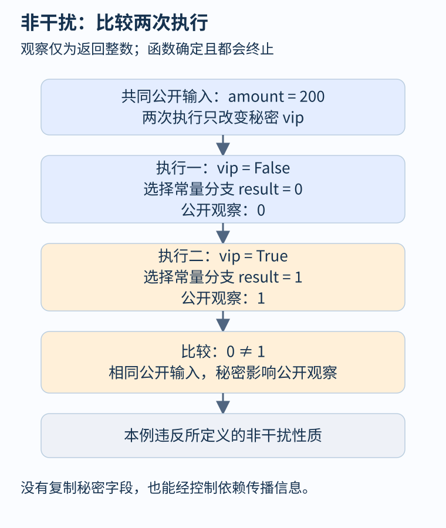
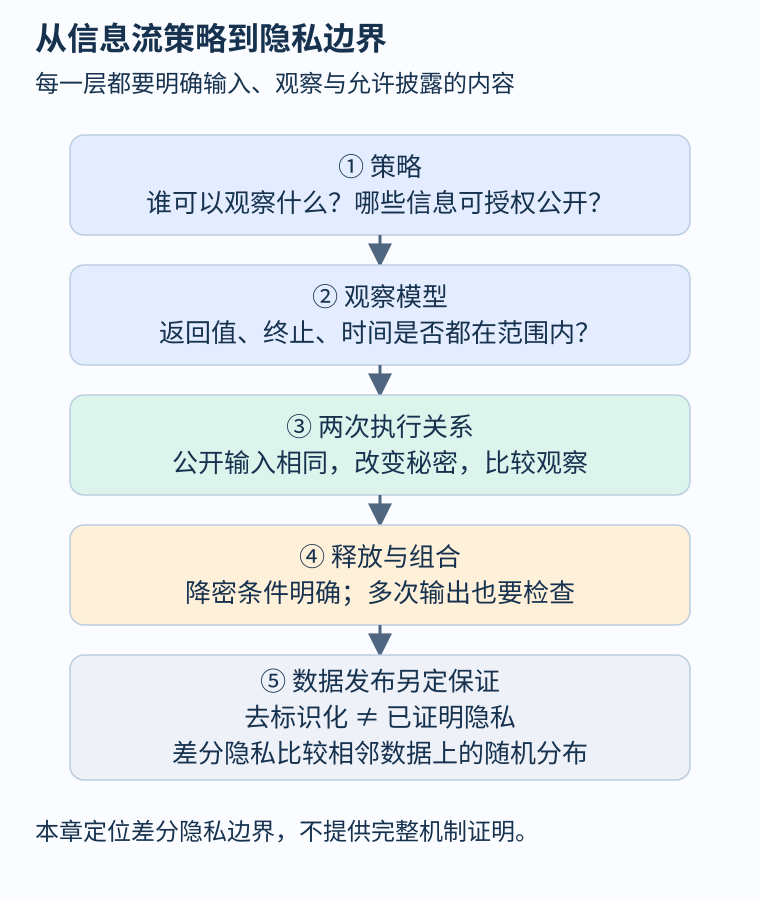

# 第 44 章 信息流、非干扰与隐私边界

删除日志中的姓名，不代表日志不再暴露个人信息。一个返回值即使没有直接包含秘密字段，也可能通过条件分支透露秘密。本章把“信息是否泄露”转换为执行之间的关系，并说明程序级信息流保证与数据发布隐私之间的边界。

## 先选观察者，再选秘密

假设订单服务内部保存客户的特殊资格 `vip`，它不允许向普通访客公开。退款金额 `amount` 已经对访客可见。教学模型采用确定、会终止的函数，普通观察者只能看到返回的整数，暂不观察运行时间、网络长度与缓存行为。

```python
def public_result(amount, vip):
    if vip:
        result = 1
    else:
        result = 0
    return result
```

返回值没有显式复制 `vip`，仍完整揭示它。固定公开输入 `amount=200`，分别运行 `vip=False` 与 `vip=True`，结果为零和一。秘密影响了控制流，控制流又影响公开输出，这称为隐式信息流。



图 44-1：仅检查一次运行的返回值是否“包含敏感字符串”，无法发现这种两次执行之间的区别。

[Sabelfeld 与 Myers 的信息流论文](https://www.cs.cornell.edu/andru/papers/jsac/sm-jsac03.pdf)以程序行为刻画保密策略。这里最简的非干扰要求是：相同公开输入下，秘密怎样改变，公开观察都不变。若 `l` 是公开输入、`h` 是秘密，可写成：

\[
\forall l,h_1,h_2.\quad
\operatorname{obs}(P(l,h_1))=\operatorname{obs}(P(l,h_2)).
\]

该式在本章模型中比较两次终止执行。若程序可能不终止、包含随机或并发，就要重新定义观察及执行之间的对应，不能直接沿用这个等式。

## 与普通污点传播有什么区别

污点分析通常沿赋值和调用追踪来源，适合发现敏感值是否到达受限输出。若只跟踪显式数据依赖，上面的常量零、一可能被误认为无敏感来源。处理隐式流时，可以给分支内部语句附上控制上下文标签，即程序计数器标签：秘密条件影响的语句也受到相应约束。

[Jif 的官方语言说明](https://www.cs.cornell.edu/jif/doc/jif-3.3.0/language.html)介绍了安全标签与控制上下文的作用，也明确保留了一些泄露通道的限制。标签机制能够执行特定政策，却不能因为标签名字叫“秘密”，就推导出对所有物理观察都安全。

考虑另一个函数：无论 `vip` 为何都返回 `amount+1`，但两条分支执行不同数量的内部循环。若观察仅包含返回值，可能满足当前非干扰模型；若观察者还能测量耗时，则需要新的分析。这里的“通过”和“失败”取决于明确观察，不是任意改变判定标准。

## 把关系性质变成联合检查

在确定且终止的模型中，可以将程序复制两份，给它们相同公开输入和独立秘密输入，然后检查输出是否可能不同。这叫自组合的一种基本形式。程序没有因此变成两次部署，复制是为了构造证明对象。

```text
假设 public_1 = public_2
output_1 = P(public_1, secret_1)
output_2 = P(public_2, secret_2)
检查 output_1 != output_2 是否可达
```

普通可达性通常在单次执行里找坏状态；非干扰则要求在一组执行之间建立关系。复制后还要避免把两份秘密误设为相同，否则测试只是在比较程序与自身的相同输入，漏掉真正目标。动态差分测试能够提供反例，但有限样本未发现差异不能证明所有秘密输入都无影响。



图 44-2：判断隐私前先写清允许公开什么，再分别检查程序行为和数据发布机制。

## 允许公开的信息必须单独规定

真实退款系统必须让用户知道自己的退款结果，因此“任何秘密都不能影响任何输出”可能过强。策略可以允许特定身份查看自己的金额，或在满足条件时公开某项汇总。解密式释放，即 declassification，描述授权的信息降密，但它需要规定主体、数据、条件和范围；不是在报警处加一个“允许”注解便完成论证。

例如允许公开“本月总退款额”，并不等于允许公开每位客户的金额，也不等于任意追加筛选条件都合法。多次查询及不同输出组合可能暴露比单个输出更多的信息。授权政策与观察模型应覆盖这些组合行为。

身份替换和去标识化也是不同任务。把姓名换成固定编号，会减少直接标识，却仍可能保留可链接的购买时间和金额组合。本章不提供数据重识别过程；需要记住的是：改变字段形式，没有自动建立关于个人信息推断的数学保证。

## 差分隐私处于哪条边界

差分隐私比较相邻数据库上的随机输出分布，限制增加或移除一人的数据对输出分布的影响。[Dwork 与 Roth 的专著](https://www.cis.upenn.edu/~aaroth/Papers/privacybook.pdf)系统讨论了其定义、机制和组合。它与本章固定输入的确定性非干扰有共同的“比较执行”视角，但并非同一性质。

声称差分隐私，需要明确相邻关系、随机机制、隐私参数和组合预算；“加了随机噪声”不足以证明。反过来，一个模块满足关于特定公开输出的非干扰，也没有直接证明整套分析平台的数据发布满足差分隐私。这里将差分隐私作为延伸边界，不把一个简短例子冒充完整隐私证明。

## 终止与时间是不同的观察选择

假设两个秘密值都最终返回零，其中一个需要更多步骤。只比较返回值与是否终止的策略，仍可能接受它；把运行步数纳入观察后，结论就可能改变。若其中一个秘密值使程序永不返回，原先“两个执行都会终止”的前提已经不成立，不能用没有返回值来回避比较。

这种区别影响工具选择。只追踪输出变量的切片可能遗漏调度和耗时依赖；完整微架构分析又会显著扩大范围。可行做法是先为部署场景选择观察模型，把未覆盖的通道作为明确边界，再判断所需保证是否足够。无关观察没有必要无限扩充，真实可观察的行为也不能为方便证明而删去。

## 观察练习

函数先读取秘密字段，然后丢弃它，最后总返回 `amount+1`。它是否违反非干扰？如果同时把秘密写入仅管理员可读日志，又该怎样回答？

参考答案：在本章只观察终止返回值的确定性模型中，读取本身不意味着秘密影响公开输出。加入日志后，要重新界定观察者和政策：普通访客确实不能观察日志这一前提必须成立；管理员可能得到不同观察。访问控制、信息传播与日志权限是互相连接的假设，不能仅根据一条赋值判断整个系统。

## 本章资料

- [Sabelfeld、Myers：Language-Based Information-Flow Security](https://www.cs.cornell.edu/andru/papers/jsac/sm-jsac03.pdf)。
- [Jif：Language Features](https://www.cs.cornell.edu/jif/doc/jif-3.3.0/language.html)。
- [Dwork、Roth：The Algorithmic Foundations of Differential Privacy](https://www.cis.upenn.edu/~aaroth/Papers/privacybook.pdf)。
