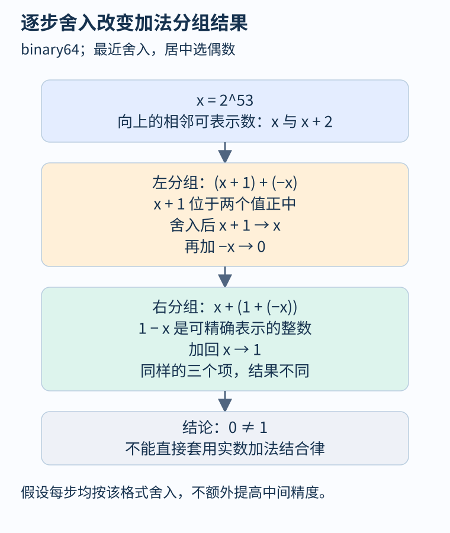
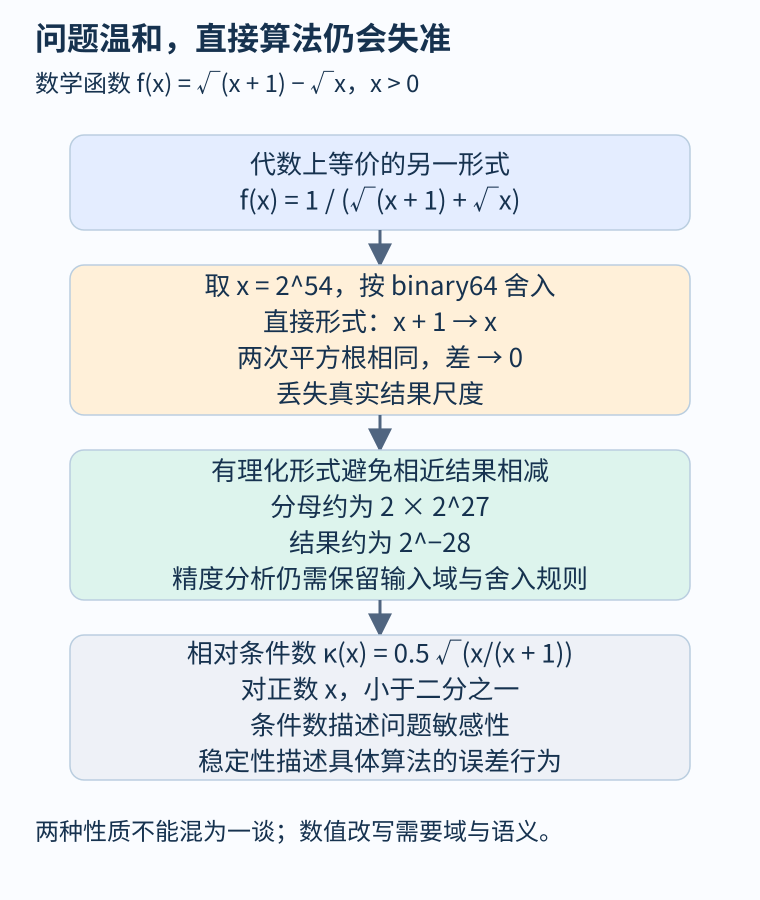

# 第 41 章 浮点语义、数值误差与稳定性

前面用数学整数推导金额不变量，用位向量解释机器溢出。浮点需要第三种细致视角：程序处理的是有限可表示数，每次运算都可能舍入。把实数等式直接用于优化、断言或 CPU/GPU 等价检查，可能改变实际结果。

## 明确格式，才能谈误差

本章主要使用 IEEE 754 binary64 思想模型：有效精度为五十三个二进制位，采用舍入到最近、正好居中时选偶数的规则；每步按该格式舍入，不额外提高中间精度，不启用改变表达式分组的优化。还需在具体实现中核对 NaN、无穷、次正规数和异常处理。

[Goldberg 的原始论文授权重印](https://docs.oracle.com/cd/E19957-01/806-3568/ncg_goldberg.html)解释了表示与舍入如何影响程序。有限精度不是“所有数都略微不准”：二的幂和许多整数可以精确表示，关键是当前量级下可表示数之间的间隔。

令 `x=2^53`。从这个数向上，相邻 binary64 值的间隔是二，因此数学结果 `x+1` 正好位于 `x` 与 `x+2` 中间。按本章舍入规则选择 `x`，那个一被吸收。

```python
x = float(2**53)
left = (x + 1.0) + (-x)
right = x + (1.0 + (-x))
# 本章模型下 left 为 0.0，right 为 1.0
```

右边的 `1-x` 恰好是可表示的负整数，因此加回 `x` 得一。两式仅改分组，结果已经不同。下面图解沿每一次舍入展开，而不是只展示最后两个数字。



图 41-1：实数加法结合律不能直接当作严格浮点语义下的等价重写规则。

## 不同误差回答不同问题

设精确实数结果为 `y`，计算结果为 `yhat`。绝对误差是 `|yhat-y|`，相对误差在 `y!=0` 时为前者除以 `|y|`。接近零时，相对误差可能很大甚至无定义，应用需要同时规定绝对容差。ULP 则以相应量级的可表示数间隔衡量误差，不能当成固定十进制小数位。

[Python 的浮点教程](https://docs.python.org/3/tutorial/floatingpoint.html)区分存储值与输出格式。将结果打印成两位小数，只改变显示，不能倒推中间运算没有误差。整数分适合要求精确记账的金额；科学测量和概率计算又可能需要浮点。表示选择应来自规格，并明确输入与输出的单位。

## 一个可以改写得更稳的函数

考虑正数输入上的数学函数：

\[
f(x)=\sqrt{x+1}-\sqrt{x}
     =\frac{1}{\sqrt{x+1}+\sqrt{x}}.
\]

数学上两式相同。取 `x=2^54`，按本章格式计算，`x+1` 首先舍入回 `x`，两次平方根便相同，左式得到零。右式分母约为 `2×2^27`，返回约 `2^-28`，仍保留了真实结果的尺度。变换不能凭直觉推广到所有域：要保留 `x>0`、无异常范围，以及对平方根的明确语义。



图 41-2：改写改变了舍入传播；具体精度收益必须在约定的输入域内检查。

这里既有 `x+1` 的吸收，也有相近结果相减时暴露已有误差的机制。相减操作本身可能精确，却无法恢复操作数此前丢掉的信息。不能把所有消去现象都解释为“减法硬件不准确”。

## 条件数与算法稳定性分开讨论

条件数描述数学问题对输入扰动有多敏感；稳定性讨论具体算法引入的误差怎样影响结果。[Higham 对后向误差的说明](https://nhigham.com/2020/03/25/what-is-backward-error/)区分计算结果与真解的距离，以及需要改变多少输入才能把计算结果解释为精确解。定义“多少”还需指定绝对、相对或分量尺度。

对上面的正数函数，标量相对条件数可以求得 `κ(x)=|x f'(x)/f(x)|=0.5 sqrt(x/(x+1))`，小于二分之一。数学问题并不因大 `x` 就具有很大的相对条件数，直接相减的算法却能丢掉全部有效结果。因此不能把算法不稳定简单归咎于“问题本来敏感”。反过来，高条件数问题即使用稳定算法，也可能放大输入的不确定性。

## 分析器与编译器要记录哪些前提

静态区间可以估计数值范围，却未必自动给出舍入误差上界。要证明误差性质，需传播精确值与近似值的关系，或使用带方向舍入的包围区间等方法。有限测试与高精度参考可发现问题，不能单独证明整个连续输入域的误差界。

编译器若获得允许重结合、忽略某些特殊值的选项，原表达式的逐步舍入模型可能变化。[LLVM 的 fast-math 规则](https://llvm.org/docs/LangRef.html#fast-math-flags)将这些许可显式表示。因此性能比较与跨设备验证应同时保存格式、舍入、融合运算、库函数和编译选项。GPU 并行归约的分组变化，也需要数值规格而不只是无竞态证明。

## 融合运算也会改变逐步结果

设 `a=2^27+1`、`b=2^27-1`，它们在本章格式中均可精确表示。精确乘积是 `2^54-1`，单独乘法按规则舍入为 `2^54`，随后减去 `2^54` 得零。若用一次融合乘加计算 `a*b-2^54`，中间乘积不单独舍入，最终结果为可精确表示的负一。二者差异来自舍入位置，不说明其中一个硬件随机算错。

因此“允许融合”与“允许任意重结合”是不同许可。前者只在规定操作中减少一次舍入，后者可能大幅改变加法树。需要位级可复现时，必须审查编译与库的具体规则；只要求给定误差界时，则可在证明或测试边界内选择更快实现。

特殊值还会影响控制流。NaN 不遵守普通实数的全序比较关系，例如用 `x!=x` 在特定浮点语义中可识别 NaN；假定所有值都是实数，可能把这类分支错误删除。正负零在相等比较中一致，却在某些后续运算中产生可区分结果。分析不必每次展开全部特殊情况，但省略它们时必须有可检查的输入前提。

本章的两组吸收与平方根表达式已在当前 Python 环境核对，环境报告二进制基数二、有效位五十三；这验证了具体运行结果，没有证明所有工具链与设备都相同。融合乘加例子依据明确舍入模型推导，未记为硬件实测。模型推导与实测记录应一直分开保存。

## 观察练习

两个实现分别输出零和 `2^-28`。测试断言它们绝对误差小于 `10^-6`，因此通过。能否据此说它们等价，或直接计算函数已稳定？

参考答案：不能。这条断言只给出宽松绝对距离，`2^-28` 约为 `3.7×10^-9`，零也会通过。若关心该尺度上的相对准确性，必须增加相应规格和参考值，并明确接近零如何处理。单点通过既非全域等价，也非稳定性证明。

## 本章资料

- [David Goldberg：What Every Computer Scientist Should Know About Floating-Point Arithmetic](https://docs.oracle.com/cd/E19957-01/806-3568/ncg_goldberg.html)。
- [Python：Floating-Point Arithmetic](https://docs.python.org/3/tutorial/floatingpoint.html)。
- [Nicholas Higham：What Is Backward Error?](https://nhigham.com/2020/03/25/what-is-backward-error/)。
- [LLVM：Fast-Math Flags](https://llvm.org/docs/LangRef.html#fast-math-flags)。
