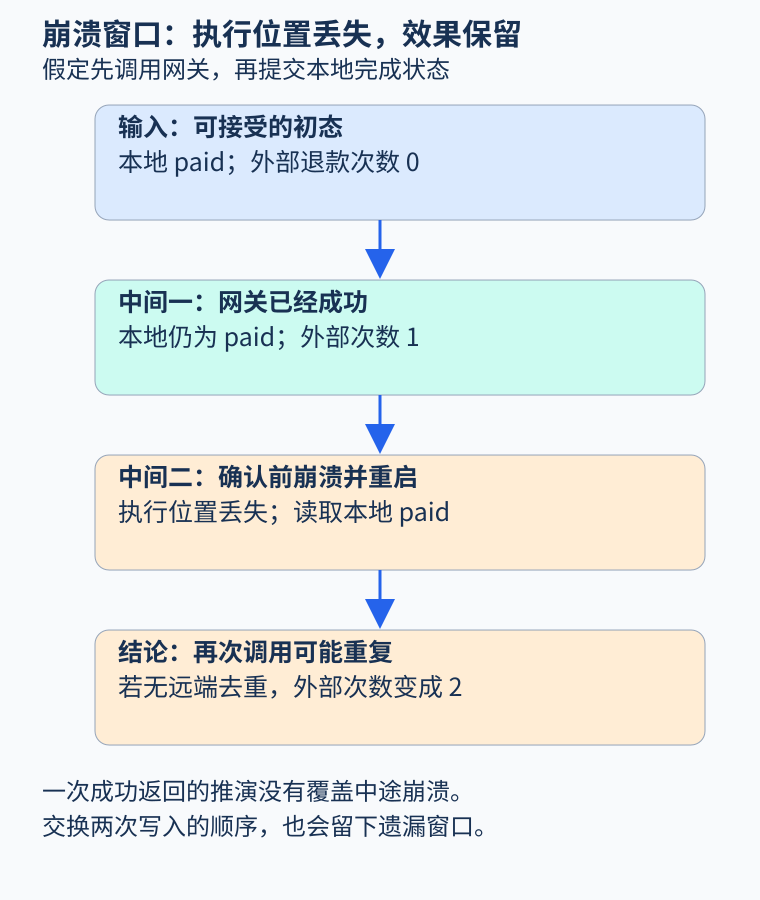
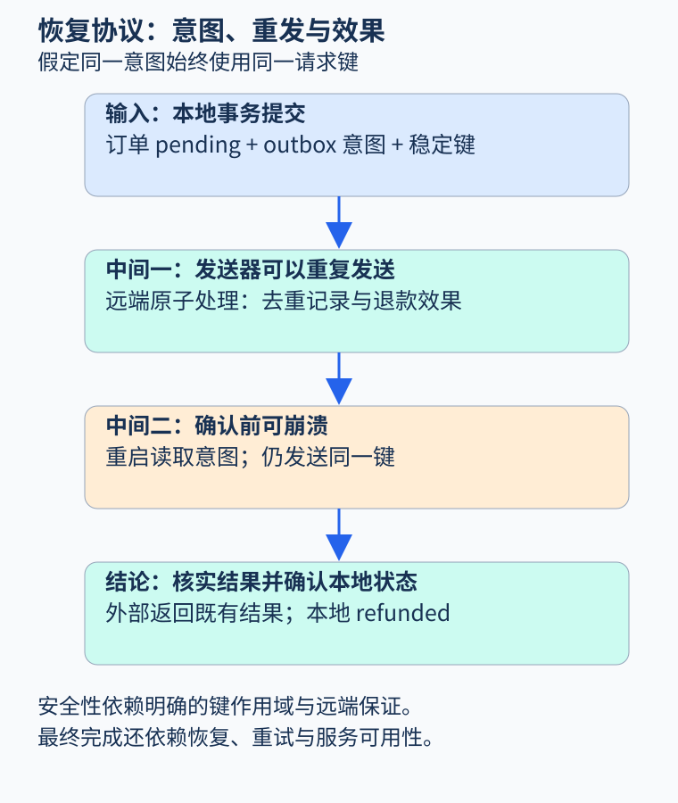

# 第 43 章 分布式、持久化与崩溃恢复

一段函数可以在返回时满足后置条件，却在进程崩溃后留下无法解释的账务状态。程序分析走出单进程后，必须把两个问题分开：哪些改变已经持久化，哪些外部效果已经发生。内存中的执行位置丢失，不代表数据库或支付系统会随之回滚。

## 把崩溃加入状态转换

先假定一个订单只退款一次，金额固定为已支付的一百分。最朴素的实现先调用网关，再保存本地状态：

```text
if database.state == paid:
    gateway.refund(order_id, 100)
    database.state := refunded
```

入口为本地 `paid`、外部退款次数零。网关成功后，状态变成“本地仍为 paid，外部次数一”。若此时进程退出，重启读取本地状态，便可能再次调用网关。成功返回路径看似正确，却遗漏了中途失败窗口。

把两句交换也不解决问题：若先持久化 `refunded`，再调用外部服务，那么两步之间崩溃可能留下“本地已退款，外部次数零”。前者可能重复，后者可能遗漏。除非两项操作处于共同的原子提交协议，否则不能仅凭代码顺序宣称它们一起发生。



图 43-1：图中崩溃只丢失当前执行位置，本地已提交状态和外部已发生效果分别保留。原创教学图。

分析时可使用状态元组 `〈L,V,E〉`：`L` 是本地持久状态，`V` 是易失的程序计数器，`E` 是外部持久效果。一次崩溃重置 `V`，并保留模型承诺持久的部分。这个表示使失败成为普通转换的一部分，而不是在主流程之外补一句“失败时重试”。

## 先持久化意图，再处理传递

事务性 outbox 的基本做法，是在同一个本地事务里提交业务变化和待发送事件。[AWS 的 outbox 指南](https://docs.aws.amazon.com/prescriptive-guidance/latest/cloud-design-patterns/transactional-outbox.html)同时强调，转发可能产生重复，消费方仍需幂等处理。它解决的是一类本地双写间隙，并未让任意外部操作自动具有一次性效果。

对退款，可先把请求记录为 `pending`，同时保存稳定的请求键和发送意图。后台发送器读已提交的意图，向网关提交请求，取得可确认结果后再把本地状态改成 `refunded`。`pending` 表示请求已被接受并等待确认，不能提前当作退款已经完成。

若发送成功后、确认落库前崩溃，发送器仍会重发。因此还需要外部协议：同一作用域内的同一键，必须关联同一退款意图；外部去重记录与实际效果要有适当的原子关系。一个普通缓存如果先查后写、记录过期或落盘失败，就不能承担这些保证。



图 43-2：本地持久化负责保留意图，外部协议负责重复请求的效果边界；确认写回负责恢复可观察业务状态。原创教学图。

## “一次”究竟指哪一层

队列投递一次、消费者处理一次、账户只记一笔钱，是不同性质。队列提供的保证不应直接外推到任意网关和数据库组合。网络超时尤其重要：调用者没收到成功应答，只能说明结果未知，不能据此认定远端没有完成退款。

请求键还要绑定参数。相同键却携带不同金额时，应拒绝冲突或返回已有操作的明确结果，而不是默默把新金额当作旧请求。不同键作用于同一订单时，仍需累计金额约束；幂等处理只解决同一意图的重复，不替代余额检查。

恢复协议因此需要两类判断：安全性要求不会重复或超额产生效果；活性要求已接受的意图最终被处理或明确失败。即使前者在模型里成立，若后台永远不再调度，后者仍不成立。证明活性通常要额外假定服务恢复、重试持续发生与远端最终可用。

## 用有限模型实际观察

本书 `examples/extension_checks.py` 把上述协议缩成一个可运行模型：本地状态为 paid、pending、refunded；发送阶段为 idle 或 waiting；外部效果次数只探索到二，二已经足以显示重复。进程崩溃只把 waiting 重置为 idle，稳定请求键和远端去重记录不变。

```bash
python3 examples/extension_checks.py
python3 -m unittest discover -s examples -p 'test_extension_checks.py' -v
```

实际探索中，不启用远端去重时得到八个状态，并找到四步轨迹：提交 pending 意图、发送成功、确认前崩溃、再次发送。启用模型中的原子去重与效果时得到五个状态，未出现效果次数二，且存在已确认完成状态。

这个实验枚举的是明确定义的小状态图。它没有建模多个订单、并发发送器、消息乱序、键过期、磁盘损坏或真实事务隔离；这些条件若进入系统，就需要扩展模型。它也没有验证某家支付接口的实现。把假设写成可检查的边界，比把结果称为“已经证明真实服务 exactly-once”更准确。

## 从协议图回到实现

实现审查应寻找图中每个原子步骤的依据：本地事务覆盖哪些表，转发器怎样认领工作，外部幂等键保存多久，崩溃后如何查询未知结果，确认状态与金额如何一致。图中一条箭头若对应实现中的三次非原子写入，就需要把中间状态重新展开。

持久化层也有自己的语义。写入内存缓存、提交数据库事务和数据已满足故障模型要求的耐久性，不是同义词。模型可以假设事务提交后持久，但工程保证要由所选数据库、配置和部署条件支持。程序分析负责把这些依赖显式化，不能替产品文档创造保证。

恢复完成后还要进行对账。若本地记录为 pending 而远端已有成功结果，系统应根据稳定请求身份核对并补全确认；若参数冲突或结果无法核实，则进入显式待处理状态。把未知保留下来，比为了让状态表整齐而把所有失败统一写成“未退款”更符合故障事实。对账同样受远端查询能力与记录保留期限限制。

## 练习与参考答案

系统用新的随机键重试一笔未知结果的退款。虽然网关按键幂等，能否沿用本章“不重复效果”的结论？

参考答案：不能。模型要求同一意图使用稳定键。新键可能被视为新操作；应恢复原请求身份并查询或重试同一意图。即使键稳定，还需确认作用域、参数一致性和去重记录的有效范围。

## 本章资料

- [AWS Prescriptive Guidance：Transactional outbox pattern](https://docs.aws.amazon.com/prescriptive-guidance/latest/cloud-design-patterns/transactional-outbox.html)：本地原子意图与重复投递的边界。
- [Lamport：Specifying Systems](https://lamport.azurewebsites.net/tla/book.html)：以状态转换、环境假设和性质描述系统的进一步阅读。
- 本书 `examples/extension_checks.py`：有限退款恢复模型，结果不外推到未建模的故障。
