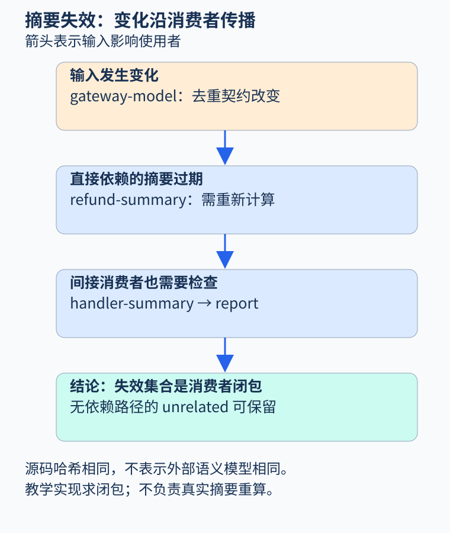
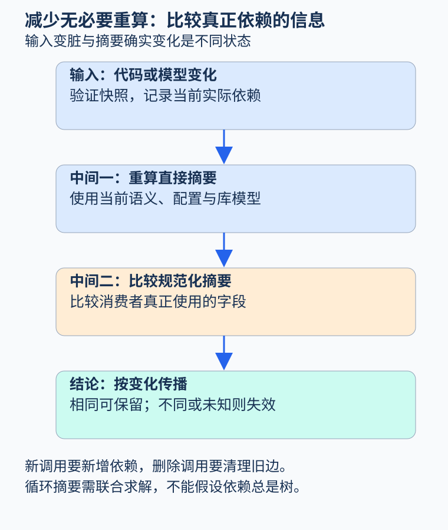

# 第 48 章 增量分析、大型工程与摘要失效

大型工程里，一次提交可能只改了五行代码，完整分析却要花很久。缓存可以省去重复计算，但过期缓存也会让“未发现问题”建立在旧语义上。增量分析的核心问题是：这份结果究竟依赖哪些输入，它们现在还成立吗？

## 文件没有变化，结论仍可能失效

设 `gateway_model` 描述退款网关的效果，`refund_summary` 依赖它，`handler_summary` 又依赖退款摘要，最终报告依赖处理器摘要。现在网关从“同键永久去重”改为“只在限定期间内去重”，应用源码完全没变，原先依赖永久保证的报告仍然需要重算。

```text
gateway_model → refund_summary → handler_summary → report
```

本图箭头统一表示“输入影响使用者”。如果缓存键仅包含函数文本，四个文件的哈希可能全相同，缓存却已经语义失效。外部契约、分析配置、编译宏、目标平台、语言版本和规则版本，都可能是分析输入。



图 48-1：需要失效的是变化输入及其消费者闭包，不能只扫描发生文本修改的位置。原创教学图。

[LLVM 新 Pass Manager 文档](https://llvm.org/docs/NewPassManager.html)专门讨论分析结果的保持与失效。变换可明确声明哪些分析仍然有效，也可更新分析以保持一致性。这里的重要经验是：保留结果需要理由，不能因为旧对象仍在内存中就认为结论仍正确。

## 区分脏输入、变化摘要与重算结果

源代码变化表示旧结果可能无效，不表示新结果必然不同。例如把函数中一个仅用于调试的局部名字改掉，语义摘要可能完全相同。若所有潜在影响都立即传播到顶层，增量效果会很差；若一律假定摘要相同，又会漏掉真实变化。

可以先标记待检查输入，重算直接消费者，再比较规范化摘要。若下游只依赖摘要且摘要不变，可以阻止无必要的进一步传播。[Rust 编译器开发指南的 red-green 算法](https://rustc-dev-guide.rust-lang.org/queries/incremental-compilation-in-detail.html)展示了这种把重算与变化判断交织的思路；本书借用它解释依赖验证，不宣称教学程序实现了 rustc 的算法。

摘要相等也有前提。它必须包含消费者实际使用的信息；若摘要只记录返回类型，便不能用“类型未变”断言网络副作用和异常行为未变。规范化还能避免无意义的顺序差异造成缓存抖动，但不能删除真正重要的身份或源位置关联。



图 48-2：输入变化先触发重算，再由消费者所依赖的摘要决定是否继续传播；未知时保守失效。原创教学图。

## 依赖图也会变化

若处理器新增一个调用，摘要开始依赖新的库模型，旧依赖图中根本没有这条边。重算时必须记录本次实际读取的输入，并更新依赖关系；只在第一次运行记边，之后一直复用，无法支持接口演进。

反射、动态分派和配置会使这一点更难。一个调用目标从单一函数扩展为两个函数，原调用者即使文本未变，也可能需要重算。可以把目标解析结果作为明确输入，而不是让它成为隐藏的全局状态。相反，删除调用后应清理旧依赖，避免无关变化长期触发重算。

跨函数递归还会形成环。若多个摘要互相依赖，可以按强连通分量组织联合求解，直到摘要稳定，再向外传播。存在 widening、预算或启发式调度时，增量求解未必与某次全量运行逐位相同；应说明目标是保持性质保证，还是复现某种确定的全量结果。

## 缓存身份不只是一串哈希

哈希负责压缩输入身份，前提是已经把真正输入列全。示例 `analysis_key` 把源码、整数语义、库模型和配置序列化后计算摘要。修改模型或配置会产生不同键；但它不能自动发现调用者漏传了编译宏。这是一个接口约定，而不是完整依赖发现器。

分析结果也应携带状态：已完成、未知、超时、输入不支持。旧缓存中的未知不能在下一次运行变成“通过”，部分结果也不能在依赖变化后保留证明标签。若结果引用源位置，重构后还需更新映射，避免正确性质指向错误代码。

在并行工程中，缓存读写应绑定一致的输入快照。一个任务使用新调用图和旧库摘要，可能得到任何单一版本都不支持的组合结论。结果提交时需要确认依赖版本仍与计算时一致，或在变化后重新安排计算。

## 一个可运行的失效闭包

`examples/extension_checks.py` 中的 `invalidated` 输入为“每个节点依赖哪些输入”的字典。实现先反向建立消费者边，再从变化节点做队列遍历；每个节点至多加入结果集合一次，因此循环依赖也能终止。它计算保守失效范围，不负责重算摘要或比较语义相等。

示例从 gateway-model 出发，得到它自身、refund-summary、handler-summary 和 report；独立节点不受影响。测试还覆盖菱形依赖、环、缺失节点拒绝，以及配置与库模型改变缓存身份。读者可以在纸上按队列顺序复现这几个集合，看到“文本没改但结果过期”的具体过程。

真实系统仍需验证依赖记录完整。一个实用回归方法是在同一冻结快照上分别运行全量与增量分析，比较状态和报告差异；任何差异都要解释。全量结果本身未必完美，但能帮助发现缓存层引入的额外错误。再配合随机编辑序列和模型升级测试，可以覆盖一次提交难以暴露的失效链。

大型项目的增量策略也可以按层划分：局部语法检查快速响应，跨函数摘要稍后更新，全项目性质按预算后台复核。界面应说明每项结果对应的快照和完成状态，避免把不同阶段结果拼成一个无条件通过。延迟计算能改善体验，但不能把尚未重算的结论伪装成当前结果。

## 练习与参考答案

某函数摘要相同，但函数源位置变化。可以完整复用旧报告吗？

参考答案：语义结论可能复用，但报告位置、证据链接和源版本需要重新映射或更新。若摘要没有包含某项实际被消费者使用的信息，连语义复用也需要重新判断。缓存对象的不同字段可以具有不同失效条件。

## 本章资料

- [LLVM：Using the New Pass Manager](https://llvm.org/docs/NewPassManager.html)：分析缓存、保持集合与失效。
- [Rust Compiler Development Guide：Incremental compilation in detail](https://rustc-dev-guide.rust-lang.org/queries/incremental-compilation-in-detail.html)：依赖记录与 red-green 变化判断。
- 本书 `examples/extension_checks.py`：失效闭包与示意缓存键，未实现完整增量分析引擎。
