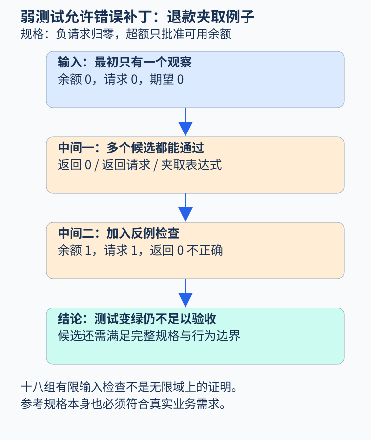
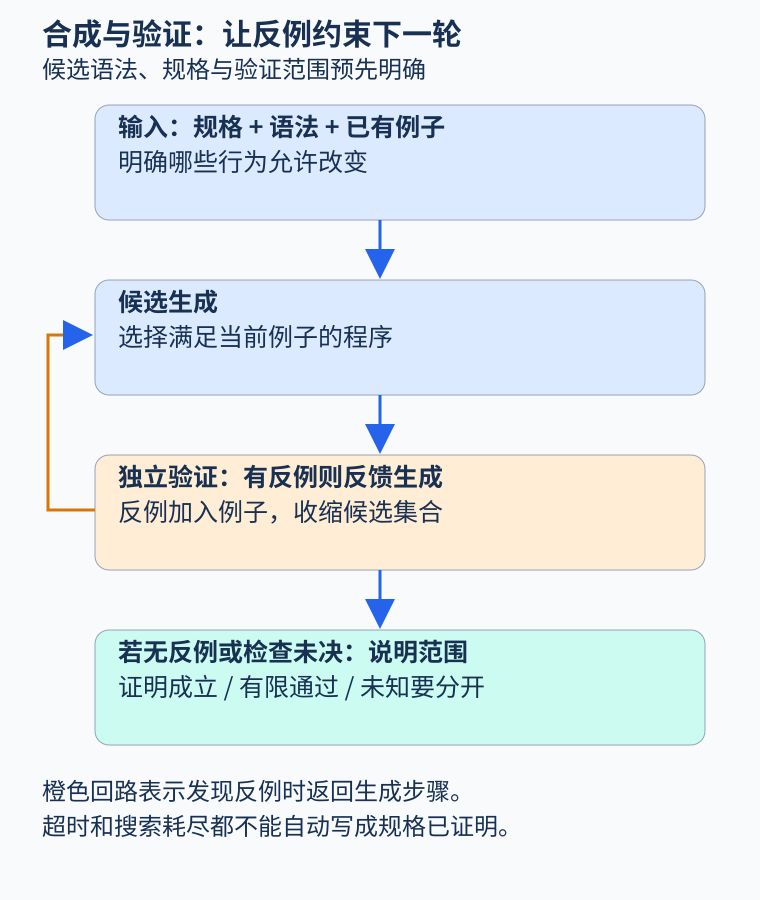

# 第 49 章 程序合成、自动修复与验证闭环

发现错误之后，系统可能进一步提出补丁：增加边界判断、替换一个表达式，或生成资源清理代码。补丁能编译、测试变绿，只说明它满足这些检查。程序合成研究怎样从规格约束寻找程序，而验证负责判断候选是否满足已声明的要求，两者应形成有明确边界的闭环。

## 先定义要合成的行为

为便于手算，本章另定义一个“允许部分批准”的退款计算政策：`remaining` 是非负整数余额，`requested` 是任意整数请求；负请求返回零，超额请求只批准可用余额。它不同于书中某些“超额就拒绝”的接口，不能混用规格。

```text
result = min(max(requested, 0), remaining)
```

只写 `0 <= result <= remaining` 仍不够，永远返回零也满足它。完整规格还要求合法范围内的请求原样批准，并定义边界外的行为。这使合成器无法通过删掉所有业务功能来“修复”金额错误。

语法引导合成把背景理论、语义规格和候选语法一起作为输入，见 Alur 等人的[Syntax-Guided Synthesis 原论文](https://dspace.mit.edu/entities/publication/bf74e326-5c4c-4a29-867a-cb0bd67fcc9f)。候选空间是问题的一部分：若只允许常量表达式，便不可能表达上述全部行为；搜索失败可能来自语言限制，不一定来自规格矛盾。

## 测试通过为何仍会过拟合

设初始测试只有 `remaining=0, requested=0 → 0`，下面四个候选都通过：永远返回零、原样返回请求、只截断上界、同时截断上下界。它们在已观察输入上相同，在其他输入上却明显不同。

增加 `remaining=1, requested=1 → 1` 排除永远返回零；增加负请求可排除原样返回和只截上界。最后留下的夹取表达式并非因为“长得最合理”而可信，而是因为它还需要通过独立于生成过程的性质检查。



图 49-1：一次测试只能约束观察点；反例把尚未约束的差异变成下一轮输入。原创教学图。

自动修复中的过拟合也可能表现为删除抛错语句、跳过失败分支、直接返回固定结果。旧测试变绿，但安全条件、正常功能或其他调用者的契约被破坏。补丁评估应检查相关规格、未修改行为及外部效果，而不只是最初失败的断言。

## 用反例推动下一轮搜索

CEGIS 的核心循环可以读成四步：根据当前例子生成候选；由验证器寻找违反规格的输入；若找到就把反例加入约束；再次搜索。若验证器真能证明全部指定输入上不存在反例，才得到对应范围的正确性结论。若验证器只是超时、随机测试没发现问题或仅查有限样本，结论必须相应降级。

这里要与抽象细化区分：CEGAR 常用于细化分析模型以排除伪反例；CEGIS 用反例约束候选程序。两者都由反例驱动，但更新的对象不同。工程系统可以组合二者，例如先细化抽象以确认反例，再用确认的反例约束补丁。



图 49-2：验证成功、发现反例和无法判断是三种不同出口；搜索耗尽也不自动表示不存在任何程序。原创教学图。

## 本书实际执行了什么

`examples/extension_checks.py` 的 `finite_cegis` 枚举上述四个固定候选，验证域明确为余额 0、1、2 与请求 −1 至 4 的十八组输入。初始观察只有 `(0,0)`。实测先选 always-zero，被 `(1,1)` 驳回；再选 raw-request，被 `(0,−1)` 驳回；然后选择 clamp，在十八组输入中未发现反例。

这是一项完整有限枚举，能说明选中的候选满足该有限域上的参考规格。它没有搜索任意 Python 程序，也没有通过枚举证明无限整数域性质。无限域上该表达式确实可进一步按请求小于零、介于零与余额之间、大于余额三种情况证明；这种数学推导与有限测试是不同证据。

示例故意保留只截上界的候选。它虽然通过最初测试，却在负请求上违反规格；实现不必实际选择它，已有反例就能将其排除。测试同时确认了“弱测试允许错误候选”与“反例反馈收缩候选集合”，没有把固定搜索顺序包装成通用智能修复能力。

## 修复前后还要验证哪些关系

局部表达式正确，不表示整个接口兼容。若原函数遇到超额请求会抛异常，改成批准部分金额会改变调用者协议；若金额单位被弄错，数学夹取也救不了业务含义。因此补丁应声明允许改变的行为与必须保持的行为，并把必要的调用者、类型和效果纳入验证。

并发与外部操作尤其不能靠重复运行解决。把退款调用移到锁内可能改变性能与死锁风险；让失败后重试可能重复外部效果。修复验证需沿着变化影响扩展检查范围，保存新的前提和未决事项。一个验证器若使用与生成器完全相同的错误规格，两者一致也不能证明真实需求得到满足。

## AI 在闭环中的位置

AI 可以扩展候选生成、解释反例或帮助提出不变量；求解器、测试器、证明助手或人工审查承担不同层次的核实。候选来自哪一种生成器，不改变最终证据要求。若所有候选均失败，应返回搜索范围和失败原因；若检查未知，应保留未知，而不是把当前最像正确的补丁当作已验证结果。

修复完成后，还应把原始反例加入回归材料，并记录为何它体现正确规格。否则后续改动可能删掉保护条件，又因为原有测试仍然稀疏而再次通过。闭环最终积累的不只是补丁，也是更明确的规格与证据。

修复空间还可以限制允许修改的位置和语法，减少搜索与审查成本。但限制必须成为结果的一部分：只允许替换算术表达式，就无法修复遗漏的事务协议；只允许增加判断，也可能无法保持正常请求的活性。合成结果应说明它解决了哪一种性质，而不是用一个局部补丁暗示整个模块已经正确。

## 练习与参考答案

把候选集合改成只有 always-zero 和 raw-request，十八组输入都检查完仍无可接受候选，可以断言规格无解吗？

参考答案：不能。只能说明给定候选集合内没有解。clamp 已是集合外的可行表达式；真正的规格无解需要独立论证，而搜索超时甚至不能说明有限集合已经穷尽。

## 本章资料

- [Alur 等：Syntax-Guided Synthesis，2013](https://dspace.mit.edu/entities/publication/bf74e326-5c4c-4a29-867a-cb0bd67fcc9f)：候选语法、背景理论、规格与 CEGIS。
- 本书 `examples/extension_checks.py` 与 `examples/test_extension_checks.py`：四候选、十八输入的有限合成实验。
